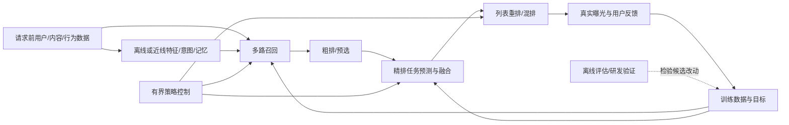

# Baseline 与 Pipeline 的替换关系

同一方法放在哪一层，取决于服务时读什么、输出交给谁，以及下游保留哪些模块。图中反馈进入后续训练，在线请求只能使用当时可得的数据。[论文索引](00_总索引.md)

## 接入已有系统时最容易混淆的接口

| 现网改动 | 可比较的路线 | 比较或组合时的条件 |
|---|---|---|
| 增加内容特征和尾部监督 | [GALA](GALA_2607_29213.md) 导出商家向量，[AKT-Rec](AKT-Rec_2605_23310.md) 共享语义簇统计，[SARA](SARA_2609_17639.md) 增加正负理由特征，[RecoReward](RecoReward_2607_25901.md) 改写物品描述 | 可在同一排序器上比较下游增量。教师信息量、输入长度、刷新频率和新增参数都要记账。|
| 保存长历史 | [UxSID](UxSID_2605_09040.md) 的键是用户×语义码，[SequenceO1](SequenceO1_2609_08443.md) 保存远历史摘要，[RecMem](RecMem_2611_17921.md) 保存递归更新的槽位，[KuaFu](KuaFu_2609_31045.md) 则跨用户复用物品计算 | 键、失效触发和读取方不同。应先决定谁消费缓存，再比较相同历史和相同预算下的两组收益。|
| 让即时意图影响召回 | [RecGPT-Mobile](RecGPT-Mobile_2605_04726.md) 端侧生成查询，[TriGen](TriGen_2611_16395.md) 直接将触发商品注入生成决策，[R2QRec](R2QRec_2610_39984.md) 用多查询调用冻结检索器 | 看现网能否消费查询、是否有点击触发入口、下游可给多少候选配额。|
| 用推理结果辅助现有模型 | [RPORec](RPORec_2605_21967.md) 将推理作为排序特征，[OneReason](OneReason_2606_06260.md) 同时有近线召回与实时特征，[OneLatent / WhisperRec](OneLatent_WhisperRec_2610_30675.md) 用潜在标记和异步缓存 | 先按产物区分候选与特征，再测试两者是否互补。单独改变刷新策略以量出新鲜度收益。|
| 替换生成码或解码决策 | [ACT](ACT_2611_00323.md) 用唯一作者 token，[OneRetrieval](OneRetrieval_2606_13533.md) 用可编辑属性槽，[ReSID](ReSID_2611_16404.md) 放宽码匹配，[RGD](RGD_2607_25344.md) 给前缀增加价值分 | 同一目录下观察真实对象命中、合法性和路径存活。唯一 token 需要足够的对象监督，可编辑码还要求更新绑定接口。|
| 共享多阶段排序 | [UniPinRec](UniPinRec_2606_00422.md) 在向量 ANN 后加轻排并共享历史，[OneTrans-V2](OneTrans-V2_2609_28589.md) 在 SID 召回、粗排、精排之间联合训练，[UniRec](UniRec_2609_11052.md) 对齐粗精排融合 | 三者的输出和改造范围不同。联合训练用相同预算比质量，缓存复用用同一 checkpoint 比重算成本。|
| 降低排序计算 | [HELIX](HELIX_2609_37183.md) 共享只依赖用户的计算，[CC Retriever](CC_Retriever_2609_22441.md) 在粗排引入关系边特征，[RACE](RACE_2611_18244.md) 按请求裁剪端侧模型 | 分别测共享比例、特征读取成本、以及简单和困难请求的质量与延迟。[RecIS](RecIS_2610_41457.md) 的作用点在训练系统。|
| 改变整张列表 | [OGR](OGR_2608_17613.md) 学习列表生成，[UGR](UGR_2610_39426.md) 联合安排广告与自然商品，[OneTrans-GSR](OneTrans-GSR_2611_04720.md) 用列表奖励训练线上策略，[Amazon Playlist Curation](Amazon_Playlist_Curation_amazon_playlist.md) 从已有歌单筛歌 | 固定候选集只适合识别纯排列贡献。集合或长度本身也是机制时，主实验应允许它们变化。|
| 改变探索或目标权重 | [PinEqualizer](PinEqualizer_2607_22518.md) 修复新内容漏斗，[PRL-PUTS](PRL-PUTS_2605_16344.md) 调多目标融合权重，[DREAM](DREAM_2608_09408.md) 给既有阶段下发有界参数 | 逐层查看曝光是否来自新供给、策略在用户间重新分配，或业务目标本身改变。|
| 改变研发或评估流程 | [NOVA](NOVA_2606_27243.md) 筛模型架构，[GPBM](GPBM_amazon_gpbm.md) 估计策略价值，[Spotify Agent](Spotify_Agent_2609_30297.md) 改提示与工具说明，[ATLAS](ATLAS_2608_30685.md) 用诊断信号训练策略 | 分别考察训练轮次利用率、选型方向准确率、工具行为和用户指标。线上收益归到实际部署的产物。|

## 工程参考

- 美团 MTFM 的工程文章介绍推荐基础模型，相关原论文首发于 2026 年 2 月。[美团技术文章](https://tech.meituan.com/2026/09/22/Meituan-Foundation-Model-for-Recommendation.html)
- NVIDIA 的 HSTU 部署文章说明推理与缓存配置。使用文中的时延数字时应同时看缓存命中条件。[NVIDIA 技术文章](https://developer.nvidia.com/blog/deploying-an-hstu-generative-recommender-with-nvidia-dynamo-triton)

同一上线同时更换多个模块时，用分阶段开关估计主效应和交互效应。两种方法结合后的增益会受信息重叠、预算挤占和优化冲突影响。[八个对照实验](13_实验选型与八类对照.md)
