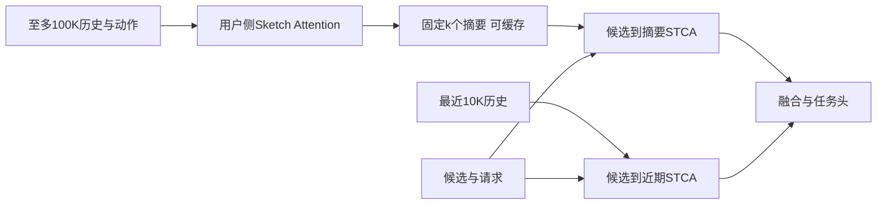

# SequenceO1 · 重复请求能否共享远期兴趣摘要

<!-- 全库方法复筛开始 -->
> **方法储备 · 司乘行为序列建模**。保留“SequenceO1 · 重复请求能否共享远期兴趣摘要”这一研究问题或机制；是否用于当前业务另行验证。
> 原有阅读范围与证据等级不变；储备不等于效果已验证。
> [[研究前沿/论文库复筛与阅读路线|全库阅读路线]] · [[研究前沿/司乘行为序列建模/存量论文分层索引|本方向完整分层]]
<!-- 全库方法复筛结束 -->

将远历史写成可复用的兴趣原型，近期行为继续单独输入。线上收益同时受到远历史信息、缓存复用和刷新策略影响。

*SequenceO1: End-to-End Ultra-Long (100K) Sequence Modeling in Recommendation with Low-Rank Caching*  
Lin Guan 等 · 字节跳动  
[论文全文 · v1](https://arxiv.org/html/2609.08443v1)

**适用条件**　在固定近期模块之外仍发现长期兴趣收益，且用户复访能摊销压缩成本时。

**改动位置**　远历史模块和KV缓存；先保留近期分支及主ranker。

[[#结果与对照|质量、FLOPs 与线上指标]] · [[#S01-A：摘要是否保留稀有且任务相关的长程信息|实验 A · 信息保真]] · [[#S01-B：成本释放还是摘要本身带来收益|实验 B · 成本与缓存]]

## 先区分三个瓶颈

10K 以上历史使存储、CPU/GPU传输、精排延迟和训练吞吐恶化；即使单层 attention 已线性化，多个候选、重复请求仍反复处理相同用户历史。原 production pipeline 为 STCA 10K + lifelong TWIN V2；后者先离线聚类、再目标相关检索，压缩和检索未必直接服从最终精排目标。

失效可来自三处：截断丢失稳定偏好；分阶段检索漏掉关键行为；直接扩大历史造成系统成本失控。本文同时改变三处，不能将全部增益归到一种原因。必须先比较同样100K输入、同样摘要大小，再比较预算限制下可上线方案。

## 方法与训练、服务流程

输入X为最长100K行为、每项d维；以1K×128原型形成token对原型的softmax分配（每个token对原型权重和为1），聚合成1K×128 sketch。两层带LN、残差、SwiGLU的refinement与动作融合细化sketch。线上sketch经128→1024适配器、16头×64维目标注意力接入现有ranker；近期10K STCA仍保留，不是只靠一个100K压缩器预测。

原型分配可写A∈R^{k×n}、S=AX（A按每个历史token归一）；压缩器与排序目标端到端训练，另有MRLB在批内复用同用户历史，并用请求mask保留样本边界。FlashSA避免物化k×n完整中间矩阵；pipeline lift将用户级压缩前移异步执行。原型、refinement和适配器可训练，缓存值是否参与每个训练step的完整梯度/陈旧参数一致性未完全说明。

缓存key包含UID、模型版本、历史时间戳、配置；训练TTL3小时、命中率约.5；在线TTL1小时、命中率约.6。命中时固定sketch成本近似与历史长度无关；miss时仍需读原始历史并压缩，不能将“SequenceO1”理解成整个系统最坏情况O(1)。缓存构建、更新及版本切换是实际部署依赖。

式（6）–（9）中，每条历史行为在原型维度分配权重。$P$ 为全局共享的可学习原型，低秩描述的是历史长度的投影。

$$S=(PW_Q)(XW_K)^T/\sqrt d,\quad A_{ji}=\frac{e^{S_{ji}}}{\sum_{j'}e^{S_{j'i}}},\quad \widetilde X=AX.$$

精排输入为既定候选视频、请求与用户特征，以及由物品和动作组成的历史；输出包括 finish、skip 和 like。训练的多任务权重未完整公开。缓存只含长期摘要，请求特征和近期历史逐次计算。

**实施缺口：**文字强调联合训练，却未充分交代跨优化步缓存命中时如何处理旧计算图、摘要梯度、模型版本与 TTL 的关系。不能自行补成“所有命中都完整反传”。接入前需明确 stop-gradient、重算或版本粒度，并测 stale gradient 的代价。

## 结果与对照

| 实验与条件 | 基线 → 结果 / 原文数值 | 单位与解释 | 原文位置 |
|---|---|---|---|
| 统一轻量STCA512压缩比较；固定1K×128 | SA FinishAUC +1.07%；K-means +.30%；mean +.46%；position +.72%；Lightning +.83%；recent-query +.78% | 原文Δ%及“absolute”措辞不完全统一，保留源单位，不换算百分点 | 表3 |
| 生产底座保留近期10K；替换远历史 | Finish AUC/UAUC +.29%/+.40%；Like UAUC +.72%；Dislike +1.29%/+3.63% | 表4按相对提升；是特定模块替换 | 表4 |
| 抖音1个月A/B | 时长 +1.4999%；30天活跃 +.1968%；Dislike −6.9829% | 相对变化；声称显著但未列CI/p/分桶比例 | 线上实验 |
| 极速版同周期 | 时长 +1.6655%；30天活跃 +.2335%；Dislike −5.9972% | 独立产品，不能与抖音相加 | 线上实验 |
| 表1，100K轻量消融 | 仅改归一化轴，SA 对 vanilla 的各任务 ΔUAUC 为 +0.01% 至 +0.20% | 该设置下的归一化设计有收益；原表未明确该表百分号是否绝对点，保留原单位，不自行换算 | 表1 |
| 图1(c) | 同100K截断、平均85K，SA +1.07% 对直接 STCA +1.29%，比值约83% | 保留大部分扩历史收益，**没有超过无压缩参照** | 图1(c) |
| 图1(a)(b) | 100K长期分支训练 FLOPs 49.9×低、推理63.9×低 | 依赖训练 R=40/命中0.5，服务 R=300/命中0.6；**排除了公共recent-10K和ranker成本**，不是端到端速度倍数 | 图1(a)(b) |

表2将 k从1K增至2K仅 +0.03%、层数2至3仅 +0.02%，作者不作为独立显著证据；去动作融合 -0.20%（相对最终SA），提示“保留什么行为”比盲目多摘要更值得测。论文未公开可重建的工业样本规模/训练划分/全部调参预算，线上候选数与刷新频率严格对照也不充分。

附录中的GEMM FLOPs不覆盖非GEMM算子、数据搬运、缓存miss和全部线上服务成本。压缩对照比只看整体A/B更能说明原型聚合价值，但不等于已证明远历史中所有稀有信号被无损保留。

## 收益从哪里来

1. **瓶颈**：【论文证据】逐请求计算100K历史成本高，截断或简单压缩可能丢失远期信号。
2. **具体改动**：【论文证据】学习原型sketch、refinement、动作融合，并跨请求/样本缓存与复用。
3. **发生的变化**：【作者解释】历史聚合保留多兴趣结构，资源摊销让更长历史可用于现有排序。
4. **可测中介**：【论文证据】同sketch尺寸的压缩消融更好；【我的推断】还应测近期之外兴趣覆盖、稀有事件保真、cache miss和陈旧度。
5. **目标指标**：【论文证据】生产AUC及两产品时长/活跃/负反馈改善。
6. **业务成立条件**：【证据缺口】成立依赖远历史真实有用、重复访问足够且缓存时效/模型版本一致；完整服务成本与梯度陈旧误差尚未独立分离。

**机制证据：中（压缩器和组合系统）；弱（远历史信息保留的单一因果解释）。** 固定1K×128输出的多压缩器对照及保留近期分支的生产替换；仍不能区分更多历史、额外模型和动作信息的全部贡献。

**替代解释**：100K数据量、联合训练与更强refinement、动作特征、缓存服务方式和原TWIN优化程度均可能解释部分收益。

**人群和失效边界**：近期历史与长期兴趣不重合、周期性回访且历史足够长者更有机会；新用户、短历史、快速换兴趣及cache miss多者可能无效。

**可证伪对照**：固定近期10K分支与ranker，比较真实远历史、用户内时间打乱、跨用户匹配长度/活跃度置换；压缩器匹配训练FLOPs、缓存字节和在线预算。用户内时间置换只诊断时序敏感性；若sketch对输入排列不敏感，不下降不能否定内容保留。再单独改变TTL测试时效中介。若跨用户置换不降或只近期重合人群受益，则“远历史保留”解释不足；若平均延迟好而miss P99失守，则工程链不成立。

图 3 的两张权重直方图采用不同的归一化域。仅凭刻度无法推断兴趣槽更专门化。同长度压缩改善质量和靠复用腾出成本延长历史，分别需要对照；低活跃用户的命中率与具体兴趣促成回访的机制未被验证。

## 在现有系统中替换什么

生产基线是带近期STCA和远历史TWIN-V2的既有系统，不是无序列模型。公共压缩对照与生产表使用不同底座，不能将表3的1.07%当生产提升。

长历史特征生产/缓存→目标注意力→现有排序。依赖版本化KV、历史读取、异步压缩、miss回退及训练分组；服务O(1)不覆盖离线与miss。

- **UxSID：条件替换**。一个缓存用户原型，另一个按UID×SID缓存；目标依赖、覆盖与字节预算决定选择。
- **KuaFu：仅思想相似**。都摊销长历史计算；SequenceO1交付可训练排序sketch，KuaFu交付item压缩token供画像解码，输出与更新节奏不同。

与 [[2026推荐系统论文地图/论文/P5_排序训练与跨阶段协同/CCFormer_2607_28070|CCFormer]] 都可减少历史重复计算，但 SequenceO1 用固定用户摘要支持超长历史，CCFormer 逐层读取细到粗历史。可保留 CCFormer 近期路径并加 sketch 长期分支，必须测重复信息和算力；两种压缩连续叠加可能删除稀有兴趣。与训练辅助监督可组合，但辅助任务必须监督最终摘要保留的内容，不能默认收益叠加。

最小版本：先离线实现用户侧SA、保持近期和预测头不变，不做生产缓存；确认同长度/预算质量后再接入用户级批处理与缓存。需要历史动作可回放、严格事件时间、模型版本键、缓存过期监控；额外成本包括100K特征读取和自定义kernel维护。

## 如何在自己的系统里验证

**最小实验**　用同一时间切分先做真/置换远历史，再对比等字节压缩器；端到端压测版本切换和miss。

**中间指标与护栏**　远期独有兴趣命中、分层AUC、sketch漂移；护栏为miss P99、缓存存储、训练GPU时和陈旧率。

**无效时的排查**　机制：跨用户替换远历史仍等效（仅用户内重排不作此判据）；实现：mask、聚合归一或版本key错；数据：活跃用户泄漏或历史时间不准；场景：近期行为已足够。

**扩量与停止条件**　远期独有兴趣与线上价值均改善、全链预算达标才扩；miss尾延迟或真/假历史无法区分则停查，不以GEMM FLOPs单独放行。

### S01-A：摘要是否保留稀有且任务相关的长程信息

- 假设：SA收益来自保留远期分散兴趣，而非仅更大容量。
- 最小改动/对照：SA、位置桶、均值池化都压100K到同k×d；加参数量相当但只看recent10K的负对照，以及远期事件打乱用户归属的负对照。
- 固定：样本、标签、候选、近期分支、训练样本数、参数/FLOPs分别配对报告，缓存关闭。
- 中间指标：远期稀有类目回访召回、摘要对远期偏好探针的可恢复性、受控删除远期事件后的分数变化；最终为时间外UAUC/NDCG、潜在A/B时长与负反馈。
- 支持：优势集中在确有远期证据的群体，打乱后消失，且不是热门项覆盖造成。推翻/停止：同容量短历史也有同样收益、打乱历史不影响增益，转查容量/正则或泄漏。

### S01-B：成本释放还是摘要本身带来收益

- 假设：上线优势主要由复用允许更长历史，而非缓存改善预测。
- 两阶段对照：同100K下无缓存/不同TTL，再在同P99预算下给各方法可承受最大历史；负对照为直接STCA用相同预算增加训练次数。
- 固定：候选和曝光策略、模型权重、特征截止时间；刷新频率单独做因子，不与TTL一起默默改变。
- 中间：命中率按活跃度、miss P99、IO字节、成本、staleness age、缓存/新算分数差；最终离线质量和线上价值/千请求成本。
- 支持：缓存同信息量质量近似不变，预算再投入后质量增加。停止：低命中使miss拖垮SLA、缓存陈旧损失超过扩历史收益；先缩TTL或保留离线方案，不扩部署。

**业务验收**　 固定全链服务预算的有效消费/转化，缓存年龄、关键长尾与P99作护栏。

## 适用边界

- 表3Δ%与正文absolute措辞有单位歧义，保留原表写法；不能自行转换成百分点。
- 缓存训练的参数/梯度一致性细节及完整端到端成本未充分披露。
- 线上显著性缺CI/p、分桶比例；远历史不同人群效果需自测。

## 论文版本与本地原文

*SequenceO1: End-to-End Ultra-Long (100K) Sequence Modeling in Recommendation with Low-Rank Caching*。Lin Guan 等 · RecSys 2026 Industry Track。首发 2026-09-08，本文采用 v1（2026-09-08）。

公式与表1–5/复杂度/缓存段。

[论文版本页](https://arxiv.org/abs/2609.08443) · [v1 全文](https://arxiv.org/pdf/2609.08443v1) · [本地原文](<../../../模型迭代研究知识库/90_原文证据/decision_continual_system/2609.08443v1.html>) · [会议 DOI](https://doi.org/10.1145/3773078.3831864)

## 关联阅读

[UxSID](UxSID_2605_09040.md) · [ReST](<../P5_排序训练与跨阶段协同/ReST_2609_01240.md>) · [CCFormer](<../P5_排序训练与跨阶段协同/CCFormer_2607_28070.md>) · [KuaFu](KuaFu_2609_31045.md)

[返回问题索引](<../../00_总索引.md>)
