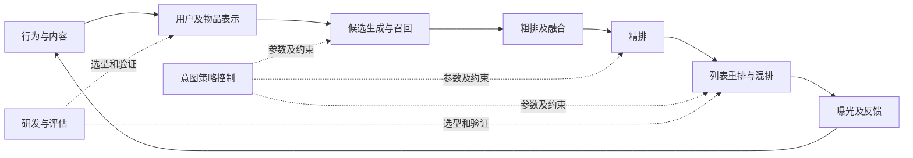

# Baseline与Pipeline替换关系

[返回总索引](00_总索引.md) · [逐篇收益矩阵](02_逐篇收益链路与证伪矩阵.md)

下面的“可替换”表示输入输出职责接近，**不是无需训练或改代码就能替换**。“可互补”表示作用位置不同，不表示收益可相加；候选重叠、标签共用、目标耦合和容量竞争都可能让联合收益变小。

## 一张图确定改动边界

这是一张帮助定位的通用示意，不能作为每篇生产拓扑。各篇具体保留/替换范围以正文为准。

## 同位置替代、不同位置互补

|位置|原始职责与典型baseline|本库方案|真正改变的接口|
|---|---|---|---|
|物品/作者语义|通用caption、冻结图文embedding、ID拼接|[GALA](论文/P1_语义表征与稀疏泛化/GALA_2607_29213.md)、[RecoReward](论文/P1_语义表征与稀疏泛化/RecoReward_2607_25901.md)、[SARA](论文/P1_语义表征与稀疏泛化/SARA_2609_17639.md)、[AKT-Rec](论文/P1_语义表征与稀疏泛化/AKT-Rec_2605_23310.md)|内容向量、理由特征或簇共享方式；主要保留下游|
|长历史支路|SIM/TWIN式先取Top-K再精建模、整体压缩|[UxSID](论文/P2_时间长历史与记忆/UxSID_2605_09040.md)、[SequenceO1](论文/P2_时间长历史与记忆/SequenceO1_2609_08443.md)|target语义组缓存或user sketch；原短期/任务头仍在|
|时间编码|RoPE/ALiBi/时间桶/RAB|[DTE](论文/P2_时间长历史与记忆/DTE_2608_16274.md)、[ReST](论文/P5_排序训练与跨阶段协同/ReST_2609_01240.md)|物理时间进入attention/输入的方式；不改变候选空间|
|用户语义生产|全历史反复读、自由摘要|[KuaFu](论文/P2_时间长历史与记忆/KuaFu_2609_31045.md)、[RecGPT-V3](论文/P3_意图推理与召回接口/RecGPT-V3_2607_15591.md)、[RPORec](论文/P3_意图推理与召回接口/RPORec_2605_21967.md)|可复用item压缩、结构记忆、受推荐反馈约束的文本|
|召回输出接口|双塔向量、标题生成、SID生成|[PAIR](论文/P3_意图推理与召回接口/PAIR_2610_30941.md)、[R2QRec](论文/P3_意图推理与召回接口/R2QRec_2610_39984.md)、[X-Rec](论文/P3_意图推理与召回接口/X-Rec_2609_29180.md)、[OneReason](论文/P3_意图推理与召回接口/OneReason_2606_06260.md)|向量/文本query/连续分布/SID四种输出；成本账不同|
|SID生成业务对齐|NTP+普通beam、末端rerank|[RGD](论文/P4_生成目标对齐与解码/RGD_2607_25344.md)、[UniVA](论文/P4_生成目标对齐与解码/UniVA_2605_05803.md)、[OxygenREC-v2](论文/P4_生成目标对齐与解码/OxygenREC-v2_2607_24255.md)|解码价值、商业码及行为条件；训练/推理改动各异|
|精排主干|DLRM/HSTU/OneTrans/SORT类|[ReST](论文/P5_排序训练与跨阶段协同/ReST_2609_01240.md)、[CCFormer](论文/P5_排序训练与跨阶段协同/CCFormer_2607_28070.md)、[LazFormer](论文/P5_排序训练与跨阶段协同/LazFormer_2609_14978.md)、[GenRec（Netflix）](论文/P5_排序训练与跨阶段协同/GenRec_Netflix_2608_10257.md)|监督、交互、迁移或知识来源，不是统一一种“LLM替换”|
|跨层协同|阶段独立模型或独立融合|[UniRec](论文/P5_排序训练与跨阶段协同/UniRec_2609_11052.md)、[OneTrans-V2](论文/P5_排序训练与跨阶段协同/OneTrans-V2_2609_28589.md)、[UNIQUE](论文/P5_排序训练与跨阶段协同/UNIQUE_2609_23718.md)、[CC Retriever](论文/P5_排序训练与跨阶段协同/CC_Retriever_2609_22441.md)|分别为融合、底座、召回联合监督、早期特征供给|
|列表|点分排序、独立Generator再混排、G-E|[OGR](论文/P6_列表混排与生成架构/OGR_2608_17613.md)、[UGR](论文/P6_列表混排与生成架构/UGR_2610_39426.md)、[OneTrans-GSR](论文/P6_列表混排与生成架构/OneTrans-GSR_2611_04720.md)|列表生成、反馈偏好、去掉/保留Evaluator的边界不同|
|权重和策略|全局权重、规则、固定触达|[PRL-PUTS](论文/P7_探索多目标与增量价值/PRL-PUTS_2605_16344.md)、[DREAM](论文/P7_探索多目标与增量价值/DREAM_2608_09408.md)、[DragonBandit](论文/P7_探索多目标与增量价值/DragonBandit_2608_10182.md)|请求级效用、跨阶段策略参数、因果预算分配|
|评估与研发|固定验证集、通用judge、手工实验、IPM/PBM/INTERPOL|[NOVA](论文/P8_评估研发与推荐Agent/NOVA_2606_27243.md)、[Spotify Agent](论文/P8_评估研发与推荐Agent/Spotify_Agent_2609_30297.md)、[ATLAS](论文/P8_评估研发与推荐Agent/ATLAS_2608_30685.md)、[GPBM](论文/P8_评估研发与推荐Agent/GPBM_amazon_gpbm.md)|研发候选过滤、工具轨迹诊断、OPE估值|

## 最容易混淆的八组关系

### 1. UniRec、OneTrans-V2、UNIQUE、Sona：统一的对象不同

[UniRec](论文/P5_排序训练与跨阶段协同/UniRec_2609_11052.md)联合的是粗精排**融合函数**，原任务预估器和级联仍在。[OneTrans-V2](论文/P5_排序训练与跨阶段协同/OneTrans-V2_2609_28589.md)统一的是召粗精**模型及用户编码**，仍按阶段筛候选。[UNIQUE](论文/P5_排序训练与跨阶段协同/UNIQUE_2609_23718.md)在模型内联结检索码和target-aware评分，但实际接生产**召回通路**。[Sona](论文/P6_列表混排与生成架构/Sona_2608_11015.md)在音箱音乐推荐中用共享编码器联结生成候选与蒸馏排序，改造范围更大。

四者不能用“端到端程度”排高低。先分别测跨层截断损失和重复编码成本；前者很高而系统改造预算小，可先研究UniRec，后者很高且服务栈能统一，才有OneTrans-V2式整合理由。

### 2. RGD、UniVA、TSGR、DASO、OxygenREC-v2：对齐问题出现在不同地方

[RGD](论文/P4_生成目标对齐与解码/RGD_2607_25344.md)主要改**搜索打分**；[UniVA](论文/P4_生成目标对齐与解码/UniVA_2605_05803.md)从商业码、训练value到合法搜索一起改；[TSGR](论文/P4_生成目标对齐与解码/TSGR_2607_18796.md)在显式query场景用联合VRM给解码后候选补侧信息；[DASO](论文/P4_生成目标对齐与解码/DASO_2608_20611.md)修复**训练梯度缺失**；[OxygenREC-v2](论文/P4_生成目标对齐与解码/OxygenREC-v2_2607_24255.md)让目标行为前置并用训练特权teacher提供指导。

它们可能互补，但叠加前必须检查奖励尺度。训练已过度偏向某目标，再在每层解码加相同reward可能双重放大；用不同teacher/RM又可能制造目标冲突。最小组合先固定一个生成器，只比较搜索；确认搜索不足后再比较训练目标。

### 3. OneReason、RPORec、OneLatent、RecGPT-V3：推理与接入路径不同

[OneReason](论文/P3_意图推理与召回接口/OneReason_2606_06260.md)需要较重的SID语义基础与课程，可近线召回或注入实时模型；[RPORec](论文/P3_意图推理与召回接口/RPORec_2605_21967.md)以文本和推荐头衔接，工业加近线用户特征；[OneLatent / WhisperRec](论文/P3_意图推理与召回接口/OneLatent_WhisperRec_2610_30675.md)学习少量标记上的上下文状态，运行时接近无CoT成本，但仍采用异步召回；[RecGPT-V3](论文/P3_意图推理与召回接口/RecGPT-V3_2607_15591.md)把记忆、混合接口与潜在推理共同改造。

显式CoT和latent路线部分替代执行方式，但教师数据、SID语义学习、近线缓存通常仍可共享。应做“相同训练监督、不同执行方式”与“相同执行方式、不同训练监督”两组实验，不能把全部收益称为思考收益。

### 4. UxSID、SequenceO1、KuaFu：缓存键决定经济性

[UxSID](论文/P2_时间长历史与记忆/UxSID_2605_09040.md)缓存键接近`(user, SID)`，保留目标条件化但条目数乘目标组数；[SequenceO1](论文/P2_时间长历史与记忆/SequenceO1_2609_08443.md)缓存user sketch，能共享给多个候选，候选读取阶段恢复个性差异；[KuaFu](论文/P2_时间长历史与记忆/KuaFu_2609_31045.md)缓存item压缩语义，跨用户与任务复用更高，但用户画像生成仍需计算。它们不是同一张cache的替代实现。

比较时核算写入、更新、版本失效、replica、key开销和miss，不止向量裸大小。压缩两次不一定更好：先item压缩再user sketch可能遗漏低频关键事件，需做信息保真探针。

### 5. GALA、RecoReward、SARA、AKT：语义增强的监督不同

GALA用实际购买监督对齐向量；RecoReward用冻结双塔的受众亲和奖励描述；SARA用问卷理由和judge训练作者侧文本；AKT用簇与活跃度控制知识迁移。它们可在不同层配合，但同一份内容监督可能产生高度相关特征。

是否组合要用2×2：仅语义对齐、仅融合/迁移、两者都有、两者都无；固定总维数与下游参数。组合收益小于两项之和，可能来自信息重叠、非线性饱和、优化冲突或曝光约束；仅凭不相加不能识别原因，也不自动说明某方法无效。更细比较见[09语义与推理](09_语义注入与推理贡献比较.md)。

### 6. OGR、UGR、OneTrans-GSR、Amazon gate：输出空间不同

[OGR](论文/P6_列表混排与生成架构/OGR_2608_17613.md)通过SID和planner生成列表；[UGR](论文/P6_列表混排与生成架构/UGR_2610_39426.md)在上游给定异质候选中生成多个列表，再保留Evaluator；[OneTrans-GSR](论文/P6_列表混排与生成架构/OneTrans-GSR_2611_04720.md)同样从动态候选集合组单，但强RM主要在训练期使用；[Amazon Playlist Curation](论文/P6_列表混排与生成架构/Amazon_Playlist_Curation_amazon_playlist.md)仅删已有歌单项。

若任务只是“移除明显不协调项”，直接训练复杂列表policy可能付出不必要的搜索与reward建模成本。若位置交互和广告混排才是问题，subset filter不能替代列表建模。候选集合质量与排列质量必须拆开测。

### 7. PRL-PUTS、DREAM、DragonBandit：策略的时间与因果尺度不同

[PRL-PUTS](论文/P7_探索多目标与增量价值/PRL-PUTS_2605_16344.md)是gamma=0的上下文bandit，动作是当前请求权重；[DREAM](论文/P7_探索多目标与增量价值/DREAM_2608_09408.md)是结构意图到多阶段参数的控制，离线回放不是真实多步环境；[DragonBandit](论文/P7_探索多目标与增量价值/DragonBandit_2608_10182.md)预测干预增量并做全局触达预算。都含“策略”，但不共享同一个动作空间、奖励时域或因果假设。

对feed权重选择，先测个性化是否优于同平均权重；对营销，先测uplift是否优于response propensity；对多阶段控制，先测统一协调是否优于各层单独调。不能把即时CTR作为长期增量的替代标签。

### 8. NOVA、Spotify、ATLAS、GPBM：都帮助迭代，但不在一层

NOVA判断**模型改造是否正确和值得训练**；Spotify与ATLAS判断**用户交互Agent如何失败**；GPBM判断**新排序策略的离线估值是否可靠**。可串成研发流程，但其论文业务收益不能相加。应报告完整候选分母、失败类型、评估预算与被选模型的独立实验结果。

## 窗口外baseline如何使用

经典方法只用作定位本期改动，不混入首发统计。例如OneTrans首发2025-10、OneRec-Think首发2025-10、SORT首发2026-03、SOLAR首发2026-03；窗口内修订或2026会议收录不把它们变成5月后的新论文。原站链接、更新日期与其他排除项见[05检索范围](05_检索范围与排除记录.md)及分支检索附件。

本库没有在同一数据、同一GPU预算下重跑这些模型，所以“结构上可替换”不能升级为“已证明优于你当前baseline”。最有价值的迁移单位往往是一个监督、一种缓存粒度或一个更早的价值接口，而非整套论文名称。
