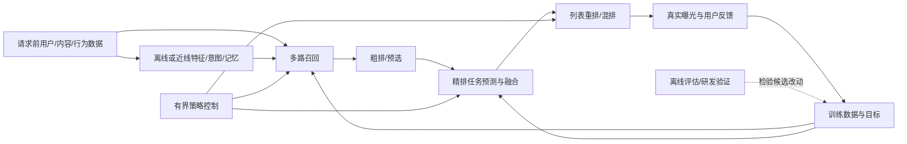

# Baseline与Pipeline：以接口确认能否替换

[总索引](00_总索引.md) · [问题地图](01_问题地图与选型路线.md)

“都用Transformer/LLM/RL/SID”只能提示阅读关联，不能证明可替换。每篇正文给实际实验baseline、输入输出、冻结/训练对象、部署依赖和预算；下表汇总关系，不跨论文比提升大小。

这是位置示意，不是所有论文共同的生产架构。用户未来反馈只能进入之后的训练/评估，不能倒流为该次在线输入。Agent也可能把现有检索、排序作为工具；它不必替换底层推荐系统。

| 关系类型 | 必须满足的条件 | 例子与边界 |
|---|---|---|
| 直接竞争 | 同位置、任务/接口、可用信息和预算可比 | GPBM与INTERPOL评估器；论文内同协议baseline优先 |
| 条件性替换 | 需满足规模、数据或部署前提，有明确保留模块 | ACT替换某路SID生成召回，但头尾路由和ranker保留 |
| 互补 | 不同瓶颈/接口可接，增量须实验验证 | 样本权重与表示升级可能组合，但有优化相互作用 |
| 上下游衔接 | 上游产物满足下游schema、时效和分布要求 | 意图特征→DREAM控制；新增召回→既有ranker |
| 仅思想相似 | 共享概念但对象/输出不同 | NOVA、Spotify、ATLAS都是闭环迭代，却分别改网络、prompt、服务策略 |
| 同框架前序/后续 | 有明确框架、版本或方法家族沿革 | RecIS 2025/2026为同框架的不同报告；这不是pipeline上下游，也不把所有旧组件算作2026创新 |

**预算不是一个数。** 模型参数、可训练参数、训练样本量/时间、在线FLOPs、显存、候选数、历史长度、缓存新鲜度、P99和端到端成本都可能改变。可先做预算匹配的机制比较，再给真实可部署的质量—成本边界；不要为了控制公平性移除待检验机制。

**组合不能相加。** 独立论文的上线环境、分母、流量、基线版本不同；即使同一平台，也不能把百分比相加预测收益。2×2组合试验应报告主效应与交互项及中介；组合不增益并不唯一指向信息冗余。

## 逐篇关系记录

### [GALA](论文/P1_语义表征与稀疏泛化/GALA_2607_29213.md)

- **AKT-Rec：互补**。前者改善内容表征，后者共享头尾统计；若同一语义输入已重复吸收购买信息，需消融再组合。
- **RecoReward：条件替换**。均以推荐反馈校正内容，但一个交付向量、一个交付共享描述，取决于下游接口。

### [AKT-Rec](论文/P1_语义表征与稀疏泛化/AKT-Rec_2605_23310.md)

- **GALA：互补**。都为排序注入离线语义，但 GALA 对齐内容支路，AKT 解决簇与 ID 的头尾共享；需测重复信息。
- **RecoReward：上下游**。共享描述可成为物品语义输入，须独立验证是否改善簇质量而非仅增加文本。

### [RecoReward](论文/P1_语义表征与稀疏泛化/RecoReward_2607_25901.md)

- **GALA：条件替换**。目标同为推荐对齐的内容表示，但下游需要文本还是冻结向量决定接口。
- **SARA：互补**。SARA 有真实理由标签并增加正负支路；RecoReward 可改描述，但不能替代问卷理由真实性。
- **RPORec：仅思想相似**。都使用推荐反馈约束文本；前者物品共享描述，后者用户推理/答案。

### [SARA](论文/P1_语义表征与稀疏泛化/SARA_2609_17639.md)

- **RecoReward：互补**。同属内容语义，但一个从行为奖励优化共享描述、一个从显式理由建立语义监督；应控制文本信息重复。
- **AKT-Rec：仅思想相似**。都借共享簇泛化；理由SID的厌恶语义与一般头尾知识迁移任务不同。

### [Beyond Item IDs](论文/P2_时间长历史与记忆/Beyond_Item_IDs_2606_07546.md)

- **UxSID：互补**。SID/folding可先降低基础历史成本；是否再建UID×SID缓存取决于目标条件化增量。
- **SequenceO1：条件替换**。都削减长历史在线负担，折叠与原型sketch可在同总资源下竞争；信息损失模式不同。
- **DTE：互补**。DTE修时间信号，folding需确保折叠后时间结构可表达，不能直接假设可叠加。

### [UxSID](论文/P2_时间长历史与记忆/UxSID_2605_09040.md)

- **SequenceO1：条件替换**。都为长历史提供在线低成本表示；UxSID按目标分缓存，SequenceO1缓存用户原型，条件是缓存预算及目标依赖需求。
- **Beyond Item IDs：互补**。SID历史压缩/folding可先降低基础序列成本，再评估是否仍需目标SID缓存；不可假定独立增益。

### [DTE](论文/P2_时间长历史与记忆/DTE_2608_16274.md)

- **Beyond Item IDs：互补**。压缩与时间信息可并用，但folding后周期/局部顺序是否保留须验证。
- **SequenceO1：互补**。可给近期或sketch上游加时间信息；sketch是否能保留局部顺序不能预设。

### [SequenceO1](论文/P2_时间长历史与记忆/SequenceO1_2609_08443.md)

- **UxSID：条件替换**。一个缓存用户原型，另一个按UID×SID缓存；目标依赖、覆盖与字节预算决定选择。
- **KuaFu：仅思想相似**。都摊销长历史计算；SequenceO1交付可训练排序sketch，KuaFu交付item压缩token供画像解码，输出与更新节奏不同。

### [KuaFu](论文/P2_时间长历史与记忆/KuaFu_2609_31045.md)

- **RecGPT-V3：互补**。KuaFu提供可复用item语义/画像，V3维护结构记忆与生成候选；相接需检验信息重叠和刷新边界。
- **SequenceO1：仅思想相似**。都压缩长历史，但一个向LLM交付soft token，一个向ranker交付学习sketch，不能直接替换。

### [RecGPT-Mobile](论文/P3_意图推理与召回接口/RecGPT-Mobile_2605_04726.md)

- **RecGPT-V3：互补**。端侧给实时意图，V3维护更长记忆与混合接口；要处理重复候选和请求预算。
- **KuaFu：仅思想相似**。都将行为变成下游语义；画像近线偏长期，Mobile事件触发偏即时。

### [RPORec](论文/P3_意图推理与召回接口/RPORec_2605_21967.md)

- **OneReason：条件替换**。同一预算下可比较近线语义特征与生成SID补召回；前者无需扩SID词表，接口不同。
- **RecoReward：仅思想相似**。都以推荐scorer训文本；一者用户侧，一者内容侧，不能把同reward形式当同方法。
- **SARA：互补**。用户理解与作者理由可能结合，需检验语义重复和训练head自证。

### [OneReason](论文/P3_意图推理与召回接口/OneReason_2606_06260.md)

- **RPORec：条件替换**。近线生成SID与近线文本特征是不同改造接口，应按资源和候选增量选择。
- **RecGPT-V3：直接竞争**。生成召回层可在相同业务/候选预算比较，但多域规模和标签信息必须控制。

### [OneRetrieval](论文/P3_意图推理与召回接口/OneRetrieval_2606_13533.md)

- **UNIQUE：条件替换**。都可产召回候选；UNIQUE是Feed单层平衡量化+联合评分，本篇是搜索属性可编辑SID；需按业务接口和字典资源选择。
- **UniRec：上下游**。OneRetrieval候选仍进后续粗精排，UniRec可协调融合；不能认为召回统一已解决阶段冲突。
- **PinEqualizer：互补**。可编辑新词解决召回可达性，冷内容全漏斗还需特征校准与探索，不能视为同一机制。

### [RecGPT-V3](论文/P3_意图推理与召回接口/RecGPT-V3_2607_15591.md)

- **RecGPT-Mobile：互补**。端侧即时query可补近期delta，但需统一候选预算与去重。
- **KuaFu：条件替换**。都减少长历史理解成本，但结构memory可审计，soft token偏复用物品；按重建与更新需求比较。
- **OneReason：直接竞争**。在生成召回入口、相同候选数量与服务预算下可比较，保留候选身份变化；其预训练规模与业务域差异必须控制。

### [OneLatent / WhisperRec](论文/P3_意图推理与召回接口/OneLatent_WhisperRec_2610_30675.md)

- **R2QRec：条件替换**。ANN文本query接口与SID基础模型接口不同
- **DASO：互补**。可探索接后训练，未证明叠加

### [ConnectionMind](论文/P3_意图推理与召回接口/ConnectionMind_2608_10187.md)

- **OneReason：条件替换**。生成召回层可竞争，但ConnectionMind依赖social graph而OneReason主要SID序列；相同可召回item目录及候选数量/资源预算方可比较，允许实际返回候选不同。
- **RPORec：互补**。图候选与用户语义特征可能同时接ranker，需验证冗余。
- **AKT-Rec：上下游**。本篇产候选，AKT在下游排序处理稀疏实体；不可默认提升相加。

### [X-Rec](论文/P3_意图推理与召回接口/X-Rec_2609_29180.md)

- **R2QRec：直接竞争**。候选触发表示选择
- **PAIR：条件替换**。多兴趣采样需求和吞吐不同

### [PAIR](论文/P3_意图推理与召回接口/PAIR_2610_30941.md)

- **R2QRec：条件替换**。人员画像匹配或生成文本查询
- **OneLatent：仅思想相似**。都利用行为意图，但无相同生成接口

### [R2QRec](论文/P3_意图推理与召回接口/R2QRec_2610_39984.md)

- **PAIR：条件替换**。查询生成与直接双塔取决于已有接口/延迟
- **X-Rec：直接竞争**。同召回trigger位置，需统一预算和索引

### [UniVA](论文/P4_生成目标对齐与解码/UniVA_2605_05803.md)

- **RGD：直接竞争**。逐层价值引导实现不同
- **TSGR：条件替换**。广告商业约束与搜索query场景不同

### [TSGR](论文/P4_生成目标对齐与解码/TSGR_2607_18796.md)

- **UniVA：条件替换**。搜索query与广告定向不同
- **OneTrans-V2：条件替换**。内置预排或三阶段统一取决于基础设施

### [OxygenREC-v2](论文/P4_生成目标对齐与解码/OxygenREC-v2_2607_24255.md)

- **DASO：条件替换**。后训练支持分布与特权教师方案不同
- **RGD：互补**。生成内化判别与外置解码reward可实验组合

### [RGD](论文/P4_生成目标对齐与解码/RGD_2607_25344.md)

- **UniVA：直接竞争**。解码阶段概率价值融合
- **DASO：互补**。训练/推理可组合但无叠加证据

### [DASO](论文/P4_生成目标对齐与解码/DASO_2608_20611.md)

- **RGD：互补**。训练rollout与推理解码不同环节
- **OxygenREC-v2：条件替换**。后训练信用与特权teacher各有依赖

### [ACT](论文/P4_生成目标对齐与解码/ACT_2611_00323.md)

- **UNIQUE：仅思想相似**。单步码仍需展开；ACT是唯一真实作者token
- **SID生成召回：条件性替换**。作者训练样本足够且词表内存可承受
- **传统C2C：互补**。ACT处理有数据头部，传统分支保留长尾

### [UniPinRec](论文/P5_排序训练与跨阶段协同/UniPinRec_2606_00422.md)

- **OneTrans-V2：条件替换**。同为跨阶段统一的竞争路线；两阶段ANN与三阶段SID的输出、索引和范围不同，需重新适配，非直接模块替换
- **HELIX：上下游**。可讨论精排，当前保留TransAct V2

### [CCFormer](论文/P5_排序训练与跨阶段协同/CCFormer_2607_28070.md)

- **HELIX：直接竞争**。排序骨干的字段交互/序列压缩选择
- **ReST：条件替换**。全骨干或序列分支改造范围不同

### [GenRec（Netflix）](论文/P5_排序训练与跨阶段协同/GenRec_Netflix_2608_10257.md)

- **Sona：仅思想相似**。都复用历史与内容知识，但Sona生成SID并排序，GenRec输出目录分数，不能直接替换。
- **UniRec：上下游**。GenRec可提供任务/目录分数，融合层仍可用UniRec思路；需重新标定并验证计算预算。

### [ReST](论文/P5_排序训练与跨阶段协同/ReST_2609_01240.md)

- **CCFormer：条件替换**。仅序列分支升级或全交互骨干替换
- **LazFormer：互补**。序列监督与预训练迁移可探索组合

### [UniRec](论文/P5_排序训练与跨阶段协同/UniRec_2609_11052.md)

- **PRL-PUTS：条件替换**。两者都可改融合效用；PRL是一阶段请求级离散权重，UniRec需两阶段联合训练。
- **CC Retriever：互补**。前者把关系信号送到粗排，UniRec协调融合；同时改造需重测校准与交互，收益不可相加。

### [LazFormer](论文/P5_排序训练与跨阶段协同/LazFormer_2609_14978.md)

- **ReST：互补**。预训练迁移与辅助序列监督
- **CCFormer：条件替换**。迁移优先或从头训练压缩骨干

### [CC Retriever](论文/P5_排序训练与跨阶段协同/CC_Retriever_2609_22441.md)

- **UniRec：互补**。CC增加粗排可用信息，UniRec协调阶段融合；共同接入需重新校准。
- **UNIQUE：条件替换**。都可减少早期信息丢失，但UNIQUE生产只贡献一个召回源，CC承担连接内容粗排，不能直接按收益排名。

### [UNIQUE](论文/P5_排序训练与跨阶段协同/UNIQUE_2609_23718.md)

- **Sona：条件替换**。Sona在特定音乐面替换召回到排序，UNIQUE目前只是召回源；相同替换范围和资源下才能比。
- **UniRec：上下游**。UNIQUE产出候选，UniRec可协调后续融合，需重新校准新增候选分布。

### [OneTrans-V2](论文/P5_排序训练与跨阶段协同/OneTrans-V2_2609_28589.md)

- **UniPinRec：条件替换**。同为跨阶段统一的竞争路线；两阶段ANN与三阶段SID的输出、索引和范围不同，需重新适配，非直接模块替换
- **HELIX：条件替换**。局部竞争于精排骨干，重用需重设共享上下文、因果mask与候选接口

### [HELIX](论文/P5_排序训练与跨阶段协同/HELIX_2609_37183.md)

- **CCFormer：直接竞争**。精排交互与序列压缩骨干
- **OneTrans-V2：条件替换**。局部竞争于精排骨干，需重设共享上下文、因果mask与候选接口，不能视为线性上下游

### [RecIS](论文/P5_排序训练与跨阶段协同/RecIS_2610_41457.md)

- **RecIS 2509.20883（2025）：同框架前序/后续报告**。属于框架演进，非pipeline上下游；2025已公开多项基础机制。非同arXiv修订版本，增量未独立消融，精确新增贡献和代码版本差仍待核验。
- **TorchRec / PICASSO：直接竞争**。训练框架层的条件替换，需同模型、硬件、优化器、精度与数据语义比较。
- **SequenceO1 / UxSID / AKT-Rec：互补**。可能加速其训练，但是否受稀疏通信限制由profile决定，不能推导用户指标叠加。
- **MetaETT：仅思想相似**。都是系统方向名称出现于覆盖检索；RecIS不是该撤稿论文，身份与状态独立。

### [Sona](论文/P6_列表混排与生成架构/Sona_2608_11015.md)

- **UNIQUE：条件替换**。同为生成与排序共享表示，但实际部署接口不同；先统一范围及预算。
- **GenRec（Netflix）：仅思想相似**。均用内容知识/历史复用，Sona输出SID候选再评分，GenRec目录直接打分。

### [OGR](论文/P6_列表混排与生成架构/OGR_2608_17613.md)

- **UGR：条件替换**。UGR在给定混合候选上生成且保留Evaluator；OGR使用SID生成，候选边界不同。
- **OneTrans-GSR：条件替换**。后者在已召回候选上用RM教policy且线上无RM，OGR以曝光日志直接校准；先对齐接口和预算。

### [UGR](论文/P6_列表混排与生成架构/UGR_2610_39426.md)

- **OneTrans-GSR：直接竞争**。在既有候选重排/混排接口可竞争，但UGR保留Evaluator，后者线上去RM；比较须算各自总服务预算。
- **OGR：条件替换**。先把SID生成候选与给定候选的范围对齐，不能跨论文GMV/互动排序。

### [OneTrans-GSR](论文/P6_列表混排与生成架构/OneTrans-GSR_2611_04720.md)

- **UGR：直接竞争**。均可在给定候选上统一重排/混排；UGR仍有Evaluator，OneTrans-GSR不在线调RM。
- **OGR：条件替换**。OGR生成SID且SPA支持日志列表；需先对齐候选空间和监督来源。

### [Amazon Playlist Curation](论文/P6_列表混排与生成架构/Amazon_Playlist_Curation_amazon_playlist.md)

- **Sona：上下游**。Sona可生成/排序歌候选，本方法可作后置quality gate，但其删歌会改变后者列表分布，需联测。
- **UGR：仅思想相似**。都利用列表上下文；一个删负例，一个生成混合候选次序，非同接口。

### [PRL-PUTS](论文/P7_探索多目标与增量价值/PRL-PUTS_2605_16344.md)

- **UniRec：条件替换**。同为效用融合但PRL只改单阶段权重、UniRec改两阶段联合损失；按瓶颈选择。
- **DragonBandit：仅思想相似**。都用策略选择，但Dragon针对营销因果增量与全局预算，reward/动作/时序不同。

### [Uncertainty Calibration](论文/P7_探索多目标与增量价值/Uncertainty_Calibration_2605_17788.md)

- **URED：互补**。风险调分可与回收召回同用，但URED高分池不等于低risk；须测交互。
- **PinEqualizer：仅思想相似**。两者有探索加分，但PinEqualizer先修全漏斗供给与校准，不能只拿一个UCB公式替代。

### [PinEqualizer](论文/P7_探索多目标与增量价值/PinEqualizer_2607_22518.md)

- **URED：互补**。URED回收既有高分未曝光供给，PinEqualizer处理新内容全漏斗；发现定义不同，不能直接比较百分比。
- **PRL-PUTS：互补**。效用权重策略可承载探索目标，但需先修语料/召回支持并记录action propensities。
- **Uncertainty Calibration：仅思想相似**。都有risk bonus，但其人群策略与本篇内容冷启、协方差估计不同。

### [DREAM](论文/P7_探索多目标与增量价值/DREAM_2608_09408.md)

- **详见笔记：条件关系**。与PRL-PUTS条件性替换策略器，但动作维度不同；与RecGPT意图特征上下游；与UGR互补，只能控制已暴露参数，不能绕过混排竞价约束。

### [DragonBandit](论文/P7_探索多目标与增量价值/DragonBandit_2608_10182.md)

- **PRL-PUTS：仅思想相似**。PRL即时utility bandit不估计触达增量，不能因为都用策略优化就替代。
- **PinEqualizer：仅思想相似**。内容探索与营销干预都有预算分配，但处理、结果和干扰结构不同。

### [Soft Curriculum](论文/P7_探索多目标与增量价值/Soft_Curriculum_2609_35783.md)

- **详见笔记：条件关系**。SCL替换训练权重；AKT-Rec/GALA改输入表示，原则上互补，但需同预算2×2检验；与PinEqualizer的探索流量/漏斗校准上下游相接，不替代可曝光候选保障。

### [URED](论文/P7_探索多目标与增量价值/URED_2611_05997.md)

- **Uncertainty Calibration：互补**。可以给回收候选加风险策略，但必须独立测校准，不能预设URED池低risk。
- **PinEqualizer：互补**。URED修候选供给一个环节，PinEqualizer覆盖新内容全漏斗；需根据瓶颈决定组合。

### [NOVA](论文/P8_评估研发与推荐Agent/NOVA_2606_27243.md)

- **详见笔记：条件关系**。与ReAct/OpenHands/R&D-Agent+相同skills是实际流程基线；Optuna仅L2条件竞争。与Spotify/ATLAS仅研发闭环思想类似，搜索对象分别是网络代码、prompt、服务Agent参数。

### [ATLAS](论文/P8_评估研发与推荐Agent/ATLAS_2608_30685.md)

- **详见笔记：条件关系**。与Spotify可共用轨迹诊断但优化对象不同；与NOVA仅思想相似；与原推荐召回排序为上下游工具关系，不取代底层模型。

### [Spotify Agent](论文/P8_评估研发与推荐Agent/Spotify_Agent_2609_30297.md)

- **详见笔记：条件关系**。条件性替代人工prompt/debug流程；与ATLAS的诊断信号可互补但ATLAS本例更新模型参数，Spotify更新harness文档。与NOVA仅思想相似，不能互换成功率。

### [GPBM](论文/P8_评估研发与推荐Agent/GPBM_amazon_gpbm.md)

- **详见笔记：条件关系**。与INTERPOL直接竞争评估器，IPM/PBM为特例；与PRL-PUTS的Reward@HIT只有OPE思想相似，动作空间与识别假设不同，不可直接替换；与NOVA等上游选型模块条件互补。
