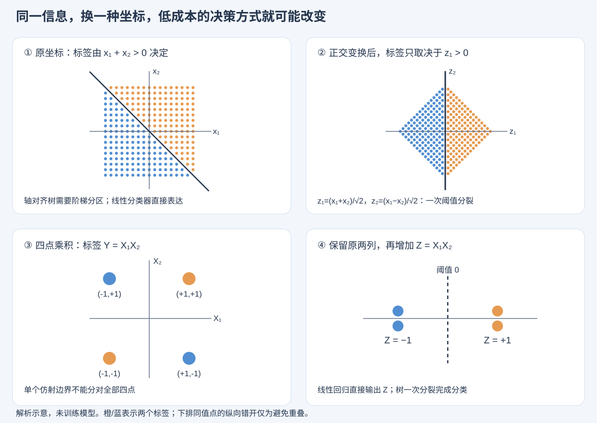

# 信息相同，为什么换一种特征表示，模型就更容易学？

> **核心结论：信息决定理想预测的上限；表示、模型和训练过程共同决定，在有限数据与计算预算内，能接近这个上限到什么程度。**  
> 确定性特征工程的主要作用，是把目标关系改写成当前学习系统容易表达、容易搜索、容易稳定估计的形式。它可能改变函数类，也可能只改变参数化、正则化与优化路径；没有普遍的收益保证。

本文按问题组织数学推导和一手论文证据。跨模型比较中的“容易”指关系在给定架构、数据与训练条件下的表达或学习成本。首轮检索于 2026 年 11 月 6 日完成，11 月 20 日补核了部分回归、未见组合和基础模型的特征工程实验。

配套：[论文清单与证据边界](02_论文地图与检索记录.md) · [实验设计与可复核例子](03_验证方案与数学例子.md)

## 1. 先澄清：“信息相同”至少有四种含义

设一条样本的原始输入为 $X$，标签为 $Y$，新表示为 $Z=\phi(X)$。以下结论假设变换固定、不使用测试标签、没有额外的数据源。

### 1.1 在原特征旁添加确定性交叉：信息严格相同

例如从价格 $p$、数量 $q$ 构造总额 $pq$，并保留原来的两列。由条件互信息的链式法则：

$$
I(Y;X,\phi(X))
= I(Y;X)+I(Y;\phi(X)\mid X)
=I(Y;X).
$$

因此，知道完整 $X$ 的无限能力预测者，不会因为额外看到 $\phi(X)$ 而获得新的观测信息。对同一损失函数，允许所有可测预测规则时，两者的 Bayes 最优风险相同。

但这不是说实际模型已经能有效计算 $\phi$。信息论没有向预测者收取“从原始坐标计算乘法、比值、周期或组合关系”的成本。

### 1.2 用新表示替换原特征：不一定信息相同

一般只能保证数据处理不等式：

$$
I(Y;\phi(X))\le I(Y;X).
$$

若 $\phi$ 可逆，则等号成立；若 $\phi$ 不可逆，但对任务充分，即 $Y\perp X\mid\phi(X)$，也可以保持关于 $Y$ 的信息。把时间戳替换成小时、把行为序列替换成平均 embedding、把连续值分桶，都可能损失任务相关信息。

因此，“高维变低维”“做了 embedding”“加了 attention”本身，都不能证明输入信息相同。

### 1.3 行内计算相同，不代表整个学习系统没有引入知识

手工指定 $pq$ 这一候选，本身表达了“应优先寻找乘法关系”的先验。数值计算没有创造新的观测信息，但设计者已经替模型缩小了搜索范围。

若变换依赖训练集 $D$，如目标编码、监督分桶、训练好的 embedding，则应讨论固定 $D$ 后的 $\phi_D(X)$。历史统计、外部知识图谱或预训练权重还可能引入原始单行之外的信息。不能把这些收益全部解释成“同一条样本换了坐标”。

**公平性原则：** 既要记录输入字段，也要记录生成表示所用的数据、标签、先验和计算成本。

### 1.4 “相同信息”不等于“相同可用信息”

Xu 等提出 $\mathcal V$-information：相对于受限预测函数族，定义标签的可预测程度。确定性计算可以增加这个受限意义下的可用信息，而不违背 Shannon 信息的数据处理不等式。这个框架直接回答了本题的信息论疑问。它本身仍不是某次 SGD 训练一定成功的保证。[Xu et al., ICLR 2020](https://arxiv.org/abs/2002.10689)

为直观说明，可以写成：

$$
H_{\mathcal V}(Y\mid Z)
=\inf_{q\in\mathcal V}
\mathbb E[-\log q(Y\mid Z)],
$$

$$
I_{\mathcal V}(Z\to Y)
=H_{\mathcal V}(Y\mid\varnothing)-H_{\mathcal V}(Y\mid Z).
$$

这里要求预测族满足相应的“可以忽略输入”条件。$H_{\mathcal V}$ 是预测族中的最优总体对数损失，不是有限数据、有限训练预算下实际测得的损失。

**实际问题还要再加一层：** 即使存在低损失的 $q\in\mathcal V$，具体优化器能否在给定时间内找到它？

## 2. 为什么原特征已有信息，构造交叉仍然有收益？

可以把原因分为六类。它们会同时发生，不应把所有收益都称为“增加表达能力”。

| 机制 | 具体改变了什么 | 例子 | 可能付出的代价 |
|---|---|---|---|
| 改变受限函数类 | 原坐标下复杂的函数，在新坐标下变成简单函数 | 线性模型加入 $x_1x_2$ | 增加维度、过拟合 |
| 提高表示效率 | 同一关系需要更少的层、叶子、参数或更小的范数 | 树加入 $x_1+x_2$ 后一刀表达斜阈值 | 错误先验限制其他关系 |
| 改善搜索信号 | 将多步联合发现变成可直接发现的单变量信号 | 平衡 XOR 加入乘积特征 | 大量伪交叉会制造偶然信号 |
| 改善数值条件 | 改变尺度、曲率、梯度方向和步长适配 | 标准化、白化 | 原有正则化含义随之变化 |
| 改变统计共享方式 | 让不同样本共享参数，或压缩自由度 | FM 的低秩交互、类别 embedding | 共享假设错误时欠拟合 |
| 改变训练偏好 | 同一函数有不同参数成本与学习速度 | 重复特征改变 Ridge 惩罚；周期编码改变优先拟合的模式 | 可能强化捷径、损害分布外泛化 |

### 2.1 最干净的数学例子：乘积信息已经在两列中，线性模型仍取不出来

令 $X_1,X_2$ 独立、均匀取 $\{-1,+1\}$，目标为：

$$
Y=X_1X_2.
$$

这是与 XOR/XNOR 等价的奇偶关系，交换标签正负不影响学习难点。所有数据只有四种：

| $X_1$ | $X_2$ | $Y$ |
|---|---|---|
| $-1$ | $-1$ | $+1$ |
| $-1$ | $+1$ | $-1$ |
| $+1$ | $-1$ | $-1$ |
| $+1$ | $+1$ | $+1$ |

**数学推导：**

$$
\mathbb E[Y]=0,\qquad
\mathbb E[X_1Y]=\mathbb E[X_2]=0,\qquad
\mathbb E[X_2Y]=0.
$$

在平方损失下，最优仿射线性预测器 $b+w_1X_1+w_2X_2$ 为零函数，最小风险是 $1$。加入 $Z=X_1X_2$ 后，预测器 $\hat Y=Z$ 的风险为 $0$。

与此同时：

$$
I(Y;X_1,X_2)=1\ \text{bit},\qquad
I(Y;X_1,X_2,Z)=1\ \text{bit}.
$$

**信息一 bit 都没增加，但对线性回归的价值从不可用变成完全可用。** 改变的是“输入表示与模型函数族的组合”。

四点无法被仿射边界全分开的理由也很直接：若两个对角正例的打分均大于零，两式相加要求截距为正；另外两个负例的打分均小于零，两式相加又要求截距为负。无严格分离解；而一个仿射边界可以只分错一个角点。

这里必须指明损失：如果改成仿射分类器的 0–1 分类误差，四点问题的最佳错误率是 $1/4$，不能沿用“线性回归输出零”就声称所有线性分类器只能随机猜。

### 2.2 表达出来与搜出来，是两件事

同一个四点问题，一棵深度为 2 的树完全能表达：先切 $X_1$，再在两个子节点切 $X_2$。

但在根节点，无论按 $X_1$ 还是 $X_2$ 分裂，左右两边仍各有一半正例、一半负例；总体上的熵/Gini/MSE 改善都是零。一个只接受正收益、逐步贪心生长的树，可能在第一步就停住。

这说明：

- **表示上：** 深度 2 足够。
- **算法上：** 达到好解需要先走一步即时收益为零的分裂。
- **交叉后：** $Z=X_1X_2$ 与标签直接对应，一次阈值分裂即可分类。

这是对理想平衡分布的推导。有限样本噪声、强制生长、零增益处理和具体实现可能使树继续生长，所以不能写成“XGBoost 无法学习 XOR”。XGBoost 的贪心分裂与正则化目标见其原论文；本文的 XOR 是用来分析这一搜索机制的例子。[Chen & Guestrin, KDD 2016](https://arxiv.org/abs/1603.02754)

两比特问题对小 MLP 往往也很容易。真正的启示是“存在性不保证搜索路径”，不是“所有交叉都让神经网络难以训练”。

### 2.3 不增加函数类，也能改变结果：复制特征与 Ridge

**数学推导：** 只有一列 $x$ 时，模型为 $ax$，Ridge 惩罚为 $\lambda a^2$。复制这列后模型为 $(u+v)x$；对固定有效系数 $a=u+v$：

$$
\min_{u+v=a}\lambda(u^2+v^2)
=\frac{\lambda a^2}{2}.
$$

复制前后：

- 输入信息相同；
- 可以表示的预测函数相同；
- 同一个有效系数的最小正则化成本变为一半。

因此，固定 $\lambda$ 的实验结果可能改变。变化来自正则化几何；如果重新匹配惩罚强度，这个特定差异可以消除。

**重要推论：** “加特征后提升”甚至不足以单独证明模型原先缺乏表达能力，也可能只是改变了有效正则化。

### 2.4 表示可以把复杂关系变成模型偏好的简单关系

图中上排用可逆的正交变换把斜边界对齐到第一坐标，下排保留原特征并增加确定性乘积。点的颜色按给定规则计算。

“简单”必须说明相对于谁：

- 对轴对齐树，一维阈值简单，倾斜边界通常需要阶梯状分区。
- 对线性模型，任意方向的超平面都简单，但乘积通常不简单。
- 对含乘法的结构，低阶多项式自然；周期关系或除法未必自然。
- 对距离模型，表示决定哪些样本邻近，尺度和无关维度尤其重要。

没有脱离模型与算法的统一“最简单表示”。

## 3. “理论上能表达”和“实际训练能学出来”之间隔着什么？

### 3.1 通用逼近定理是存在性结果

Cybenko 的经典结果在其激活函数与定义域等条件下说明，单隐藏层网络可以逼近相应连续函数。它不直接给出工程上合适的宽度、范数、样本量、SGD 训练时间，也不保证范围外的数值外推。[Cybenko, 1989](https://doi.org/10.1007/BF02551274)

“MLP 是通用逼近器，所以无需特征工程”遗漏了至少五个问题：

1. **资源：** 给定宽度与深度是否够，而不是允许无限扩展后是否够？
2. **表示成本：** 好解是否需要很大的参数、很精细的分段或极高精度？
3. **可识别性：** 有限样本能否把目标规律与其他拟合规律区分开？
4. **优化：** 初始化与梯度更新能否找到这种解？
5. **泛化：** 找到的解是否在新样本与新分布上继续成立？

深度分离理论提供了“不同结构以极不相同的规模表示某些函数”的构造性证据；它不是“所有深网络在所有任务上更好”的定理。[Telgarsky, COLT 2016](https://proceedings.mlr.press/v49/telgarsky16.html)

### 3.2 用一个有条件的风险上界分开三种差距

固定表示 $\phi$，把对应的原始输入函数族写成：

$$
\mathcal H_\phi=\{x\mapsto f(\phi(x)):f\in\mathcal F\}.
$$

设训练得到 $\hat h\in\mathcal H_\phi$，其经验风险距离该函数族内的最优经验风险不超过 $\varepsilon_{\mathrm{opt}}$。令

$$
\delta_D=\sup_{h\in\mathcal H_\phi}|R(h)-\widehat R_D(h)|.
$$

则直接加减经验风险可得：

$$
R(\hat h)-R^*
\le
\underbrace{\inf_{h\in\mathcal H_\phi}R(h)-R^*}_{\text{受限函数类的逼近差距}}
+
\underbrace{2\delta_D}_{\text{总体与样本风险的差距}}
+
\underbrace{\varepsilon_{\mathrm{opt}}}_{\text{经验优化差距}}.
$$

这里 $R^*=R_X^*$ 是使用完整原输入时的 Bayes 风险。若表示有损，第一项同时包含信息损失 $R_Z^*-R_X^*$ 和受限函数类的逼近差距 $\inf_{h\in\mathcal H_\phi}R(h)-R_Z^*$；严格保信息时前者为零。

这是本文的解释性推导。要把 $\delta_D$ 变为有用的高概率界，需要独立同分布、损失尾部、函数类复杂度等条件；对大型深网，直接的统一收敛界可能非常宽松。若 $\phi$ 由同一训练集自适应选择或学习，还需把表示搜索纳入复杂度分析，或使用合适的数据拆分。若显式正则化，应把约束纳入函数族，或另外分析惩罚目标，不能把正则化损失混作原始风险。

这一上界的用途是辨别机制：

- 新表示可能降低逼近差距；
- 也可能减小有效复杂度、改善样本效率；
- 还可能让优化更快；
- 也可能扩张函数类、放大估计误差或恶化数值条件。

**一个方向变好，不保证总风险下降。** 三项也不是可从一份离线成绩单直接、唯一分解出来的因果贡献。

### 3.3 梯度不是在所有可表达函数中均匀搜索

训练过程会偏爱某些解。频谱偏置研究在所分析的网络与设置中发现，较低频的函数成分通常更早被拟合；这有助于解释为何周期编码或合适的数值 embedding 可能改变学习速度，但不能简化为“所有高频都难学”。[Rahaman et al., ICML 2019](https://proceedings.mlr.press/v97/rahaman19a.html)

在可分线性分类、特定损失尾部和步长条件下，梯度下降会趋向特定最大间隔方向，说明优化器即使没有显式写出某项正则，也会选择特定解。[Soudry et al., JMLR 2018](https://jmlr.org/papers/v19/18-188.html)

**本文推论：** 换表示可能改变参数空间中的路径、距离和“什么解便宜”。即使最终可表达函数族相同，实际学习偏好仍可能不同。不能把上述特定理论直接推广成任意深网的精确描述。

### 3.4 数值条件不是次要实现细节

在线性最小二乘中，损失曲率由特征二阶矩决定；特征中心化后对应协方差。若两个方向的曲率相差 $10^6$ 倍，固定步长既要避免陡方向发散，又要沿缓方向前进。适当缩放可以改变这种病态条件，而不改变无限制线性模型的函数集合。

Adam、归一化层和二阶方法能缓解部分问题，但不保证对任意重参数化完全不变。比较“原始特征 vs 新特征”时，学习率、权重衰减、初始化与早停都可能需要重新选择。

### 3.5 插值、外推与发现真实算式不能混为一谈

有限 ReLU MLP 是分段仿射函数，因此不能在二维开区域上精确等于连续乘法 $x_1x_2$，但可以在紧集内逼近。一个小网络又可以在前述四个离散点上精确输出乘积。这两句话完全相容。

拟合训练范围内的乘法，也不等于掌握任意数值范围的乘法。NALU、NAU/NMU 等工作把算术操作加入结构，体现了为外推提供专门偏置的路线；这些单元仍有优化与适用范围限制。[Trask et al., NeurIPS 2018](https://arxiv.org/abs/1808.00508) · [Madsen & Johansen, ICLR 2020](https://arxiv.org/abs/2001.05016)

即使各字段都在熟悉的范围内，**取值组合也可能需要外推**。用 $a,b\in\{0,1\}$ 分别表示下雨和高峰。假设训练数据只有 $(0,0),(1,0),(0,1)$，对应的合成响应为 $0,1,1$。以下两条规则在每条训练记录上的误差都为零。

$$
f(a,b)=a+b,\qquad g(a,b)=a+b+3ab.
$$

到了雨天高峰 $(1,1)$，两条规则分别预测 **2** 和 **5**。即使给模型加上交叉列 $ab$，它在训练集仍恒为零，损失对交叉系数没有约束。反复收集前三种组合也无法从数据判定第四格该取哪个值。模型能凭加性、低秩共享或业务先验作出预测，而判断哪种外推更准，需要该组合的标签或独立可信的结构依据。

D’Amour 等在实际模型中观察到，同分布测试表现相近的解，在面向部署条件的压力测试上可能出现明显分歧。上述四格是这一问题的代数例子。[D’Amour 等，JMLR 2022](https://jmlr.org/papers/v23/20-1335.html)

## 4. 同一个关系，哪些模型更容易学？

假设各模型看到相同的原始变量。这里比较表达成本和搜索信号，实际收益还取决于样本分布与训练方法。

### 4.1 连续乘法 $y=x_1x_2$

给定 $z=x_1x_2$，线性回归只需一个系数。只有原始两列时，线性回归和恒等链接的主效应 GAM 都缺少联合项。但若两列皆为正，对数链接 GAM 可通过 $\log x_1+\log x_2$ 精确表示响应尺度上的乘积。

| 模型 | 拟合连续乘积时，哪一步需要由模型学习？ |
|---|---|
| XGBoost 等轴对齐常数叶树 | 用矩形区域拼成阶梯曲面。加入 $z$ 可把回归降为一维分段拟合。若只预测 $\mathbf1[z>c]$，一次分裂即可。 |
| 有限 ReLU MLP / ResNet | 用分段仿射函数在有限范围逼近曲面。精确表示的限制见 §3.5。 |
| FM、普通 DCNv2、含二阶项的多项式核 | 预测函数已有乘积项。给定参数预算时，要看 $x_1x_2$ 的系数能否充分独立地调整和估计。 |
| Attention / FT-Transformer | 字段间的点积先用于计算相对权重。预测乘积值时，下游还需能读出它的大小，见 §5.3。 |
| PNN、NMU | 乘积层或算术单元直接提供乘法，仍需学会选择参与运算的输入。 |

当 $X_1,X_2$ 独立且均值为零时，$\mathbb E[Y\mid X_1]=\mathbb E[Y\mid X_2]=0$。按平方误差选分裂的树，无论在根节点切哪一个变量，总体误差都没有即时改善。乘积列给第一刀提供了搜索信号。

### 4.2 斜阈值 $y=\mathbf1[x_1+x_2>c]$

在线性分类器或 MLP 中，一个仿射打分 $x_1+x_2-c$ 就能给出正确分类边界。在轴对齐树中，要沿着斜线拼出阶梯，直接提供 $s=x_1+x_2$ 后只需一次分裂。斜树允许节点自行搜索线性组合，以搜索方向的成本换取更少的叶子。

### 4.3 XOR 与高阶奇偶关系

两比特 XOR 可由深度为 2 的树或小型 ReLU 网络精确表示。平衡数据为何可能让贪心树在第一步停下，见 §2.2。用 $0,1$ 表示比特，关系就写成 $x_1+x_2-2x_1x_2$。

扩展到更多比特时，标准二阶 FM 的表达阶数有限。DCN/CIN 可随层数增加交互阶数，仍要从数据识别哪些比特参与。已知任务族、标签无噪声时，布尔奇偶关系也可用 $\mathrm{GF}(2)$ 上的线性方程学习。梯度训练的结果取决于分布与算法。[Shalev-Shwartz et al., 2017](https://proceedings.mlr.press/v70/shalev-shwartz17a.html) · [Daniely & Malach, 2020](https://arxiv.org/abs/2002.07400)

### 4.4 类别组合与低秩共享

设两个字段分别有 $A,B$ 个类别，组合效应用矩阵 $M$ 表示。给每个 pair 一个独立系数，需要估计 $AB$ 个值，能拟合任意表，但某格没有观测时就缺少该格的直接证据。若用 $M=UV^\top$，宽度为 $k$ 的因子只需 $k(A+B)$ 个参数。同一用户类别与其他物品类别的观测，也可用于估计这个用户类别的向量。

若交互矩阵接近低秩，且已有观测足以估计两个因子，就有机会预测未见组合。若各格效应独立且无规则，低维向量会欠拟合。

### 4.5 周期、比率、差值与距离

| 关系 | 表示改变了什么 | 适用条件 |
|---|---|---|
| 日内周期 | $\sin(2\pi t/T),\cos(2\pi t/T)$ 让午夜前后在圆上相邻，线性层能拟合一个频率的任意相位。 | 多峰形状可能需要更多谐波。只保留相位会丢掉绝对日期。 |
| 比率 | 比率回归需要计算除法。若只判断 $x_1/x_2>c$ 且 $x_2>0$，原坐标上的 $x_1-cx_2>0$ 已是线性边界。 | 分母近零会放大噪声，变号会改变不等式方向。对数差要求两个量为正。 |
| 差值、距离 | 线性层能直接算 $x_1-x_2$。给定 $\lVert u-v\rVert^2$ 可把多个坐标上的接近程度压缩成一列。 | 差值可能改变正则化成本，单独保留距离会失去方向。 |

局部陡变可用分桶、样条或分段线性 embedding 建模。结点由训练集确定，区间过细会增加方差。数值 embedding 在多种骨干上都有实证收益。[Gorishniy et al., 2022](https://arxiv.org/abs/2203.05556)

### 4.6 候选物品与历史行为匹配

同一用户看过球鞋和相机。当候选从跑鞋换成镜头时，两条历史行为对预测的价值可能随之改变。给定完整历史，拼接 MLP 要从固定位置学匹配，DeepSets 通过对称聚合共享各位置的处理，候选 attention 则在汇总前逐条计算相关性。若目标取决于同类次数、最大相似度或距上次浏览的时间，这些统计可以直接作为输入。

不同历史可能得到同一平均向量。若基线只看均值，逐条匹配还用到了池化丢失的信息。DIN 的局部激活允许权重总和随候选改变，从而保留匹配强度。[Zhou et al., KDD 2018](https://arxiv.org/abs/1706.06978)

## 5. 模型机制与公式速查

### 5.1 FM 与乘积层如何共享参数

标准二阶 FM 的预测为

$$
\hat y=w_0+\sum_i w_ix_i+\sum_{i<j}\langle v_i,v_j\rangle x_ix_j.
$$

同一类别在多个 pair 内复用向量，因此两个字段间的交互块具有 §4.4 的低秩结构。FFM 让同一类别针对不同对方字段使用不同向量，放松跨字段的共享。DeepFM 让 FM 与深分支共用 embedding，Wide & Deep 可用 wide 分支保留人工指定组合的独立权重。[FM](https://libfm.org/index.html) · [FFM](https://www.csie.ntu.edu.tw/~cjlin/papers/ffm.pdf) · [DeepFM](https://arxiv.org/abs/1703.04247) · [Wide & Deep](https://arxiv.org/abs/1606.07792)

PNN 在中间层计算字段 embedding 的内积或外积，再交给 MLP。xDeepFM 的 CIN 每层将上一层向量与原始字段向量逐坐标相乘，再对不同字段组合加权压缩。这两种完整网络的输出均不限于二阶。[PNN](https://arxiv.org/abs/1611.00144) · [xDeepFM](https://arxiv.org/abs/1803.05170)

### 5.2 DCNv2 的交叉阶数与系数约束

设 $x_0$ 为进入 cross 分支的数值和类别 embedding 拼接向量。普通交叉层为

$$
x_{\ell+1}=x_0\odot(W_\ell x_\ell+b_\ell)+x_\ell.
$$

$\odot$ 是逐元素乘法。每层只再乘一次 $x_0$，因此 $L$ 层输出关于 $x_0$ 的多项式次数至多为 $L+1$，合适权重下可以达到。高阶项系数由多层权重的乘积求和得到，调整一个参数可能同时改变多个单项式。把 $W_\ell$ 分解为低秩矩阵可节省计算，也会进一步限制系数。[DCNv2，§3–4](https://arxiv.org/abs/2008.13535)

上界只针对普通交叉分支和 $x_0$ 坐标。若 $x_0$ 已含乘积，关于原始字段的次数可能更高。若编码本身是非多项式函数，整个映射也可能没有有限的多项式次数。非线性门控专家或串、并联深分支也不受此界约束。早期 DCNv1 使用 $x_0(w_\ell^\top x_\ell)+b_\ell+x_\ell$，各坐标共用同一个投影，且偏置加在乘法外。[DCN v1](https://arxiv.org/abs/1708.05123)

### 5.3 Attention 的打分如何进入预测

标准点积注意力先比较 query 与 key，再对 value 求加权和，$d_k$ 是每个头的 key 维度。

$$
\operatorname{Attention}(Q,K,V)=\operatorname{softmax}\!\left(QK^\top/\sqrt{d_k}\right)V.
$$

双线性打分进入 softmax，每行同时加上一个常数不会改变结果。只有一个 key 时，权重恒为 1。因而从 $QK^\top$ 中出现乘积，推不出预测头能读出每个独立的 $x_ix_j$，也推不出数值外推能力。[Vaswani et al., 2017](https://arxiv.org/abs/1706.03762)

AutoInt 堆叠多头字段交互层，文中的“高阶”指组合依赖。经过 softmax 后，DCN 的多项式次数界不适用于它。FT-Transformer 给数值列和类别列都建 token，TabTransformer 主要对类别 embedding 做上下文化。[AutoInt](https://arxiv.org/abs/1810.11921) · [FT-Transformer](https://arxiv.org/abs/2106.11959) · [TabTransformer](https://arxiv.org/abs/2012.06678)

### 5.4 其他模型的结构差异

| 模型 | 解释实验结果时要核对的结构 |
|---|---|
| XGBoost、LightGBM、随机森林、ExtraTrees | 对精确阈值树，严格单调变换保留或反转单列排序，训练样本仍可按相同方式分组。直方图近似或有限精度可能改变候选分区。森林用随机化与平均改善估计，常规节点仍沿单列切分。[XGBoost](https://arxiv.org/abs/1603.02754) · [LightGBM](https://proceedings.neurips.cc/paper_files/paper/2017/hash/6449f44a102fde848669bdd9eb6b76fa-Abstract.html) |
| CatBoost、NODE | CatBoost 可构造类别组合，并用排列中更早样本的标签估计类别统计。NODE 将对称树中逐层共享的分裂改写成可微的特征选择和软路由。[CatBoost](https://arxiv.org/abs/1706.09516) · [NODE](https://arxiv.org/abs/1909.06312) |
| ResNet、RealMLP、TabM | 残差连接、预处理与初始化、共享参数的多分支集成分别改变训练过程。比较 MLP 与 Transformer 时，对齐数值编码、调参预算和集成设置，才能解释分数差异。[Revisiting](https://arxiv.org/abs/2106.11959) · [RealMLP](https://arxiv.org/abs/2407.04491) · [TabM](https://arxiv.org/abs/2410.24210) |
| GAM、GA²M、EBM | 允许选定的二维形状函数后，模型可直接拟合相应字段对的联合响应。[GA²M](https://www.cs.cornell.edu/~yinlou/papers/lou-kdd13.pdf) · [EBM](https://arxiv.org/abs/1909.09223) |
| RBF 核、近邻与检索模型 | 核带宽或距离决定哪些样本彼此相似。随机 Fourier 基可近似 RBF 核，ModernNCA 学习近邻距离，TabR 在预测时还使用检索样本的标签。[Random Features](https://papers.nips.cc/paper_files/paper/2007/file/013a006f03dbc5392effeb8f18fda755-Paper.pdf) · [ModernNCA](https://arxiv.org/abs/2407.03257) · [TabR](https://arxiv.org/abs/2307.14338) |
| TabNet、CNN、GNN、TabPFN | TabNet 逐步选择参与计算的列。CNN 利用局部邻接共享权重。GNN 用图边指定邻居，外部给定的边可能携带新信息。TabPFN 则使用跨任务预训练得到的先验。[TabNet](https://arxiv.org/abs/1908.07442) · [TabPFN](https://www.nature.com/articles/s41586-024-08328-6) |

## 6. 为什么特征价值随模型、已有特征与训练方式变化？

### 6.1 先给“价值”一个可检验定义

把训练过程记为 $A$，包含模型族、预处理、优化器、正则化、超参数选择和预算 $B$。已有特征集合为 $S$，候选为 $z$。给定训练分布 $P_{\rm tr}$，在目标分布 $P$ 上评价增益。

$$
\Delta(z\mid S,A,n,B,P,\ell)
=
\mathbb E\!\left[
R_P(\hat f_{S,A,n,B})
-
R_P(\hat f_{S\cup\{z\},A,n,B})
\right].
$$

期望覆盖训练样本与训练随机性；两边应使用成对的数据划分，并清楚约定是否分别调参。$\Delta>0$ 表示在这套条件下添加特征有收益。这是本文的操作性定义，不冒充某篇论文的定理。

这个式子把容易被省略的条件写全了：

- **模型不同：** 同一 $z$ 是否已可低成本表示不同。
- **已有特征不同：** 是否已经有替代变量、交叉或隐表示不同。
- **样本量不同：** 独立参数是否估得准不同。
- **预算/训练不同：** 原始模型能否自己发现关系不同。
- **分布不同：** 训练时有效的关联是否继续成立不同。
- **损失不同：** 排序、概率校准、尾部误差的价值不同。

不加这些条件的“这个特征有多重要”，通常没有唯一答案。

### 6.2 价值不是各列独立相加：替代与互补同时存在

沿用入口的四个等概率点，给标签加上主效应，令 $Y=3X_1+X_1X_2$。只用截距、$X_1,X_2$ 做最小二乘，最佳预测是 $3X_1$，剩余误差是 $X_1X_2$，均方误差为 1。现在有两列候选。

| 候选列 | 单独做带截距回归的 $R^2$ | 加到已有基线后的均方误差 | 比基线减少的误差 |
|---|---:|---:|---:|
| $2X_1$ | 90% | 1 | 0 |
| $X_1X_2$ | 10% | 0 | 1 |

按单列分数筛选会优先留下 $2X_1$，它解释的部分基线已经全部学到。乘积单独只解释标签方差的 10%，却恰好解释了基线剩下的全部误差。反过来，若基线已有乘积，再加一次的增量就为零。

**这个判断在平方损失下可以算准。** 固定同一总体分布，考虑无正则的线性回归，假设各变量二阶矩有限。令 $H$ 为含截距的已有基函数张成的空间，$\Pi_H v$ 是用这些基函数对 $v$ 所作的最小二乘预测。分别取出标签和候选列中基线解释不了的部分 $r=Y-\Pi_HY$、$u=z-\Pi_Hz$。加列后的预测可以写成 $h+\beta u$，其中 $h\in H$。因为 $u$ 与 $H$ 正交，给定 $\beta$ 时最优的 $h$ 仍是 $\Pi_HY$。两组最优均方误差之差为

$$
G=\mathbb E[r^2]-\min_\beta\mathbb E[(r-\beta u)^2]
=\frac{\big(\mathbb E[ru]\big)^2}{\mathbb E[u^2]}
\quad\text{当 }\mathbb E[u^2]>0.
$$

展开平方，最优系数为 $\beta=\mathbb E[ru]/\mathbb E[u^2]$。若 $\mathbb E[u^2]=0$，候选已在原空间内，$G=0$。若把候选列缩放为原来的非零倍，分子与分母按相同比例变化，$G$ 保持不变。因此只按残差方差的大小筛列也会漏掉有用特征。

这里的投影只用**当前模型的基函数**。若用全体原始输入求条件均值，任何确定性 $z=g(X)$ 都有 $\mathbb E[z\mid X]=z$，计算中便看不到它为有限模型节省了什么。这是部分回归在总体平方损失下的直接推导。实际重训增益 $\Delta$ 还受样本量、正则化与训练算法影响，复制列改变 Ridge 惩罚就是一个例子。[Lovell，1963，定理 4.1](https://www.stat.ucla.edu/~nchristo/statistics100C/partial_regr.pdf)

### 6.3 更强模型会降低人工特征收益吗？

比较模型升级前后的四个分数就能回答。A 组用原始输入，B 组额外给交叉列，特征增益为 $\Delta=L_A-L_B$。记模型升级让两组损失分别下降 $d_A,d_B$。在同一测试集和损失下，恒有

$$
\Delta_{\rm 新}-\Delta_{\rm 旧}=d_B-d_A.
$$

若升级主要帮助原始组自己学出关系，$d_A>d_B$，人工特征的增益缩小。若新结构更善于利用交叉列，$d_B>d_A$，增益反而扩大。即使两组损失都下降，这两种情况都可能发生。只看升级后模型的绝对分数，无法判断该删哪一列。

**一个升级后交叉更有用的例子。** 令三个输入独立、等概率取 $-1,+1$，目标为 $Y=X_1X_3+X_1X_2X_3$，候选为 $z=X_1X_2$。在这八个点上，不同变量集合的乘积两两正交。各模型的最优均方误差可以逐项算出。

| 模型 | A 组仅用原始三列 | B 组再给 $z$ | 加列减少的误差 |
|---|---:|---:|---:|
| 仿射线性模型 | 2 | 2 | 0 |
| 最高二次的多项式模型 | 1 | 0 | 1 |

线性模型即使拿到 $z$，仍无法把它与 $X_3$ 相乘。二阶模型在 A 组能拟合第一项，在 B 组还能用 $zX_3$ 精确拟合第二项。同一交叉在换模型后从零收益变成消除了全部剩余误差。

Wu 等的预印本给出了一个增益缩小的实例。在 8 个小样本分类任务上，TabPFN v1 到 v3 的**事后最佳变换**增益从 1.21 降至 0.25 个 macro-F1 百分点（跨数据集中位数）。每个任务先将每种变换在 30 个配对划分上的增益取中位数，再选最高值。候选也包括分箱和筛选。这个量描述给定候选集合里观察到的最好成绩。要估计团队事前能选出的收益，还需在内层验证集选变换，再到独立测试集计分。[Wu 等，2026 年预印本，图 1](https://arxiv.org/html/2609.13202v1)

### 6.4 训练方法会重新定义“便宜的函数”

- 早停改变模型来得及学到哪些关系。
- 权重衰减与输入缩放共同决定惩罚几何。
- Dropout、特征采样会改变模型对相关特征族的依赖。
- 重采样、负采样与样本权重改变有效训练分布和目标。
- 集成可能降低某些不稳定交互的方差。
- 预训练把当前训练集之外的先验带入初始化或预测程序。
- 辅助任务与中间监督可能显著帮助训练，但必须计入新增监督。

这些变化可以改变 $\Delta$，即使原始字段完全不动。

### 6.5 特征重要性、增量价值、信息与因果不是同一个量

Fisher 等研究模型类依赖度，强调多个预测同样良好的模型可能依赖不同变量。这为“重要性不能脱离模型”提供了直接依据。[Fisher et al., JMLR 2019](https://www.jmlr.org/papers/v20/18-760.html)

| 问法 | 实际在测什么 | 不应误读成什么 |
|---|---|---|
| 树 split gain、SHAP 等 | 指定模型、指定分布/背景与解释规则下的使用或归因 | 加列并重新训练后的收益 |
| Attention 权重 | 模块中的聚合权重 | 该字段的全局因果贡献 |
| 单变量互信息/相关性 | 单列与目标的统计依赖 | 联合交互的全部价值 |
| 条件互信息 $I(Y;z\mid X)$ | 完整 $X$ 已知后的新增信息 | 受限算法的学习便利性 |
| 删除/添加后重新训练 | 指定训练流程下的条件预测增量 | 因果干预效果或普遍重要性 |

特别地，若 $z=g(X)$，则 $I(Y;z\mid X)=0$，但 $\Delta$ 可以为正。

普通 permutation importance 若只打乱 $z$ 而保留父特征，会制造不满足 $z=g(X)$ 的输入，可能把分布外破坏误认为高增量价值。若严格给定完整父特征，确定性 $z$ 又没有独立的条件随机性可供置换。此时应优先采用“保留父特征、移除派生特征组并重新训练”的对照。

条件 probing 的研究也强调，评价表示应明确已有 baseline，并比较加入表示后额外可预测的部分；“比 baseline 单独更好”与“在 baseline 之上提供增量”是不同问题。[Hewitt et al., EMNLP 2021](https://arxiv.org/abs/2109.09234)

### 6.6 容易学不等于值得学

一个容易读取、在训练集里高度相关的代理变量，可能使优化器更快依赖它，而忽视较复杂但更稳定的规律。关于 simplicity bias 的研究提供了这类构造与实验。[Shah et al., NeurIPS 2020](https://arxiv.org/abs/2006.07710)

因此，一项表示的目标应是：**让稳定且与部署目标有关的规律更容易被学到**。只缩短到达低训练损失的时间，不能证明它改善了泛化。需要时间外推、实体外推或环境变化下的验证。

## 7. 论文证据能支持到哪一步？

### 7.1 最贴近本题的证据

| 证据 | 设计与发现 | 可以得出的结论 | 不能得出的结论 |
|---|---|---|---|
| V-information（2020） | 对受限预测族定义可用信息 | Shannon 信息相同，受限可预测性仍可不同 | 实际 SGD 一定找到族内最优 |
| Fourier Features（2020） | 在低维坐标回归中改变输入编码与学习频谱 | 表示可改变拟合高频成分的速度与泛化 | 任意表格数据加周期特征都会提升 |
| Numerical Embeddings（2022） | 比较同一骨干的数值输入编码 | 编码是多个骨干共享的重要设计维度 | 全部收益都来自编码，且不需要计入参数/调参变化 |
| Tree vs DL（2022） | 旋转、无关特征、平滑等干预 | 模型对方向、无关维度与不规则目标的偏好不同 | 所有干预都保信息，或树永远强于深网 |
| Revisiting（2021） | 统一比较深度基线与训练设置 | 强 MLP/ResNet 基线和规范调参很重要 | 一个固定榜单能覆盖所有任务和训练方式 |

来源：[Xu](https://arxiv.org/abs/2002.10689) · [Tancik](https://arxiv.org/abs/2006.10739) · [Numerical Embeddings](https://arxiv.org/abs/2203.05556) · [Grinsztajn](https://arxiv.org/abs/2207.08815) · [Revisiting](https://arxiv.org/abs/2106.11959)

Grinsztajn 等的研究使用 45 个筛选后的数据集，主实验训练集上限为 10K，并进行较充分超参数搜索。这里最贴题的是可逆旋转：它改变列方向，却不丢失旋转输入的信息。论文中的标签平滑、删特征则是不同干预，不能都称为“换表示”。结论应限制在其数据筛选、模型、预处理和预算下。

### 7.2 较新的模型证据，主要回答“学习程序也重要”

- **TabR（2024）：** 显式利用训练样本检索与标签聚合，说明推断方式可以改变数据利用效率；要另计训练记忆与推断成本。
- **RealMLP（2024）：** 组合预处理、初始化和优化设置说明强默认训练流程的重要性；其后续版本披露过 XGBoost 类别编码错误及部分未重跑结果，不宜照抄细碎排名。
- **TabM（2025）：** 参数高效集成改善 MLP 的性能与效率折中；这不是单一表示变换实验，其旧 TabPFN 基线也不能代表 Nature 2025 版本。
- **TabPFN（Nature 2025）：** 在论文范围内的小表格任务表现强，说明跨任务先验可改善小样本学习；新任务上的低延迟不包括大规模预训练成本。
- **ModernNCA（2025）：** 学习邻域表示与预测规则，可以形成很强的近邻基线；收益同时涉及表示、优化与检索。

来源：[TabR](https://arxiv.org/abs/2307.14338) · [RealMLP](https://arxiv.org/abs/2407.04491) · [TabM](https://arxiv.org/abs/2410.24210) · [TabPFN](https://www.nature.com/articles/s41586-024-08328-6) · [ModernNCA](https://arxiv.org/abs/2407.03257)

这些工作共同反对一种粗糙判断：“某个模型名字已经决定它能学到多少信息。”它们没有证明一种架构在所有表格关系、样本规模和预算下最优。

## 8. 最终应形成怎样的判断方式？

### 8.1 对四个原始问题的明确回答

**问题一：原始特征已包含信息，为什么交叉仍有收益？**

因为“包含”只说明理想预测者可以利用；交叉把某种计算和结构先验预先交给模型，可能降低有限模型的表示成本、搜索难度或估计负担，也可能改变正则化。它可以不增加任何 Shannon 信息而提高实际预测效果。

**问题二：理论能表达与训练能学出差在哪里？**

前者是某个参数解存在；后者要求在给定数据、预算、初始化、优化器和约束下找到可泛化的解。资源效率、统计可识别性、优化路径与分布外稳定性，都不能由存在性自动推出。

**问题三：同一关系为什么不同模型难易不同？**

各模型把不同操作作为低成本原语：树偏好轴对齐分区，线性层偏好加性和斜超平面，FM/DCN 偏好特定共享方式的乘法交互，attention 偏好内容相关的匹配聚合，核与近邻依赖距离几何，算术单元提供操作约束。关系与这些原语匹配时，学习负担通常更小；其他关系可能需要昂贵的间接表示。

**问题四：特征价值为什么随模型、已有特征和训练变化？**

给定模型、已有特征、训练方式和目标分布，特征的价值才对应一个可测的条件增量 $\Delta(z\mid S,A,n,B,P,\ell)$。最能解释标签的单列可能只重复基线已学到的部分。换用能组合更多字段的模型后，同一交叉也可能成为拟合高阶关系所缺的中间量。

### 8.2 一个可操作的审查顺序

1. **核对信息：** 是行内确定性增广、压缩，还是引入了历史/标签/外部知识？
2. **写出关系：** 是乘法、阈值、周期、比率、局部规则，还是候选相关聚合？
3. **指出困难所在：** 是模型不含这个关系、表示成本高、搜索信号弱，还是样本不足？
4. **检查基线和数据覆盖。** 候选能否解释基线在留出样本上的误差？出现误差的组合在训练中有多少条？
5. **做成对验证：** 原始输入与增广输入共享样本划分，分别看固定设置与重新调参的结果。
6. **检查全成本与稳定性：** 包括特征构造、训练、推断、维护，以及时间/实体外推。
7. **写出有限结论：** “在这些条件下收益多少、哪些情形失效”，避免升级成无条件模型判断。

完整实验表见[验证方案](03_验证方案与数学例子.md)。

### 8.3 最值得保留的一句话

> **特征工程是在选择问题的表示方式；模型结构是在选择低成本的计算方式；训练方法是在选择寻找与偏好哪些解。三者共同决定可学习性。评价一个特征，应问它在当前系统中减少了哪一种困难，并验证这种减少能否转化为稳定的部署收益。**
