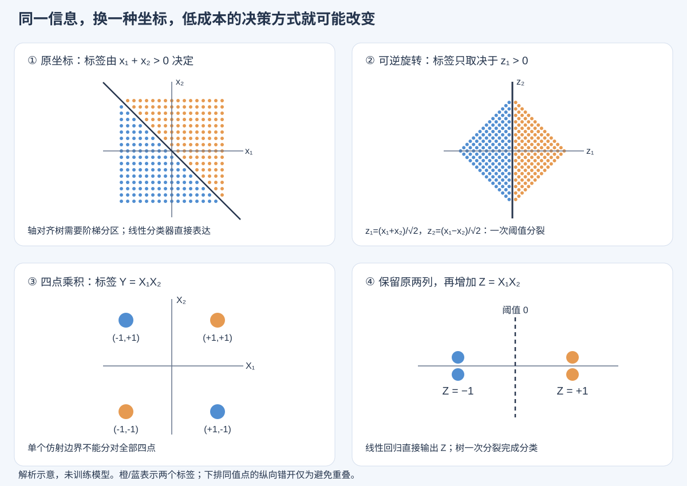

# 信息相同，为什么换一种特征表示，模型就更容易学？

> **核心结论：信息决定理想预测的上限；表示、模型和训练过程共同决定，在有限数据与计算预算内，能接近这个上限到什么程度。**  
> 确定性特征工程的主要作用，是把目标关系改写成当前学习系统容易表达、容易搜索、容易稳定估计的形式。它可能改变函数类，也可能只改变参数化、正则化与优化路径；没有普遍的收益保证。

本文是围绕问题组织的文献综合与数学分析，不是单篇论文逐节翻译。标为“数学推导”的部分是本文自行推导；标为“论文证据”的部分给出一手来源；跨模型的“容易/困难”指明确条件下的结构倾向，不是无条件性能排名。检索与核验日期：2026 年 11 月 6 日。

配套：[论文清单与证据边界](./02_论文地图与检索记录.md) · [实验设计与可复核例子](./03_验证方案与数学例子.md)

## 1. 先澄清：“信息相同”至少有四种含义

设一条样本的原始输入为 $X$，标签为 $Y$，新表示为 $Z=\phi(X)$。以下结论假设变换固定、不使用测试标签、没有额外的数据源。

### 1.1 在原特征旁添加确定性交叉：信息严格相同

例如从价格 $p$、数量 $q$ 构造总额 $pq$，并保留原来的两列。由条件互信息的链式法则：

$$
I(Y;X,\phi(X))
= I(Y;X)+I(Y;\phi(X)\mid X)
=I(Y;X).
$$

因此，知道完整 $X$ 的无限能力预测者，不会因为额外看到 $\phi(X)$ 而获得新的观测信息。对同一损失函数，允许所有可测预测规则时，两者的 Bayes 最优风险相同。

但这不是说实际模型已经能有效计算 $\phi$。信息论没有向预测者收取“从原始坐标计算乘法、比值、周期或组合关系”的成本。

### 1.2 用新表示替换原特征：不一定信息相同

一般只能保证数据处理不等式：

$$
I(Y;\phi(X))\le I(Y;X).
$$

若 $\phi$ 可逆，则等号成立；若 $\phi$ 不可逆，但对任务充分，即 $Y\perp X\mid\phi(X)$，也可以保持关于 $Y$ 的信息。把时间戳替换成小时、把行为序列替换成平均 embedding、把连续值分桶，都可能损失任务相关信息。

因此，“高维变低维”“做了 embedding”“加了 attention”本身，都不能证明输入信息相同。

### 1.3 行内计算相同，不代表整个学习系统没有引入知识

手工指定 $pq$ 这一候选，本身表达了“应优先寻找乘法关系”的先验。数值计算没有创造新的观测信息，但设计者已经替模型缩小了搜索范围。

若变换依赖训练集 $D$，如目标编码、监督分桶、训练好的 embedding，则应讨论固定 $D$ 后的 $\phi_D(X)$。历史统计、外部知识图谱或预训练权重还可能引入原始单行之外的信息。不能把这些收益全部解释成“同一条样本换了坐标”。

**公平性原则：** 既要记录输入字段，也要记录生成表示所用的数据、标签、先验和计算成本。

### 1.4 “相同信息”不等于“相同可用信息”

Xu 等提出 $\mathcal V$-information：相对于受限预测函数族，定义标签的可预测程度。确定性计算可以增加这个受限意义下的可用信息，而不违背 Shannon 信息的数据处理不等式。这个框架直接回答了本题的信息论疑问。它本身仍不是某次 SGD 训练一定成功的保证。[Xu et al., ICLR 2020](https://arxiv.org/abs/2002.10689)

为直观说明，可以写成：

$$
H_{\mathcal V}(Y\mid Z)
=\inf_{q\in\mathcal V}
\mathbb E[-\log q(Y\mid Z)],
$$

$$
I_{\mathcal V}(Z\to Y)
=H_{\mathcal V}(Y\mid\varnothing)-H_{\mathcal V}(Y\mid Z).
$$

这里要求预测族满足相应的“可以忽略输入”条件。$H_{\mathcal V}$ 是预测族中的最优总体对数损失，不是有限数据、有限训练预算下实际测得的损失。

**实际问题还要再加一层：** 即使存在低损失的 $q\in\mathcal V$，具体优化器能否在给定时间内找到它？

## 2. 为什么原特征已有信息，构造交叉仍然有收益？

可以把原因分为六类。它们会同时发生，不应把所有收益都称为“增加表达能力”。

| 机制 | 具体改变了什么 | 例子 | 可能付出的代价 |
|---|---|---|---|
| 改变受限函数类 | 原坐标下复杂的函数，在新坐标下变成简单函数 | 线性模型加入 $x_1x_2$ | 增加维度、过拟合 |
| 提高表示效率 | 同一关系需要更少的层、叶子、参数或更小的范数 | 树加入 $x_1+x_2$ 后一刀表达斜阈值 | 错误先验限制其他关系 |
| 改善搜索信号 | 将多步联合发现变成可直接发现的单变量信号 | 平衡 XOR 加入乘积特征 | 大量伪交叉会制造偶然信号 |
| 改善数值条件 | 改变尺度、曲率、梯度方向和步长适配 | 标准化、白化 | 原有正则化含义随之变化 |
| 改变统计共享方式 | 让不同样本共享参数，或压缩自由度 | FM 的低秩交互、类别 embedding | 共享假设错误时欠拟合 |
| 改变训练偏好 | 同一函数有不同参数成本与学习速度 | 重复特征改变 Ridge 惩罚；周期编码改变优先拟合的模式 | 可能强化捷径、损害分布外泛化 |

### 2.1 最干净的数学例子：乘积信息已经在两列中，线性模型仍取不出来

令 $X_1,X_2$ 独立、均匀取 $\{-1,+1\}$，目标为：

$$
Y=X_1X_2.
$$

这是与 XOR/XNOR 等价的奇偶关系，交换标签正负不影响学习难点。所有数据只有四种：

| $X_1$ | $X_2$ | $Y$ |
|---|---|---|
| $-1$ | $-1$ | $+1$ |
| $-1$ | $+1$ | $-1$ |
| $+1$ | $-1$ | $-1$ |
| $+1$ | $+1$ | $+1$ |

**数学推导：**

$$
\mathbb E[Y]=0,\qquad
\mathbb E[X_1Y]=\mathbb E[X_2]=0,\qquad
\mathbb E[X_2Y]=0.
$$

在平方损失下，最优仿射线性预测器 $b+w_1X_1+w_2X_2$ 为零函数，最小风险是 $1$。加入 $Z=X_1X_2$ 后，预测器 $\hat Y=Z$ 的风险为 $0$。

与此同时：

$$
I(Y;X_1,X_2)=1\ \text{bit},\qquad
I(Y;X_1,X_2,Z)=1\ \text{bit}.
$$

**信息一 bit 都没增加，但对线性回归的价值从不可用变成完全可用。** 改变的是“输入表示与模型函数族的组合”。

四点无法被仿射边界全分开的理由也很直接：若两个对角正例的打分均大于零，两式相加要求截距为正；另外两个负例的打分均小于零，两式相加又要求截距为负。无严格分离解；而一个仿射边界可以只分错一个角点。

这里必须指明损失：如果改成仿射分类器的 0–1 分类误差，四点问题的最佳错误率是 $1/4$，不能沿用“线性回归输出零”就声称所有线性分类器只能随机猜。

### 2.2 表达出来与搜出来，是两件事

同一个四点问题，一棵深度为 2 的树完全能表达：先切 $X_1$，再在两个子节点切 $X_2$。

但在根节点，无论按 $X_1$ 还是 $X_2$ 分裂，左右两边仍各有一半正例、一半负例；总体上的熵/Gini/MSE 改善都是零。一个只接受正收益、逐步贪心生长的树，可能在第一步就停住。

这说明：

- **表示上：** 深度 2 足够。
- **算法上：** 达到好解需要先走一步即时收益为零的分裂。
- **交叉后：** $Z=X_1X_2$ 与标签直接对应，一次阈值分裂即可分类。

这是对理想平衡分布的推导。有限样本噪声、强制生长、零增益处理和具体实现可能使树继续生长，所以不能写成“XGBoost 无法学习 XOR”。XGBoost 的贪心分裂与正则化目标见其原论文；本文的 XOR 是用来分析这一搜索机制的例子。[Chen & Guestrin, KDD 2016](https://arxiv.org/abs/1603.02754)

两比特问题对小 MLP 往往也很容易。真正的启示是“存在性不保证搜索路径”，不是“所有交叉都让神经网络难以训练”。

### 2.3 不增加函数类，也能改变结果：复制特征与 Ridge

**数学推导：** 只有一列 $x$ 时，模型为 $ax$，Ridge 惩罚为 $\lambda a^2$。复制这列后模型为 $(u+v)x$；对固定有效系数 $a=u+v$：

$$
\min_{u+v=a}\lambda(u^2+v^2)
=\frac{\lambda a^2}{2}.
$$

复制前后：

- 输入信息相同；
- 可以表示的预测函数相同；
- 同一个有效系数的最小正则化成本变为一半。

因此，固定 $\lambda$ 的实验结果可能改变。变化来自正则化几何；如果重新匹配惩罚强度，这个特定差异可以消除。

**重要推论：** “加特征后提升”甚至不足以单独证明模型原先缺乏表达能力，也可能只是改变了有效正则化。

### 2.4 表示可以把复杂关系变成模型偏好的简单关系

图中上排是可逆旋转，下排是保留原特征并增加确定性乘积。颜色是解析定义的标签，未训练任何模型。它说明决策边界相对坐标轴的位置会改变，不代表某个模型已经取得这些实验结果。

“简单”必须说明相对于谁：

- 对轴对齐树，一维阈值简单，倾斜边界通常需要阶梯状分区。
- 对线性模型，任意方向的超平面都简单，但乘积通常不简单。
- 对含乘法的结构，低阶多项式自然；周期关系或除法未必自然。
- 对距离模型，表示决定哪些样本邻近，尺度和无关维度尤其重要。

没有脱离模型与算法的统一“最简单表示”。

## 3. “理论上能表达”和“实际训练能学出来”之间隔着什么？

### 3.1 通用逼近定理是存在性结果

Cybenko 的经典结果在其激活函数与定义域等条件下说明，单隐藏层网络可以逼近相应连续函数。它不直接给出工程上合适的宽度、范数、样本量、SGD 训练时间，也不保证范围外的数值外推。[Cybenko, 1989](https://doi.org/10.1007/BF02551274)

“MLP 是通用逼近器，所以无需特征工程”遗漏了至少五个问题：

1. **资源：** 给定宽度与深度是否够，而不是允许无限扩展后是否够？
2. **表示成本：** 好解是否需要很大的参数、很精细的分段或极高精度？
3. **可识别性：** 有限样本能否把目标规律与其他拟合规律区分开？
4. **优化：** 初始化与梯度更新能否找到这种解？
5. **泛化：** 找到的解是否在新样本与新分布上继续成立？

深度分离理论提供了“不同结构以极不相同的规模表示某些函数”的构造性证据；它不是“所有深网络在所有任务上更好”的定理。[Telgarsky, COLT 2016](https://proceedings.mlr.press/v49/telgarsky16.html)

### 3.2 用一个有条件的风险上界分开三种差距

固定表示 $\phi$，把对应的原始输入函数族写成：

$$
\mathcal H_\phi=\{x\mapsto f(\phi(x)):f\in\mathcal F\}.
$$

设训练得到 $\hat h\in\mathcal H_\phi$，其经验风险距离该函数族内的最优经验风险不超过 $\varepsilon_{\mathrm{opt}}$。令

$$
\delta_D=\sup_{h\in\mathcal H_\phi}|R(h)-\widehat R_D(h)|.
$$

则直接加减经验风险可得：

$$
R(\hat h)-R^*
\le
\underbrace{\inf_{h\in\mathcal H_\phi}R(h)-R^*}_{\text{受限函数类的逼近差距}}
+
\underbrace{2\delta_D}_{\text{总体与样本风险的差距}}
+
\underbrace{\varepsilon_{\mathrm{opt}}}_{\text{经验优化差距}}.
$$

这里 $R^*=R_X^*$ 是使用完整原输入时的 Bayes 风险。若表示有损，第一项同时包含信息损失 $R_Z^*-R_X^*$ 和受限函数类的逼近差距 $\inf_{h\in\mathcal H_\phi}R(h)-R_Z^*$；严格保信息时前者为零。

这是本文的解释性推导。要把 $\delta_D$ 变为有用的高概率界，需要独立同分布、损失尾部、函数类复杂度等条件；对大型深网，直接的统一收敛界可能非常宽松。若 $\phi$ 由同一训练集自适应选择或学习，还需把表示搜索纳入复杂度分析，或使用合适的数据拆分。若显式正则化，应把约束纳入函数族，或另外分析惩罚目标，不能把正则化损失混作原始风险。

这一上界的用途是辨别机制：

- 新表示可能降低逼近差距；
- 也可能减小有效复杂度、改善样本效率；
- 还可能让优化更快；
- 也可能扩张函数类、放大估计误差或恶化数值条件。

**一个方向变好，不保证总风险下降。** 三项也不是可从一份离线成绩单直接、唯一分解出来的因果贡献。

### 3.3 梯度不是在所有可表达函数中均匀搜索

训练过程会偏爱某些解。频谱偏置研究在所分析的网络与设置中发现，较低频的函数成分通常更早被拟合；这有助于解释为何周期编码或合适的数值 embedding 可能改变学习速度，但不能简化为“所有高频都难学”。[Rahaman et al., ICML 2019](https://proceedings.mlr.press/v97/rahaman19a.html)

在可分线性分类、特定损失尾部和步长条件下，梯度下降会趋向特定最大间隔方向，说明优化器即使没有显式写出某项正则，也会选择特定解。[Soudry et al., JMLR 2018](https://jmlr.org/papers/v19/18-188.html)

**本文推论：** 换表示可能改变参数空间中的路径、距离和“什么解便宜”。即使最终可表达函数族相同，实际学习偏好仍可能不同。不能把上述特定理论直接推广成任意深网的精确描述。

### 3.4 数值条件不是次要实现细节

在线性最小二乘中，损失曲率由特征二阶矩决定；特征中心化后对应协方差。若两个方向的曲率相差 $10^6$ 倍，固定步长既要避免陡方向发散，又要沿缓方向前进。适当缩放可以改变这种病态条件，而不改变无限制线性模型的函数集合。

Adam、归一化层和二阶方法能缓解部分问题，但不保证对任意重参数化完全不变。比较“原始特征 vs 新特征”时，学习率、权重衰减、初始化与早停都可能需要重新选择。

### 3.5 插值、外推与发现真实算式不能混为一谈

有限 ReLU MLP 是分段仿射函数，因此不能在二维开区域上精确等于连续乘法 $x_1x_2$，但可以在紧集内逼近。一个小网络又可以在前述四个离散点上精确输出乘积。这两句话完全相容。

拟合训练范围内的乘法，也不等于掌握任意数值范围的乘法。NALU、NAU/NMU 等工作把算术操作加入结构，体现了为外推提供专门偏置的路线；这些单元仍有优化与适用范围限制。[Trask et al., NeurIPS 2018](https://arxiv.org/abs/1808.00508) · [Madsen & Johansen, ICLR 2020](https://arxiv.org/abs/2001.05016)

**真正应问：** 在什么输入范围、误差标准和数据分布下，给定结构与训练过程能稳定恢复什么规律？

## 4. 同一个关系，不同模型到底容易或困难在哪里？

以下比较默认输入中包含相同的必要原始变量；不把不同数据量、外部预训练和信息丢失混入结构比较。“容易”表示运算形式与模型结构匹配，不保证一次训练成功。

### 4.1 关系一：连续乘法 $y=x_1x_2$

| 模型 | 如何表示关系 | 主要难点 | 显式提供 $x_1x_2$ 的作用 |
|---|---|---|---|
| 线性/Logistic | 原始加性项不足；Logistic 的链接函数不会自动生成任意交互 | 函数类不匹配 | 回归变为一个系数；分类可在乘积上设阈值 |
| identity-link GAM、仅主效应回归 EBM | 加性输出 $\sum_j f_j(x_j)$ 无法表达一般乘积 | 缺少联合项 | 可把交叉作为新一维输入；或明确加入二维项 |
| XGBoost/LightGBM/随机森林 | 用多个矩形区域上的常数近似曲面 | 叶子/树预算、贪心搜索、边界外常值延伸 | 减少搜索维度；数值回归仍通常需分段拟合 |
| ReLU MLP/ResNet | 以分段仿射函数逼近 | 精度、宽深、学习速度和外推 | 将乘法计算交给特征侧，减少逼近负担 |
| FM/FFM | 预测项含二阶乘积/双线性操作 | 系数共享与秩约束、稀疏数据 | 对已充分建模的二阶项增益可能小 |
| PNN | 产品层提供二阶操作，再由深网组合 | 产品表示与后续网络的优化、统计估计 | 可简化指定关系；完整网络不限于二阶 |
| 普通 DCNv2 cross network | 每层直接乘原始坐标与当前线性组合 | 阶数、系数共享、秩和训练条件 | 可能冗余，也可能绕开受限阶数或不易学习的项 |
| Attention/FT-Transformer | token 的打分有双线性项，再经归一化和聚合 | 评分交互不等于直接输出原始乘积 | 把算术关系明确提供给下游，仍可能有用 |
| 多项式核 | 在隐式多项式特征空间中拟合 | 核阶数、正则化、样本规模 | 若核空间已经含该项，主要改变权重/预算而非新增关系 |
| NAU/NMU 等算术结构 | 在结构内约束加法、乘法 | 学到正确操作选择、数值与训练稳定性 | 结构已提供相应偏置，收益取决于剩余困难 |

这里 GAM 的限制指 identity link 的加性输出；正数域内若允许 log link，$\log x_1+\log x_2$ 可在响应尺度表示乘积。交互“存不存在”也取决于采用什么输出/链接尺度。

特别地，当 $x_1,x_2$ 独立、中心化且目标为乘积时，$\mathbb E[Y\mid X_1]=\mathbb E[Y\mid X_2]=0$。对以条件均值为叶输出、按 MSE 贪心分裂的树，根节点的单变量总体增益也可能为零。不能只把连续乘法的困难理解成“树要很多叶子”。

### 4.2 关系二：倾斜阈值 $y=\mathbf1[x_1+x_2>c]$

- **线性分类器、MLP：** 加法和倾斜超平面直接由线性层表达，通常无需先学习复杂非线性。
- **轴对齐树、常规 GBDT：** 每次只能切单坐标，通常要用阶梯形边界逼近；加入 $s=x_1+x_2$ 后，一次分裂就足够。
- **斜树（oblique tree）：** 若节点允许对线性组合分裂，就已把这个方向搜索放进模型，但优化节点方向的成本也增加。
- **DCNv2、Attention：** 有线性/残差路径时可以表达，但对这种关系没有仅凭更复杂交互机制就必胜的理由。

**结论：** 对树有价值的“加和特征”，对一个已充分训练的线性模型可能完全冗余。

### 4.3 关系三：XOR 与更高阶奇偶关系

- **线性加性模型：** 缺少所需交互；两比特时加入乘积即可修正。
- **浅树：** 深度 2 可表达两比特 XOR，但正增益贪心规则可能缺乏第一步信号。
- **MLP：** 两比特时很小的网络就可精确表示；高阶时是否困难还取决于分布、初始化、冗余变量和训练方法。
- **FM：** 主要提供二阶结构，一般高阶奇偶不能仅靠二阶回归项直接表达。
- **DCN/CIN/高阶多项式：** 明确增加可用交互阶数，但也要承担高阶搜索与系数估计成本。

不能把“某种梯度算法在某分布上困难”说成“该关系不可学习”。已知任务族且无噪声的布尔 parity 可以用 GF(2) 上的线性代数学习；神经网络学习 parity 的正反结果也依赖设定。[Shalev-Shwartz et al., ICML 2017](https://proceedings.mlr.press/v70/shalev-shwartz17a.html) · [Daniely & Malach, NeurIPS 2020](https://arxiv.org/abs/2002.07400)

### 4.4 关系四：类别组合——任意记忆，还是低秩共享？

设用户类别为 $a$、物品类别为 $b$，真实关系可以写为矩阵 $M_{ab}$。

- **类别 pair one-hot + 线性模型：** 每个组合有独立参数，能记忆复杂、无规则的组合。但长尾 pair 数据不足，未见组合无法仅凭这个参数得到可靠预测。
- **矩阵分解/FM：** 用 $\langle u_a,v_b\rangle$ 共享统计强度。若关系近似低秩，且观测到的组合足以估计共享因子，就有机会用更少参数预测部分未见组合；任意高秩关系则可能欠拟合。
- **FFM：** 同一特征根据对方字段使用不同 embedding，增加表达自由度，同时增加参数和稀疏估计负担。
- **DeepFM、Wide & Deep：** 把显式低阶/记忆路径与深层组合路径结合，分别承担不同归纳偏置。
- **CatBoost：** 有监督类别统计及类别组合处理，重点是如何利用类别信号并控制目标泄漏；不是把任意高基数 pair 都免费学好。
- **Attention：** 可以根据其他字段动态组织表示，但 embedding 维度、训练样本和共享方式仍决定能否估计具体 pair 关系。

这里“学得容易”不仅指算式长短，还指**如何跨样本共享证据**。独立 pair 参数更自由，但自由不等于容易估准。

### 4.5 关系五：周期、比率、差值与距离

| 关系 | 有用的表示 | 为什么可能有用 | 必须说明的边界 |
|---|---|---|---|
| 日内周期 | $\sin(2\pi t/T),\cos(2\pi t/T)$ | 把周期端点邻近性显式交给线性层或距离模型 | 单一正弦基不足以表达所有周期形状；若只保留相位会丢掉绝对时间 |
| 比率回归 $x_1/x_2$ | 比率、适用时的对数差 | 减少模型自行近似除法的负担 | 分母近零、符号变化与噪声放大；需要定义合法域 |
| 比率阈值 $\mathbf1[x_1/x_2>c]$ | 比率，或 $x_1-cx_2$ | 对树可变成一维分裂 | 当 $x_2>0$ 时本来就是线性边界，不能拿它证明 MLP 难以表达除法 |
| 差值、相对变化 | $x_1-x_2$、相对基准偏差 | 把“比较”而非“绝对水平”作为候选 | 线性模型已能表示差值；收益可能来自正则化或训练预算 |
| 欧氏距离 | $\lVert u-v\rVert^2$，或分量平方与交叉 | 将多维关系压成可直接使用的统计量 | 压缩可能丢失方向；先验距离是否符合任务需检验 |
| 局部不规则响应 | 分桶、样条、分段线性 embedding | 让局部响应由局部基函数表示 | 边界与结点来自训练集；过多分桶增加方差 |

数值 embedding 研究提供了实证支持：对标量数值先做合适的向量编码，可以改善多个深度骨干，不是 Transformer 专享的能力。[Gorishniy et al., NeurIPS 2022](https://arxiv.org/abs/2203.05556)

### 4.6 关系六：候选物品与用户历史中的“哪个行为相关”？

若模型输入保留同一份完整历史 $H=(h_1,\ldots,h_m)$ 与候选 $q$：

- **固定长度拼接 MLP：** 可以表达复杂关系，但需要自行学会位置处理、匹配和聚合。
- **DeepSets/池化结构：** 给出集合不变性，适合与排列无关的统计；聚合形式会约束可保留的关系。
- **Attention/DIN 类结构：** 让候选参与历史元素的权重计算，提供“先匹配、再聚合”的计算路径。
- **手工匹配特征：** 例如候选与历史的最大相似度、同类次数、最近一次间隔，可以直接暴露指定统计；是否充分取决于任务。

这里最容易偷换概念：**“平均历史向量”与“完整历史序列”通常不是相同信息。** 用后者取得提升，可能同时包含保留更多信息与更好计算结构两种原因。

DIN 的局部激活权重也不是标准 softmax attention 的简单同义词，其设计允许未归一化的兴趣强度。不要因为都有加权求和就抹掉这种差别。[Zhou et al., KDD 2018](https://arxiv.org/abs/1706.06978)

## 5. 不止几个模型：按“内置的运算与共享方式”理解模型家族

### 5.1 树模型家族：离散分区、局部选择与贪心生长

**XGBoost/GBDT** 逐步拟合残差或梯度信息，基础树通常做轴对齐划分。它对阈值、不连续、局部规则和少量关键列有合适偏置；不是因为树不需要表示，而是原始列方向经常已经提供了有用表示。

**LightGBM** 的生长、分桶及效率设计改变了在给定时间内可搜索的树；并没有把每个节点变成任意多变量算术单元。**CatBoost** 则专门处理类别统计与训练偏移问题。**随机森林/ExtraTrees** 通过随机化和平均降低部分方差，不能由此消除轴对齐表示成本。**斜树** 直接改变节点的原语。**NODE** 用可微的 oblivious decision ensembles 把树式偏置引入端到端训练。

有一个很实用的边界：对理想的精确单变量阈值树，严格单调变换保留或反转样本排序，因而保留可选阈值分区。因此，单独对一列取合法域内的对数，通常不像构造多列交叉那样改变树的表达几何。直方图近似、有限精度、抽样、缺失值或实现细节可能打破这种理想等价。

这里说的是模型原语；不同软件和参数配置仍需单独评估。[XGBoost](https://arxiv.org/abs/1603.02754) · [LightGBM](https://proceedings.neurips.cc/paper_files/paper/2017/hash/6449f44a102fde848669bdd9eb6b76fa-Abstract.html) · [CatBoost](https://arxiv.org/abs/1706.09516) · [NODE](https://arxiv.org/abs/1909.06312)

### 5.2 MLP、ResNet、RealMLP、TabM：同名骨干不等于同一个学习系统

普通 MLP 反复做仿射变换和逐点非线性。连续交互往往通过隐层组合间接形成，具体难度取决于宽度、激活、尺度和优化。

ResNet 的残差连接改变深层优化路径；数值 embedding 改变进入第一层的基函数；RealMLP 组合预处理、初始化和训练设置；TabM 利用共享权重的多个预测分支做参数高效集成。后两类不是简单“换了一个激活函数”。

**因此，拿未经充分调参的原始标量 MLP 与带 embedding、规范训练和集成的 Transformer 比较，不能把全部差异归因于 attention。** 对照实验必须把输入表示、骨干、优化和集成分开。[Revisiting, 2021](https://arxiv.org/abs/2106.11959) · [RealMLP, 2024](https://arxiv.org/abs/2407.04491) · [TabM, 2025](https://arxiv.org/abs/2410.24210)

### 5.3 FM、FFM、DeepFM、PNN、xDeepFM：把乘法与共享规则写入结构

FM 的标准二阶形式为：

$$
\hat y=w_0+\sum_i w_ix_i+
\sum_{i<j}\langle v_i,v_j\rangle x_ix_j.
$$

它不必枚举并独立估计每一个 pair 系数，而用向量内积共享参数。这既是优势，也是约束。FFM 增加字段条件化的向量；DeepFM 将 FM 路径与深层路径结合；PNN 把乘积作为中间操作；xDeepFM 的 CIN 设计了显式的向量级组合。这些模型在“交互如何计算、系数如何共享”上并不等价。[FM](https://libfm.org/index.html) · [FFM](https://www.csie.ntu.edu.tw/~cjlin/papers/ffm.pdf) · [DeepFM](https://arxiv.org/abs/1703.04247) · [PNN](https://arxiv.org/abs/1611.00144) · [xDeepFM](https://arxiv.org/abs/1803.05170)

**本文解释：** 显式二阶操作让“存在乘法”这件事不再需要由通用网络逐步近似；但哪个 pair 值得学习、它的系数是多少、低秩共享是否合适，仍然要从数据中估计。

### 5.4 DCNv2：明确的乘法路径，不是无条件交叉求解器

普通 DCNv2 cross layer 为：

$$
x_{\ell+1}
=x_0\odot(W_\ell x_\ell+b_\ell)+x_\ell.
$$

$x_0$ 是进入 cross network 的原始向量，可能是数值特征和类别 embedding 的拼接；$\odot$ 表示逐元素乘法。低秩分解减少矩阵成本；组合方式还可选择与 deep 分支并联或串联。[Wang et al., WWW 2021](https://arxiv.org/abs/2008.13535)

**以下是由公式得到的结构分析：**

- 第一层可直接产生二阶单项式；若不引入额外输入相关门控或非线性，$L$ 个 cross layer 的输出最高次数不超过 $L+1$，合适参数下可达 $L+1$。
- 次数是相对于 $x_0$ 坐标而言。如果输入已经包含乘积、非线性数值 embedding，或先经过其他网络，不能直接说它对原始业务字段也只有 $L+1$ 阶。
- 高阶系数由多层矩阵乘积组织，并不等于每一个高阶单项式都有独立自由参数。
- 低秩分解会进一步约束可实现交互；增加层数也不能解决所有样本稀疏与训练稳定性问题。
- 带门控专家、非线性或深分支的完整模型，不再由这个简单的多项式次数界完整描述。

DCNv1 的原公式含 $x_0(w_\ell^\top x_\ell)$，共享更强；其原论文的偏置位置与上述公式不同，不能在不处理偏置时简单宣布“令矩阵为某种秩一形式就完全等同”。[DCN v1](https://arxiv.org/abs/1708.05123)

如果目标关系本来就是易估计的低阶交叉，DCNv2 可能减少人工特征的边际收益。如果业务交叉是精确比率、复杂条件统计、超出当前阶数的组合，或特定交互在训练中不容易被发现，显式特征仍可能有用。**“结构中有 cross”不等于“所有有用 cross 都已学好”。**

### 5.5 Attention、AutoInt、FT-Transformer、TabTransformer：内容相关的交互与聚合

标准 attention 的核心为：

$$
\operatorname{Attention}(Q,K,V)
=\operatorname{softmax}\left(\frac{QK^\top}{\sqrt d}\right)V.
$$

一个数值字段或类别字段如何变成 token，字段身份如何编码，哪些 token 可以交互，最终使用什么输出头，都会影响可学习性。[Vaswani et al., NeurIPS 2017](https://arxiv.org/abs/1706.03762)

**由公式得到的分析：** $QK^\top$ 的确包含双线性打分，但经过 softmax 后是相对权重，再对 $V$ 加权；它不等同于把每个 $x_ix_j$ 当成独立显式数值交给预测头。softmax 具有平移不变性并产生归一化权重，也不会自动保证精确乘除法或数值外推。

AutoInt 用多头自注意力建模特征交互；FT-Transformer 包含数值和类别 tokenization；TabTransformer 主要围绕类别字段的上下文化 embedding。不能把三者的输入机制当成完全相同，也不能把 AutoInt 所说的交互阶数直接视为 DCN 的严格多项式次数。[AutoInt](https://arxiv.org/abs/1810.11921) · [FT-Transformer](https://arxiv.org/abs/2106.11959) · [TabTransformer](https://arxiv.org/abs/2012.06678)

**容易的方向：** 根据当前内容选择交互对象、整合多字段上下文。  
**仍可能困难的方向：** 数值精确计算、特定长尾组合的可靠估计、不合适 tokenization 下的复杂局部响应，以及有限预算内的训练。

### 5.6 其他家族提醒我们：学习难度还取决于“比较方式”和“先验来源”

| 家族与例子 | 核心偏好 | 表示为什么重要 |
|---|---|---|
| GAM、样条、EBM/GA2M | 单变量平滑或分段响应，加上选定低阶交互 | 显式基函数与交互集合决定可拟合关系 |
| RBF-SVM、核岭回归 | 相似输入有相似输出，由核定义平滑与复杂度 | 尺度、距离、核宽度决定相似性 |
| kNN、ModernNCA | 通过邻域共享标签证据 | 表示决定近邻；无关维度可扭曲距离 |
| TabR | 学习检索和样本间标签聚合 | 使用训练记忆的方式变了，且需计入检索成本 |
| TabNet | 逐步选择稀疏特征并进行非线性处理 | 选择机制可抑制无关列；仍需学交互 |
| CNN | 局部性、平移共享 | 有意义的邻接关系让共享有用；任意排列的表格列通常不具备这种结构 |
| GNN | 已给定图上的邻域聚合 | 图结构可能是额外信息；若由同一 $X$ 构图，则同时引入邻接先验与计算 |
| TabPFN | 从预训练任务中学习预测程序/先验 | 小样本能力包含跨任务训练贡献，不能全归因于当前表的表示 |

GAM/GA²M 与 EBM 的机制可参阅[成对可解释模型](https://www.cs.cornell.edu/~yinlou/papers/lou-kdd13.pdf)和[InterpretML](https://arxiv.org/abs/1909.09223)；显式随机基函数如何近似核，见[Random Features](https://papers.nips.cc/paper_files/paper/2007/file/013a006f03dbc5392effeb8f18fda755-Paper.pdf)。

TabPFN、TabR 和 ModernNCA 是很有价值的比较对象，但它们改变的不只是单行特征编码。因此必须说明“同信息”是对单行输入、整份训练数据，还是包括预训练知识的整个系统而言。[TabR](https://arxiv.org/abs/2307.14338) · [ModernNCA](https://arxiv.org/abs/2407.03257) · [TabNet](https://arxiv.org/abs/1908.07442) · [TabPFN](https://www.nature.com/articles/s41586-024-08328-6)

## 6. 为什么特征价值随模型、已有特征与训练方式变化？

### 6.1 先给“价值”一个可检验定义

把训练过程记为 $A$，包含模型族、预处理、优化器、正则化、超参数选择和预算 $B$。已有特征集合为 $S$，候选为 $z$，测试分布为 $P$。定义：

$$
\Delta(z\mid S,A,n,B,P,\ell)
=
\mathbb E\!\left[
R_P(\hat f_{S,A,n,B})
-
R_P(\hat f_{S\cup\{z\},A,n,B})
\right].
$$

期望覆盖训练样本与训练随机性；两边应使用成对的数据划分，并清楚约定是否分别调参。$\Delta>0$ 表示在这套条件下添加特征有收益。这是本文的操作性定义，不冒充某篇论文的定理。

这个式子把容易被省略的条件写全了：

- **模型不同：** 同一 $z$ 是否已可低成本表示不同。
- **已有特征不同：** 是否已经有替代变量、交叉或隐表示不同。
- **样本量不同：** 独立参数是否估得准不同。
- **预算/训练不同：** 原始模型能否自己发现关系不同。
- **分布不同：** 训练时有效的关联是否继续成立不同。
- **损失不同：** 排序、概率校准、尾部误差的价值不同。

不加这些条件的“这个特征有多重要”，通常没有唯一答案。

### 6.2 价值不是各列独立相加：替代与互补同时存在

**替代：** 已有几乎同等可靠的总额特征时，再加入价格与数量的乘积可能收益很小；去掉原有总额后，它又可能很重要。

**互补：** 在乘积任务里，单看 $X_1$ 或 $X_2$ 都没有标签信息，但两者联合可确定标签。某列的边际价值可能随已有特征增加而增大，而不是必然递减。

**模型条件化：** 即使 $S$ 已包含两个原始变量，线性学习器仍可能需要 $X_1X_2$；一个已充分训练的适配乘法模型则未必需要。

所以，一次单变量筛选可能删掉有用交互的组成部分；对一个模型“冗余”，也不代表对另一个模型冗余。

### 6.3 更强模型会降低人工特征收益吗？

可能，但不保证。

如果新模型已经低成本表达并稳定学出 $z$ 所代表的关系，那么 $z$ 的边际收益可能下降。随着更多样本、更长训练或更好预训练，原有人工“提示”也可能变得多余。

但更强的模型仍然是有限预算系统：它可能仍偏好错误捷径、受到数值条件影响，或缺乏某个业务操作的先验。新特征也可能与新结构互补。

因此，“更强模型不需要特征工程”与“人工特征永远有收益”都不是可由通用逼近或单个 benchmark 推出的结论。

### 6.4 训练方法会重新定义“便宜的函数”

- 早停改变模型来得及学到哪些关系。
- 权重衰减与输入缩放共同决定惩罚几何。
- Dropout、特征采样会改变模型对相关特征族的依赖。
- 重采样、负采样与样本权重改变有效训练分布和目标。
- 集成可能降低某些不稳定交互的方差。
- 预训练把当前训练集之外的先验带入初始化或预测程序。
- 辅助任务与中间监督可能显著帮助训练，但必须计入新增监督。

这些变化可以改变 $\Delta$，即使原始字段完全不动。

### 6.5 特征重要性、增量价值、信息与因果不是同一个量

Fisher 等研究模型类依赖度，强调多个预测同样良好的模型可能依赖不同变量。这为“重要性不能脱离模型”提供了直接依据。[Fisher et al., JMLR 2019](https://www.jmlr.org/papers/v20/18-760.html)

| 问法 | 实际在测什么 | 不应误读成什么 |
|---|---|---|
| 树 split gain、SHAP 等 | 指定模型、指定分布/背景与解释规则下的使用或归因 | 加列并重新训练后的收益 |
| Attention 权重 | 模块中的聚合权重 | 该字段的全局因果贡献 |
| 单变量互信息/相关性 | 单列与目标的统计依赖 | 联合交互的全部价值 |
| 条件互信息 $I(Y;z\mid X)$ | 完整 $X$ 已知后的新增信息 | 受限算法的学习便利性 |
| 删除/添加后重新训练 | 指定训练流程下的条件预测增量 | 因果干预效果或普遍重要性 |

特别地，若 $z=g(X)$，则 $I(Y;z\mid X)=0$，但 $\Delta$ 可以为正。

普通 permutation importance 若只打乱 $z$ 而保留父特征，会制造不满足 $z=g(X)$ 的输入，可能把分布外破坏误认为高增量价值。若严格给定完整父特征，确定性 $z$ 又没有独立的条件随机性可供置换。此时应优先采用“保留父特征、移除派生特征组并重新训练”的对照。

条件 probing 的研究也强调，评价表示应明确已有 baseline，并比较加入表示后额外可预测的部分；“比 baseline 单独更好”与“在 baseline 之上提供增量”是不同问题。[Hewitt et al., EMNLP 2021](https://arxiv.org/abs/2109.09234)

### 6.6 容易学不等于值得学

一个容易读取、在训练集里高度相关的代理变量，可能使优化器更快依赖它，而忽视较复杂但更稳定的规律。关于 simplicity bias 的研究提供了这类构造与实验。[Shah et al., NeurIPS 2020](https://arxiv.org/abs/2006.07710)

因此，一项表示的目标应是：**让稳定且与部署目标有关的规律更容易被学到**。只缩短到达低训练损失的时间，不能证明它改善了泛化。需要时间外推、实体外推或环境变化下的验证。

## 7. 论文证据能支持到哪一步？

### 7.1 最贴近本题的证据

| 证据 | 设计与发现 | 可以得出的结论 | 不能得出的结论 |
|---|---|---|---|
| V-information（2020） | 对受限预测族定义可用信息 | Shannon 信息相同，受限可预测性仍可不同 | 实际 SGD 一定找到族内最优 |
| Fourier Features（2020） | 在低维坐标回归中改变输入编码与学习频谱 | 表示可改变拟合高频成分的速度与泛化 | 任意表格数据加周期特征都会提升 |
| Numerical Embeddings（2022） | 比较同一骨干的数值输入编码 | 编码是多个骨干共享的重要设计维度 | 全部收益都来自编码，且不需要计入参数/调参变化 |
| Tree vs DL（2022） | 旋转、无关特征、平滑等干预 | 模型对方向、无关维度与不规则目标的偏好不同 | 所有干预都保信息，或树永远强于深网 |
| Revisiting（2021） | 统一比较深度基线与训练设置 | 强 MLP/ResNet 基线和规范调参很重要 | 一个固定榜单能覆盖所有任务和训练方式 |

来源：[Xu](https://arxiv.org/abs/2002.10689) · [Tancik](https://arxiv.org/abs/2006.10739) · [Numerical Embeddings](https://arxiv.org/abs/2203.05556) · [Grinsztajn](https://arxiv.org/abs/2207.08815) · [Revisiting](https://arxiv.org/abs/2106.11959)

Grinsztajn 等的研究使用 45 个筛选后的数据集，主实验训练集上限为 10K，并进行较充分超参数搜索。这里最贴题的是可逆旋转：它改变列方向，却不丢失旋转输入的信息。论文中的标签平滑、删特征则是不同干预，不能都称为“换表示”。结论应限制在其数据筛选、模型、预处理和预算下。

### 7.2 较新的模型证据，主要回答“学习程序也重要”

- **TabR（2024）：** 显式利用训练样本检索与标签聚合，说明推断方式可以改变数据利用效率；要另计训练记忆与推断成本。
- **RealMLP（2024）：** 组合预处理、初始化和优化设置说明强默认训练流程的重要性；其后续版本披露过 XGBoost 类别编码错误及部分未重跑结果，不宜照抄细碎排名。
- **TabM（2025）：** 参数高效集成改善 MLP 的性能与效率折中；这不是单一表示变换实验，其旧 TabPFN 基线也不能代表 Nature 2025 版本。
- **TabPFN（Nature 2025）：** 在论文范围内的小表格任务表现强，说明跨任务先验可改善小样本学习；新任务上的低延迟不包括大规模预训练成本。
- **ModernNCA（2025）：** 学习邻域表示与预测规则，可以形成很强的近邻基线；收益同时涉及表示、优化与检索。

来源：[TabR](https://arxiv.org/abs/2307.14338) · [RealMLP](https://arxiv.org/abs/2407.04491) · [TabM](https://arxiv.org/abs/2410.24210) · [TabPFN](https://www.nature.com/articles/s41586-024-08328-6) · [ModernNCA](https://arxiv.org/abs/2407.03257)

这些工作共同反对一种粗糙判断：“某个模型名字已经决定它能学到多少信息。”它们没有证明一种架构在所有表格关系、样本规模和预算下最优。

2026 年检索到一篇直接讨论基础模型是否还需要特征工程的新线索，但页面日期与编号存在未解的元数据不一致，已单列在检索记录，未作为核心论据。

## 8. 最终应形成怎样的判断方式？

### 8.1 对四个原始问题的明确回答

**问题一：原始特征已包含信息，为什么交叉仍有收益？**

因为“包含”只说明理想预测者可以利用；交叉把某种计算和结构先验预先交给模型，可能降低有限模型的表示成本、搜索难度或估计负担，也可能改变正则化。它可以不增加任何 Shannon 信息而提高实际预测效果。

**问题二：理论能表达与训练能学出差在哪里？**

前者是某个参数解存在；后者要求在给定数据、预算、初始化、优化器和约束下找到可泛化的解。资源效率、统计可识别性、优化路径与分布外稳定性，都不能由存在性自动推出。

**问题三：同一关系为什么不同模型难易不同？**

各模型把不同操作作为低成本原语：树偏好轴对齐分区，线性层偏好加性和斜超平面，FM/DCN 偏好特定共享方式的乘法交互，attention 偏好内容相关的匹配聚合，核与近邻依赖距离几何，算术单元提供操作约束。关系与这些原语匹配时，学习负担通常更小；其他关系可能需要昂贵的间接表示。

**问题四：特征价值为什么随模型、已有特征和训练变化？**

因为有意义的价值是条件增量 $\Delta(z\mid S,A,n,B,P,\ell)$，不是附着在列名上的固定属性。替代、互补、正则化、优化预算、分布和评价指标都改变它。

### 8.2 一个可操作的审查顺序

1. **核对信息：** 是行内确定性增广、压缩，还是引入了历史/标签/外部知识？
2. **写出关系：** 是乘法、阈值、周期、比率、局部规则，还是候选相关聚合？
3. **指出困难所在：** 是模型不含这个关系、表示成本高、搜索信号弱，还是样本不足？
4. **检查替代：** 当前已有列、embedding 或结构是否已经提供相同计算？
5. **做成对验证：** 原始输入与增广输入共享样本划分，分别看固定设置与重新调参的结果。
6. **检查全成本与稳定性：** 包括特征构造、训练、推断、维护，以及时间/实体外推。
7. **写出有限结论：** “在这些条件下收益多少、哪些情形失效”，避免升级成无条件模型判断。

完整实验表见[验证方案](./03_验证方案与数学例子.md)。

### 8.3 最值得保留的一句话

> **特征工程是在选择问题的表示方式；模型结构是在选择低成本的计算方式；训练方法是在选择寻找与偏好哪些解。三者共同决定可学习性。评价一个特征，应问它在当前系统中减少了哪一种困难，并验证这种减少能否转化为稳定的部署收益。**
