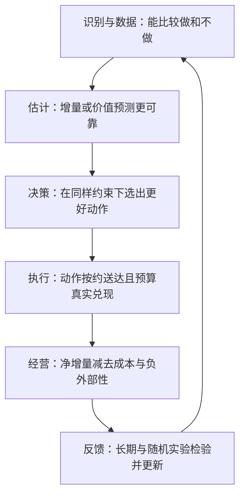

# 从方法改动到真实收益：哪些环节可以替换、哪些不能跳过

返回 [阅读入口](00-阅读入口.md)。本页是跨论文的**分析者归纳**，不是某篇作者给出的统一框架。

## 1. 一条完整收益链需要五次成立

每一跳都可能断。更低预测误差不必然更好排序；更好全曲线AUUC不必然提高实际top-K；更好分数不必然改变现有规则；正确分配不必然送达；短期转化上升不必然提高平台总利润。

一个常见、但仅供理解的**解释性经营目标**是：

$$
\max_\pi\ \mathbb E\!\left[\Delta M(X,\pi(X))-C(X,\pi(X))-H(X,\pi(X))\right],
$$

其中 $\Delta M$ 是相对明确对照策略的增量贡献毛利，$C$ 是增量营销及执行成本，$H$ 是未计入前两项的用户伤害或外部成本；预算、资格、频控另外作为约束。**必须防止重复计成本**：若结果标签本来就是净利润，不应再减一次补贴。原文只报告GMV/成本时，也不能改名为贡献毛利。

## 2. 逐类方法的收益桥梁

|瓶颈|对应论文|改动后必须发生什么|观察到什么说明这条链没成立|
|---|---|---|---|
|归因收割自然需求|ETDC+HCA|校准改变渠道优先级，预算迁移后实验增量更高|误差下降但预算未变，或迁移到饱和渠道|
|局部目标奖励店间替代|CanniUplift|平台监督改变候选排序，跨店净额改善|单店涨、平台不涨；总量标签漏掉候选外消费|
|两头表征共享不当|CHAUN|处理效应排序/校准改善，预算截点收益改善|结果AUC变好但uplift趋零，或top30策略反而更差|
|有限产能下金额错误代价大|VALOR|高价值增量机会被保留，而非只追大客户|金额头更大但随机holdout没有更高增量|
|分配器利用外推误差|ReAlloc|受支持的局部动作净值提升，低置信时不行动|只要限制一放开就虚高，随机扰动方向不对|
|多业务线竞争+闭环偏差|LinkedIn|探索扩支持，LP解决冲突，送达兑现资源|探索概率没记录，或只能增加名义分配无法送达|
|短期获客与复购不一致|Lyft NBA|动作改变后续状态，长期价值在留出/随机试验兑现|提升只存在于同一拟合的转移模型|
|过度触发商业召回|Pinterest|减少计算与曝光，在预设非劣界内控制购物损失并改善普通互动|将不显著误判为等价；库存变化后回放失效|
|用户间传播干扰|Flywheel|全量效应读数校准，少错过有效增长功能|传播分母不稳定、重复归因、不同流量占比结果漂移|
|激励广告价值稀疏、模拟外推|Offline-MBRL|模型样本改善critic，保守性阻止策略吃模型误差|模拟分高、真实收入/曝光下降；只涨曝光不涨利润|
|短期代理与长期决策偏离|长期效果共识|跨实验决策后悔下降，真实长期保留组认可|只在用户随机切分有效，跨实验/机制失效|
|组合触达与配额割裂|BUOPLR|联合时间/样式分配改变实际送达；剪枝损失可接受|只涨点击不涨日级净活跃；删掉同槽竞争的备选动作|
|对照资格与时间窗不对称|Tatari|样本构造减少选择/观察机会差异，测量再指导预算|估计变大但外部实验不一致；匹配后目标总体漂移|
|稀疏实验发布决策不稳|Teads|校准异质性不确定性，并用业务阈值避免低价值上线|将HBM和ROPE的贡献混同；边界未决被误当等价|
|素材组合方差与独立假设偏差|Ad-POM|meta重加权稳定梯度，组内模型保住组合差值|meta太粗遗漏交互；仅oracle结构有效，实用版本失败|

## 3. baseline谱系：继承哪一层，而不是“都用了因果”

|基础范式及原文|它解决的基本问题|2026文章如何改造|不能自动解决的事|
|---|---|---|---|
|[S/T/X meta-learners](https://arxiv.org/abs/1706.03461)|用通用监督学习器构建CATE估计|VALOR换收入分布和排序损失；CanniUplift改监督粒度|未观测混杂、干扰、预算优化|
|[TARNet/CFR](https://arxiv.org/abs/1606.03976)|共享表征、双结果头，CFR增加分布平衡|CHAUN改成跨头信息交互；VALOR作为可插模块|平衡表示不是消除所有混杂的证明|
|[DragonNet](https://arxiv.org/abs/1906.02120)|共享表示中加入处理概率与targeted regularization|LinkedIn加入序列/多产品、探索与约束；CHAUN比较其双头结构|处理概率估得好不等于真实assignment机制可忽略|
|[DML](https://arxiv.org/abs/1608.00060)、[R-learner](https://arxiv.org/abs/1712.04912)|用nuisance模型及残差/正交目标降低一阶估计误差影响|ReAlloc做局部边际teacher与蒸馏；不是单纯再训一次回归|正交性不能让未记录混杂自动消失|
|LP/MCKP资源分配|给定价值后在约束下选动作|LinkedIn全局LP、BUOPLR组合分配、Lyft occupancy LP|求解最优不等于输入价值正确；期望约束不等于逐路径保证|
|离线RL/世界模型|用历史转移优化序贯回报|Offline-MBRL加业务结构与保守critic；Lyft先校正转移再LP|未知分配机制与不受支持的动作不能靠模拟创造识别信息|
|实验增量/网络实验|通过分配设计和readout估效应|ETDC消费实验作为校准标签；Flywheel修网络全量效应|细粒度分摊不是细粒度因果识别；网络外溢不能照搬独立单位SE|

基础论文仅用于定位范式，全部排除在2026新论文计数之外。

## 4. 哪些可以组合

**组合一：平台价值模型 + 约束分配。** CanniUplift式平台标签可以输出候选价值，LinkedIn式LP负责全局配额。接口要统一用户/商品单位、时间窗、处理定义、价值币种与成本；平台视角分数不能又被重复相加计算同一用户总收益。多个券同时发出后存在交互，不能假设一阶价值总是可加。

总量校准不能替代候选排序验证：接入LP前，用随机改变单个候选、固定其他优惠背景的实验检查边际价值；再检查总量误差相近时，不同训练随机种子的候选排序是否稳定。拟合总和的多个分量可能互相抵消，不能因此认为每个候选贡献都已被识别。

**组合二：收入损失 + 现有CATE骨架。** 先把VALOR式零膨胀收入头插入已有T-Learner/DragonNet，再单独考虑排序目标或CHAUN跨头结构。这样可回答“收益来自分布目标还是信息共享”。VALOR的排序标签是transformed outcome，并非原始收入；公开代码的构造/排序目标与论文有差异，须先对齐倾向概率、伪结果与实际损失，再实验金额权重。伪结果条件均值等于uplift，也不自动保证经过符号与非线性权重转换的配对目标仍一致。稳健权重涉及识别敏感度与公式澄清，应独立试验。

**组合三：归因校准 + 定期实验。** ETDC使稀疏实验结果进入日常经营；新渠道、价格变化、严重饱和仍需新实验锚。HCA提供可用的经营分摊，不意味着每个子campaign都有已识别增量。

**组合四：动态策略 + 长期评估。** Lyft的粗状态CMDP可以用于动作选择，长期效果共识约束评估方式。模型OPE与线上长期保留组应是独立的两层；不能用同一世界模型既产生策略又唯一证明策略有效。

## 5. 不能随意替换的对象

- 用户级CATE、渠道级平均增量、商品级预算梯度、网络全量GTE是不同估计对象。
- “发券”与“核销”、“分配广告”与“实际曝光”、“启用召回源”与“最终看到商业内容”是不同treatment。
- 7日点击、30日GMV、折扣LTV、年化前后收入变化不能直接混成一个奖励。
- 实验读数修正与投放策略变化是不同干预：估计器读出更大的效应，不是它创造了更大的业务结果。
- 非显著、等价、非劣是不同结论；相邻两条置信区间重叠也不足以计算两策略差的显著性，需要直接比较差值。

## 6. 第二轮全文补齐后的组合建议

**控制组构造与归因校准可以串联，但需统一目标总体。** [Tatari](论文/Tatari_CEM_DML.md)重构可触达控制和观察窗口，解决观察比较的上游问题；[ETDC](论文/ETDC_HCA.md)消费实验结果做日常归因校准。把matched ATT直接外推到全渠道总量，仍可能遗漏不在共同支持内的用户。Tatari不能取代实验锚，ETDC也不能替它修复上游身份错误。

**“估计器更好”与“发布门槛更合理”分别实验。** [Teads](论文/Teads_分层贝叶斯.md)既改HBM估计器，也用ROPE区分统计与实用意义。其避免一次低价值发布的案例，不能全算成贝叶斯模型收益。用旧/新估计器×零阈值/业务阈值的2×2回测，才知道优先改哪一层。

**组合动作有两种不同问题。** [BUOPLR](论文/BUOPLR.md)的动作是时间×样式，主要输出用户—动作增量给资源求解器；[Ad-POM](论文/AdPOM_组合素材.md)选择整个素材集合，主要改离线策略梯度和组内选择。后者不提供前者所需的多用户预算求解器；前者的单动作增量不能直接当素材集合交互价值。可以借鉴共享、降维和支持域管理，但必须重建动作定义。

**剩余3篇的关系目前只能作为采用假说。** [M-DLRI](待核实/M-DLRI_候选.md)可定位为多杠杆联合响应候选；[TEUM](待核实/TEUM_证据待补.md)为团队干扰及无队友信息的部署候选；[STEAL](待核实/STEAL_证据待补.md)为长期效果评估候选。它们分别对应估计表示、干扰/部署、长期评价，尚无完整原文支持直接替换现有生产模块。

## 7. 第三轮：新增方法如何接入，而不是简单叠模型

|新增条目|输入→改动→中间量→实际动作→收益来源|最小可替换位置|不能省的反证|
|---|---|---|---|
|[FunnelCausalNet](论文/FunnelCausalNet_漏斗与收入.md)|多档券RCT→每档转化×客单→同单位收入增量并锚定ATE→同预算选券→避免只追低客单转化|收入响应头/校准层，可保留分配器|按用户留出；直接GMV、硬漏斗、均值校准分别比较；区间宽2的覆盖可能无信息|
|[TaQFormer](论文/TaQFormer_多维发券.md)|多维券向量→保留各处理坐标→联合响应/交互更准→固定allocator改变组合选择→减少错配券|处理编码decoder；OBS/RCT融合另做消融|TransTEE强基线、RCT-only、同参数预算；融合的额外约0.178%不能说成1.26%|
|[Causal Action Geometry](论文/Causal_Action_Geometry.md)|时间漂移日志→选稳定响应形状→当前重拟合→支持内改价→动作方向更可迁移|连续处理响应及跨时模型选择|固定log较强；同搜索资源；神经生产实现不能直接继承核score定理|
|[美团阈值激励](论文/Meituan_阶梯激励预算.md)|无offer历史+pilot→响应与成本校准→阶梯奖励价值→共享预算选offer→可能少付无效奖励|阈值offer生成/价值与预算模块|回放/controlled laws不是线上净收益；理论预算收紧与实际算法分开|
|[CASH](补充/CASH_广告主补贴.md)|历史响应→按可靠范围许可动作→共享预算影子价不被虚高曲线污染→选补贴档→潜在减少错配|支持域/路由/分配器前的动作许可|已执行档校准不检验未执行档反事实；LLM审计IPW不是补贴去混杂|
|[Spotify](论文/Spotify_双阈值增量推荐.md)|异窗两头→拒绝伪差分→高响应且低自然概率门控→少展示→减少机会成本|最后门控；先冻结p1另学p0也可做机制验证|同曝光随机删减/提高p1；消费非劣界；释放槽位实际去哪|
|[Netflix Blending](论文/Netflix_Blending_代理与北极星.md)|历史多指标实验→去噪效应协方差→随n变化权重→改发布集合→潜在提高组合北极星回报|实验决策读数层|论文/代码先对齐；独立实验折评价；混合检验不严格控北极星5%假阳性|
|[Meridian GeoX](论文/Google_Meridian_GeoX.md)|历史geo序列→分层设计+反事实模型+placebo推断→较可信的lift/区间→少错停/加投→潜在经营收益|实验设计和读数层|设计选择需留出/重演；SMB弱信号、非平稳与跨区泄漏；A/A不能独自证明真实lift精度|
|[Amazon RLM](补充/Amazon_销售损失因果诊断.md)|商品经营日志→残差化/反事实归因→人审建议→商家改价/补货等→销售可能恢复|诊断辅助与建议排序|诊断因子不等于可行动作；共同随机全集ITT，不能以已采纳子组29.14%替代|
|[DCEO](补充/DCEO_长期代理排序.md)|用户4天目标→critic局部响应→代理actor→排序融合→可能改善跨请求GMV|原排序融合的代理分数|同critic自评不是独立因果验证；随机boost扰动核实真实局部响应|
|[GrowthGR](补充/GrowthGR_长期商品增长.md)|交互日志→ItemLTV/多价值奖励→生成召回更偏新品→混排与曝光→新品成熟后订单可能提高|专门新品召回通道/训练奖励|点击未随机；teacher标签自评；全平台/老品挤占及成熟窗必须单列|

**组合必须遵守层级。** FunnelCausalNet/VALOR可以提供“同币种、同窗、同动作”的收益估计，再接LinkedIn式分配；不能把转化者客单差当共同总体效果。TaQFormer学多维券响应，Ad-POM学素材集合策略，BUOPLR学时间×样式，三者只能借鉴表示/支持管理，不能直接交换输出。Netflix解决同时可测低敏目标，STEAL候选处理未成熟长期结果；即使都叫代理也不是同一任务。

**测量到经营还有两个接口。** 第一，历史ATT不等于加一元预算的边际回报，需要剂量/局部扰动；第二，测量准确不意味着人会改变发布/预算行为，要记录实际改了哪些动作、有没有按计划执行。若动作不变，经营收益链到决策处就中断；若执行变了却没有独立增量，链条到最终结果处中断。
