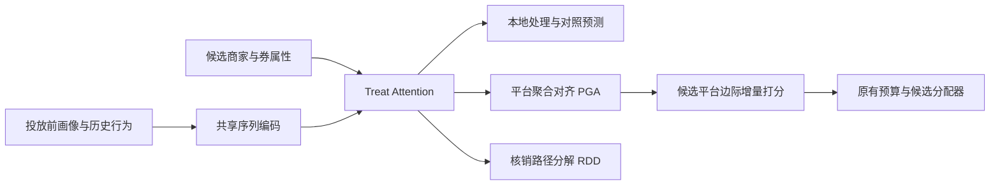

# CanniUplift：把商家局部增量对齐到平台净增量

**独立审计：2026-11-07。采用结论：可开展最小验证。** 已有平台总GMV、商家标签和核销日志时，可先验证PGA/RDD的模块价值；并不等于当前材料足以复现线上收益。**证据状态：全文及附录已核**（arXiv v1，12页；§2—4、附录A—C，原Table 1—4）。首次公开2026-07-06；修订未见；会议2026-08-09—13；正式在线出版日未核。已核企业署名为淘天。

**因果对象。** 样本是用户—候选商家/券，处理为给该商家发券，对照为不发该券，核销是处理后变量。目标是固定其他商家优惠背景时，该券对用户平台总GMV的条件边际效应；不是核销者平均处理效应。业务结果观察窗的确切长度、退款处理和工业训练/验证切分未充分披露，不能把2025-10-05—12的A/B日期当成每条标签的观察窗。训练需各商家GMV、平台总GMV和核销标签；部署只需决策前历史和候选信息，不得使用未来核销/成交。

论文：[CanniUplift: A Holistic Framework for Mitigating Seller and Incentive Cannibalization in E-commerce Uplift Modeling](https://arxiv.org/abs/2607.05242)。[阅读全文](https://arxiv.org/html/2607.05242v1)，[KDD DOI](https://doi.org/10.1145/3770855.3818334)。作者署名为阿里淘天。首次公开 2026-07-06，KDD 2026；**线上实验实际为 2025-10-05 至 2025-10-12**。以下依据 v1。

> 最值得借鉴的改变是监督目标：单店卖得更多，可能来自别的店少卖；发券后的成交，也可能并非由这张券促成。先让模型解释清楚平台总盘子和成交路径，再讨论更复杂的网络。

## 1. 为什么要提出它

常规流程是为用户—商家—券预测 uplift，再由预算分配器选择投放。EUEN/T-Learner 等可以估计单店处理与对照之差，但营销经营目标通常是平台总增量。假设券让用户从原本准备购买的 90 元商品转向另一店 30 元商品：该店看到增长，平台可能损失 60 元。这是**目标粒度错误**，仅提高单店标签拟合精度不会自动修复。

另一个问题是同一发券组包含“用了此券成交”“未用此券但受其他券或自然需求驱动成交”。把这两类混成一个机制，可能使有限样本模型学到错误的响应结构。原文 §4.1 报告其业务日志存在约 35% 的聚合增量高估，以及发券并成交样本约 25% 未核销，属于场景诊断数值，不能泛化为所有电商的蚕食率。

**概念校正：**随机发券组的全部结果与随机未发券组结果作差，仍是合法的意向处理效应（ITT）；未核销成交不会天然使 ITT 有偏。论文的 RDD 更适合解释为结构化预测与降噪，而不是“只有核销才有因果效应”的识别定理。

## 2. 改了哪段 pipeline

| 模块 | 输入与输出 | 训练信号 | 作用位置 |
|---|---|---|---|
| Treat-Attention | 候选券/店为 Query，用户浏览与历史权益序列为 Key/Value，得到候选相关表示 | 下游联合损失 | 表示层；让相同用户对不同券有不同响应特征 |
| 本地 uplift | 处理、对照两个结果预测 | 单店 GMV | 保留可解释的商家视角，生产基线采用 EUEN |
| PGA | 聚合候选店的平台视角预测 | 用户观察窗内平台总 GMV | 目标/监督层；约束局部预测不能集体夸大总量 |
| RDD | 核销概率、核销与不核销路径的增量 | GMV 与核销标签 | 结果分布建模层；用两条路径重构处理组结果 |

GMV 使用 Tweedie 损失，核销使用交叉熵，平台与核销项默认权重均为 1（§3.5）。Tweedie 对应零值很多且正值长尾的 GMV 分布；它改善分布拟合，并不提供因果识别。

下面是**解释性简写**，不是原文编号公式：

$$
\widehat y_1=\widehat y_0+\widehat p_r\widehat\delta_r+(1-\widehat p_r)\widehat\delta_{\neg r}.
$$

模型预测两条路径的混合，而不是在推断时要求知道用户未来会不会核销。核销是处理后的监督标签，不能直接放进投放前特征。

PGA 训练时要求多店预测之和贴近总 GMV，推断时只对候选店切换处理状态并计算平台头之差。**附录 C.2 明确这是 practical marginal scoring approximation**：它避免每次重算所有店的反事实，不能理解为已经严格识别任意商家之间的干扰结构。

## 3. 达成什么结果

原文 Table 1、2 的工业指标实际是多 treatment 分箱加权后的指标。不能直接与另一篇的 AUUC 数值比较。

**离线识别边界：**§4.1.1 只说明工业数据来自日志，没有充分披露该离线集的随机分配机制；§4.2 使用原始组间均值差，分箱加权也不是倾向得分校正。因此这些首先是论文日志口径下的性能证据。若不是随机分配，仍需可忽略混杂、重叠和一致性等条件以及合适的评估估计量，不能仅凭网络结构把曲线读成真实因果排序精度。线上 A/B 与离线曲线应分别判断。

| 工业集指标 | 最强基线 EUEN | CanniUplift | 说明 |
|---|---:|---:|---|
| Seller AUUC | 0.744 | 0.769 | 单店候选排序 |
| Seller QINI | 0.297 | 0.314 | 单店累计增量曲线 |
| User AUUC | 0.794 | 0.849 | 聚合到用户的平台视角 |
| User QINI | 0.319 | 0.348 | 用户级累计增量 |

Table 2 中，单加 PGA 的 User AUUC 为 0.826，单加核销辅助任务为 0.803，单加 RDD 为 0.818，全部模块为 0.849。该对照有价值：RDD 与“额外多一个标签”并不等价。但其中 User QINI 上 RDD 0.332 小于 PGA 0.337，不能说每个模块对所有指标都最优。

线上 Table 3 相对生产基线：营销成本 **−2.45%**，平台增量 GMV **+4.08%**，ROI **+6.69%**。ROI 定义为增量 GMV/成本，不是净利润率。按两个前项复算，$1.0408/0.9755-1\approx6.69\%$，数值一致。原文未给出足够的样本规模、置信区间及随机化细节来独立审计显著性。

## 4. 收益链路：每一步为什么可能有效

以下以【原文事实】【分析推断】【待验证假说】分开：事实只代表原文报告，机制解释并非已分解出来的线上贡献。

### 4.1 【分析推断】PGA：改正奖励对象，减少“店间搬家”的预算

单店目标过高 → 同类店之间替代被误奖励 → 平台监督对这种局部好、整体差的预测施加惩罚 → 候选排序降低高替代用户/商家的优先级 → 预算更多流向能增加平台消费的机会 → 同一成本对应更高平台净增量。

它应优先改善平台粒度校准和用户排序，而不是必然改善每个商家的收入。Table 2 的 User AUUC 增益方向与此相符；§4.6 的同类店浏览特征相关性只是机制一致性证据，**不是个体蚕食真值验证**。

可证伪预测：在“高同类店替代”人群改善应明显强于没有替代的人群；若单店 GMV 增加而平台 GMV 不变，收益链路没有闭合。更进一步，保持预算、候选集与分配器相同，只换平台监督，比较跨店净额。

另一个具体断点是**总量正确不唯一决定候选贡献**：把一个候选预测加一个数、另一个减同一个数，总量可能不变。本地损失和共享表示可以约束解，但平台聚合损失本身不是候选边际效应的识别证明。应在固定其他优惠背景、随机改变单个候选的实验中核验打分；也检查不同随机种子下总量误差相近时，单候选排序是否稳定。

### 4.2 【分析推断】RDD：给混合结果分布增加有业务含义的结构

不同成交机制混合 → 单一处理头需要用同一组参数解释异质路径 → 核销概率与路径头分工 → 不核销人群的处理结果不再被迫复用核销人群模式 → 有机会减少排名噪声和奖励误分配。

真正支持这一步的是 RDD 对比“+Redem 辅助任务”的消融。原文图 4 把不核销组两模型预测 3.435 与 3.192 的差异描述为减少高估，但**没有个体反事实真值，预测下调本身不足以证明更准确**。需要在随机化、未按未来核销筛选的总体中验证策略价值，核销分组只能诊断。

可证伪预测：相同标签、相同模型容量下，路径分解依然优于辅助核销任务；在并行优惠很少或核销机制简单的人群，差距可能缩小。如果收益只来自更多参数或新增历史标签，不能归因于分解本身。

### 4.3 【分析推断】表示与损失：降低建模误差，为前两步提供可学习信号

候选关注不同历史片段，使模型能利用“最近看了同类高价商品”等投放前信息；Tweedie 避免以不合适的噪声假设拟合大量零值与长尾。二者可能降低估计方差，但本文主要消融围绕 PGA/RDD，不能把整体 +4.08% 拆分成每项贡献百分比。

【待验证假说】逐模块还需排除的替代解释：

| 模块与完整经营链 | 具体场景与证据定位 | 替代解释、条件、中间诊断与证伪 |
|---|---|---|
| PGA新增平台监督→局部过估受到总量约束→平台校准/候选排序改变→同预算内少投替代性强的券→原分配器执行→可能提高净GMV | 90元商品被30元替代品抢走；【原文事实】§3.3、Table 2 User AUUC 0.794→0.826、C.2近似打分 | 额外监督/容量也可带来增益；需平台标签完整且候选背景可比。查总量校准、单候选扰动校准和跨种子排序；总量准确但单候选随机效应不准即推翻“学到蚕食边际”的解释 |
| RDD新增概率和两路径头→分解混合分布→可能减小差分噪声→固定触达下少给无响应用户券→预测混合值投放→可能省补贴 | 同一用户已有更优平台券；【原文事实】§3.4、Table 2 +Redem与+RDD、Fig4仅预测对比 | 新标签、参数量、选择未来核销分组都可解释表象；保持容量/标签相等，在全体随机用户检验。辅助头持平、或随机总体策略价值不改善则否证分解必要性 |
| Treat-Attention让候选查询不同历史→表示更贴近券/店响应→可能改善候选排序→固定预算与候选池选不同店→发券→可能增量增长 | 价格敏感用户近期领取多种券；【原文事实】§3.1式6—7；无单独线上消融 | 序列长度、参数量或历史权益特征可能是真因；比较同容量pooling与attention，查候选交换响应和时序泄漏。若只事实GMV误差下降、目标预算policy value不变，经营链未闭合 |
| Tweedie适配零膨胀长尾→减少大额样本/零值拟合失衡→可能改善GMV校准→预算按更稳的差值重排→执行券方案→可能提高增量/成本 | 大量零购买、少数高客单；【原文事实】§3.5损失；没有独立贡献表 | 损失换型与PGA/RDD混合；固定表示和目标比较MSE/Tweedie，查零值率、尾部分桶校准、用户聚类bootstrap。若收益只由少数异常大单驱动则失败 |

## 5. baseline、相似与替换关系

| 现有方法或论文（身份） | 共同问题 | 本文具体改动 | 可替换/组合 | 不能替换 | 接口与假设对齐 | 公平比较实验 |
|---|---|---|---|---|---|---|
| EUEN/T-Learner（实比，Table 1；EUEN为工业最强） | 单券条件增量 | EUEN上加PGA/RDD | 复用本地头和分配器，替换监督/打分 | 随机化、预算求解、跨人干扰控制 | 用户/商家/券口径及结果窗一致；平台标签需额外提供 | EUEN、PGA、辅助核销、RDD、PGA+RDD；同候选/预算/容量与调参次数 |
| DragonNet/TARNet（实比，Table 1） | 潜在结果估计 | 处理信息隔离与平台/路径建模 | 可比较或替换结果头 | 不自动修复观测混杂 | 控制头不可泄漏当前处理属性；数据与倾向假设一致 | 全模型对照外，另做同backbone仅换监督，避免把结构差全归PGA |
| ReAlloc（分析补充） | 净价值驱动分配 | 本文供给平台候选价值，后者学预算调配方向 | 可研究平台目标进入调配模型 | 候选边际分数不能直接充当连续预算梯度 | 离散发券与占比导数、同时优惠背景、成本单位必须重建 | 固定分配器先测平台价值；再在联合随机扰动上测组合 |
| 网络干扰/腾讯Flywheel（分析补充） | 局部增长与整体增长不一致 | 本文做聚合监督的工程近似 | 可用网络实验校验平台效果 | 不能替换网络估计量/暴露映射 | 用户内跨店与用户间网络是不同干扰单位 | 平台级留出或按干扰簇随机，检测候选外净变化 |

## 6. 迭代时先做什么

| 项目 | 可执行约定 |
|---|---|
| 适用症状 | 商家uplift相加长期高于实验平台增量，或多优惠用户排序不稳。 |
| 数据前提 | 用户聚合随机holdout、发券概率、平台/商家GMV与退款、核销、其他优惠和投放前序列；标签窗覆盖券有效期并冻结。 |
| 最小改动 | 先EUEN+PGA，再独立+Redem/+RDD；暂不改召回与预算器。 |
| 固定项 | 相同人群、预算上限、候选券、特征截止点、计算/调参预算、随机种子和执行规则。 |
| 对照组 | EUEN、同容量PGA、辅助核销、RDD、PGA+RDD；attention与损失随后单独切换。 |
| 中间诊断 | 平台/店双层校准、跨店替代分层、尾部稳定、候选随机扰动排序；核销分组只作诊断。 |
| 最终指标 | 预先固定预算下随机policy value、平台增量GMV、实付补贴、贡献利润、触达率及后续回落。 |
| 失败判据 | 预注册最小经营增益；效应区间不能排除无益、净利润下降、跨店总盘不增或未来标签泄漏时不推广。 |
| 后续投入条件 | 在独立时间窗仍改善且同预算实付/触达可解释，才做小流量用户随机AB；再考虑完整架构。 |

【原文事实】§4.3给40次Optuna试验/experiment、最多30 epochs、early stopping 5、batch 4096；不能据此保证每基线有效搜索空间/总GPU时长相等。Table 1/2无误差条；没有数据/代码运行记录，本审计不是复现。线上成本下降而非严格同实际支出，需报告每券面额、核销支出及触达差异，不能把+6.69%全部归于净GMV提升。

## 7. 逐篇 double-check

- [x] 首发与企业核实；2026 论文与 2025 实验明确分离。
- [x] 线上 ROI 可由 GMV 与成本复算；没有将 GMV 当利润。
- [x] 基线使用工业最强 EUEN；synthetic 只验证 seller cannibalization，不声称验证 RDD。
- [x] RDD 与辅助核销标签作区分；没有按未来核销直接筛选因果评估样本。
- [x] 指出个体蚕食相关性与预测下调均不能独立证实因果正确性。
- [x] 指出单候选平台边际分数是近似，没有夸大为干扰识别定理。

**借鉴结论：**当你的问题是“券拉动单店，但平台净增量不稳定”，本篇优先级很高；当问题是分配混杂、缺乏随机探索或缺少平台总量标签，仅搬这套网络不能补齐识别条件。

---

[返回阅读入口](../00-阅读入口.md) · [问题分类总表](../01-问题分类与论文总表.md) · [收益链路与模块关系](../02-收益链路与可替换模块.md)
