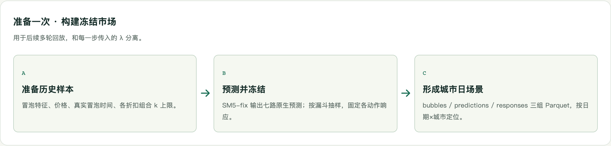
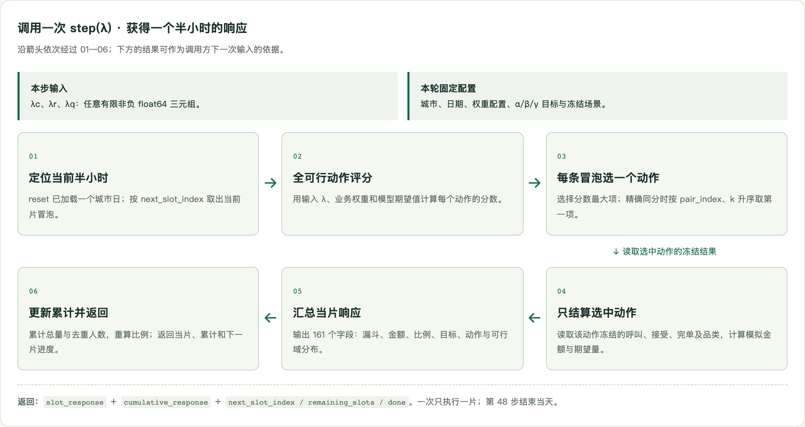
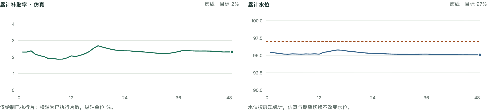
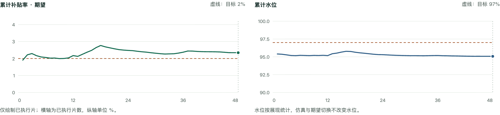
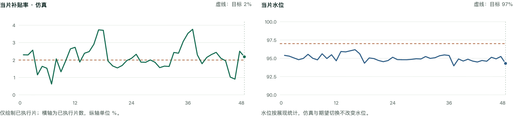
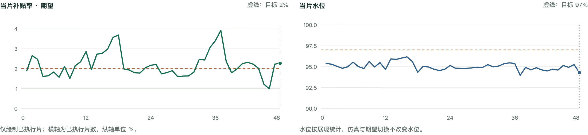
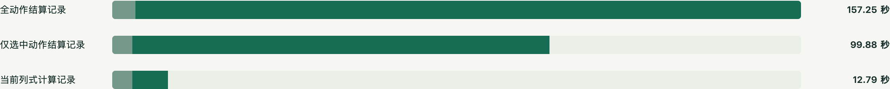

# 花小猪市场仿真系统介绍

> 系统资料日期：2026 年 10 月 21 日；文档整理日期：2026 年 10 月 30 日。  
> 代码基准：`42d56ea344cd8547b3906ad6edb33dc26f886567`。  
> 原始页面：[仿真系统介绍.html](仿真系统介绍.html)。

## 系统概览

**输入一组 λ，得到半小时市场响应。** 系统在固定的历史冒泡环境中，接收 λc、λr、λq，为当前半小时的每条冒泡选择最优可行动作，结算其冻结响应，返回当片指标和截至当前的累计账本。

当前状态为 **SM5-fix 冻结场景就绪**，已实现“全动作冻结 → 微观决策 → 半小时回放”；按城市 × 日期分区，输入 λ 后返回响应。

| 项目 | 当前规模与口径 |
| --- | --- |
| 回放周期 | 一座城市的一天为一轮，48 步 / 天 |
| 模型输出 | 保留 SM5-fix 原生 7 路预测 |
| 场景日期 | 2026-09-14—2026-09-22，共 9 天 |
| 唯一冒泡 | 5,688,112 条，约 568.81 万 |
| 可行动作 | 405,842,867 个，约 4.06 亿 |
| 样本范围 | 完整下采样输入，不能等同于业务全量 |

本文件保留页面的九个章节，将折叠说明展开，公式转换为可编辑的 LaTeX，完整字段字典和 48 片回放摘要置于附录。原始回放数据另存为 JSON，保留全部数值精度。页面中的交互浏览仍可通过原始 HTML 使用。

## 阅读导航

- [[#1 数据从哪里来，如何进入仿真]]
- [[#2 从 λ 到市场响应的完整流程]]
- [[#3 冒泡能选哪些动作，模型提供什么]]
- [[#4 用期望值选优，用冻结结果结算]]
- [[#5 响应指标与字段含义]]
- [[#6 把一天，展开成 48 次响应]]
- [[#7 直接输入 λ，读取市场响应]]
- [[#8 一次 step 与完整一天要多久]]
- [[#9 当前仿真的含义与边界]]
- [[#附录 A 完整响应字段字典]]
- [[#附录 B 48 个时间片的关键回放指标]]
- [[#附录 C 原始数据与交互操作]]

## 1 数据从哪里来，如何进入仿真

历史样本、事件时间、模型和业务权重有独立来源；冻结场景把它们整理为可重复使用的市场环境。

Hive 冒泡样本＋漏斗事件时间→本地样本宽表→SM5-fix 全动作预测与冻结→城市日场景

### 01 · 历史冒泡与特征

`kflower_strategy.plft_v4_training_sample`

读取 2026-09-14 至 2026-09-22 的 9 个日期分区，保留原表样本集合与全部已有字段。导出阶段不再次随机抽样，不按是否呼叫或完单筛选，也不筛选单一策略组。冒泡键为 `(dt, trace_id)`。

源表已有的特征宽表由 `plft_v4_training_sample_action_space` 关联车辆价格、序列、供需和历史特征构成；仓库中的 `sql/plft_v4_training_sample.sql` 定义了字段与源表清洗条件。当前导出不重新验证上游抽样概率，十倍折算是仿真约定。

本地输入：`data/plft_v4_training_sample_20260914_20260922/`<br>已完成导出：5,688,196 行、1,250 列、144 个 Parquet 文件；补齐三个事件时间后仍保留原表样本行。

### 02 · 冒泡、开始计费与完单时间

`kflower_strategy.trip_funnel_events_di`

对样本日 T，扫描事件表的 T～T+1 分区，以 `bubble_trace_id = trace_id` 半连接筛出相关事件，再按冒泡键聚合并左连接回样本。只读取 `bubble`、`charge_start`、`finish` 三种事件。

| 输出列 | 取数规则 | 当前仿真用途 |
| --- | --- | --- |
| `bubble_event_time` | 冒泡事件完整时间戳的最小值 | 分配半小时时间片，并作为代理入账时间。 |
| `charge_start_event_time` | 开始计费事件完整时间戳的最大值 | 保留用于数据核验；不作为本版入账时间。 |
| `finish_event_time` | 完单事件完整时间戳的最大值 | 保留用于数据核验；不决定本版模拟完单结果。 |

会话时区 Asia/Shanghai。仅有时分秒的事件值先补齐事件分区日期，再比较完整时间戳；缺失保留 null。事件表为九天样本覆盖到 2026-09-23 的分区。

#### 查看实际导出入口与时间关联方法

入口脚本按生产字段合同显式输出 1,250 列，使用 Spark SQL 读取 Hive，写出日期分区的 Snappy Parquet。每日日志、取数 SQL 和行数核验保存在输出目录。

```bash
python3 scripts/start_sample_export.py \
  --script scripts/export_training_sample_with_events.py \
  --driver-memory 12g --master 'local[4]' -- \
  --output data/plft_v4_training_sample_20260914_20260922 \
  --start-date 2026-09-14 --end-date 2026-09-22 --partitions 16
```

时间关联的核心 SQL（T 以 2026-09-14 为例；正式投影与列序由脚本生成）：

```sql
WITH event_times AS (
  SELECT bubble_trace_id,
    MIN(CASE WHEN event_type='bubble' THEN event_ts END) AS bubble_event_time,
    MAX(CASE WHEN event_type='charge_start' THEN event_ts END) AS charge_start_event_time,
    MAX(CASE WHEN event_type='finish' THEN event_ts END) AS finish_event_time
  FROM (
    SELECT e.bubble_trace_id, e.event_type,
      CAST(CASE
        WHEN TRIM(CAST(e.event_time AS STRING))
          RLIKE '^[0-9]{2}:[0-9]{2}:[0-9]{2}([.][0-9]+)?$'
        THEN CONCAT(e.dt, ' ', TRIM(CAST(e.event_time AS STRING)))
        ELSE CAST(e.event_time AS STRING)
      END AS TIMESTAMP) AS event_ts
    FROM kflower_strategy.trip_funnel_events_di e
    LEFT SEMI JOIN (
      SELECT trace_id FROM kflower_strategy.plft_v4_training_sample
      WHERE dt='2026-09-14'
    ) s ON e.bubble_trace_id=s.trace_id
    WHERE e.dt BETWEEN '2026-09-14' AND '2026-09-15'
      AND e.event_type IN ('bubble','charge_start','finish')
      AND e.bubble_trace_id IS NOT NULL AND TRIM(e.bubble_trace_id)<>''
  ) events
  GROUP BY bubble_trace_id
)
SELECT s.*, e.bubble_event_time, e.charge_start_event_time, e.finish_event_time
FROM kflower_strategy.plft_v4_training_sample s
LEFT JOIN event_times e ON s.trace_id=e.bubble_trace_id
WHERE s.dt='2026-09-14';
```

对应实现：`scripts/export_training_sample_with_events.py`；实际 SQL：`data/plft_v4_training_sample_20260914_20260922/_queries/2026-09-14.sql`；导出来源与验收：`_request.json`、`_export_metadata.json`。

### 03 · 标准业务权重与目标参数

`kflower_strategy.platform_union_stg_v4_lambda_dict`

当前使用 2026-10-20 导出时的最新分区 **2026-10-19**，全量读取该分区所有行和列，共 390,915 行。先由 `SHOW PARTITIONS` 确定最大 dt，再导出并校验本地 Parquet；这是固定快照，不随 Hive 自动更新。

```sql
SHOW PARTITIONS kflower_strategy.platform_union_stg_v4_lambda_dict;

SELECT *
FROM kflower_strategy.platform_union_stg_v4_lambda_dict
WHERE dt = '2026-10-19';
```

运行时按 `dt、stg_group、city_id、alpha、beta、gamma` 精确匹配业务权重 `weight_*` 和原始目标系数 `a0…a4`。每片执行的三个 λ 直接来自调用方的输入；表内 λ 可作为输入值来源，但不限制可传入的实数值。

本地快照：`data/policy_parameters/platform_union_stg_v4_lambda_dict_20261019/`<br>取数 SQL：`sql/export_decision_weights.sql`；来源记录：快照中的 `_export_metadata.json`。

### 04 · 模型与可复用冻结场景

SM5-fix 部署包直接从下列 OFS 目录复制，使用 epoch 23 的既有权重，无需重新训练。输入归一化统计量包含在 checkpoint 中。

`/ofs/pltf-sub-and-pap/chenjiaxi/cc_bcr/deployments/sm5_best_epoch23_clean_20261015/`

本地模型：`data/models/sm5_fix/`，包含 `model.pth`、模型定义与来源记录。<br>冻结场景：`data/scenarios/detail_sm5_fix_full_20260914_20260922/`。

构建器对全部下采样输入预测并冻结全可行动作。场景按 `(dt, trace_id)` 保留首条，得到 **5,688,112 条唯一冒泡、405,842,867 个动作**；按日期×城市分成 3,072 个分区，每个分区包含冒泡、预测、冻结响应三个文件。场景构建不依赖 λ 字典。

每轮 `reset` 只读目标城市日的三个文件；后续 `step` 使用内存中的 Arrow 批次。冻结依据与规模记录在场景的 `manifest.json`、`audit.json` 中。

## 2 从 λ 到市场响应的完整流程

仿真系统负责执行输入并返回响应；一次调用推进半小时，一个城市日共 48 步。

### 准备一次 · 构建冻结市场

用于后续多轮回放，和每一步传入的 λ 分离。

1. **准备历史样本**：冒泡特征、价格、真实冒泡时间、各折扣组合 k 上限。
2. **预测并冻结**：SM5-fix 输出七路原生预测；按漏斗抽样，固定各动作响应。
3. **形成城市日场景**：bubbles / predictions / responses 三组 Parquet，按日期×城市定位。



### 调用一次 step(λ) · 获得一个半小时的响应

沿箭头依次经过 01—06；下方的结果可作为调用方下一次输入的依据。

- **本步输入：**λc、λr、λq：任意有限非负 float64 三元组。

- **本轮固定配置：**城市、日期、权重配置、α/β/γ 目标与冻结场景。

1. **定位当前半小时**：reset 已加载一个城市日；按 next_slot_index 取出当前片冒泡。
2. **全可行动作评分**：用输入 λ、业务权重和模型期望值计算每个动作的分数。
3. **每条冒泡选一个动作**：选择分数最大项；精确同分时按 pair_index、k 升序取第一项。
4. **只结算选中动作**：读取该动作冻结的呼叫、接受、完单及品类，计算模拟金额与期望量。
5. **汇总当片响应**：输出 161 个字段：漏斗、金额、比例、目标、动作与可行域分布。
6. **更新累计并返回**：累计总量与去重人数，重算比例；返回当片、累计和下一片进度。

**返回：**`slot_response` ＋ `cumulative_response` ＋ `next_slot_index / remaining_slots / done`。一次只执行一片；第 48 步结束当天。



运行期不重新做模型推理或随机抽样。相同场景、权重配置与 λ 序列得到相同结果；λ 可逐片变化，不需要预先穷举全部 λ 组合。

## 3 冒泡能选哪些动作，模型提供什么

输入 λ 决定评分倾向；系统仍需在每条冒泡自身的可行空间中选择实际动作。

一个动作由折扣组合与默勾 k 共同确定。28 个组合是配置中的合法特价／幸运折扣搭配，每个组合最多 20 个 k；每条冒泡的实际上限由自身的 `decision_k_max` 提供。

$$
\mathcal{A}_i=\{(p,k):0\le p<28,\ 1\le k\le K_{i,p}\}
$$

$$
|\mathcal{A}_i|=\sum_{p=0}^{27}\max(K_{i,p},0)\le 560
$$

i 为冒泡，p 为折扣组合索引，K 为该组合的决策上限。K=−1 或 0 时不产生动作；一条冒泡必须至少有一个可行动作，否则拒绝执行。幸运折扣 100 表示不展现。

### SM5-fix · epoch 23 · 原生七路输出

输入为 float32 原始特征，归一化由 checkpoint 内统计量完成。展平输出为每条冒泡 3,920 个数，按任务→折扣组合→k 排列。模型先完成完整空间计算，再由构建器提取可行动作。

$$
\mathbb{R}^{B\times1223}\ \longrightarrow\ \mathbb{R}^{B\times7\times28\times20}
$$

| 输出 | 中文含义 | 后续用途 |
| --- | --- | --- |
| `bcr` | 冒泡完单概率 | 预期完单、评分、金额期望。 |
| `ecr` | 冒泡呼叫概率 | 冻结呼叫、预期呼叫、派生呼叫后完单概率。 |
| `dsar` | 已呼叫条件下默勾接受概率 | 冻结接受、预期默勾接受呼叫。 |
| `f_l / f_u / f_o` | 已完单条件下幸运／特价／其他品类概率（三路） | 冻结完单品类，分别计算各品类预期完单和金额。 |
| `g_o` | 其他品类完单条件 GMV，单位分 | 该品类的金额结算；不是整体预期 GMV。 |

$$
\mathrm{CR}=\begin{cases}\mathrm{BCR}/\mathrm{ECR},&\mathrm{ECR}>0\\0,&\mathrm{ECR}=0\end{cases}
$$

条件完单概率由响应模块派生。序列有效长度与可行 k 上限分别处理，允许 k 大于序列有效长度。模型、动作空间配置或历史输入变化时，需要对应的新冻结场景。

## 4 用期望值选优，用冻结结果结算

给定相同的场景、业务权重和 λ，逐冒泡选择与返回响应均可复现。

$$
\begin{array}{rl}S_i(a)={}&v_i(a)-\lambda_c(C_i-\alpha M_i)\\&-\lambda_r I_i(\beta U_i-L_i)\\&-\lambda_q I_i(L_i-\gamma U_i)\end{array}
$$

$$
a_i^*=\underset{a\in\mathcal{A}_i}{\mathrm{arg\,max}}\;S_i(a)
$$

### 约束项

- λc 对应补贴率；C 为预期补贴，M 为预期假 GMV，α 为补贴率目标。
- λr 对应水位下限 β，λq 对应水位上限 γ；L、U 为幸运／特价实付价格。
- I 是幸运展现标记；水位项按展现冒泡计入，不乘完单概率。

### 选优规则

- 评分读取模型期望量；不根据已冻结的成功或失败结果挑动作。
- 精确同分按折扣组合索引、k 升序选择。
- λ 保留 float64 精度，不映射固定网格；固定 λ 不保证聚合约束自动达标。

$$
\begin{array}{rl}v_i={}&w_X b_i+w_Y b_i(f_{l,i}+f_{u,i})+w_G G_i\\&+w_H e_i+w_D e_i d_i\end{array}
$$

b、e、d 分别表示 BCR、ECR、DSAR；五个 w 来自权重表。金额统一使用分。微观业务价值是加权和，不是原始目标 F。

### 展开金额与补贴公式

$$
s_i=\min\!\left(\left\lfloor P_i(1-D_{u,i})\right\rfloor,2000\right)
$$

$$
U_i=P_i-s_i,\qquad L_i=\left\lceil P_iD_{l,i}\right\rceil
$$

$$
C_i=b_i f_{u,i}s_i
$$

$$
M_i=b_i(f_{l,i}G_{l,i}+f_{u,i}G_{u,i}+f_{o,i}g_{o,i})
$$

$$
G_i=b_i(f_{l,i}P_iD_{l,i}+f_{u,i}G_{u,i}+f_{o,i}g_{o,i})
$$

P 为特价盒子前置券后价格，Du／Dl 为实付折扣率；Gu 为历史特价应付金额，Gl 为历史幸运假 GMV；g_o 为模型给出的其他品类条件 GMV。幸运真 GMV 使用 P×Dl 的未取整值；水位幸运实付 L 使用向上取整值。

### 展开冻结漏斗的抽样方式

$$
c_i=\mathbf{1}\{u_c<e_i\}
$$

$$
x_i=c_i\,\mathbf{1}\{u_f<\mathrm{CR}_i\}
$$

$$
d_i^{\mathrm{sim}}=c_i\,\mathbf{1}\{u_d<d_i\}
$$

u_c、u_f、u_d 由日期、冒泡键、seed 和阶段确定。相同冒泡的不同动作共享同一阶段随机数；呼叫后的完单与接受按独立阶段抽样。完单后再按 f_l、f_u、f_o 选择品类。上述过程在场景构建时一次完成，step 直接读取选中动作的冻结结果。

## 5 响应指标与字段含义

补贴率、水位使用不同统计集合；下方按当前代码逐项说明所有 161 个单片响应字段。

### 补贴率 · 完单代理口径

$$
R_t^{(z)}=\frac{\sum_{i\in B_t} C_i^{(z)}}{\sum_{i\in B_t} M_i^{(z)}}
$$

B_t 是当片冒泡集合；z 为预期或仿真口径。仿真分子、分母按模拟完单及其品类结算；预期量使用完单概率与品类概率加权。

### 水位 · 全部幸运展现冒泡

$$
W_t=\frac{\sum_{i\in B_t} I_iL_i}{\sum_{i\in B_t} I_iU_i}
$$

I 表示选中动作是否展现幸运盒子；未呼叫、未完单的幸运展现冒泡也进入同一分子、分母。

**两个独立假设：**用模拟完单代理计费成功；代理成功时，入账时间取冒泡时间。前者决定是否入账，后者决定何时入账。模型未独立输出开始计费概率，汇总不另外报告计费量。

| 冻结结果 | 仿真补贴 | 仿真假 GMV | 仿真真 GMV |
| --- | --- | --- | --- |
| 未完单 | 0 | 0 | 0 |
| 特价完单 | s | Gu | Gu |
| 幸运完单 | 0 | Gl | P×Dl（不取整） |
| 其他品类完单 | 0 | g_o | g_o |

GMV 按仿真实际发生的完单品类计入，各品类分别统计并加总；其他品类金额使用模型条件均值，单笔金额不额外抽样。

### 累计先加总，再计算比例

39 个样本可加字段跨片累加，补贴率、CR、各品类份额和单均值都从累计分子、分母重算，不平均各片比例。动作分布按桶合并，累计人数按乘客集合取并集；人数、人均值和比率不进行十倍放大。空片正常推进时间。

### 原始目标 F 的含义

$$
\begin{array}{rl}F={}&\dfrac XN+a_0\dfrac YX+a_1\dfrac GX\\&+a_2\dfrac HB+a_3\dfrac XH+a_4\dfrac DH\end{array}
$$

X=完单数，Y=一口价完单数，G=真 GMV（分），H=呼叫数，D=默勾接受呼叫数，B=冒泡数，N=全部冒泡的去重乘客数。预期 F 是预期总量的代入值；必要分母为零时返回 null。

### 全部 161 个响应字段 · 中文指标字典

单片字段类型直接取自当前 SLOT_SCHEMA；累计响应复用指标口径，不重复单片时间和 λ 字段。`sample_` 为样本原始量，`scaled_` 为十倍折算；金额字段以分保存。比率保存为小数，界面可转换为百分比。原始加总量在空片为 0，零分母比率为 null。

全部字段按指标族列于 [[#附录 A 完整响应字段字典]]，保留 161 个字段的中文名称、字段名、Arrow 类型和说明。

## 6 把一天，展开成 48 次响应

本节展示一次使用固定 λ 输入的真实仿真运行记录。原页面可拖动时间片查看已执行状态，并切换“当片／累计”与“仿真／期望”；文档保留四种视图的完整曲线、全天结果与逐片数据。

### 城市 8 · 2026-09-14

44,886 条冒泡 · 标准权重分区 2026-10-19 · DSAR tau_60

真实回放记录 / 只读浏览

- λc `0.00045224929385954694`
- λr `0.00005706941286652894`
- λq `0`
- 目标：补贴率 2% · 水位 97%

**已执行 48 / 48 片 · 23:30—24:00**

next_slot_index = 48 · done = true

累计响应 · 仿真值 · 样本原始量

| 指标 | 全天累计仿真值 | 说明 |
| --- | --- | --- |
| 冒泡数 | 44,886 | 全部输入冒泡 |
| 完单数 | 30,091 | 按冻结完单结果计数 |
| 补贴金额 / 元 | 10,721.29 | 从内部“分”转换为“元” |
| 补贴率 | 2.3054% | 高于目标 0.3054 个百分点 |
| 水位 | 95.0701% | 低于目标 1.9299 个百分点 |
| 去重冒泡人数 | 26,286 | 累计时跨时间片去重 |

#### 回放曲线

横轴为已执行时间片数，纵轴单位为百分比；补贴率目标为 2%，水位目标为 97%。水位按幸运展现冒泡统计，切换仿真与期望口径不改变水位。下列图均展示全部 48 片。









| 指标 | 全天累计仿真值 |
| --- | --- |
| 呼叫数 | 33,007 |
| 一口价完单数 | 20,570 |
| 默勾接受呼叫数 | 21,664 |
| 真 GMV / 元 | 436,025.24 |
| 假 GMV / 元 | 465,050.90 |
| 人均完单 / 单 | 1.1448 |

交互仅浏览已经保存的轨迹；不在浏览器执行模型或重新选择动作。所有数量均为样本原始量。

### 完整一天结果 · 模型期望与冻结仿真

| 指标 | 模型期望 | 冻结仿真 |
| --- | --- | --- |
| 呼叫数 | 33,055.33 | 33,007.00 |
| 完单数 | 30,138.34 | 30,091.00 |
| 一口价完单数 | 20,611.26 | 20,570.00 |
| 默勾接受呼叫数 | 21,720.07 | 21,664.00 |
| 补贴金额 / 元 | 10,891.80 | 10,721.29 |
| 真 GMV / 元 | 435,914.92 | 436,025.24 |
| 假 GMV / 元 | 464,823.40 | 465,050.90 |
| 补贴率 | 2.3432% | 2.3054% |

全天水位为 **95.0701%**，低于 97% 目标；两种补贴率均高于 2% 目标。这是这一组 λ 在该城市日产生的市场响应，不能单凭一次运行确定真实业务收益。

## 7 直接输入 λ，读取市场响应

使用 reset / step 即可运行；本页的展示范围是仿真环境本身。

| 接口 | 用途 |
| --- | --- |
| **ReplayEnv(...)** | 指定冻结场景、权重快照与本轮目标配置。 |
| **reset(city_id, dt)** | 加载目标城市日、划分 48 片，并清空累计账本。 |
| **step([λc, λr, λq])** | 执行当前半小时，返回当片响应、累计响应和进度。 |

```python
from hxz_simulator.replay import ReplayEnv

env = ReplayEnv(
    "data/scenarios/detail_sm5_fix_full_20260914_20260922",
    "data/policy_parameters/platform_union_stg_v4_lambda_dict_20261019",
    config_dt="2026-10-19",
    stg_group="v5_sf0_dsar_onlinev2_20261008_tau_60",
    alpha=20, beta=97, gamma=97,
)
state = env.reset(city_id=8, dt="2026-09-14")

# 本次输入 λ，执行 00:00—00:30。
state = env.step([
    0.00045224929385954694,
    0.00005706941286652894,
    0.0,
])
current = state["slot_response"]          # 刚执行的半小时响应
cumulative = state["cumulative_response"] # 截至当前的累计响应

# 下一次调用执行 00:30—01:00；调用方可传入另一组 λ。
# 共执行 48 次 step 后，state["done"] 为 True。
```

目标编码 20/97/97 对应补贴率 0.02、水位下限／上限 0.97。该示例使用九月历史冒泡和十月拟上线权重快照；不把两个日期混作同一来源分区。

| 返回字段 | 中文含义与推进规则 |
| --- | --- |
| `city_id / dt` | 本轮城市和日期。 |
| `slot_response` | 刚执行片的 161 字段响应；reset 后为 null。 |
| `cumulative_response` | 截至当前的累计指标、累计分布及人数；reset 后加总量为 0、比率为 null、分布为空。 |
| `last_lambdas` | 刚执行片的三个输入 λ；初始为 null。 |
| `next_slot_index` | 下一待执行片；初始为 0，第一次 step 后为 1，结束时为 48。 |
| `remaining_slots` | 剩余待执行片数；从 48 递减到 0。 |
| `done` | 第 48 步执行后为 true；不会自动进入次日，需要再次 reset。 |

**失败不会推进账本：**非法 λ、无可行动作、输入不一致或计算溢出会报错。有效输入可逐片改变；空片返回零量并正常推进。`observation()` 只读取当前状态。

## 8 一次 step 与完整一天要多久

分别展示加载、逐片计算、完整城市日与历史优化对照，避免混用不同计时口径。

下列完整城市日基准均为**城市 8、2026-09-14**：44,886 条冒泡、6,474,704 个可行动作。2026-10-21 在本机 CPU 上运行，batch=256、Arrow 线程数=2，使用已冻结场景，无运行期推理或重采样。

| 指标 | 值 |
| --- | --- |
| 当前基准单步平均 | 0.170s |
| 当前基准单步 P95 | 0.260s |
| 加载＋48 步 | 12.79s |

| 阶段／指标 | 实测耗时或占用 | 计时口径 |
| --- | --- | --- |
| 环境构造 | 0.83 秒 | 读取场景清单与权重快照；单独计时。 |
| reset 加载城市日 | 4.62 秒 | 读取三个文件，校验并按时间片组织 Arrow 数据。 |
| 单步平均 | 0.170 秒 | 48 个半小时时间片的平均计算耗时。 |
| 单步 P50 / P95 | 0.205 / 0.260 秒 | 48 次 step 的中位数与第 95 百分位。 |
| 单步最大 | 0.265 秒 | 该次城市日回放中最慢的一步。 |
| 48 步计算合计 | 8.17 秒 | 评分、选优、结算与累计；不含 reset。 |
| reset＋48 步 | 12.79 秒 | 一轮城市日的加载和计算；不含环境构造。 |
| 进程峰值 RSS | 916.4 MiB | 基准进程整体峰值，包含运行与记录开销。 |

**本页展示的固定 λ 轨迹：**同一城市日、使用标准字典三个 λ 的另一次实际运行，reset＋48 步为 **15.45 秒**，环境构造为 0.22 秒，总计 15.67 秒。该记录未拆分 reset 和 step；不能据此推导单步耗时。它与上面的逐片变化 λ 基准是两次独立运行。

### 已有优化对照记录

下图展示三次完整城市日记录的加载与计算耗时；每次的具体计时直接取自对应 JSON。配对加速结论见下表，不把跨运行的加载波动归因于评分优化。

| 记录 | reset 加载 | 48 步计算 | 显示合计 |
| --- | --- | --- | --- |
| 全动作结算记录 | 5.22 秒 | 152.03 秒 | 157.25 秒 |
| 仅选中动作结算记录 | 4.57 秒 | 95.32 秒 | 99.88 秒 |
| 当前列式计算记录 | 4.62 秒 | 8.17 秒 | 12.79 秒 |



| 对照内容 | 对照前 → 对照后 | 验证与解释 |
| --- | --- | --- |
| 按日期×城市读取 | reset：36.90 → 7.15 秒 | 文件数 48 → 3；同一城市日首片汇总在浮点容差内一致，冻结值保持一致。 |
| 仅结算选中动作 | 48 步：152.03 → 95.32 秒 | 计算提速 1.59 倍；48 步完整状态完全一致。 |
| 批量校验与列式评分 | 48 步：95.08 → 8.17 秒 | 计算提速 11.64 倍，耗时减少 91.4%；48 步完整状态完全一致。 |

### 小场景的毫秒级记录与适用范围

城市 8、九天共 162 条冒泡的工程验收执行了 4,752 步。reset P50 为 34.4 ms；非空片 step P50 为 3.9 ms、P95 为 5.0 ms。这是小场景正确性验收，不用于估计完整城市日性能。

以上均为已有实测记录，不是重新跑出的结果，也不是延迟保证。耗时随城市日冒泡量、可行动作数、文件缓存和机器负载变化；其他城市不能直接套用同一耗时。当前每次 reset 都重新加载，未提供跨轮次数据缓存。

### 计时证据位置

- 当前逐片 λ 基准：`temp/columnar_replay_20261021/after.json`；对照为同目录 `before.json`。
- 选中动作结算对照：`temp/selected_settlement_20261021/before.json`、`after.json`。
- 分区读取对照：`temp/partition_scene_20261021/partition_verification.json`。
- 本页固定 λ 轨迹计时：`data/replays/fixed_dict_city8_20260914_20261021_151522/summary.json`。
- 小场景验收：`temp/columnar_replay_20261021/smoke/audit.json`。

## 9 当前仿真的含义与边界

它是给定历史环境与 λ 输入的可复现市场响应系统。

- **历史市场外生**λ 改变当前片的选中动作与结算结果；后续冒泡数量、需求、供给和市场特征沿用历史输入。
- **成熟时间简化**用模拟完单代理计费成功，入账取冒泡时间；未单独模拟计费漏斗、延迟成熟或已计费但未完单的过程。
- **模型响应**冻结仿真是模型下的一次随机实现。相同场景支持重复对比，但实现一致性验证不能替代模型校准或真实业务效果评估。
- **样本边界**场景覆盖九天现有下采样输入；十倍量级折算不自动消除抽样偏差，也不恢复全量去重乘客数。
- **城市日轮次**每轮 48 片，reset 清空累计账本；返回状态只包含已执行响应，不包含未来片或未选动作结果。

### 本页依据

代码基准 `42d56ea344cd8547b3906ad6edb33dc26f886567`。模型来源、样本来源、权重快照、冻结场景规模、字段说明与性能记录均核对到当前仓库文件。本页嵌入真实回放汇总，不执行在线取数、模型推理或重新选优。

- 实现：`replay.py`、`slot_response.py`、`batch_decision.py`、`decision.py`、`scenario.py`、`model.py`。
- 字段：`hxz_simulator.slot_response.SLOT_SCHEMA`，共 161 个字段，中文说明按计算代码编写。
- 交互数据：`data/replays/fixed_dict_city8_20260914_20261021_151522/steps.jsonl`，48 步最终累计值与 `summary.json` 已核对。
- 来源与耗时：见本页“数据来源”和“仿真耗时”中列出的实际文件。

## 附录 A 完整响应字段字典

字段类型和中文定义逐项保留自原页面，共 **161 个字段**。字段名保持原样；`sample_` 为样本原始量，`scaled_` 为十倍量级折算；金额单位为分，比率保存为小数。

### 时间与输入（8 项）

| 中文指标 | 字段名 | Arrow 类型 | 含义与计算口径 |
| --- | --- | --- | --- |
| 业务日期 | `dt` | `string` | 本次城市日的日期，格式 YYYY-MM-DD。 |
| 城市 ID | `city_id` | `int64` | 本次环境选定的城市。 |
| 时间片序号 | `slot_index` | `int16` | 本次刚执行的半小时序号，0—47；0 对应 00:00—00:30。 |
| 时间片开始时间 | `slot_start` | `timestamp[ms, tz=Asia/Shanghai]` | 上海时区的开始时间，包含左端点；时间精度为毫秒。 |
| 时间片结束时间 | `slot_end` | `timestamp[ms, tz=Asia/Shanghai]` | 上海时区的结束时间，不包含右端点；第 47 片结束于次日 00:00。 |
| 补贴率约束 λc | `lambda_c` | `double` | 该时间片实际传入的补贴率惩罚系数；有限非负 float64，金额口径为分。 |
| 水位下限约束 λr | `lambda_r` | `double` | 该时间片实际传入的水位下限惩罚系数；有限非负 float64。 |
| 水位上限约束 λq | `lambda_q` | `double` | 该时间片实际传入的水位上限惩罚系数；有限非负 float64。 |

### 规模与漏斗（18 项）

| 中文指标 | 字段名 | Arrow 类型 | 含义与计算口径 |
| --- | --- | --- | --- |
| 冒泡数（样本） | `sample_input_bubbles` | `int64` | 样本原始量。当前统计范围内全部输入冒泡的条数；每条冒泡选出一个动作，不以呼叫或完单为条件。 |
| 仿真呼叫数（样本） | `sample_sim_call` | `int64` | 样本原始量。累计选中动作的冻结呼叫标记。 |
| 仿真默勾接受呼叫数（样本） | `sample_sim_accept` | `int64` | 样本原始量。累计选中动作的冻结默勾接受标记；需已呼叫，不要求完单。 |
| 仿真完单数（样本） | `sample_sim_finish` | `int64` | 样本原始量。累计选中动作的冻结完单标记。 |
| 仿真一口价完单数（样本） | `sample_sim_fixed_price_finish` | `int64` | 样本原始量。幸运盒子与特价盒子的仿真完单数之和。 |
| 预期呼叫数（样本） | `sample_expected_call` | `double` | 样本原始量。对选中动作的 ECR 求和。 |
| 预期默勾接受呼叫数（样本） | `sample_expected_accept` | `double` | 样本原始量。对选中动作的 ECR×DSAR 求和；接受以呼叫为条件。 |
| 预期完单数（样本） | `sample_expected_finish` | `double` | 样本原始量。对选中动作的 BCR 求和。 |
| 预期一口价完单数（样本） | `sample_expected_fixed_price_finish` | `double` | 样本原始量。对 BCR×(f_l+f_u) 求和，等于两类预期完单数之和。 |
| 冒泡数（十倍折算） | `scaled_input_bubbles` | `int64` | 对应 sample_ 字段×10 的量级折算；不是全量观测。当前统计范围内全部输入冒泡的条数；每条冒泡选出一个动作，不以呼叫或完单为条件。 |
| 仿真呼叫数（十倍折算） | `scaled_sim_call` | `int64` | 对应 sample_ 字段×10 的量级折算；不是全量观测。累计选中动作的冻结呼叫标记。 |
| 仿真默勾接受呼叫数（十倍折算） | `scaled_sim_accept` | `int64` | 对应 sample_ 字段×10 的量级折算；不是全量观测。累计选中动作的冻结默勾接受标记；需已呼叫，不要求完单。 |
| 仿真完单数（十倍折算） | `scaled_sim_finish` | `int64` | 对应 sample_ 字段×10 的量级折算；不是全量观测。累计选中动作的冻结完单标记。 |
| 仿真一口价完单数（十倍折算） | `scaled_sim_fixed_price_finish` | `int64` | 对应 sample_ 字段×10 的量级折算；不是全量观测。幸运盒子与特价盒子的仿真完单数之和。 |
| 预期呼叫数（十倍折算） | `scaled_expected_call` | `double` | 对应 sample_ 字段×10 的量级折算；不是全量观测。对选中动作的 ECR 求和。 |
| 预期默勾接受呼叫数（十倍折算） | `scaled_expected_accept` | `double` | 对应 sample_ 字段×10 的量级折算；不是全量观测。对选中动作的 ECR×DSAR 求和；接受以呼叫为条件。 |
| 预期完单数（十倍折算） | `scaled_expected_finish` | `double` | 对应 sample_ 字段×10 的量级折算；不是全量观测。对选中动作的 BCR 求和。 |
| 预期一口价完单数（十倍折算） | `scaled_expected_fixed_price_finish` | `double` | 对应 sample_ 字段×10 的量级折算；不是全量观测。对 BCR×(f_l+f_u) 求和，等于两类预期完单数之和。 |

### 动作与可行域（12 项）

| 中文指标 | 字段名 | Arrow 类型 | 含义与计算口径 |
| --- | --- | --- | --- |
| 幸运盒子展现冒泡数（样本） | `sample_lucky_exposures` | `int64` | 样本原始量。选中动作的幸运折扣不是 100 的冒泡数；未呼叫、未完单也计入。 |
| 幸运盒子可展现冒泡数（样本） | `sample_lucky_available_bubbles` | `int64` | 样本原始量。可行空间中至少存在一个幸运折扣不是 100 的动作的冒泡数；不要求最终选中该动作。 |
| k 下边界冒泡数（样本） | `sample_k_lower_bound_bubbles` | `int64` | 样本原始量。选中折扣组合的上限 K>1，且实际选中 k=1 的冒泡数。 |
| k 上边界冒泡数（样本） | `sample_k_upper_bound_bubbles` | `int64` | 样本原始量。选中折扣组合的上限 K>1，且实际选中 k=K 的冒泡数。 |
| 幸运盒子展现冒泡数（十倍折算） | `scaled_lucky_exposures` | `int64` | 对应 sample_ 字段×10 的量级折算；不是全量观测。选中动作的幸运折扣不是 100 的冒泡数；未呼叫、未完单也计入。 |
| 幸运盒子可展现冒泡数（十倍折算） | `scaled_lucky_available_bubbles` | `int64` | 对应 sample_ 字段×10 的量级折算；不是全量观测。可行空间中至少存在一个幸运折扣不是 100 的动作的冒泡数；不要求最终选中该动作。 |
| k 下边界冒泡数（十倍折算） | `scaled_k_lower_bound_bubbles` | `int64` | 对应 sample_ 字段×10 的量级折算；不是全量观测。选中折扣组合的上限 K>1，且实际选中 k=1 的冒泡数。 |
| k 上边界冒泡数（十倍折算） | `scaled_k_upper_bound_bubbles` | `int64` | 对应 sample_ 字段×10 的量级折算；不是全量观测。选中折扣组合的上限 K>1，且实际选中 k=K 的冒泡数。 |
| 幸运盒子展现率 | `lucky_exposure_rate` | `double` | 幸运盒子展现冒泡数 ÷ 冒泡数；使用同一统计范围的总量重算，分母为零时为 null。存储为小数比值。 |
| 幸运盒子可展现率 | `lucky_available_rate` | `double` | 幸运可展现冒泡数÷全部冒泡数；反映可行空间是否允许幸运展现，不等于实际展现率。 |
| k 下边界比例 | `k_lower_bound_rate` | `double` | k 下边界冒泡数÷选中折扣组合 K>1 的冒泡数；分母为零时为 null。 |
| k 上边界比例 | `k_upper_bound_rate` | `double` | k 上边界冒泡数÷选中折扣组合 K>1 的冒泡数；分母为零时为 null。 |

### 品类响应（50 项）

| 中文指标 | 字段名 | Arrow 类型 | 含义与计算口径 |
| --- | --- | --- | --- |
| 仿真幸运盒子完单数（样本） | `sample_sim_finish_lucky` | `int64` | 样本原始量。冻结结果为完单且品类为幸运盒子的次数。 |
| 仿真特价盒子完单数（样本） | `sample_sim_finish_special` | `int64` | 样本原始量。冻结结果为完单且品类为特价盒子的次数。 |
| 仿真其他品类完单数（样本） | `sample_sim_finish_other` | `int64` | 样本原始量。冻结结果为完单且品类为其他品类的次数。 |
| 预期幸运盒子完单数（样本） | `sample_expected_finish_lucky` | `double` | 样本原始量。对选中动作的 BCR×f_l 求和。 |
| 预期特价盒子完单数（样本） | `sample_expected_finish_special` | `double` | 样本原始量。对选中动作的 BCR×f_u 求和。 |
| 预期其他品类完单数（样本） | `sample_expected_finish_other` | `double` | 样本原始量。对选中动作的 BCR×f_o 求和。 |
| 仿真幸运盒子假 GMV（样本） | `sample_sim_fake_gmv_lucky_cents` | `double` | 样本原始量。只在冻结完单品类为幸运盒子时计入 Gl；否则为零；单位分。 |
| 仿真特价盒子假 GMV（样本） | `sample_sim_fake_gmv_special_cents` | `double` | 样本原始量。只在冻结完单品类为特价盒子时计入 Gu；否则为零；单位分。 |
| 仿真其他品类假 GMV（样本） | `sample_sim_fake_gmv_other_cents` | `double` | 样本原始量。只在冻结完单品类为其他品类时计入 g_o（模型条件均值）；否则为零；单位分。 |
| 仿真幸运盒子真 GMV（样本） | `sample_sim_true_gmv_lucky_cents` | `double` | 样本原始量。只在冻结完单品类为幸运盒子时计入 P×Dl（不取整）；否则为零；单位分。 |
| 仿真特价盒子真 GMV（样本） | `sample_sim_true_gmv_special_cents` | `double` | 样本原始量。只在冻结完单品类为特价盒子时计入 Gu；否则为零；单位分。 |
| 仿真其他品类真 GMV（样本） | `sample_sim_true_gmv_other_cents` | `double` | 样本原始量。只在冻结完单品类为其他品类时计入 g_o（模型条件均值）；否则为零；单位分。 |
| 预期幸运盒子假 GMV（样本） | `sample_expected_fake_gmv_lucky_cents` | `double` | 样本原始量。对 BCR×f_l×对应金额求和；对应金额为 Gl，单位分。 |
| 预期特价盒子假 GMV（样本） | `sample_expected_fake_gmv_special_cents` | `double` | 样本原始量。对 BCR×f_u×对应金额求和；对应金额为 Gu，单位分。 |
| 预期其他品类假 GMV（样本） | `sample_expected_fake_gmv_other_cents` | `double` | 样本原始量。对 BCR×f_o×对应金额求和；对应金额为 g_o（模型条件均值），单位分。 |
| 预期幸运盒子真 GMV（样本） | `sample_expected_true_gmv_lucky_cents` | `double` | 样本原始量。对 BCR×f_l×对应金额求和；对应金额为 P×Dl（不取整），单位分。 |
| 预期特价盒子真 GMV（样本） | `sample_expected_true_gmv_special_cents` | `double` | 样本原始量。对 BCR×f_u×对应金额求和；对应金额为 Gu，单位分。 |
| 预期其他品类真 GMV（样本） | `sample_expected_true_gmv_other_cents` | `double` | 样本原始量。对 BCR×f_o×对应金额求和；对应金额为 g_o（模型条件均值），单位分。 |
| 仿真幸运盒子完单数（十倍折算） | `scaled_sim_finish_lucky` | `int64` | 对应 sample_ 字段×10 的量级折算；不是全量观测。冻结结果为完单且品类为幸运盒子的次数。 |
| 仿真特价盒子完单数（十倍折算） | `scaled_sim_finish_special` | `int64` | 对应 sample_ 字段×10 的量级折算；不是全量观测。冻结结果为完单且品类为特价盒子的次数。 |
| 仿真其他品类完单数（十倍折算） | `scaled_sim_finish_other` | `int64` | 对应 sample_ 字段×10 的量级折算；不是全量观测。冻结结果为完单且品类为其他品类的次数。 |
| 预期幸运盒子完单数（十倍折算） | `scaled_expected_finish_lucky` | `double` | 对应 sample_ 字段×10 的量级折算；不是全量观测。对选中动作的 BCR×f_l 求和。 |
| 预期特价盒子完单数（十倍折算） | `scaled_expected_finish_special` | `double` | 对应 sample_ 字段×10 的量级折算；不是全量观测。对选中动作的 BCR×f_u 求和。 |
| 预期其他品类完单数（十倍折算） | `scaled_expected_finish_other` | `double` | 对应 sample_ 字段×10 的量级折算；不是全量观测。对选中动作的 BCR×f_o 求和。 |
| 仿真幸运盒子假 GMV（十倍折算） | `scaled_sim_fake_gmv_lucky_cents` | `double` | 对应 sample_ 字段×10 的量级折算；不是全量观测。只在冻结完单品类为幸运盒子时计入 Gl；否则为零；单位分。 |
| 仿真特价盒子假 GMV（十倍折算） | `scaled_sim_fake_gmv_special_cents` | `double` | 对应 sample_ 字段×10 的量级折算；不是全量观测。只在冻结完单品类为特价盒子时计入 Gu；否则为零；单位分。 |
| 仿真其他品类假 GMV（十倍折算） | `scaled_sim_fake_gmv_other_cents` | `double` | 对应 sample_ 字段×10 的量级折算；不是全量观测。只在冻结完单品类为其他品类时计入 g_o（模型条件均值）；否则为零；单位分。 |
| 仿真幸运盒子真 GMV（十倍折算） | `scaled_sim_true_gmv_lucky_cents` | `double` | 对应 sample_ 字段×10 的量级折算；不是全量观测。只在冻结完单品类为幸运盒子时计入 P×Dl（不取整）；否则为零；单位分。 |
| 仿真特价盒子真 GMV（十倍折算） | `scaled_sim_true_gmv_special_cents` | `double` | 对应 sample_ 字段×10 的量级折算；不是全量观测。只在冻结完单品类为特价盒子时计入 Gu；否则为零；单位分。 |
| 仿真其他品类真 GMV（十倍折算） | `scaled_sim_true_gmv_other_cents` | `double` | 对应 sample_ 字段×10 的量级折算；不是全量观测。只在冻结完单品类为其他品类时计入 g_o（模型条件均值）；否则为零；单位分。 |
| 预期幸运盒子假 GMV（十倍折算） | `scaled_expected_fake_gmv_lucky_cents` | `double` | 对应 sample_ 字段×10 的量级折算；不是全量观测。对 BCR×f_l×对应金额求和；对应金额为 Gl，单位分。 |
| 预期特价盒子假 GMV（十倍折算） | `scaled_expected_fake_gmv_special_cents` | `double` | 对应 sample_ 字段×10 的量级折算；不是全量观测。对 BCR×f_u×对应金额求和；对应金额为 Gu，单位分。 |
| 预期其他品类假 GMV（十倍折算） | `scaled_expected_fake_gmv_other_cents` | `double` | 对应 sample_ 字段×10 的量级折算；不是全量观测。对 BCR×f_o×对应金额求和；对应金额为 g_o（模型条件均值），单位分。 |
| 预期幸运盒子真 GMV（十倍折算） | `scaled_expected_true_gmv_lucky_cents` | `double` | 对应 sample_ 字段×10 的量级折算；不是全量观测。对 BCR×f_l×对应金额求和；对应金额为 P×Dl（不取整），单位分。 |
| 预期特价盒子真 GMV（十倍折算） | `scaled_expected_true_gmv_special_cents` | `double` | 对应 sample_ 字段×10 的量级折算；不是全量观测。对 BCR×f_u×对应金额求和；对应金额为 Gu，单位分。 |
| 预期其他品类真 GMV（十倍折算） | `scaled_expected_true_gmv_other_cents` | `double` | 对应 sample_ 字段×10 的量级折算；不是全量观测。对 BCR×f_o×对应金额求和；对应金额为 g_o（模型条件均值），单位分。 |
| 仿真一口价完单份额 | `sim_fixed_price_finish_share` | `double` | 仿真一口价完单数 ÷ 仿真完单数；使用同一统计范围的总量重算，分母为零时为 null。存储为小数比值。 |
| 仿真幸运盒子完单份额 | `sim_finish_share_lucky` | `double` | 仿真幸运盒子完单数 ÷ 仿真完单数；使用同一统计范围的总量重算，分母为零时为 null。存储为小数比值。 |
| 仿真幸运盒子单均真 GMV | `sim_avg_true_gmv_lucky_cents` | `double` | 仿真幸运盒子真 GMV ÷ 仿真幸运盒子完单数；使用同一统计范围的总量重算，分母为零时为 null。单位分/单。 |
| 仿真特价盒子完单份额 | `sim_finish_share_special` | `double` | 仿真特价盒子完单数 ÷ 仿真完单数；使用同一统计范围的总量重算，分母为零时为 null。存储为小数比值。 |
| 仿真特价盒子单均真 GMV | `sim_avg_true_gmv_special_cents` | `double` | 仿真特价盒子真 GMV ÷ 仿真特价盒子完单数；使用同一统计范围的总量重算，分母为零时为 null。单位分/单。 |
| 仿真其他品类完单份额 | `sim_finish_share_other` | `double` | 仿真其他品类完单数 ÷ 仿真完单数；使用同一统计范围的总量重算，分母为零时为 null。存储为小数比值。 |
| 仿真其他品类单均真 GMV | `sim_avg_true_gmv_other_cents` | `double` | 仿真其他品类真 GMV ÷ 仿真其他品类完单数；使用同一统计范围的总量重算，分母为零时为 null。单位分/单。 |
| 预期一口价完单份额 | `expected_fixed_price_finish_share` | `double` | 预期一口价完单数 ÷ 预期完单数；使用同一统计范围的总量重算，分母为零时为 null。存储为小数比值。 |
| 预期幸运盒子完单份额 | `expected_finish_share_lucky` | `double` | 预期幸运盒子完单数 ÷ 预期完单数；使用同一统计范围的总量重算，分母为零时为 null。存储为小数比值。 |
| 预期幸运盒子单均真 GMV | `expected_avg_true_gmv_lucky_cents` | `double` | 预期幸运盒子真 GMV ÷ 预期幸运盒子完单数；使用同一统计范围的总量重算，分母为零时为 null。单位分/单。 |
| 预期特价盒子完单份额 | `expected_finish_share_special` | `double` | 预期特价盒子完单数 ÷ 预期完单数；使用同一统计范围的总量重算，分母为零时为 null。存储为小数比值。 |
| 预期特价盒子单均真 GMV | `expected_avg_true_gmv_special_cents` | `double` | 预期特价盒子真 GMV ÷ 预期特价盒子完单数；使用同一统计范围的总量重算，分母为零时为 null。单位分/单。 |
| 预期其他品类完单份额 | `expected_finish_share_other` | `double` | 预期其他品类完单数 ÷ 预期完单数；使用同一统计范围的总量重算，分母为零时为 null。存储为小数比值。 |
| 预期其他品类单均真 GMV | `expected_avg_true_gmv_other_cents` | `double` | 预期其他品类真 GMV ÷ 预期其他品类完单数；使用同一统计范围的总量重算，分母为零时为 null。单位分/单。 |

### GMV与补贴（14 项）

| 中文指标 | 字段名 | Arrow 类型 | 含义与计算口径 |
| --- | --- | --- | --- |
| 仿真补贴金额（样本） | `sample_sim_cost_cents` | `double` | 样本原始量。仅对仿真特价完单计入 s，未完单或其他完单品类记零；单位分。 |
| 仿真假 GMV（样本） | `sample_sim_fake_gmv_cents` | `double` | 样本原始量。按冻结完单品类计入对应假 GMV；未完单记零；单位分。 |
| 仿真真 GMV（样本） | `sample_sim_true_gmv_cents` | `double` | 样本原始量。按冻结完单品类计入对应真 GMV；未完单记零；单位分。 |
| 预期补贴金额（样本） | `sample_expected_cost_cents` | `double` | 样本原始量。对 BCR×f_u×s 求和；单位分。 |
| 预期假 GMV（样本） | `sample_expected_fake_gmv_cents` | `double` | 样本原始量。对 BCR×(f_l×Gl+f_u×Gu+f_o×g_o) 求和；单位分。 |
| 预期真 GMV（样本） | `sample_expected_true_gmv_cents` | `double` | 样本原始量。对 BCR×(f_l×P×Dl+f_u×Gu+f_o×g_o) 求和；单位分。 |
| 仿真补贴金额（十倍折算） | `scaled_sim_cost_cents` | `double` | 对应 sample_ 字段×10 的量级折算；不是全量观测。仅对仿真特价完单计入 s，未完单或其他完单品类记零；单位分。 |
| 仿真假 GMV（十倍折算） | `scaled_sim_fake_gmv_cents` | `double` | 对应 sample_ 字段×10 的量级折算；不是全量观测。按冻结完单品类计入对应假 GMV；未完单记零；单位分。 |
| 仿真真 GMV（十倍折算） | `scaled_sim_true_gmv_cents` | `double` | 对应 sample_ 字段×10 的量级折算；不是全量观测。按冻结完单品类计入对应真 GMV；未完单记零；单位分。 |
| 预期补贴金额（十倍折算） | `scaled_expected_cost_cents` | `double` | 对应 sample_ 字段×10 的量级折算；不是全量观测。对 BCR×f_u×s 求和；单位分。 |
| 预期假 GMV（十倍折算） | `scaled_expected_fake_gmv_cents` | `double` | 对应 sample_ 字段×10 的量级折算；不是全量观测。对 BCR×(f_l×Gl+f_u×Gu+f_o×g_o) 求和；单位分。 |
| 预期真 GMV（十倍折算） | `scaled_expected_true_gmv_cents` | `double` | 对应 sample_ 字段×10 的量级折算；不是全量观测。对 BCR×(f_l×P×Dl+f_u×Gu+f_o×g_o) 求和；单位分。 |
| 仿真单均真 GMV | `sim_avg_true_gmv_cents` | `double` | 仿真真 GMV ÷ 仿真完单数；使用同一统计范围的总量重算，分母为零时为 null。单位分/单。 |
| 预期单均真 GMV | `expected_avg_true_gmv_cents` | `double` | 预期真 GMV ÷ 预期完单数；使用同一统计范围的总量重算，分母为零时为 null。单位分/单。 |

### 水位与约束（15 项）

| 中文指标 | 字段名 | Arrow 类型 | 含义与计算口径 |
| --- | --- | --- | --- |
| 水位幸运实付价格合计（样本） | `sample_water_lucky_pay_cents` | `double` | 样本原始量。对全部幸运展现冒泡累加 L=ceil(P×Dl)，单位分；水位分子，不要求完单。 |
| 水位特价实付价格合计（样本） | `sample_water_special_pay_cents` | `double` | 样本原始量。在同一批幸运展现冒泡上累加 U=P−s，单位分；水位分母，不要求完单。 |
| 水位幸运实付价格合计（十倍折算） | `scaled_water_lucky_pay_cents` | `double` | 对应 sample_ 字段×10 的量级折算；不是全量观测。对全部幸运展现冒泡累加 L=ceil(P×Dl)，单位分；水位分子，不要求完单。 |
| 水位特价实付价格合计（十倍折算） | `scaled_water_special_pay_cents` | `double` | 对应 sample_ 字段×10 的量级折算；不是全量观测。在同一批幸运展现冒泡上累加 U=P−s，单位分；水位分母，不要求完单。 |
| 仿真补贴余量（样本） | `sample_sim_subsidy_headroom_cents` | `double` | 样本原始量。α×仿真假 GMV−仿真补贴，单位分。正值有余量，负值超过补贴率目标。 |
| 预期补贴余量（样本） | `sample_expected_subsidy_headroom_cents` | `double` | 样本原始量。α×预期假 GMV−预期补贴，单位分。正值有余量，负值超过补贴率目标。 |
| 水位下限余量（样本） | `sample_water_lower_headroom_cents` | `double` | 样本原始量。幸运实付价格合计−β×特价实付价格合计，单位分。正值有余量，负值低于下限。 |
| 水位上限余量（样本） | `sample_water_upper_headroom_cents` | `double` | 样本原始量。γ×特价实付价格合计−幸运实付价格合计，单位分。正值有余量，负值超过上限。 |
| 仿真补贴余量（十倍折算） | `scaled_sim_subsidy_headroom_cents` | `double` | 对应 sample_ 字段×10 的量级折算；不是全量观测。α×仿真假 GMV−仿真补贴，单位分。正值有余量，负值超过补贴率目标。 |
| 预期补贴余量（十倍折算） | `scaled_expected_subsidy_headroom_cents` | `double` | 对应 sample_ 字段×10 的量级折算；不是全量观测。α×预期假 GMV−预期补贴，单位分。正值有余量，负值超过补贴率目标。 |
| 水位下限余量（十倍折算） | `scaled_water_lower_headroom_cents` | `double` | 对应 sample_ 字段×10 的量级折算；不是全量观测。幸运实付价格合计−β×特价实付价格合计，单位分。正值有余量，负值低于下限。 |
| 水位上限余量（十倍折算） | `scaled_water_upper_headroom_cents` | `double` | 对应 sample_ 字段×10 的量级折算；不是全量观测。γ×特价实付价格合计−幸运实付价格合计，单位分。正值有余量，负值超过上限。 |
| 仿真补贴率 | `sim_subsidy_rate` | `double` | 仿真补贴金额 ÷ 仿真假 GMV；使用同一统计范围的总量重算，分母为零时为 null。存储为小数比值。 |
| 预期补贴率 | `expected_subsidy_rate` | `double` | 预期补贴金额 ÷ 预期假 GMV；使用同一统计范围的总量重算，分母为零时为 null。存储为小数比值。 |
| 水位 | `water_level` | `double` | 水位幸运实付价格合计 ÷ 水位特价实付价格合计；使用同一统计范围的总量重算，分母为零时为 null。存储为小数比值。 |

### 业务目标（26 项）

| 中文指标 | 字段名 | Arrow 类型 | 含义与计算口径 |
| --- | --- | --- | --- |
| 仿真完单价值贡献（样本） | `sample_sim_value_finish` | `double` | 样本原始量。业务权重 weight_finish × 仿真完单数；真 GMV 使用分。可为负值，不含 λ 约束惩罚。 |
| 仿真一口价完单价值贡献（样本） | `sample_sim_value_fixed_price_finish` | `double` | 样本原始量。业务权重 weight_fixed_price_finish × 仿真一口价完单数；真 GMV 使用分。可为负值，不含 λ 约束惩罚。 |
| 仿真真 GMV价值贡献（样本） | `sample_sim_value_gmv` | `double` | 样本原始量。业务权重 weight_gmv × 仿真真 GMV；真 GMV 使用分。可为负值，不含 λ 约束惩罚。 |
| 仿真呼叫价值贡献（样本） | `sample_sim_value_call` | `double` | 样本原始量。业务权重 weight_call × 仿真呼叫数；真 GMV 使用分。可为负值，不含 λ 约束惩罚。 |
| 仿真默勾接受呼叫价值贡献（样本） | `sample_sim_value_default_accept_call` | `double` | 样本原始量。业务权重 weight_default_accept_call × 仿真默勾接受呼叫数；真 GMV 使用分。可为负值，不含 λ 约束惩罚。 |
| 预期完单价值贡献（样本） | `sample_expected_value_finish` | `double` | 样本原始量。业务权重 weight_finish × 预期完单数；真 GMV 使用分。可为负值，不含 λ 约束惩罚。 |
| 预期一口价完单价值贡献（样本） | `sample_expected_value_fixed_price_finish` | `double` | 样本原始量。业务权重 weight_fixed_price_finish × 预期一口价完单数；真 GMV 使用分。可为负值，不含 λ 约束惩罚。 |
| 预期真 GMV价值贡献（样本） | `sample_expected_value_gmv` | `double` | 样本原始量。业务权重 weight_gmv × 预期真 GMV；真 GMV 使用分。可为负值，不含 λ 约束惩罚。 |
| 预期呼叫价值贡献（样本） | `sample_expected_value_call` | `double` | 样本原始量。业务权重 weight_call × 预期呼叫数；真 GMV 使用分。可为负值，不含 λ 约束惩罚。 |
| 预期默勾接受呼叫价值贡献（样本） | `sample_expected_value_default_accept_call` | `double` | 样本原始量。业务权重 weight_default_accept_call × 预期默勾接受呼叫数；真 GMV 使用分。可为负值，不含 λ 约束惩罚。 |
| 仿真业务价值（样本） | `sample_sim_business_value` | `double` | 样本原始量。五项加权贡献之和：完单、一口价完单、真 GMV、呼叫、默勾接受呼叫；不含 λ 惩罚，不等于原始目标 F。 |
| 预期业务价值（样本） | `sample_expected_business_value` | `double` | 样本原始量。五项加权贡献之和：完单、一口价完单、真 GMV、呼叫、默勾接受呼叫；不含 λ 惩罚，不等于原始目标 F。 |
| 仿真完单价值贡献（十倍折算） | `scaled_sim_value_finish` | `double` | 对应 sample_ 字段×10 的量级折算；不是全量观测。业务权重 weight_finish × 仿真完单数；真 GMV 使用分。可为负值，不含 λ 约束惩罚。 |
| 仿真一口价完单价值贡献（十倍折算） | `scaled_sim_value_fixed_price_finish` | `double` | 对应 sample_ 字段×10 的量级折算；不是全量观测。业务权重 weight_fixed_price_finish × 仿真一口价完单数；真 GMV 使用分。可为负值，不含 λ 约束惩罚。 |
| 仿真真 GMV价值贡献（十倍折算） | `scaled_sim_value_gmv` | `double` | 对应 sample_ 字段×10 的量级折算；不是全量观测。业务权重 weight_gmv × 仿真真 GMV；真 GMV 使用分。可为负值，不含 λ 约束惩罚。 |
| 仿真呼叫价值贡献（十倍折算） | `scaled_sim_value_call` | `double` | 对应 sample_ 字段×10 的量级折算；不是全量观测。业务权重 weight_call × 仿真呼叫数；真 GMV 使用分。可为负值，不含 λ 约束惩罚。 |
| 仿真默勾接受呼叫价值贡献（十倍折算） | `scaled_sim_value_default_accept_call` | `double` | 对应 sample_ 字段×10 的量级折算；不是全量观测。业务权重 weight_default_accept_call × 仿真默勾接受呼叫数；真 GMV 使用分。可为负值，不含 λ 约束惩罚。 |
| 预期完单价值贡献（十倍折算） | `scaled_expected_value_finish` | `double` | 对应 sample_ 字段×10 的量级折算；不是全量观测。业务权重 weight_finish × 预期完单数；真 GMV 使用分。可为负值，不含 λ 约束惩罚。 |
| 预期一口价完单价值贡献（十倍折算） | `scaled_expected_value_fixed_price_finish` | `double` | 对应 sample_ 字段×10 的量级折算；不是全量观测。业务权重 weight_fixed_price_finish × 预期一口价完单数；真 GMV 使用分。可为负值，不含 λ 约束惩罚。 |
| 预期真 GMV价值贡献（十倍折算） | `scaled_expected_value_gmv` | `double` | 对应 sample_ 字段×10 的量级折算；不是全量观测。业务权重 weight_gmv × 预期真 GMV；真 GMV 使用分。可为负值，不含 λ 约束惩罚。 |
| 预期呼叫价值贡献（十倍折算） | `scaled_expected_value_call` | `double` | 对应 sample_ 字段×10 的量级折算；不是全量观测。业务权重 weight_call × 预期呼叫数；真 GMV 使用分。可为负值，不含 λ 约束惩罚。 |
| 预期默勾接受呼叫价值贡献（十倍折算） | `scaled_expected_value_default_accept_call` | `double` | 对应 sample_ 字段×10 的量级折算；不是全量观测。业务权重 weight_default_accept_call × 预期默勾接受呼叫数；真 GMV 使用分。可为负值，不含 λ 约束惩罚。 |
| 仿真业务价值（十倍折算） | `scaled_sim_business_value` | `double` | 对应 sample_ 字段×10 的量级折算；不是全量观测。五项加权贡献之和：完单、一口价完单、真 GMV、呼叫、默勾接受呼叫；不含 λ 惩罚，不等于原始目标 F。 |
| 预期业务价值（十倍折算） | `scaled_expected_business_value` | `double` | 对应 sample_ 字段×10 的量级折算；不是全量观测。五项加权贡献之和：完单、一口价完单、真 GMV、呼叫、默勾接受呼叫；不含 λ 惩罚，不等于原始目标 F。 |
| 仿真原始目标 F | `sim_objective_f` | `double` | 按页面给出的 F 公式及同一配置 a0…a4 计算；真 GMV 单位为分。必要分母为零或缺少权重时为 null，即使对应系数为零也不跳过分母检查。使用本次冻结仿真的实际累计量代入。 |
| 预期原始目标 F | `expected_objective_f` | `double` | 按页面给出的 F 公式及同一配置 a0…a4 计算；真 GMV 单位为分。必要分母为零或缺少权重时为 null，即使对应系数为零也不跳过分母检查。预期总量代入公式，非仿真 F 的数学期望。 |

### 漏斗与占比（8 项）

| 中文指标 | 字段名 | Arrow 类型 | 含义与计算口径 |
| --- | --- | --- | --- |
| 仿真ECR / 冒泡呼叫率 | `sim_ecr` | `double` | 仿真呼叫数 ÷ 冒泡数；使用同一统计范围的总量重算，分母为零时为 null。存储为小数比值。 |
| 仿真BCR / 冒泡完单率 | `sim_bcr` | `double` | 仿真完单数 ÷ 冒泡数；使用同一统计范围的总量重算，分母为零时为 null。存储为小数比值。 |
| 仿真CR / 呼叫后完单率 | `sim_cr` | `double` | 仿真完单数 ÷ 仿真呼叫数；使用同一统计范围的总量重算，分母为零时为 null。存储为小数比值。 |
| 仿真DSAR / 默勾接受率 | `sim_dsar` | `double` | 仿真默勾接受呼叫数 ÷ 仿真呼叫数；使用同一统计范围的总量重算，分母为零时为 null。存储为小数比值。 |
| 预期ECR / 冒泡呼叫率 | `expected_ecr` | `double` | 预期呼叫数 ÷ 冒泡数；使用同一统计范围的总量重算，分母为零时为 null。存储为小数比值。 |
| 预期BCR / 冒泡完单率 | `expected_bcr` | `double` | 预期完单数 ÷ 冒泡数；使用同一统计范围的总量重算，分母为零时为 null。存储为小数比值。 |
| 预期CR / 呼叫后完单率 | `expected_cr` | `double` | 预期完单数 ÷ 预期呼叫数；使用同一统计范围的总量重算，分母为零时为 null。存储为小数比值。 |
| 预期DSAR / 默勾接受率 | `expected_dsar` | `double` | 预期默勾接受呼叫数 ÷ 预期呼叫数；使用同一统计范围的总量重算，分母为零时为 null。存储为小数比值。 |

### 动作分布（7 项）

| 中文指标 | 字段名 | Arrow 类型 | 含义与计算口径 |
| --- | --- | --- | --- |
| 幸运盒子折扣分布 | `lubox_discount_distribution` | `list<item: struct<value: int16, sample_count: int64, scaled_count: int64, share: double>>` | 按选中幸运折扣 value 分桶；97 表示 0.97 实付折扣率，100 表示不展现。桶内 sample_count 为样本冒泡数，scaled_count 为其十倍，share=sample_count/全部冒泡数。空范围为 []。 |
| 特价盒子折扣分布 | `uabox_discount_distribution` | `list<item: struct<value: int16, sample_count: int64, scaled_count: int64, share: double>>` | 按选中特价折扣 value 分桶；97 表示 0.97 实付折扣率。桶内 sample_count 为样本冒泡数，scaled_count 为其十倍，share=sample_count/全部冒泡数。空范围为 []。 |
| 选中 k 分布 | `k_distribution` | `list<item: struct<value: int16, sample_count: int64, scaled_count: int64, share: double>>` | 按实际选中的默勾 k 值 value 分桶，k 从 1 开始。桶内 sample_count 为样本冒泡数，scaled_count 为其十倍，share=sample_count/全部冒泡数。空范围为 []。 |
| 联合动作分布 | `joint_action_distribution` | `list<item: struct<pair_index: int16, uabox_discount: int16, lubox_discount: int16, k: int16, sample_count: int64, scaled_count: int64, share: double>>` | 按 (pair_index,uabox_discount,lubox_discount,k) 联合分桶；pair_index 是 0—27 的折扣组合索引。桶内 sample_count 为样本冒泡数，scaled_count 为其十倍，share=sample_count/全部冒泡数。空范围为 []。 |
| 可行动作数分布 | `feasible_action_count_distribution` | `list<item: struct<value: int16, sample_count: int64, scaled_count: int64, share: double>>` | 每个冒泡以其全部可行动作数作为 value；由各折扣组合的正 k 上限求和。桶内 sample_count 为样本冒泡数，scaled_count 为其十倍，share=sample_count/全部冒泡数。空范围为 []。 |
| 可行折扣组合数分布 | `feasible_pair_count_distribution` | `list<item: struct<value: int16, sample_count: int64, scaled_count: int64, share: double>>` | 每个冒泡以 k 上限>0 的折扣组合个数作为 value，范围 1—28。桶内 sample_count 为样本冒泡数，scaled_count 为其十倍，share=sample_count/全部冒泡数。空范围为 []。 |
| 各折扣组合 k 上限分布 | `pair_k_max_distribution` | `list<item: struct<pair_index: int16, k_max: int16, sample_count: int64, scaled_count: int64, share: double>>` | 按 (pair_index,k_max) 分桶，每个冒泡对 28 个组合各计一次；−1、0 表示该组合不可行。每个 pair 的 share 分别合计为 1，全部 pair 合计为 28。桶内 sample_count 为样本冒泡数，scaled_count 为其十倍，share=sample_count/全部冒泡数。空范围为 []。 |

### 人数与人均（3 项）

| 中文指标 | 字段名 | Arrow 类型 | 含义与计算口径 |
| --- | --- | --- | --- |
| 样本去重冒泡人数 | `sample_passengers` | `int64` | 对全部输入冒泡按 passenger_id 去重。累计响应跨已执行时间片取人数并集，不按片相加，不进行十倍折算。 |
| 仿真人均完单 | `sim_finish_per_passenger` | `double` | 仿真样本完单数÷样本去重冒泡人数，单位单/人；人数为零时为 null，不按十倍放大。 |
| 预期人均完单 | `expected_finish_per_passenger` | `double` | 预期样本完单数÷样本去重冒泡人数，单位单/人；人数为零时为 null，不按十倍放大。 |

## 附录 B 48 个时间片的关键回放指标

城市 8，2026-09-14；以下数量均为样本原始量。时间片序号为 0—47，对应执行后进度 1—48。期望量显示到两位小数、比率显示到四位百分数；完整原始精度及其余指标见 [完整回放数据](附件/仿真系统介绍资料/完整回放数据.json)。

### 当片漏斗响应

| 片 | 时间 | 冒泡 | 去重人数 | 仿真呼叫 | 仿真完单 | 期望完单 | 仿真接受 | 仿真一口价完单 |
| --- | --- | --- | --- | --- | --- | --- | --- | --- |
| 0 | 00:00—00:30 | 463 | 414 | 369 | 337 | 318.19 | 278 | 229 |
| 1 | 00:30—01:00 | 328 | 291 | 247 | 223 | 221.94 | 176 | 155 |
| 2 | 01:00—01:30 | 310 | 275 | 239 | 207 | 216.36 | 180 | 149 |
| 3 | 01:30—02:00 | 249 | 218 | 196 | 179 | 181.27 | 153 | 114 |
| 4 | 02:00—02:30 | 215 | 190 | 173 | 154 | 157.54 | 122 | 101 |
| 5 | 02:30—03:00 | 201 | 186 | 163 | 142 | 140.86 | 111 | 93 |
| 6 | 03:00—03:30 | 152 | 132 | 123 | 115 | 110.48 | 97 | 70 |
| 7 | 03:30—04:00 | 133 | 116 | 108 | 92 | 88.22 | 81 | 53 |
| 8 | 04:00—04:30 | 136 | 117 | 108 | 96 | 94.14 | 71 | 62 |
| 9 | 04:30—05:00 | 144 | 129 | 109 | 96 | 95.18 | 80 | 52 |
| 10 | 05:00—05:30 | 240 | 217 | 166 | 144 | 155.60 | 104 | 95 |
| 11 | 05:30—06:00 | 502 | 442 | 366 | 312 | 315.95 | 231 | 184 |
| 12 | 06:00—06:30 | 888 | 771 | 627 | 546 | 562.00 | 298 | 302 |
| 13 | 06:30—07:00 | 1,078 | 955 | 808 | 680 | 675.77 | 390 | 426 |
| 14 | 07:00—07:30 | 1,619 | 1,382 | 1,178 | 1,012 | 982.59 | 664 | 676 |
| 15 | 07:30—08:00 | 1,666 | 1,398 | 1,205 | 970 | 963.23 | 625 | 651 |
| 16 | 08:00—08:30 | 1,576 | 1,380 | 1,117 | 961 | 973.14 | 644 | 643 |
| 17 | 08:30—09:00 | 1,428 | 1,254 | 1,087 | 994 | 965.11 | 692 | 705 |
| 18 | 09:00—09:30 | 1,287 | 1,152 | 987 | 917 | 888.07 | 613 | 657 |
| 19 | 09:30—10:00 | 1,164 | 1,044 | 851 | 799 | 801.38 | 558 | 515 |
| 20 | 10:00—10:30 | 1,090 | 995 | 787 | 744 | 747.39 | 537 | 515 |
| 21 | 10:30—11:00 | 1,100 | 987 | 820 | 770 | 765.43 | 553 | 508 |
| 22 | 11:00—11:30 | 1,118 | 981 | 786 | 737 | 757.66 | 539 | 513 |
| 23 | 11:30—12:00 | 1,111 | 985 | 806 | 760 | 758.40 | 521 | 532 |
| 24 | 12:00—12:30 | 1,159 | 1,042 | 826 | 768 | 783.96 | 579 | 544 |
| 25 | 12:30—13:00 | 1,106 | 1,014 | 815 | 746 | 766.31 | 562 | 505 |
| 26 | 13:00—13:30 | 1,132 | 986 | 841 | 795 | 775.78 | 552 | 529 |
| 27 | 13:30—14:00 | 1,158 | 1,029 | 833 | 777 | 774.81 | 544 | 549 |
| 28 | 14:00—14:30 | 1,109 | 984 | 836 | 788 | 768.97 | 564 | 545 |
| 29 | 14:30—15:00 | 1,032 | 916 | 756 | 706 | 711.02 | 525 | 475 |
| 30 | 15:00—15:30 | 1,088 | 966 | 789 | 736 | 737.36 | 549 | 513 |
| 31 | 15:30—16:00 | 1,235 | 1,125 | 915 | 850 | 852.21 | 610 | 565 |
| 32 | 16:00—16:30 | 1,306 | 1,178 | 893 | 812 | 829.06 | 590 | 605 |
| 33 | 16:30—17:00 | 1,401 | 1,255 | 981 | 898 | 890.05 | 664 | 679 |
| 34 | 17:00—17:30 | 1,526 | 1,345 | 1,067 | 961 | 985.23 | 737 | 719 |
| 35 | 17:30—18:00 | 1,527 | 1,358 | 1,068 | 974 | 983.92 | 725 | 744 |
| 36 | 18:00—18:30 | 1,479 | 1,310 | 1,067 | 998 | 1,001.45 | 729 | 730 |
| 37 | 18:30—19:00 | 1,363 | 1,234 | 1,016 | 941 | 942.47 | 713 | 635 |
| 38 | 19:00—19:30 | 1,222 | 1,100 | 930 | 872 | 866.08 | 609 | 609 |
| 39 | 19:30—20:00 | 1,135 | 1,027 | 860 | 809 | 811.59 | 579 | 544 |
| 40 | 20:00—20:30 | 1,200 | 1,092 | 875 | 808 | 847.22 | 618 | 553 |
| 41 | 20:30—21:00 | 1,086 | 986 | 823 | 760 | 773.55 | 568 | 534 |
| 42 | 21:00—21:30 | 1,081 | 988 | 821 | 743 | 765.82 | 544 | 466 |
| 43 | 21:30—22:00 | 932 | 842 | 740 | 673 | 652.15 | 495 | 441 |
| 44 | 22:00—22:30 | 768 | 694 | 589 | 531 | 535.42 | 386 | 305 |
| 45 | 22:30—23:00 | 659 | 601 | 494 | 463 | 465.03 | 359 | 306 |
| 46 | 23:00—23:30 | 515 | 458 | 391 | 368 | 352.25 | 289 | 262 |
| 47 | 23:30—24:00 | 469 | 422 | 355 | 327 | 330.75 | 256 | 213 |

### 当片约束与动作结构

| 片 | 仿真补贴 元 | 期望补贴 元 | 仿真补贴率 | 期望补贴率 | 水位 | 幸运展现率 | k 下边界率 | k 上边界率 |
| --- | --- | --- | --- | --- | --- | --- | --- | --- |
| 0 | 130.54 | 104.01 | 2.3006% | 1.9049% | 95.4012% | 55.2916% | 47.3002% | 1.9438% |
| 1 | 88.79 | 104.05 | 2.2947% | 2.6538% | 95.2963% | 51.2195% | 47.5610% | 2.7439% |
| 2 | 93.93 | 95.10 | 2.5682% | 2.4750% | 95.0515% | 50.0000% | 55.8065% | 1.6129% |
| 3 | 33.35 | 47.64 | 1.1508% | 1.6102% | 94.8093% | 57.4297% | 51.4056% | 1.6064% |
| 4 | 43.51 | 45.26 | 1.6391% | 1.6458% | 94.9851% | 46.9767% | 46.0465% | 3.7209% |
| 5 | 39.17 | 44.99 | 1.5296% | 1.8335% | 95.5442% | 50.7463% | 43.7811% | 1.9900% |
| 6 | 12.52 | 30.07 | 0.6211% | 1.5724% | 95.0078% | 55.2632% | 45.3947% | 2.6316% |
| 7 | 34.11 | 30.82 | 2.0658% | 2.1098% | 94.7872% | 47.3684% | 43.6090% | 2.2556% |
| 8 | 22.83 | 24.72 | 1.3263% | 1.5111% | 95.6209% | 55.1471% | 51.4706% | 1.4706% |
| 9 | 32.98 | 34.96 | 1.9550% | 2.1471% | 94.9676% | 52.0833% | 37.5000% | 2.7778% |
| 10 | 74.60 | 69.45 | 2.6403% | 2.3526% | 95.4890% | 45.8333% | 46.6667% | 3.3333% |
| 11 | 159.09 | 173.83 | 2.7312% | 2.8629% | 94.6604% | 25.2988% | 44.4223% | 2.9880% |
| 12 | 186.95 | 196.70 | 1.8848% | 1.9559% | 95.9284% | 69.7072% | 22.0721% | 5.1802% |
| 13 | 279.17 | 323.75 | 2.3902% | 2.7264% | 95.8776% | 51.2987% | 24.6753% | 5.1948% |
| 14 | 460.98 | 489.94 | 2.4862% | 2.7743% | 96.0292% | 59.4194% | 34.2804% | 3.7060% |
| 15 | 489.69 | 494.25 | 2.9098% | 2.9826% | 96.1787% | 59.2437% | 30.4322% | 4.9220% |
| 16 | 616.83 | 594.22 | 3.7347% | 3.5711% | 95.6130% | 48.9848% | 32.7411% | 5.7107% |
| 17 | 579.06 | 549.38 | 3.7085% | 3.6917% | 94.3274% | 37.5350% | 37.6751% | 3.5014% |
| 18 | 293.69 | 284.35 | 1.9443% | 1.9888% | 95.0481% | 67.1329% | 33.6441% | 3.1857% |
| 19 | 194.01 | 223.25 | 1.6610% | 1.9339% | 94.9633% | 65.6357% | 36.3402% | 2.6632% |
| 20 | 170.02 | 197.06 | 1.5475% | 1.7972% | 94.7013% | 65.8716% | 42.0183% | 2.0183% |
| 21 | 183.17 | 190.34 | 1.6859% | 1.7824% | 94.5381% | 66.7273% | 39.6364% | 2.4545% |
| 22 | 205.34 | 221.71 | 1.9712% | 2.0481% | 94.6887% | 66.2791% | 41.7710% | 2.7728% |
| 23 | 237.51 | 244.03 | 2.1005% | 2.1744% | 95.1434% | 65.8866% | 39.5140% | 2.7003% |
| 24 | 258.18 | 247.21 | 2.3310% | 2.2058% | 94.8237% | 73.5116% | 44.8663% | 1.6393% |
| 25 | 193.27 | 186.18 | 1.8811% | 1.7385% | 94.8074% | 77.3960% | 44.6655% | 2.4412% |
| 26 | 209.06 | 196.54 | 1.8705% | 1.8052% | 94.8064% | 75.3534% | 39.5760% | 2.5618% |
| 27 | 219.17 | 204.33 | 2.0065% | 1.9002% | 94.8566% | 74.4387% | 40.8463% | 3.3679% |
| 28 | 217.35 | 180.44 | 1.8710% | 1.6002% | 94.9379% | 76.8260% | 42.0198% | 3.1560% |
| 29 | 159.05 | 165.11 | 1.5644% | 1.6290% | 94.9080% | 77.7132% | 40.9884% | 1.7442% |
| 30 | 181.55 | 180.53 | 1.6502% | 1.6369% | 95.2394% | 74.2647% | 45.0368% | 2.6654% |
| 31 | 204.06 | 223.72 | 1.6326% | 1.8264% | 94.9880% | 72.7126% | 43.2389% | 3.0769% |
| 32 | 307.18 | 321.22 | 2.4347% | 2.4684% | 95.0805% | 71.2864% | 41.1179% | 4.1348% |
| 33 | 351.02 | 361.33 | 2.3939% | 2.4364% | 95.3510% | 67.8087% | 44.8965% | 2.4268% |
| 34 | 483.90 | 504.66 | 3.0714% | 3.0655% | 95.4648% | 59.5675% | 47.5098% | 3.5387% |
| 35 | 567.50 | 556.12 | 3.5335% | 3.4085% | 95.3860% | 55.5992% | 50.2292% | 2.8815% |
| 36 | 600.88 | 626.39 | 3.7669% | 3.9247% | 93.9691% | 43.9486% | 51.2508% | 2.1636% |
| 37 | 303.29 | 313.88 | 2.2950% | 2.3658% | 94.9092% | 62.1423% | 44.8276% | 2.9347% |
| 38 | 221.77 | 220.69 | 1.7899% | 1.7934% | 94.6273% | 68.3306% | 42.7169% | 2.7005% |
| 39 | 238.90 | 222.82 | 2.1516% | 1.9863% | 94.8735% | 65.3744% | 41.7621% | 2.2907% |
| 40 | 259.88 | 267.86 | 2.3167% | 2.2520% | 94.6226% | 61.4167% | 46.3333% | 1.9167% |
| 41 | 260.65 | 250.42 | 2.4419% | 2.3197% | 94.4938% | 60.1289% | 48.3425% | 1.7495% |
| 42 | 222.75 | 239.75 | 2.1040% | 2.2272% | 94.7009% | 61.8871% | 43.0157% | 2.4977% |
| 43 | 183.10 | 183.34 | 1.9559% | 2.0171% | 94.5987% | 58.1545% | 42.7039% | 3.2189% |
| 44 | 74.79 | 91.15 | 1.0210% | 1.2190% | 95.1422% | 73.5677% | 38.2812% | 3.1250% |
| 45 | 64.59 | 72.15 | 0.9028% | 0.9924% | 94.9234% | 86.0395% | 43.2473% | 1.6692% |
| 46 | 163.29 | 137.67 | 2.5063% | 2.2269% | 95.2540% | 56.8932% | 53.9806% | 2.7184% |
| 47 | 114.27 | 124.40 | 2.1872% | 2.2746% | 94.3030% | 54.3710% | 49.2537% | 3.8380% |

### 截至各片的累计指标

| 已执行片数 | 累计冒泡 | 累计去重人数 | 仿真完单 | 期望完单 | 仿真补贴率 | 期望补贴率 | 水位 | 仿真人均完单 |
| --- | --- | --- | --- | --- | --- | --- | --- | --- |
| 1 | 463 | 414 | 337 | 318.19 | 2.3006% | 1.9049% | 95.4012% | 0.8140 |
| 2 | 791 | 690 | 560 | 540.13 | 2.2982% | 2.2179% | 95.3608% | 0.8116 |
| 3 | 1,101 | 939 | 767 | 756.49 | 2.3730% | 2.2926% | 95.2764% | 0.8168 |
| 4 | 1,350 | 1,135 | 946 | 937.76 | 2.1530% | 2.1679% | 95.1865% | 0.8335 |
| 5 | 1,565 | 1,304 | 1,100 | 1,095.29 | 2.0803% | 2.0920% | 95.1640% | 0.8436 |
| 6 | 1,766 | 1,451 | 1,242 | 1,236.15 | 2.0141% | 2.0623% | 95.2084% | 0.8560 |
| 7 | 1,918 | 1,552 | 1,357 | 1,346.63 | 1.8937% | 2.0221% | 95.1899% | 0.8744 |
| 8 | 2,051 | 1,642 | 1,449 | 1,434.85 | 1.9051% | 2.0273% | 95.1702% | 0.8825 |
| 9 | 2,187 | 1,743 | 1,545 | 1,528.99 | 1.8678% | 1.9953% | 95.1985% | 0.8864 |
| 10 | 2,331 | 1,850 | 1,641 | 1,624.17 | 1.8730% | 2.0041% | 95.1847% | 0.8870 |
| 11 | 2,571 | 2,042 | 1,785 | 1,779.77 | 1.9424% | 2.0374% | 95.2118% | 0.8741 |
| 12 | 3,073 | 2,451 | 2,097 | 2,095.73 | 2.0665% | 2.1727% | 95.1729% | 0.8556 |
| 13 | 3,961 | 3,168 | 2,643 | 2,657.73 | 2.0281% | 2.1264% | 95.4349% | 0.8343 |
| 14 | 5,039 | 4,041 | 3,323 | 3,333.50 | 2.1002% | 2.2472% | 95.5239% | 0.8223 |
| 15 | 6,658 | 5,293 | 4,335 | 4,316.09 | 2.1930% | 2.3687% | 95.6631% | 0.8190 |
| 16 | 8,324 | 6,556 | 5,305 | 5,279.33 | 2.3213% | 2.4778% | 95.7729% | 0.8092 |
| 17 | 9,900 | 7,780 | 6,266 | 6,252.46 | 2.5325% | 2.6434% | 95.7515% | 0.8054 |
| 18 | 11,328 | 8,855 | 7,260 | 7,217.57 | 2.6781% | 2.7685% | 95.6429% | 0.8199 |
| 19 | 12,615 | 9,806 | 8,177 | 8,105.64 | 2.5996% | 2.6883% | 95.5612% | 0.8339 |
| 20 | 13,779 | 10,620 | 8,976 | 8,907.03 | 2.5279% | 2.6305% | 95.5017% | 0.8452 |
| 21 | 14,869 | 11,351 | 9,720 | 9,654.41 | 2.4622% | 2.5739% | 95.4323% | 0.8563 |
| 22 | 15,969 | 12,042 | 10,490 | 10,419.84 | 2.4139% | 2.5248% | 95.3625% | 0.8711 |
| 23 | 17,087 | 12,685 | 11,227 | 11,177.50 | 2.3890% | 2.4966% | 95.3133% | 0.8851 |
| 24 | 18,198 | 13,325 | 11,987 | 11,935.90 | 2.3724% | 2.4780% | 95.3011% | 0.8996 |
| 25 | 19,357 | 14,011 | 12,755 | 12,719.87 | 2.3702% | 2.4632% | 95.2663% | 0.9104 |
| 26 | 20,463 | 14,681 | 13,501 | 13,486.17 | 2.3472% | 2.4273% | 95.2350% | 0.9196 |
| 27 | 21,595 | 15,299 | 14,296 | 14,261.95 | 2.3239% | 2.3974% | 95.2084% | 0.9344 |
| 28 | 22,753 | 15,904 | 15,073 | 15,036.76 | 2.3094% | 2.3750% | 95.1877% | 0.9477 |
| 29 | 23,862 | 16,488 | 15,861 | 15,805.72 | 2.2892% | 2.3399% | 95.1734% | 0.9620 |
| 30 | 24,894 | 16,984 | 16,567 | 16,516.74 | 2.2610% | 2.3121% | 95.1601% | 0.9754 |
| 31 | 25,982 | 17,519 | 17,303 | 17,254.10 | 2.2364% | 2.2845% | 95.1641% | 0.9877 |
| 32 | 27,217 | 18,098 | 18,153 | 18,106.30 | 2.2099% | 2.2647% | 95.1554% | 1.0030 |
| 33 | 28,523 | 18,744 | 18,965 | 18,935.37 | 2.2195% | 2.2737% | 95.1513% | 1.0118 |
| 34 | 29,924 | 19,412 | 19,863 | 19,825.42 | 2.2276% | 2.2814% | 95.1619% | 1.0232 |
| 35 | 31,450 | 20,152 | 20,824 | 20,810.64 | 2.2681% | 2.3209% | 95.1760% | 1.0333 |
| 36 | 32,977 | 20,866 | 21,798 | 21,794.56 | 2.3272% | 2.3726% | 95.1845% | 1.0447 |
| 37 | 34,456 | 21,558 | 22,796 | 22,796.01 | 2.3909% | 2.4416% | 95.1563% | 1.0574 |
| 38 | 35,819 | 22,239 | 23,737 | 23,738.48 | 2.3875% | 2.4389% | 95.1472% | 1.0674 |
| 39 | 37,041 | 22,823 | 24,609 | 24,604.56 | 2.3683% | 2.4183% | 95.1290% | 1.0783 |
| 40 | 38,176 | 23,362 | 25,418 | 25,416.15 | 2.3623% | 2.4060% | 95.1215% | 1.0880 |
| 41 | 39,376 | 23,909 | 26,226 | 26,263.37 | 2.3610% | 2.4015% | 95.1080% | 1.0969 |
| 42 | 40,462 | 24,392 | 26,986 | 27,036.92 | 2.3631% | 2.3994% | 95.0940% | 1.1063 |
| 43 | 41,543 | 24,851 | 27,729 | 27,802.75 | 2.3567% | 2.3951% | 95.0851% | 1.1158 |
| 44 | 42,475 | 25,266 | 28,402 | 28,454.89 | 2.3481% | 2.3873% | 95.0762% | 1.1241 |
| 45 | 43,243 | 25,599 | 28,933 | 28,990.32 | 2.3263% | 2.3677% | 95.0775% | 1.1302 |
| 46 | 43,902 | 25,885 | 29,396 | 29,455.34 | 2.3039% | 2.3456% | 95.0741% | 1.1356 |
| 47 | 44,417 | 26,088 | 29,764 | 29,807.60 | 2.3067% | 2.3440% | 95.0762% | 1.1409 |
| 48 | 44,886 | 26,286 | 30,091 | 30,138.34 | 2.3054% | 2.3432% | 95.0701% | 1.1448 |

## 附录 C 原始数据与交互操作

### 原始数据包

| 文件 | 内容 |
| --- | --- |
| [原始 HTML](仿真系统介绍.html) | 原页面，保留全部样式、MathML 公式、脚本、交互和内嵌轨迹 |
| [完整回放数据](附件/仿真系统介绍资料/完整回放数据.json) | 从原页面内嵌 `replay-data` 原样提取；包含运行元数据、三个 λ、48 步的当片与累计响应 |
| [响应字段字典](附件/仿真系统介绍资料/响应字段字典.json) | 161 个字段的指标族、中文指标、字段名、Arrow 类型和说明 |

轨迹元数据如下，保留原始配置编码及其来源日期：

```json
{
  "city_id": 8,
  "dt": "2026-09-14",
  "config": {
    "config_dt": "2026-10-19",
    "stg_group": "v5_sf0_dsar_onlinev2_20261008_tau_60",
    "alpha": 20,
    "beta": 97,
    "gamma": 97
  },
  "lambdas": [
    0.00045224929385954694,
    5.706941286652894e-05,
    0.0
  ],
  "money_unit": "cents",
  "display_money_unit": "yuan",
  "scope": "original downsampled sample; no 10x expansion",
  "replay_mode": "read-only recorded trajectory; no browser model inference or policy execution"
}
```

每一步记录包含 `index`、`start`、`end`、`slot` 和 `cumulative`。内嵌轨迹只保存页面所需的部分响应指标；它与完整 161 字段接口字典的覆盖范围不同，不能据此假定 JSON 内含全部 161 字段。

### 原页面交互

- 可通过滑块、方向键、上一步和下一步查看已执行 0—48 片的状态，也可回到初始状态。
- 可切换“当片 / 累计”与“仿真 / 期望”；所有数量均为样本原始量，界面金额由分换算为元。
- 图表仅绘制已执行片，横轴为已执行片数，纵轴为百分比；虚线目标分别为补贴率 2%、水位 97%。
- 原页面可按中文指标、字段名与指标族筛选完整字段字典。文档版在附录 A 展开全部条目。
- 页面 URL 参数支持 `step=0…48`、`scope=slot` 或 `cumulative`、`kind=expected` 或 `sim`；默认显示 48 片、累计、仿真口径。
- 交互仅浏览已保存轨迹，不执行线上取数、模型推理或重新选优。关闭 JavaScript 后，完整一天的静态结果表仍可阅读。

原页页脚：花小猪市场仿真系统 · 2026-10-21 · 42d56ea；历史冒泡 / 原生预测 / 冻结响应 / 逐片反馈。

