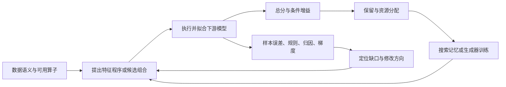

# 模型反馈怎样更有效地指导特征发现

> [!summary] 先读这个结论
> 更有效的闭环，需要同时回答：**哪里还没学好、下一步改什么、改完对谁有用。**
> 总分负责判断是否进步；结构信息负责定位和提出候选；集合搜索让互补候选有机会共同接受评价；模型条件负责约束“有用”的适用范围。
> 文献已经分别打通这些环节，但本次未找到足以证明一个统一方法在所有环节和所有模型上占优的证据。

本文围绕三个问题组织：反馈除了总分还能是什么，如何搜索互补组合，怎样支持多个下游模型。范围截至 **2026-11-06**，包含已发表论文、明确标注的预印本与作者公开实现。没有开展训练实验；公开代码只做静态阅读。讨论由此前 LLMFE、XGBoost 筛选与神经模型交互的问题引出，**不据此推断内部 LR 中未披露的实现或效果**。

详细数学见 [[模型反馈与特征发现/02-反馈、互补与迁移的数学框架]]；逐篇记录见 [[模型反馈与特征发现/03-论文与代码总索引]]；重要反例见 [[模型反馈与特征发现/04-证据边界与反例]]。

## 一、先把 LLMFE 已经打通的事情说准确

LLMFE 的核心不是给一批固定列排个名，而是把**可执行的特征变换程序**作为搜索对象：LLM 生成或修改程序，执行后训练评价器，以验证表现决定哪些程序留在经验池，再用已有优秀程序引导下一轮。程序可以包含多项增删和组合，因而搜索单位大于一条孤立特征。经验池中的分数用于组织和选择程序；这不等于生成器接收了模型梯度，也不等于对 LLM 权重进行了训练。[LLM-FE 方法及作者实现](https://arxiv.org/html/2503.14434v3)、[经验池源码](https://github.com/nikhilsab/LLMFE/blob/main/llmfe/buffer.py)

这条闭环的重要价值是：**把语言模型提出的关系假设，接到了下游预测效用上。**业务语义不再是唯一判据；含有非直观关系的程序，只要搜索能够提出、程序可以执行、评价器能够受益，同样可以被保留。反过来，“有合理语义”也不会自动得到高分。

但这个闭环仍有三个不同的瓶颈：

| 瓶颈 | 只有总分时缺少什么 | 进一步研究的对象 |
|---|---|---|
| 提案没有方向 | 不知道哪类样本、条件或表示出了问题 | 把错误和模型结构变成可操作诊断 |
| 搜索单位不合适 | 单列无收益可能阻止有用组合出现 | 成对、整组或整个程序的搜索 |
| 评价器有偏好 | 对代理模型有用未必对部署模型有用 | 模型条件反馈、多模型取舍及程序迁移 |

这些问题不是换一种重要性分数就能一起解决的。下面的五条路线分别改变闭环中不同的位置。

图中是本研究对文献的综合表达，不是某篇论文的统一架构。

## 二、路线一：把反馈变成能够定位问题的诊断

### 1. 总分没有告诉生成器“为什么”

两个候选都让 AUC 增加同样的数值，可能对应完全不同的变化：一个纠正少数困难样本，另一个改善大多数普通样本；一个利用已有变量的阈值，另一个引入历史聚合。总分可以比较结果，却不能独立告诉下一轮应该改变输入、算子、条件分区还是表示形式。

因此，有用的结构反馈不只是更长的解释，而应当能映射到具体搜索动作：

| 反馈载荷 | 能指出的缺口 | 可以引导的动作；以下为综合推导 | 代表证据 |
|---|---|---|---|
| 错误样本、逆序样本对 | 哪些对象仍无法区分 | 生成区分这些对象的条件或语义属性 | Text-and-Tabular |
| 树的分裂变量和阈值 | 关系在哪些条件下变化 | 构造分段、阈值或条件交叉 | OCTree |
| SHAP 分组和局部贡献 | 当前模型依赖哪些列、哪些列较弱 | 在组内细化，或跨组寻找关系 | SIGMA、MedFeat |
| 残差与负梯度 | 当前预测缺失的方向 | 寻找能解释剩余误差的变换 | CRAFTER；可微方法 |
| 接受/拒绝、重复与成本历史 | 哪些搜索区域已停滞 | 改变算子家族、采样与计算分配 | TopoFE、CoFEH |

“弱重要性列”既可能无用，也可能尚未得到合适表示；“高重要性列”既可能值得细化，也可能已经饱和。因此，重要性应当帮助组织探索，不能天然成为全部候选的否决权。

### 2. OCTree：结构反馈有较直接的消融证据

OCTree 在当前增广数据上**另训 CART**，把树转成文本，与规则和验证分数一起传给 LLM。它不是直接导出目标 XGBoost 的所有内部树路径。作者代码能够核到树文本进入提示的路径。[方法及代码](https://arxiv.org/html/2406.08527v2)、[utils_xg.py](https://github.com/jaehyun513/OCTree/blob/main/ours/utils_xg.py)

v2 的 Table 6 比较仅有分数和增加树结构的反馈，四个数据集的错误率均降低：

| 数据集 | 仅分数反馈，错误率% | 增加树结构，错误率% |
|---|---:|---:|
| Disease | 27.62 | 26.19 |
| Clinical | 45.61 | 45.07 |
| electricity | 6.89 | 6.65 |
| kdd | 19.47 | 19.07 |

这支持“结构提示在该设置中比只有分数更有效”，并不证明 CART 是所有任务最好的诊断器，也不证明树揭示了真实因果关系。[OCTree Table 6](https://arxiv.org/html/2406.08527v2)

### 3. 错误实例反馈：把“分不清”变成生成任务

Text-and-Tabular 使用交叉验证中正负样本的逆序对，并配合正确排序的样例，引导 LLM 生成语义属性。三个任务中，反馈版本分别在第 **4、3、9轮**达到对照版本第15轮的终值。这里最有价值的证据是候选搜索效率，而不是宣称发现了一种普适更强的预测器。论文只覆盖三个文本加表格分类任务，对回归与其他排序损失的扩展主要停留在讨论层面。[方法与反馈消融](https://arxiv.org/html/2609.21894v1)

RelAgent 把这一思想扩展到多表场景：记录各次试验的预测结果、行标识、配置和指标，让代理用只读 SQL 分析错误和版本差异，再修改 SQL 特征与模型配置。论文消融中，完整方法、去掉评估工作区、去掉反馈的平均 AUROC 分别为 **78.38、75.78、66.86**。这是组合系统的证据，不能把全部差距都归因于某一种残差提示。[RelAgent Table 7](https://arxiv.org/html/2605.07840)、[评估工作区代码](https://github.com/HxyScotthuang/RelAgent/blob/main/src/relagent/scientist/eval_workspace.py)

### 4. 残差反馈：关注“尚未解释”，但要看修正器能表达什么

CRAFTER 固定时序预测骨干，让符号搜索和 LLM 生成修正特征，并用验证残差、修正后的效用和剪枝结果分配搜索资源。它研究的是冻结预测器的后处理修正，不能直接当作任意表格模型的特征增广结论。[CRAFTER §3、§5](https://arxiv.org/html/2608.05207)

平方损失下，固定预测器并只允许加上 $a g(X)$，假设 $\mathbb E[r^2]<\infty$ 且 $0<\mathbb E[g^2]<\infty$，最优风险下降为：

$$
\frac{\mathbb E[r g(X)]^2}{\mathbb E[g(X)^2]},\qquad r=Y-f(X).
$$

这个推导解释了残差相关为什么能提供方向。但若 $Z\sim N(0,1)$，剩余误差为 $Z^2-1$，它与 $Z$ 的线性相关为零，非线性修正却有效。CRAFTER 的单候选 Spearman 门也不能覆盖任意非单调或联合关系。**代理诊断的表达范围应与后续修正器匹配。**这是根据方法得到的推论，详见数学笔记。

### 这条路线的取舍

最适合错误能被定位到样本、条件或关系的任务，尤其是文本、规则、多表和可读业务变量。优点是候选来源可解释，能够减少无方向的重复生成。局限是诊断本身依赖模型，丰富错误反馈也可能过度适应同一验证样本；图表、归因和长提示并非越多越好。

## 三、路线二：让搜索真正看到互补组合

### 1. 首先区分三种“交互”

**表达式复合**是先求比值，再按组归一化；**特征集合协同**是两列单独弱、共同使用强；**生成器互补**是 LLM 与符号搜索交换结果。三者都值得做，但不能用一个“交互”概念替代。

例如，低相关性只说明两列没有某种简单的相似关系，未必说明它们共同预测有效；生成很多算子家族说明搜索更广，未必说明最终集合更优。真正的集合问题是：在当前特征集合和目标模型之上，加入一组候选比加入其中各个候选能多带来什么。

### 2. IIFE：用交互信息引导“找谁组合”

IIFE 以

$$\tau_{ij}=I(F_i;Y\mid F_j)-I(F_i;Y)$$

给候选特征对排序，再对优先的特征对尝试二元运算，以目标模型交叉验证决定新列。XOR 例子说明这个信号的价值：两个变量各自对标签无信息，但条件于另一个变量后有信息。它能把单变量评分漏掉的特征对带入搜索。[IIFE 算法与实现](https://arxiv.org/abs/2409.04665)、[作者仓库](https://github.com/tomoverman/IIFE)

但 IIFE 仍逐步添加新列，不是任意高阶集合的全局求解；成对互信息也有估计成本。其8数据集、3模型的实验显示模型之间表现不同，不能把整体平均收益当成所有模型的预期收益。论文报告的总体相对改善受一个极端数据集影响较大，剔除该项后由26.88%变为8.74%；这正说明比单一头条数字更重要的是适用条件。[IIFE Table I 及实验讨论](https://arxiv.org/abs/2409.04665)

### 3. FEAT 与 LLMFE：将完整表示作为搜索个体

FEAT 使用多个表达式树组成表示，再拟合线性预测头；搜索个体是整套表示。其模型系数影响哪些树更容易被变异，逐样本误差参与父代选择，误差与复杂度共同影响生存选择。可微参数的梯度更新与离散树结构进化是两条机制，不能混称为“梯度直接改结构”。[FEAT 方法](https://arxiv.org/abs/1807.00981)、[作者实现](https://github.com/cavalab/feat)

LLMFE 与 EFE 则把完整变换程序作为个体，允许多项操作共同接受评价。其潜在优势是可以跨过“单列必须立即有益”的限制；代价是搜索维度更大、一次得分难以明确归因到每一项修改。**按整体评价提供了发现协同的机会，不等于已经保证发现所有协同。**[LLM-FE](https://arxiv.org/html/2503.14434v3)、[EFE](https://arxiv.org/html/2607.01548v1)

### 4. TopoFE：改善跨家族探索，但最终仍是贪心选择

TopoFE 将算术、聚合、时序、关系和非线性等家族组织为岛屿；停滞状态和历史迁移收益影响岛间信息流，LLM 根据不同岛的优秀程序合成新程序。这里主要解决“下一步去哪类表达式搜索”。

需要注意，当前v2方法将单个程序定义为一列变换；最终 **GreedySelect** 按验证适应度排序，并以相关阈值排除冗余。它没有把全部最终候选子集作为联合优化对象。因此，“跨家族合成”和“最终集合全局最优”之间仍有距离。[TopoFE v2 §2、§3.3.4、Algorithm 1](https://arxiv.org/html/2607.23286v2)

### 5. OpenFE：分层筛选的效率与不可恢复的误删

OpenFE 的第一阶段通过 Feature Boost 等机制及逐步淘汰进行候选粗筛；第二阶段在原始列和存活候选共同输入 LightGBM 后，用重要性排序。它比“每列独立测相关”更丰富，不能被描述成纯单变量方法。但第一阶段删除的列不会在第二阶段被重新发现；第二阶段联合模型的重要性，也不是所有子集重训价值的完整编码。[OpenFE 方法](https://proceedings.mlr.press/v202/zhang23ay.html)、[openfe.py](https://github.com/IIIS-Li-Group/OpenFE/blob/main/openfe/openfe.py)

SCOPE-FE v2进一步把反馈用于缩减候选供给：按输入变量间关联聚类，只保留簇内特征对，再以少量候选的FeatureBoost收益选择算子，最后复用OpenFE筛选。论文报告原始候选数的中位数减少82.9%，但这主要证明搜索空间可以压缩，不能证明找到了更完整的互补组合。独立或低关联的变量也可能对标签有协同，簇内硬限制会排除一部分此类候选；这是机制边界。其v1与v2方法有实质变化，本报告只据v2解释。[SCOPE-FE v2 §3–5](https://arxiv.org/html/2604.27025v2)

### 这条路线的取舍

如果主要担心“各自不强但联合有用”，最相关的是**改变搜索单位和保留机制**：让特征对、程序或整套表示有机会作为整体进入评价。便宜的边际分数适合分配搜索预算，若被用作唯一硬删除条件，就会限定方法能够发现的关系类型。整体搜索更充分，但计算开销、可解释归因和程序复杂度都更难控制。

## 四、路线三：把模型反馈直接接到可学习特征模块

### 从“评价一个程序”到“更新一个参数”

AutoMAN 为预设变换学习局部输入掩码，再学习全局输出掩码，与 MLP 预测头共同优化。任务损失可以直接更新输入选择权重与可学习参数，减少显式枚举大量变换的需要。STG 则用随机门控联合学习选择与预测；它主要解决已有候选的选择，不能自动生成任意新公式。[AutoMAN](https://arxiv.org/html/2406.04153)、[STG](https://proceedings.mlr.press/v119/yamada20a.html)

这条路线改变了反馈带宽：一个总分只评价完整候选，梯度能对许多参数给出局部方向。但可微并不意味着搜索空间无限：变换族、门控参数化、初始化和硬选择步骤都限制结果；非凸训练也没有全局最优保证。

FEAT 将表达式进化和参数梯度结合；Deep Symbolic Optimization 则用表达式奖励训练生成策略。后者的梯度更新的是表达式生成分布，不是把离散符号运算本身当成普通光滑网络。二者说明“符号结构搜索”和“连续参数优化”可以分工，而不必强行归成同一种方法。[FEAT](https://arxiv.org/abs/1807.00981)、[Deep Symbolic Regression](https://openreview.net/forum?id=m5Qsh0kBQG)

### 为什么这并不意味着应该替换 HyFormer 或 PEPNet

显式特征发现与神经网络内部交互作用于不同层：前者改变输入表示或程序，后者在给定输入上学习表示。某种简单比值、聚合或分段可以让有限模型更容易学习；神经网络也可能已经学会了相近关系。外部变换的增益取决于目标模型剩余的表示、数据和优化瓶颈，不能只凭表达式有业务意义判断。

AutoMAN 自身也观察到，按 MLP 学出的特征在 MLP 上通常收益更大，交给 XGBoost 的收益不同。它支持可微生成的跨模型使用，却没有消除源模型偏置。[AutoMAN §4.3](https://arxiv.org/html/2406.04153)

### 这条路线的取舍

适合算子族可预先界定、需要紧密利用任务梯度、希望把特征模块与预测头共同优化的场景。对任意 SQL、离散时间窗口、跨表操作或复杂程序，纯可微方法覆盖不全。其价值在于**对已参数化空间提供更细的更新信号**，不是天然优于开放程序搜索。

## 五、路线四：把“有用”写成模型条件，而不是一个通用标签

### 1. 真正的迁移需要同一目标模型的前后对照

LLMFE v3 的 D.3/Table 13 是本次找到的较清楚的直接证据：用 XGB 搜索特征，冻结后给 MLP、TabPFN，并与原始输入、目标模型自身参与搜索比较。均值与标准差来自5个随机划分。

| 目标模型与指标 | 原始特征 | XGB搜索特征迁移 | 目标模型自身搜索 |
|---|---:|---:|---:|
| MLP，分类ACC↑ | .745±.034 | .763±.030 | .791±.029 |
| MLP，回归NRMSE↓ | .871±.027 | .848±.017 | .631±.043 |
| TabPFN，分类ACC↑ | .852±.028 | .861±.017 | .863±.018 |
| TabPFN，回归NRMSE↓ | .289±.016 | .287±.015 | .286±.015 |

结论是**部分结构可以共享，目标模型适配仍有额外价值**。这张平均表不能证明所有数据集改善，也不能单独证明每格统计显著。[LLM-FE v3 Table 13](https://arxiv.org/html/2503.14434v3#A4.SS3)

OCTree 还有明确负例：Clinical 数据上，XGB 搜索出的特征用于 MLP，错误率由41.77%升到42.32%。因此，从原理到文献都不支持“一个模型认为好，其他模型必然也好”。[OCTree v2 Table 7](https://arxiv.org/html/2406.08527v2)

### 2. 多模型参与反馈，仍要看聚合目标

GELFE 的元标签由 LR、RF、线性SVM、KNN共同提供，但定义是**至少一个模型改善就算有用**。这符合 AutoML 最后可以选择模型的目标，却可能接受对某些固定模型有害的变换。多评价器不自动等于通用特征。[GELFE §3.1](https://personal.eur.nl/frasincar/papers/KBS2025a/kbs2025a.pdf)、[标签构建代码](https://github.com/Casper-de-Winter/GELFE/blob/master/DataSetTrainV2.py)

更完整的反馈对象是相对当前集合的收益向量：

$$
\boldsymbol\Delta(G\mid S)=
(\Delta_{m_1}(G\mid S),\ldots,\Delta_{m_K}(G\mid S)).
$$

应该如何压缩这个向量，取决于使用目标：

| 目标 | 合理的选择逻辑 | 需要接受的取舍 |
|---|---|---|
| 最后可自由选模型 | 任一模型获益可先提名候选，再比较完整流程 | 不保证固定模型或原来最优模型受益，需保留原始流程 |
| 多个已知模型共同使用 | 按部署权重的平均收益，并关注最差模型 | 平均收益可能掩盖退化；约束太严可无解 |
| 保留不同优点 | 维护Pareto候选 | 不能用一个总排名替代最终选择 |
| 共享一部分、允许专属优化 | 共享候选库＋各模型的选择和适配 | 属于适配复用，不是同一冻结特征集零适配迁移 |

这些是本研究据证据提出的设计取舍，不是 GELFE 已经验证的全部机制。尤其是 OR 提名：若两模型的风险由 $(1,10)$ 变为 $(1.2,9)$，虽有一个模型改善，最优风险仍变差；因此必须保留原始流程参与最终选择。

### 3. 特征与超参数本来就有耦合

CoFEH 让特征程序搜索和超参数优化相互反馈；子节点继承配置，贝叶斯优化结合变换后数据的元特征，新的模型评分再影响搜索树。它提醒我们：某个变换失败，可能同时受到缩放、正则化或模型配置影响。其多模型扩展是换模型后重新搜索，不能当作同一组特征的直接迁移。[CoFEH v2 方法与实验](https://arxiv.org/html/2602.09851v2)

TabPrep 同样把特征变体纳入模型调参空间。另一篇研究较新表格基础模型的论文则发现，在它的小数据、默认配置、预设变换范围内，较新模型的最佳观察增益收缩。两者研究对象和选择过程不同，不能简单判成“谁证明特征工程有效、谁证明无效”。共同启发是：**目标模型的能力改变后，原来值得外部构造的结构可能已被内部吸收。**[TabPrep](https://arxiv.org/html/2606.02384v1)、[Do Tabular Foundation Models Still Need Feature Engineering?](https://arxiv.org/html/2609.13202v1)

### 这条路线的取舍

适合代理模型与最终模型不同，或同一候选库服务多模型的系统。优势是保留失败原因与适用边界，避免一个代理的判断被永久写成“特征有用/无用”。代价是评价成本与目标定义复杂。模型族不同的反馈提供归纳偏置差异；同一模型换几个种子主要反映训练随机性，两者不能替代。

## 六、路线五：把历史反馈学进生成器

### 1. 记住高分程序，与学习怎样生成，是两种机制

LLMFE 主要在搜索时使用程序记忆。LFE/GELFE 更早就把历史评价结果变成元学习标签，用新数据的统计描述预测哪些变换值得尝试；它们学习的是变换推荐器。MSDPO 则直接微调推理 LLM，让模型自身更倾向生成有用特征方案与代码。[LFE](https://www.ijcai.org/Proceedings/2017/0352.pdf)、[GELFE](https://personal.eur.nl/frasincar/papers/KBS2025a/kbs2025a.pdf)、[MSDPO](https://aclanthology.org/2026.findings-aacl.233/)

MSDPO 分两阶段：第一阶段用 critic 对特征提案的效用、多样性和非冗余等评价构造偏好；第二阶段结合执行、格式与 XGB 验证 AUC构造偏好，并针对代码部分优化。**语义 critic 是提案质量代理，实际验证效用是另一层证据**，不能把二者合称为模型已经确认的预测贡献。

较早的FeRG-LLM也以XGB AUC为生成思路构造偏好并做DPO，说明“终局效用进入生成器参数”已有具体路径。它的反馈作用于整个思路结果，不能称为逐推理步骤奖励。其公开描述在同一80/20划分上反复选候选，未说明独立外层终测，因此这里采用机制证据，不引用头条提升作为无选择偏差的泛化收益。[FeRG-LLM方法与§4.1](https://arxiv.org/html/2503.23371v1)

该文使用8个偏好训练数据集与24个评价数据集分离。跨预测器分析在共同19个数据集、固定种子下比较原始特征、基础生成器特征、MSDPO特征：XGB平均秩为2.37/1.74/1.68；AutoGluon为1.89/1.95/1.84，越低越好。强预测系统下，特征工程相对原始输入的平均秩优势明显缩小。**平均秩不是AUC百分点**，单种子对照也不能支撑普适显著收益。[MSDPO §4.4、Table 3](https://aclanthology.org/2026.findings-aacl.233.pdf)

### 2. 反馈可以被复用，也可以把偏置固化

生成器训练的潜在价值，是把多次搜索成本摊到之后的任务；风险是训练标签只反映某个评价器、任务族和数据预算。若“有用”只由固定 XGB 的即时增益决定，偏好学习也会继承这个范围。跨数据集泛化、跨模型泛化、生成程序可执行性，是三个需要分别看证据的问题。

因此，较有依据的方向是让反馈记录保留上下文：什么模型、已有集合、任务目标、算子与输入、执行结果以及预测增量。是否进一步把这些上下文作为生成器条件，是可以从 LFE、GELFE 和 MSDPO 推导的路线；本次没有找到证明这种完整组合已达到最优的研究。

### 这条路线的取舍

适合长期处理同类任务、可以积累历史候选与评价结果的场景。与每个任务独立提示搜索相比，它需要维护训练数据和评价口径，但可能减少未来提案的无效尝试。若只处理少量任务，训练生成器的固定成本未必划算。

## 七、五条路线怎样取舍

| 路线 | 主要解决的问题 | 反馈进入哪里 | 最强支持 | 主要边界 |
|---|---|---|---|---|
| 结构诊断 | 提案无方向、反复尝试相似关系 | 提示和候选编辑 | OCTree结构消融；错误实例反馈 | 诊断依赖模型，局部解释不保证总体增益 |
| 互补组合搜索 | 单列筛选错过联合价值 | 搜索单位、亲代选择、保留机制 | IIFE、FEAT、LLMFE | 高阶空间昂贵，贪心和重要性仍有限制 |
| 可微特征模块 | 标量反馈过粗、参数更新低效 | 掩码和算子参数 | AutoMAN、STG、FEAT | 预设语法与非凸优化；任意程序难微分 |
| 模型条件反馈 | 代理与下游偏好不一致 | 评价目标、收益向量、适配 | LLMFE迁移表；GELFE多模型标签 | 通用性与专属性取舍；多评价器成本 |
| 反馈训练生成器 | 每个新任务重复付搜索成本 | 推荐器或LLM权重 | LFE/GELFE；MSDPO | 教师偏置、跨任务迁移与训练固定成本 |

它们可以组合，但不是加入越多模块越好。例如，结构反馈负责提出关系假设，整体程序搜索负责让互补变换共同接受评价，多模型反馈负责保留适用边界；若再有长期历史数据，才有依据考虑把这些反馈训练成生成器。

## 八、最后的研究判断

**第一，最值得优先改变的是反馈与动作之间的连接。**把 AUC 换成 SHAP 均值，或者往提示中增加几张图，并不必然改善搜索。反馈应明确指向“修哪个条件、换哪个算子、组成哪组候选、停止哪个分支”。结构信息和总分承担不同角色，前者指导搜索，后者评价目标效用。

**第二，互补问题首先是搜索问题，才是重要性问题。**如果候选从未作为一个组合被提出和评价，任何逐列排名都可能无法补救。LLMFE 的整程序进化有这方面潜力；IIFE、FEAT 等提供了不同的具体机制。低相关、多样性、高SHAP都只能提供部分线索。

**第三，跨模型通用性应当被表达为有条件的证据。**现有直接迁移结果表明共享收益存在，同时存在目标模型专属收益和失败格。“共享候选库＋模型专属补充”比“单一筛选器判定一切”更符合这些证据；但它是一条综合路线，不是已验证的统一最佳方案。

**第四，生成器学习是长期方向，不能把评价器偏好当成普适真理。**历史反馈越多，越需要保留模型和集合条件。否则可能更高效地重复一个评价器擅长识别的关系。

这些判断不需要知道内部 LR 的全部实现就能成立；它们说明的是下一步该如何思考模型反馈与特征发现，而不是对当前内部方案已经存在某个缺陷的断言。

返回：[[模型反馈与特征发现/00-阅读入口|阅读入口]]
