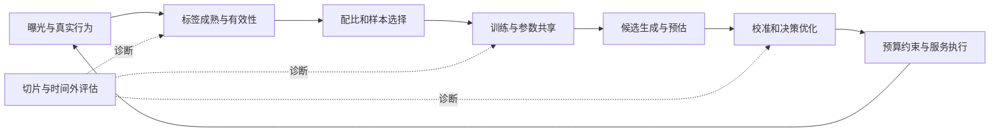

# Pipeline替换与组合关系

本页比较作用位置与接口。结构上可以接入，不代表已优于你的baseline；能一起运行，不代表收益可以相加。所有组合建议都是待实验的迁移推断。返回[[00_总索引与阅读路线]]；证据强弱见[[02_收益链路与证据矩阵]]。

## 先标出改动发生在哪一段

按该图保留可复用接口：输入字段与时点、标签定义、候选ID、预测含义、约束和资源计费。若一个新模型同时改了多段，先保存端到端结果，再用桥接实验定位来源。

## 相近方法的取舍

| 方法组 | 共同问题与不同假设 | 替换什么、保留什么 | 数据/成本与适用边界 |
|---|---|---|---|
| RC / OneRank / CAME-Grad | RC处理强弱特征学习先后；OneRank改任务信息通路；CAME处理更新方向与幅度。三者都可能改善多任务，但不是同一个诊断 | RC改训练日程与锚定；OneRank改主干与任务token；CAME改梯度合成。均可保留业务标签 | RC需可关闭历史的输入边界；OneRank改服务结构；CAME需逐任务梯度，开销随任务数增，推荐实证缺失 |
| 关系辅助头 / BOAR | 前者补联合事件监督及policy接口；后者区分辅助行为缺失与噪声 | 关系头多为新增训练head，部分供策略；BOAR涉及图构建与表示/权重 | 关系标签需对同一观测单位有合法联合结果；BOAR先解决General与分组评估矛盾再考虑整套迁移 |
| FROST / TATC / 负例规则 | FROST在线判断当前更新效用；TATC固定checkpoint按目标覆盖去冗余；规则先决定能否当负例 | 分别替换在线过滤、离线子集选择、负例准入。保留预测器 | FROST需真实batch梯度；TATC需可信probe和候选逐例计算；规则需要成熟结果与覆盖，冷启动未观测不能强标负 |
| Best-of-N / 难负采样 | 比较覆盖与margin共同决定学到的排序；难度提升不保证标签有效，也不保证覆盖上线边界 | 改pair构造与采样分布，保留pairwise模型 | 采样改变reward尺度；pointwise概率不能直接拿来替换；需要独立真值，不能只由同源judge自评 |
| TGH / GH-ESD / OR | 分别问评测是否需要复杂能力、错误发生在哪些可解释实例、当前参数是否还容易适应 | 都先做离线诊断，不必换线上模型 | TGH需时间合法图/文本；GH需发现/验证分离和成员审计；OR需梯度与短步probe，不能当泛化提升保证 |
| CRL / MoE robust / 温度缩放 | 表征减少可疑依赖、训练重权重、输出校准分别作用于不同层 | CRL加训练critic；MoE改loss；TS改概率接口 | CRL需可观察混杂与表示边界；MoE定理只适用概率混合；TS需代表性成熟标签，单一温度不能修复全部异质错误 |
| Strategic DFL / Jacobian诊断 | 前者设计决策监督；后者判断预测器输出方向能否利用这种监督 | DFL改训练目标与求解器反传；Jacobian审计模型—决策接口 | 必须先有可信决策损失/仿真；若只能输出单一收缩系数，换loss可能仅改步长；不要跳过强PTO校准baseline |
| TRACER / 回放 / 刷新 | TRACER用语义补新ID与抑制遗忘；回放保留旧分布；刷新缩短时延 | TRACER改表示与训练loss；回放改batch组成；刷新改调度 | 可互补但旧语义/旧数据都可能阻止兴趣变化；固定历史时间才能分辨“更会学”与“更新更快” |
| SequenceO1 / CCFormer | 都让长历史更便宜；前者形成候选无关可缓存摘要，后者让交互发生后逐层压缩并共享候选计算 | 前者换长期历史分支，保留近期目标注意；后者改序列主干与推理执行 | 缓存键/失效与梯度语义是接口；压缩后丢失候选特异细节不可逆；CCFormer的candidate packing不是让候选互相注意 |
| 蒸馏 / 量化 / 缓存 | 分别迁移函数、近似数值、复用已算结果；损失的信息和失效原因不同 | teacher/student、数值表示、时点依赖缓存 | 教师上限、量化margin敏感性、缓存年龄分别验证；本期未对三类各做完整精读，不能借长序列结果代证 |

## 值得做的组合与必须加的交互对照

| 候选组合 | 合理收益链 | 潜在重叠/冲突 | 最小组合实验 |
|---|---|---|---|
| 负例有效性 → FROST | 先清语义错误，再选对当前目标有用的梯度 | 双重删除长尾；实际数据量/难度变了 | 两开关2×2，精确匹配保留率、难度与来源，再看长尾与总体 |
| TATC → FROST | 静态覆盖选池，动态监测训练中价值变化 | 两者同probe偏差；计算重复；静态选池外信息永远进不来 | 静态/动态/两者/随机，固定总评分成本，保留小比例未筛探索池 |
| RC + 关系辅助头 | 先建立弱信息通道，再用联合监督细化 | 辅助任务也可能依赖历史捷径；锚定阻碍后续关系学习 | 日程×真实关系头，外加打乱/重复主任务头，分冷启与成熟 |
| OneRank + 梯度手术 | 私有通路隔离后，处理剩余共享块冲突 | 如果冲突已经消失，手术只增加噪声/成本 | 先量共享块冲突，只在该块启用；保留等更新幅度控制 |
| 切片发现 + groupDRO | 先定位可复现失败，再调权 | 噪声群体被放大、搜索过拟合、非目标群体退化 | 独立发现/验证；真/随机slice×lr×权重，停止条件看总体与关键群体 |
| CRL + MoE鲁棒加权 | 去曝光捷径后再防路由构成漂移 | 高loss权重可能重新放大噪声/受罚捷径 | 同时间外集2×2，看表示依赖、路由残差、NLL及目标收益，不能只看ECE |
| TRACER + 回放/更频繁刷新 | 语义补新实体，回放保旧，刷新补即时信息 | 对稳定和变化的假设相反；旧target锚可能过强 | old/new实体×兴趣稳定/改变分层；各方法都用相同最新数据截止时间 |
| 压缩 + 更长历史/更快刷新 | 释放资源后用于真正瓶颈 | 缓存使更新滞后，压缩丢掉稀有关键事件；成本可能只是转移 | 分别做固定长度质量、固定算力收益；每次只扩一个资源轴 |

## 上线接口的四项检查

1. **输出语义**：pairwise reward、pCTR、校准概率、决策用参数分别是什么；不可仅因都是一个分数而互换。
2. **信息时点**：任务标签、用户近期行为、候选其他项、图边、teacher输入是否在请求时可见；训练时辅助信息可以更多，服务端必须明确删去或替代。
3. **求导边界**：冻结、detach、缓存、离线摘要与共享参数分别如何处理。结构上前向可读不等于反向会写；局部detach也不等于全网任务无冲突。
4. **资源边界**：训练/推理、离线预计算/在线请求、分支/全链、均值/P99各记一次。吞吐比不能直接当成本降幅，节约算力只有被实际重新分配才产生质量链。
