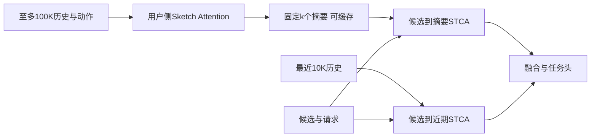

# SequenceO1：压缩的价值如何经由长历史和复用传递

**先判断是否值得试：**如果长历史确有增量，但瓶颈在重复读取、传输和候选相关计算，本文提供可接入精排的方案。若同预算增加历史完全无收益，应先查信息和监督，不必先建设缓存。

原题：*SequenceO1: End-to-End Ultra-Long (100K) Sequence Modeling in Recommendation with Low-Rank Caching*。Lin Guan、Jia-Qi Yang 等，ByteDance。首发/所读 v1 均为 2026-09-08；RecSys 2026 Industry Track，论文页注明 long oral。[元数据](https://arxiv.org/abs/2609.08443) · [所读全文](https://arxiv.org/html/2609.08443v1) · [PDF](https://arxiv.org/pdf/2609.08443v1) · [会议 DOI](https://doi.org/10.1145/3773078.3831864)。未核验独立官方代码仓库。阅读覆盖正文、公式、表1–5及复杂度相关讨论；不宣称复现代码或全面证明审计。

## 可观察的问题与竞争解释

10K 以上历史使存储、CPU/GPU传输、精排延迟和训练吞吐恶化；即使单层 attention 已线性化，多个候选、重复请求仍反复处理相同用户历史。原 production pipeline 为 STCA 10K + lifelong TWIN V2；后者先离线聚类、再目标相关检索，压缩和检索未必直接服从最终精排目标。

失效可来自三处：截断丢失稳定偏好；分阶段检索漏掉关键行为；直接扩大历史造成系统成本失控。本文同时改变三处，不能将全部增益归到一种原因。必须先比较同样100K输入、同样摘要大小，再比较预算限制下可上线方案。

## 改哪里，如何计算

任务是**候选已给定的精排多目标预估**，不是全库召回。输入为用户/请求特征、候选视频和行为 `(item, action)` 序列；输出 finish、skip、like 等任务分数。保留 recent-10K STCA 和下游融合/预测头；将 TWIN V2 长期分支换成可联合训练的 sketch 分支。

SA 使用全局共享的可学习原型 `P∈R^(k×d)`。式(6)–(9)：

$$S=(PW_Q)(XW_K)^T/\sqrt d,\quad A_{ji}=\frac{e^{S_{ji}}}{\sum_{j'}e^{S_{j'i}}},\quad \widetilde X=AX.$$

每个历史 token 的权重在**原型维度**归一化，分配给多个摘要槽；不是每个原型在全部历史位置上竞争。摘要与候选无关，之后才让目标查询摘要。两轮 SA 残差、LayerNorm、SwiGLU FFN 细化，动作侧嵌入融合保留行为类型；宽度适配后进入 STCA。默认 k≈1K、d=128、两轮。所谓 low-rank 是长度维投影，**不等于参数 LoRA 或保证无信息损失**。

训练沿最终精排监督更新摘要与预测模块；论文未完整列出 production 多任务损失权重。系统采用训练本地 KVCache、同用户多请求 batching (MRLB)、请求入口提前计算以及 FlashSA 融合内核。训练 TTL 3小时、有效命中约0.5；服务 TTL 1小时、命中约0.6。缓存键含 user、模型版本、历史时间和 sketch 配置；请求特征与近期历史不缓存。命中路径对原始100K长度为 O(1)，miss 仍需扫描原历史，近期10K分支也仍有成本。

**实施缺口：**文字强调联合训练，却未充分交代跨优化步缓存命中时如何处理旧计算图、摘要梯度、模型版本与 TTL 的关系。不能自行补成“所有命中都完整反传”。接入前需明确 stop-gradient、重算或版本粒度，并测 stale gradient 的代价。

## 结果、分母与预算

|证据位置|对照与结果|能支持什么|
|---|---|---|
|表1，100K轻量消融|仅改归一化轴，SA 对 vanilla 的各任务 ΔUAUC 为 +0.01% 至 +0.20%|该设置下的归一化设计有收益；原表未明确该表百分号是否绝对点，保留原单位，不自行换算|
|表3，同100K、同1K×128摘要|相对 STCA(512) 的 Finish AUC 增益：SA +1.07%，KMeans +0.30%，chunk mean +0.46%，位置桶 +0.72%，Lightning-Attention +0.83%|摘要质量不只是输出 token 数造成；摘要训练开销仍未完全对齐|
|图1(c)|同100K截断、平均85K，SA +1.07% 对直接 STCA +1.29%，比值约83%|保留大部分扩历史收益，**没有超过无压缩参照**|
|表4，完整production|对 STCA10K+TWIN V2，Finish AUC 相对 +0.29%，UAUC +0.40%；Like UAUC +0.72%|替换长期分支后的整体离线改善，不能套用轻量+1.07%|
|表5，一个月 A/B|抖音 Duration +1.4999%、30-Day Activeness +0.1968%；极速版 +1.6655%、+0.2335%|相对业务指标提升；作者称表中结果显著，未给足流量、区间、多重检验细节|
|图1(a)(b)|100K长期分支训练 FLOPs 49.9×低、推理63.9×低|依赖训练 R=40/命中0.5，服务 R=300/命中0.6；**排除了公共recent-10K和ranker成本**，不是端到端速度倍数|

表2将 k从1K增至2K仅 +0.03%、层数2至3仅 +0.02%，作者不作为独立显著证据；去动作融合 -0.20%（相对最终SA），提示“保留什么行为”比盲目多摘要更值得测。论文未公开可重建的工业样本规模/训练划分/全部调参预算，线上候选数与刷新频率严格对照也不充分。

## 收益链逐环拆解

1. 用户侧归一化分配与动作融合 → 每个事件进入某些摘要槽。[方法事实]；“更全面地保存分散兴趣”是[作者解释]，并没有逐兴趣信息恢复率证明。图3两种权重分布归一化域不同，**不能用直方图尺度证明更专门化**。
2. 同摘要大小的 SA → 更好的 Finish AUC。[实验证据：表3]；其中包含压缩器表达能力/训练差异，不能只归因于覆盖。
3. 目标无关摘要 → 跨候选/请求复用，减少重复数据移动与计算。[结构事实+运行命中统计]；是否在你的低活跃用户上有同样命中率属[缺证据]。
4. 节省资源 → 可以使用100K历史，同时保留近期10K细粒度分支 → 相比原生产长期模块更好排序 → 线上时长和活跃改善。[整套A/B支持]；“某次历史兴趣恢复直接导致某用户回访”是[迁移推断]，没有中介因果识别。

直接质量收益是同100K压缩器对比；成本赋能收益是把原本昂贵的100K接入生产。历史更长、端到端监督、工程复用及长期模块替换同时变化，贡献比例未知。

## 替换、组合与最小接入

与 [[S02_CCFormer_交互后压缩与共享计算]] 都可减少历史重复计算，但 SequenceO1 用固定用户摘要支持超长历史，CCFormer 逐层读取细到粗历史。可保留 CCFormer 近期路径并加 sketch 长期分支，必须测重复信息和算力；两种压缩连续叠加可能删除稀有兴趣。与训练辅助监督可组合，但辅助任务必须监督最终摘要保留的内容，不能默认收益叠加。

最小版本：先离线实现用户侧SA、保持近期和预测头不变，不做生产缓存；确认同长度/预算质量后再接入用户级批处理与缓存。需要历史动作可回放、严格事件时间、模型版本键、缓存过期监控；额外成本包括100K特征读取和自定义kernel维护。

## 可证伪实验单

### S01-A：摘要是否保留稀有且任务相关的长程信息

- 假设：SA收益来自保留远期分散兴趣，而非仅更大容量。
- 最小改动/对照：SA、位置桶、均值池化都压100K到同k×d；加参数量相当但只看recent10K的负对照，以及远期事件打乱用户归属的负对照。
- 固定：样本、标签、候选、近期分支、训练样本数、参数/FLOPs分别配对报告，缓存关闭。
- 中间指标：远期稀有类目回访召回、摘要对远期偏好探针的可恢复性、受控删除远期事件后的分数变化；最终为时间外UAUC/NDCG、潜在A/B时长与负反馈。
- 支持：优势集中在确有远期证据的群体，打乱后消失，且不是热门项覆盖造成。推翻/停止：同容量短历史也有同样收益、打乱历史不影响增益，转查容量/正则或泄漏。

### S01-B：成本释放还是摘要本身带来收益

- 假设：上线优势主要由复用允许更长历史，而非缓存改善预测。
- 两阶段对照：同100K下无缓存/不同TTL，再在同P99预算下给各方法可承受最大历史；负对照为直接STCA用相同预算增加训练次数。
- 固定：候选和曝光策略、模型权重、特征截止时间；刷新频率单独做因子，不与TTL一起默默改变。
- 中间：命中率按活跃度、miss P99、IO字节、成本、staleness age、缓存/新算分数差；最终离线质量和线上价值/千请求成本。
- 支持：缓存同信息量质量近似不变，预算再投入后质量增加。停止：低命中使miss拖垮SLA、缓存陈旧损失超过扩历史收益；先缩TTL或保留离线方案，不扩部署。

## 逐篇复核

已核对原始HTML表1–5、公式6–17、生产baseline与轻量baseline区分、命中条件及公共成本遗漏。已保留83%质量保留而非提升、不同归一化域不可直接比较、训练缓存梯度未详述。原文页未显示撤稿；未完成外部撤稿库全覆盖。最值得先测 S01-A；没有长程信息增量即停止系统改造。

返回 [[00_总索引与阅读路线]]。

## 本地证据快照

已读原文快照：[[90_原文证据/decision_continual_system/2609.08443v1.html|S01 所读版本原文]]。官方版本记录与文件SHA256见[[09_原文定位与文件清单]]。HTML快照中的外链图片可能仍需联网；正文文本和原文在线链接同时保留。
