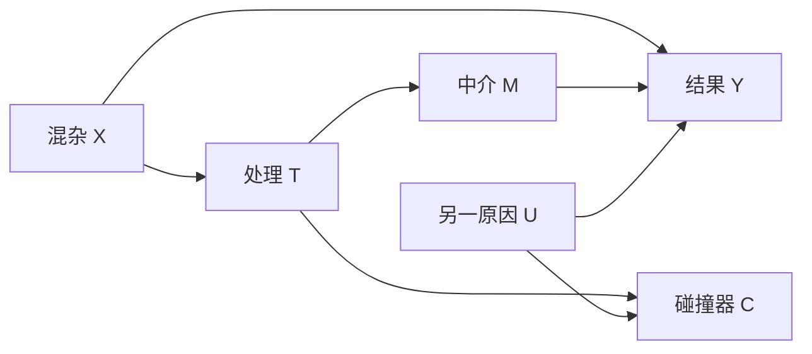

# 因果问题、潜在结果与 DAG

先修：[[知识体系/01-统计与优化/01-条件期望、估计目标与预测|条件期望与估计目标]]。学习因果推断首先要回答：想比较什么干预、针对谁、看多久、通过什么假设从已观察数据得到这个比较？模型名称应放在这些问题之后。

## 1. 相关差异与干预差异

以发券为例，$T=1$ 表示发券，$Y$ 表示一周内是否下单。观察到的 $E[Y\mid T=1]-E[Y\mid T=0]$ 比较的是两群实际接受不同处理的人；目标可能是同一目标人群在两种干预下的平均差。

设高意愿人群不发券下单率为 0.8，低意愿为 0.2，发券都增加 0.1。如果发券组 90% 是高意愿者，对照组只有 10%，观察均值分别为 0.84 与 0.26，差为 0.58；两类人真实增量都是 0.1。差异的主要部分来自人群构成，不是券的作用。

这个反例不需要复杂模型，也说明：准确预测“谁会下单”，不能自动回答“谁因为发券才下单”。

## 2. 潜在结果明确了缺失的比较

定义同一个体在两种处理下的潜在结果 $Y(1),Y(0)$。在一致性条件下，观察结果为：

$$Y=TY(1)+(1-T)Y(0).$$

每个个体通常只观察一个分支，所以个体处理效应 $Y(1)-Y(0)$ 无法直接作为普通监督标签。可识别的平均目标包括：

$$\operatorname{ATE}=E[Y(1)-Y(0)],$$
$$\operatorname{ATT}=E[Y(1)-Y(0)\mid T=1],$$
$$\tau(x)=E[Y(1)-Y(0)\mid X=x].$$

最后一个是 CATE：相同协变量条件下的平均效应，不等于某个具体人的两次命运差。即使估计 CATE 很准确，也没有观察该个体缺失的潜在结果。

ATE 与 ATT 的人群权重不同。若高低意愿人群效应不同，两个平均值就可能不同；“模型算出一个 uplift 数”不足以说明它对应哪个总体。

## 3. 识别、估计与推断是三层问题

识别问：如果知道无限数据下的观测分布，目标是否由它唯一确定？估计问：有限样本中怎样计算？推断问：误差和不确定性多大？

比如无未测混杂无法成立时，即使拥有无限日志和完美预测器，目标因果效应也未必唯一。更深网络改善的是函数估计，不能替代识别假设。反过来，随机实验使识别较清楚，也不表示有限样本的估计没有方差。

## 4. 调整识别的关键条件

对基线变量 $X$，常见条件为：

1. **一致性与明确处理版本**：实际接受 $t$ 时 $Y=Y(t)$。“发券”若混合不同面额、有效期与通知方式，需要说明这些版本是否属于同一干预。
2. **条件可交换性**：$(Y(1),Y(0))\perp T\mid X$。给定 $X$ 后，处理选择不再携带潜在结果的额外信息；这是无未测混杂假设，不能靠训练 AUC 证明。
3. **正值性/重叠**：对目标总体中相关的 $x$，$0<P(T=1\mid X=x)<1$。若某类人永远不发券，就缺少该类人的另一分支信息。
4. **适当的干扰假设**：一个人的结果不应被其他人的处理以未建模方式改变。市场、社交或运力场景常存在干扰，需要重新定义处理和随机化单位。

由这些条件，可逐步得到：

$$
E[Y(t)]=E_XE[Y(t)\mid X]
=E_XE[Y(t)\mid T=t,X]
=E_XE[Y\mid T=t,X].
$$

第二步靠可交换性，第三步靠一致性；重叠保证右侧在目标人群有数据支持。记住每个等号依赖什么，比只背最后公式更重要。

相关系统教材：[Hernán 与 Robins《What If》](https://miguelhernan.org/whatifbook)。以上发券例子和逐步推导用于区分目标与假设。

## 5. DAG 帮助判断该控制什么

三种基本结构：

混杂路径 $T\leftarrow X\rightarrow Y$ 使相关性混入共同原因；合适地调整 $X$ 可阻断它。中介路径 $T\rightarrow M\rightarrow Y$ 是总效应的一部分；控制 $M$ 可能阻断你本来想测量的作用。碰撞器路径 $T\rightarrow C\leftarrow U\rightarrow Y$ 原本被 $C$ 阻断，条件化 $C$ 或其后代可能打开路径。

例如发券影响是否点击，原有意愿也影响点击和下单。如果只在“点击的人”中比较发券与否，相当于按受处理影响的选择变量筛人，可能制造新的偏差。不能因为一个字段预测性强，就一律加入调整集。

DAG 需要领域知识；仅靠观测相关性通常不能唯一确定所有箭头方向。图中不画某个混杂，不等于它不存在。

## 6. 随机实验也需要定义目标和执行过程

随机分配 $Z$ 可使分组与基线潜在结果独立，识别的是分配效应 ITT。如果用户不领券或不使用，实际接受处理 $T$ 不再等同于 $Z$；只比较使用者与未使用者会重新引入选择。

失访、曝光漏记、实验串组、网络干扰和时间窗口变化，都可能破坏想要的比较。随机化是设计优势，不是忽略数据生成过程的理由。依从性相关的 IV/LATE 见 [[知识体系/04-因果推断/06-准实验：DID、IV与RDD|准实验识别]]。

## 7. 连续处理与多档处理的额外要求

多档优惠需为每个目标动作定义 $Y(t)$，比较 $\tau_{t,0}(x)=E[Y(t)-Y(0)\mid X=x]$。某档样本很少时，其效果估计和策略外推会不稳定。

连续出价中精确某一个数值的概率为零，重叠应通过条件密度、局部邻域和目标干预范围表达，不能直接套离散概率条件。平滑性或函数形式可帮助借力，但也引入新的假设。模型画出的平滑响应曲线，不证明整个价格区间都已被数据识别。

## 8. 自检与解析

**问：观测组差异为正，处理真实效应可能为负吗？** 可能。如果接受处理的人基线结果更高，这种选择差异足以盖过负效应。

**问：重叠不足，换更强神经网络是否就能解决？** 不能补出缺失识别信息。可以缩小目标人群、设计探索、引入明确结构假设，并承认目标或证据范围改变。

**问：所有处理前变量都必须调整吗？** 不必。需依据因果结构与估计目标；无关变量可能增方差，工具变量等也有特殊影响。处理前只是必要筛查线索，不是充分选择规则。

继续：[[知识体系/04-因果推断/02-调整、IPW与双重稳健|调整、IPW与双重稳健]]。
