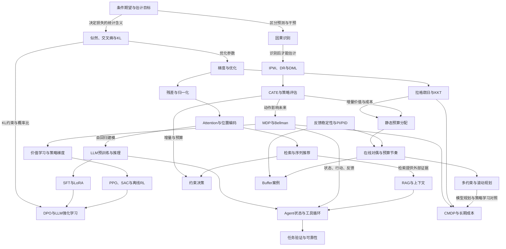

# 统一知识体系

这套内容围绕“定义目标—推导机制—检查假设—比较方法—理解失效边界”学习。43 篇主线正文已经写入，不要求每章做实验；章末自检都有解析，可用纸笔推导、反例和口述检查理解。

[[00-首页|回到知识库首页]] · [[知识体系/知识图谱.canvas|打开可拖动知识图谱]] · [[知识体系/复习/理解检查与跨领域联系|跨领域理解检查]]

## 八个领域及其问题

| 领域 | 核心问题 | 阅读入口 |
|---|---|---|
| 统计与优化 | 到底估计什么，误差来自哪里，参数怎样更新 | [[知识体系/01-统计与优化/README\|5 篇主线与补充专题]] |
| 神经网络与 Transformer | 梯度、归一化、注意力和位置如何共同工作 | [[知识体系/02-神经网络与Transformer/README\|4 篇主线]] |
| LLM | 文本概率如何成为预训练、推理、微调与偏好优化 | [[知识体系/03-LLM/README\|6 篇主线]] |
| 因果推断 | 什么条件下可从观察推到干预效应 | [[知识体系/04-因果推断/README\|6 篇主线与模型专题]] |
| 强化学习 | 动作怎样改变未来，如何优化长期价值 | [[知识体系/05-强化学习/README\|6 篇主线]] |
| Agent | 怎样基于证据行动、更新状态并可靠完成任务 | [[知识体系/06-Agent/README\|3 篇主线]] |
| 检索与推荐 | 如何表示、召回、交互、排序并评价决策 | [[知识体系/07-检索与推荐/README\|5 篇主线与模型专题]] |
| 预算分配与反馈控制 | 怎样分配资源、安排节奏并稳定满足约束 | [[知识体系/08-预算分配与反馈控制/README\|8 篇主线与项目案例]] |

## 知识图谱：边表示具体关系

箭头不是“必须把前面全部学完才准读后面”。它表示哪里可以找到后续结论的依据；遗忘时沿边回查。

## 学习顺序

先读统计 01、02 和 Transformer 01、02，建立条件期望、概率目标、梯度与 attention 的共同语言。然后选择一条主线连续读，不必同时推进所有领域：

**LLM → Agent**：Transformer 03、04 → LLM 01—05 → Agent 01—03；偏好优化放到理解策略梯度后再读 LLM 06。

**因果 → 决策 → RL**：因果 01—05 → RL 01—05 → LLM 06；因果 06 准实验作为另一条识别路线阅读。

**已有推荐经验向外扩展**：推荐 01—05 → Transformer 相关章 → LLM 01—06；用已有项目检查同一模块在推荐与语言模型中的不同条件。

**预算分配与反馈控制**：入口是 [[知识体系/08-预算分配与反馈控制/README|预算控制学习路线]]；从预算口径 → 拉格朗日/KKT → 静态分配 → 反馈基础 → PI/PID → 在线对偶 → 多约束/MPC → CMDP。已有 Buffer 经验可先读 01、03、04、06、08。

时间按理解程度安排。每章至少能做到：说清估计对象或状态、重写关键公式、解释一个等号或梯度、给出一个失效反例。做不到时回到具体章节，不需要通过新增更多笔记掩盖卡点。

## 原理、论文与项目怎样互相连接

主线正文解释可复用机制；“专题”保留具体模型和较细问题；论文精读提供原始定义、图表与实验条件；项目记录保留实际实现和当时证据。三者不互相代替。

| 项目 | 用它检查哪些知识 |
|---|---|
| [[PCVRHyFormer/README\|PCVRHyFormer入口]]、[[序列建模/README\|序列建模入口]] | 候选进入时机、mask、序列信息流、多任务梯度 |
| [[ecr/README\|ecr入口]] | CATE、OOF/DR、排序与多档预算指标 |
| [[生成式出价-仿真系统/README\|生成式出价-仿真系统入口]] | 支持区域、响应曲线、模型误差被策略利用 |
| [[tmall-hstu/README\|tmall-hstu入口]] | SID、残差量化、生成式推荐、LoRA 任务适配 |
| [[buffer-自动调整/README\|buffer-自动调整入口]] | [[知识体系/08-预算分配与反馈控制/08-案例：从现有Buffer到分层预算控制\|乘法递推、稳定性与限幅的理论对照]]；工程状态仍看项目证据 |

更多论文见 [[00-导航/论文阅读|论文阅读]]。原有算法题继续放在 Hot100 与非 Hot100，不混入机器学习主线。

## 如何维护

新增内容优先补到对应问题的正文或专题，避免再按“八股”“模型架构”创建平行知识版本。遇到项目结果变化，更新项目证据与当前结论，再检查理论页中的案例链接。旧笔记的迁移与改写清单见 [[知识体系/迁移与勘误说明|迁移与勘误说明]]。
