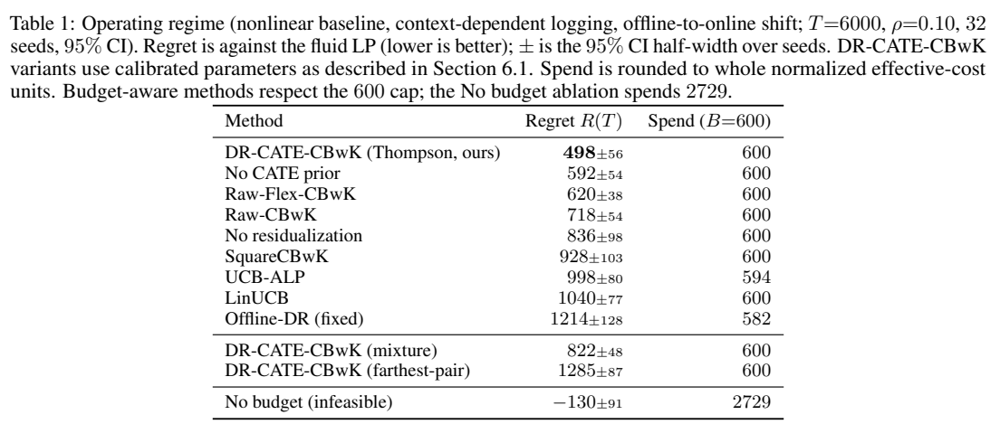

# Action-Centered Causal Bandits for Budget-Constrained Promotion Targeting

当某些人本来就更容易成交，哪一部分奖励还能归给这次干预？先看各档动作相对不干预组怎样中心化，再看剩余预算怎样约束下一轮。作者比较使用真实特征与合成结局，本地检验会固定预算控制器、只替换增量估计。

[[研究前沿/uplift模型迭代/README#预算固定时怎样选档|比较同一问题的其他方法]] · [[研究前沿/uplift模型迭代/02-可复用方法卡/按实际抽样分布中心化多档动作|中心化多档动作]] · [[研究前沿/uplift模型迭代/03-实验假设与结果/预算固定时基线错设对多档增量决策的影响|未运行：固定预算的对照]]

在有免费对照档的促销选择中，算法按实际抽样概率中心化动作特征，估计相对不干预的增量，再用剩余预算筛选可选动作。半合成招聘平台基准中，实践版后悔值为 498，对应最强收益建模对照为 620。

Yifan Lin、Kaixu Yang、Di Mo。arXiv 首次提交 2026-11-06，已读 v1（2026-11-06）。 [版本记录](https://arxiv.org/abs/2611.08990v1) · [已保存的原文 PDF](./assets/source/paper.pdf)

**阅读覆盖**　§§3–6、算法 1–3、定理 1–2、表 1–2、图 1–2；未逐行复证置信界与扩展附录。

**代码与数据**　作者报告使用真实日志特征和合成结局；本次核验的论文未给可确认的作者公开复现仓库。

## 1. 要解决的决策

每轮先见上下文 $X_t$，再从一个零成本对照和 $K$ 个付费方案中抽取动作。估计对象 $\tau_a(x)=E[Y(a)-Y(a_0)\mid X=x]$。式（3）说明预期奖励比增量价值多一个各策略共同的基线。于是可针对增量建模，而无需假定共享基线也是线性函数。流体线性规划（LP）在平均成本不超过 $\rho=B/T$ 下提供比较标准。

## 2. 从日志估计到逐轮更新

算法 2 在折外拟合各档倾向和结局，式（6）以两档结局预测差加上两档有符号的逆倾向加权残差构成 DR 伪结果，回归出各臂的初始线性对比；日志倾向可知时直接使用。它为在线估计提供初始中心，而非一开始就累积了理想的在线信息矩阵。

式（10）–（11）令 $z_t(a)$ 将当前特征放入对应动作的参数块，对照块为零；下式用 $H_{t-1}$ 表示决策前历史。

$$
u_t=z_t(A_t)-\sum_a\pi_t(a)z_t(a),\quad g_t=Y_t-\widehat f(X_t),\quad
E[u_tg_t\mid X_t,H_{t-1}]=\operatorname{Cov}_{\pi_t}(z_t)\,\theta^* .
$$

累加 $u_tu_t^\top$ 和 $u_tg_t$ 再解正则化回归。由于 $E[u_t\mid X_t,H_{t-1}]=0$，任何由决策前信息确定的共享基线残差项都消掉；基线质量仍影响抽样方差。若策略只剩一个动作，该轮没有对比信息。

算法 1 先剔除本次成本超出剩余预算的动作，再用价格 $\lambda_t$ 折减增量并在活跃集合内随机化。按 $\lambda_{t+1}=[\lambda_t+\eta_t(c_t-\rho)]_+$ 调整消耗速度。保证不超硬预算的是可支付集合；记账标的是确定的有效成本，论文按核销率折算，实际现金负债若不同需另行建模。

## 3. 对照、组件证据与边界

表 1 用实际招聘用户特征、合成响应、10,000 条离线日志、6,000 轮在线模拟、4 个付费动作、预算 600、32 个随机种子。实践版 Thompson 的后悔值为 498±56，控制器一致且可拟合非线性基线的 Raw-Flex 为 620±38；两者均消耗 600。去掉离线增量先验为 592±54，保留先验但去掉基线残差化为 836±98。± 为 95% 区间半宽。无预算版本花 2,729，其负后悔不能与可行方案作公平比较。

定理 1 在平稳 i.i.d. 上下文、线性 CATE、规定的噪声、置信与覆盖条件下给出相对流体 LP 的高概率 $\widetilde O(Kd\sqrt T)$ 后悔。达到 498 的 Thompson 规则不一定满足定理的覆盖条件；有覆盖的混合规则在表 1 为 822±48。表 2 改成非线性 CATE 后，神经版 906±42、线性版 945±45，配对比较 $p=0.11$。均是模拟决策收益，未在真实用户中验证。

## 方法与实验

[[研究前沿/uplift模型迭代/02-可复用方法卡/按实际抽样分布中心化多档动作|按实际抽样分布中心化多档动作]] · [[研究前沿/uplift模型迭代/02-可复用方法卡/按剩余有效成本约束多档探索|按剩余有效成本约束多档探索]] · [[研究前沿/uplift模型迭代/03-实验假设与结果/预算固定时基线错设对多档增量决策的影响|预算固定时基线错设对多档增量决策的影响]]
