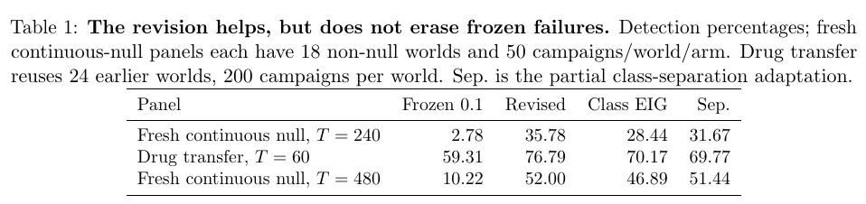

# Adaptive Experimentation Can Hide Model Error:Detection Limits and Falsification Budget

一直在参数最容易估计的位置采样，可能让错误剂量响应曲线也通过检验。作者给出当前采样策略下的功效上界，并披露主要研究失败和修订探测规则在不同期限出现的相反证据。

Ramnarayan Choudhary。arXiv 首次提交 2026-11-05，本次核验 v1（2026-11-05）。[论文与版本记录](https://arxiv.org/abs/2611.07529v1) · [原文 HTML](https://arxiv.org/html/2611.07529v1) · [本地完整 PDF](./assets/source/paper.pdf)

**阅读覆盖**　§§3–6、定理 1、算法 1、表 1、附录独立主研究与修订回放摘要；未逐项核实全部历史、LLM 实验与附录证明。题名按 arXiv 元数据记，PDF 正文使用复数 Budgets。

**代码与数据**　论文 Reproducibility and study status 明确说明 v1 未链接公开代码/数据归档；作者提及私有审阅材料，本次未取得可复现入口。

## 1. 同一实验有两类信息需求

工作模型 $p_\theta(y\mid a)$ 给定剂量的响应可用于估计参数，但若它在被采样的剂量上和真模型 $P$ 相同，再多的这类观测也难以证伪。令 $\nu_T(a)$ 为完整实验在真分布下的期望采样比例，作者以 KL 链式法则和数据处理不等式得到定理 1。对任意水平 $\alpha$ 的检验、截止 $T$ 的拒绝事件 $A_T$，

$$
D(\nu)=\inf_\theta \sum_a\nu(a)\,\mathrm{KL}\big(P(\cdot\mid a)\|p_\theta(\cdot\mid a)\big),
\qquad \Pr_P(A_T)\le \mathrm{kl}^{-1}_{\alpha}\{T D(\nu_T)\}.
$$

此上界需要真分布，不能直接充当业务报警分。论文分别检查设计本身没收集区别信号、和虽有信号但检测器没捕获这两种损失。

## 2. 如何分配证伪样本

§4–5 预先声明替代族 $h$、其后验 $w_t$ 及目标权重 $\mu$。先对每个替代假设算差异再加权，避免正负偏离在预测均值中抵消：

$$
ED_t(a)=E_{h\sim w_t}\mathrm{KL}\big(p_h(\cdot\mid a)\|p_t(\cdot\mid a)\big),
\qquad B_t=\sum_a\mu(a) ED_t(a).
$$

算法 1 修订版在尚未拒绝且 $B_t\ge\log(1/\alpha)/T$ 或独立保底硬币命中时，选取使 $ED_t$ 最大的动作；硬币概率 $0.5/\sqrt{t+1}$。其他时点跟随原设计。连续零假设比较中预测仍留在工作模型类内。替代库没有表示出的错设可能得到零分；阈值依赖期限，定理没有证明该阈值最优。

## 3. 给失败和成功同样的比较口径

预先独立设定的主研究中，最强限额对照在 60/120 步拒绝 4/288 与 14/288，均未达预注册的 20% 检出资格。它无法确认主要改进。另一个新面板在 240 步对 18 个非零世界每个运行 50 次：固定 0.1 阈值 2.78%，次级修订规则 35.78%，类别判别 EIG 28.44%，类别分离对照 31.67%。修订与类别分离的配对世界差 4.1 个百分点［1.4, 7.2］。另一新面板 480 步相差 0.6 个百分点［−1.8, 2.7］，未分出高下，不能据此推断等效。

纠正实验板归一化错误后重做的 289 单位实测回放，在 127 个按全数据拟合标记的低 p 单位，修订规则检出 14.16%，随机 3.42%，类别 EIG 17.37%。重复采样和事后标签限制外推。§6 还披露后续检测器分子修订在复用的 480 步面板保持 52.0%，未达改进条件。可借用的是诊断和基线协议，不能据此在真实投放承诺发现率。

## 方法卡与实验

[[研究前沿/uplift模型迭代/02-可复用方法卡/按实验期限保留错设探测样本|按实验期限保留错设探测样本]]

[[研究前沿/uplift模型迭代/03-实验假设与结果/固定流量下的多档响应曲线错设检出|固定流量下的多档响应曲线错设检出]]
