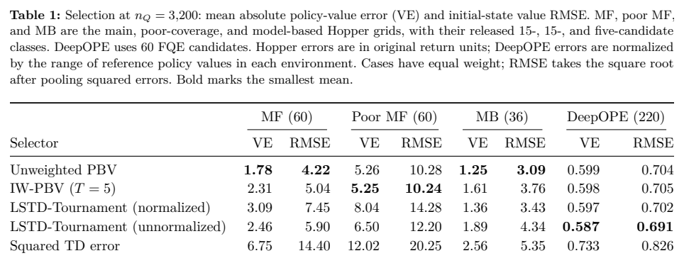

# 没有线上真值时，怎样挑选估计策略价值的模型？

<!-- 全库方法复筛开始 -->
> **方法储备 · 业务决策与理论储备**。保留“Model Selection for Off-Policy Evaluation via Bellman Tournaments”这一研究问题或机制；是否用于当前业务另行验证。
> 原有阅读范围与证据等级不变；储备不等于效果已验证。
> [[研究前沿/论文库复筛与阅读路线|全库阅读路线]] · [[研究前沿/业务决策与理论储备/存量论文分层索引|本方向完整分层]]
<!-- 全库方法复筛结束 -->

表 1 的 Hopper 主设定中，PBV 的平均绝对策略价值误差为 1.78，归一化 LSTD 对照为 3.09，平方 TD 误差选模为 6.75。DeepOPE 上未归一化 LSTD 略优。

## 论文与阅读范围

Model Selection for Off-Policy Evaluation via Bellman Tournaments。Lars van der Laan、Vasilis Syrgkanis、Nathan Kallus。首次公开 2026-10-26，所读版本 v2（2026-11-12）。精读 v2 §3–6、算法 1、表 1、S3，对照 v1。v2 扩展评判函数分析，加入 DeepOPE 和惩罚项消融。 [一手来源](https://arxiv.org/abs/2610.35748v2) · [paper.pdf](./assets/source/paper.pdf) · [paper.html](./assets/source/paper.html)

## 怎样计算

冻结待选 $Q_i$ 及目标策略，在独立验证轨迹上形成奖励、下一状态及其目标策略动作期望的 Bellman 残差。用两候选预测之差作评判函数，测量残差是否沿该差异系统偏离零，并扣除对评判函数的二次惩罚。包含零函数作为对手。对每个候选取最不利对手的分数，再选该分数最小者。算法 1 另给加权版本，先比较占用密度比估计，再把选出的权重带回矩条件。

## 与哪些方法比较

验证样本数 3,200。Hopper 主设置与低覆盖设置各有 60 组、每组 15 个模型；低覆盖时上述三种方法依次为 5.26、8.04、12.02。DeepOPE 的 220 组设置每组含 60 个 FQE 候选，PBV、未归一化 LSTD、平方 TD 的归一化误差依次为 0.599、0.587、0.733。表 S3 固定其余项去掉惩罚，Hopper 模型型候选误差由 1.25 升至 1.90，DeepOPE 从 0.599 降至 0.589。

表 1。不同环境的误差单位不同，数值仅作列内比较。 [原文第 11 页](./assets/source/paper.pdf#page=11)

## 适用条件与迁移

最小采用单元为冻结候选后的选模器。它依赖有奖赏和下一状态的日志及目标策略；某策略几乎从未到达的状态无法仅靠选模解决。复核实现可依算法 1，原文未核实作者可执行仓库。

[[研究前沿/uplift模型迭代/02-可复用方法卡/BellmanPBV-用候选差异检验价值模型的残差|用候选差异检验价值模型的残差]] · [[研究前沿/uplift模型迭代/03-实验假设与结果/BellmanPBV-同一批冻结估计器的离线选模对照|同一批冻结估计器的离线选模对照（未运行）]]
