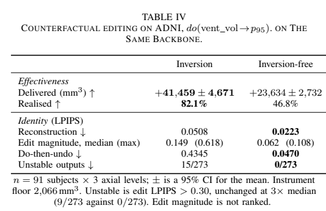

# 反事实生成应同时检查动作是否生效和个体是否保真

<!-- 全库方法复筛开始 -->
> **方法储备 · 司乘行为序列建模**。保留“无需反演的反事实编辑与可逆性检查”这一研究问题或机制；是否用于当前业务另行验证。
> 原有阅读范围与证据等级不变；储备不等于效果已验证。
> 已恢复此前因业务距离被移出的原笔记；旧取舍原因仅作历史记录。
> [[研究前沿/论文库复筛与阅读路线|全库阅读路线]] · [[研究前沿/司乘行为序列建模/存量论文分层索引|本方向完整分层]]
<!-- 全库方法复筛结束 -->

Inversion-Free High-Dimensional Counterfactual Inference。作者为 Vishnubhatla, Saketh、Ma, Pingchuan、Wan, Shu、Beigi, Alimohammad、Harrison, Andre、Raglin, Adrienne、Liu, Huan。arXiv 首投 2026-11-09，本次核验 v1。作者备注已被 IEEE BigData 2026 接收。 [版本记录](https://arxiv.org/abs/2611.12815v1) · [本地 PDF](./assets/source/paper.pdf) · [本地 HTML](./assets/source/paper.html)

## 研究问题

一个生成器可以靠少改动保住原样，也可以通过大幅改动轻易命中目标，两种单项评估都容易给出乐观结论。

## 方法与关键计算

图像属性沿因果图更新，在相同生成骨干上对照先逆推潜状态的编辑和直接使用两个条件速度差的编辑。分别测实际改变量占请求量的比例、无动作重构距离、执行后撤销距离，以及不稳定输出数。

$$
D_{\rm undo}=d\!\left(x,\;T_{c^*\to c}\big(T_{c\to c^*}(x)\big)\right)
$$

这是对表 IV 往返指标的操作记号。先由事实条件 c 切换到目标条件 c*，再切回，比对原图；仅往返误差低不足以说明编辑生效。 [原文定位](https://arxiv.org/html/2611.12815v1#S6.T4)

## 对照、结果和限制

表 IV 的 ADNI 对照含 91 名受试者、每人 3 个层面。逆推与免逆推达到请求改变量的 82.1% 与 46.8%，执行再撤销的 LPIPS 为 0.4345 与 0.0470。更保真的方法也更少改变目标属性。 [原文证据](https://arxiv.org/html/2611.12815v1#S6.T4)

原文 PDF 第 9 页。

真实个体的另一个潜在世界不可观察。测量器、图结构与近似生成器共同决定结果。迁移的是配对评估协议，图像模型结果无法证明业务动作效应。

## 复用和阅读范围

已核问题设定、方法与上文所列的关键对照，详细证明及未列出的实验以所附全文为准。本次未核实作者公开实现入口。

[[研究前沿/uplift模型迭代/02-可复用方法卡/CFEditTest-生效程度与往返保真对照|生效程度与往返保真对照]] · [[研究前沿/uplift模型迭代/03-实验假设与结果/CFEditTest-对反事实响应生成器同时测动作执行率、零动作一致性和往返误差|对反事实响应生成器同时测动作执行率、零动作一致性和往返误差]]
