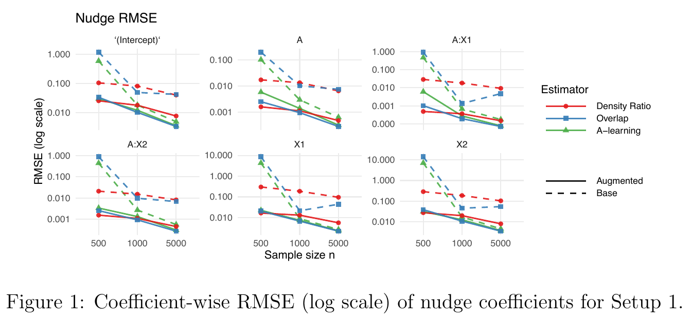

# Heterogeneous Effects of Continuous Treatments via Conditional Modified Treatment Policies

[官方论文](https://arxiv.org/abs/2608.20744) · [本地 PDF](./assets/source/paper.pdf) · [HTML 快照](./assets/source/paper.html)

首次提交：2026-08-21；本次精读：2026-11-05；核验版本：v1。会议正式发表日期未核验。本文是旧队列补精读，不是今日新发表。

阅读范围：核心方法、关键公式、主实验/理论条件及与迁移直接相关的附录。未逐行复证全部证明，也不称逐页翻译；具体覆盖见 [[研究前沿/uplift模型迭代/01-论文原文与精读/CMTP/阅读覆盖|阅读覆盖]]。HTML 为原始快照，外部样式/图片可能需要联网；PDF 是完整离线原文。

代码状态：原文未提供可核验的公开官方仓库入口；未把文中本地脚本名、提交哈希或同名项目当成已取得代码。本次未运行作者代码。

## 1. 问题、旧范式与结论

全剂量响应面需要在不同人群上覆盖很宽的剂量区间。本文把问题缩小为“现有剂量小幅改变后，谁受益”，用逆向平移后的复制数据把连续处理变成二臂对比。价值主要在**估计目标和损失构造**，不是更大的网络。固定基函数模型估计的是投影，不能自动理解为真实 CATE 曲面。

## 2. 两个估计目标与识别条件（§2.1–2.2）

剂量为 $A$、协变量为 $\boldsymbol X$。给定剂量的 nudge 与按自然剂量分布平均的 CMTP 不同：

$$
\tau_\delta(a,x)=\mathbb E[Y(a+\delta)-Y(a)\mid X=x],\qquad
\tau_\delta(x)=\mathbb E[Y(A+\delta)-Y(A)\mid X=x].
$$

识别 CMTP 需要 consistency、移位后的局部支持和 Assumption 3(A′) 的条件均值策略可交换性；识别整个 nudge 面还需要 3(A)。在这些条件下，CMTP 由观察回归 $m_0(a,x)$ 的移位差平均识别，而不是先识别整个反事实剂量响应面。

小幅变化不会自动消除混杂。固定平移在有界支持的边界仍会失败，须限制可行区域或使用尊重边界的策略。论文建议的潜在重叠优势必须通过数据诊断确认。

## 3. 复制数据、中心化与直接 CMTP（§2.3–3）

每个原始样本产生两行：$(X_i,A_i,Y_i,\widetilde\Lambda=0)$ 和 $(X_i,A_i-\delta,Y_i,\widetilde\Lambda=1)$。第二行在相同复制剂量 $a$ 上对应原剂量 $a+\delta$。二臂概率为

$$
\pi_\Lambda(x,a)=\frac{g_{A\mid X}(a+\delta\mid x)}{g_{A\mid X}(a+\delta\mid x)+g_{A\mid X}(a\mid x)}.
$$

可以直接做二分类估计该概率，避免直接拟合连续密度。加权法使两臂权重平衡；A-learning 用中心化处理变量 $\widetilde\Lambda-\pi_\Lambda$ 隔离对比。其增广损失（原文式6）为

$$
\ell_{A,\mathrm{aug}}(f;a,x)=\mathbb E[\{Y-m(a,x)-(\widetilde\Lambda-\pi_\Lambda(x,a))f(a,x)\}^2\mid X=x,A_\Lambda=a].\qquad\text{(6)}
$$

**直观理解：** 两行共享原来的结果，但坐标和“处理臂”不同；模型学习相邻剂量的差异。不能把这两行看成两个独立患者。

先拟合 nudge 再回归到 $X$ 是一种路线。直接学只依赖 $X$ 的 CMTP 更省建模复杂度，但不能简单去掉剂量输入：未稳定化的损失会引入混合分布权重。必须除以 $\pi_\Lambda$，原文式8：

$$
\ell_{A,\mathrm{aug}}^{\mathrm{CMTP}}(f;X)=\mathbb E\left[\frac{\{Y-m(A_\Lambda,X)-(\widetilde\Lambda-\pi_\Lambda(X,A_\Lambda))f(X)\}^2}{\pi_\Lambda(X,A_\Lambda)}\mid X\right].\qquad\text{(8)}
$$

这里的增广用于去除预后变化、提高精度；本次归档的平方损失结论以正确的臂概率/平衡条件为前提，不把“随便加一个结果模型”叫作已实现双重稳健。有限维 nudge 是重叠加权投影，稳定化直接 CMTP 是自然 $X$ 分布上的投影。

二元结果可用 NLL，但输出在链接尺度。原文 Proposition 6 给出概率差恢复关系：

$$
\operatorname{expit}((1-\pi_\Lambda)f^*)-\operatorname{expit}(-\pi_\Lambda f^*)=\tau_\delta(a,x).
$$

不能直接把 logit 参数差当作转化率 uplift。

## 4. 理论与实验（§4–6、补充B/C）

理论用 M-estimation、Donsker/光滑条件建立投影参数的渐近正态性；标准误须计入估计臂概率及复制行依赖。灵活深网、交叉拟合扩展在讨论中提出，不能说论文已给出任意深网的保证。

模拟比较 Density Ratio、Overlap、A-learning 及增广版，样本量 500/1000/5000。Table 1 的直接 A-learning、$X_1$ 系数在 $n=500$ 时 RMSE 从 0.1361 降至 0.0857；该项覆盖率从 0.9700 变为 0.9500。$n=5000$ 时两者 RMSE 都是 0.0285，增益并非处处存在；增广截距覆盖率约0.92也低于名义0.95。比较主要是同一低维工作模型内估计方法，不是与最强深度连续处理模型的广泛竞赛。

MIMIC-III 实例含 5,011 名完整病例，考察机械功率正负1 J/min的移动，结局为住院死亡。pH 等效应修饰项跨估计器方向较一致，但这是观察数据估计，没有干预部署或临床疗效验证。原文模拟段称 nudge 关于剂量为“quadratic”，展示公式实际对 $a$ 为一次；归档保留公式，不沿用该措辞。

图表为原始PDF裁图，页码见图片说明及附件溯源记录；数字与标记以原图为准。

## 5. 迁移价值与需要先验证的边界

可迁移到连续优惠幅度、等待时长或价格的小幅调整。但等待时长是策略与拥堵共同决定的时变处理时，单次静态可交换性未必成立。最小研究是固定一个有支持的 $\delta$，比较局部效应和整条响应面，报告重叠、外推比例及策略价值。不要据局部有效性外推到任意大动作。

## 方法卡与后续实验

- [[研究前沿/uplift模型迭代/02-可复用方法卡/CMTP-duplicate-nudge|复制数据的连续剂量局部效应学习]]
- [[研究前沿/uplift模型迭代/02-可复用方法卡/CMTP-direct-stabilization|直接CMTP的自然分布稳定化]]
- [[研究前沿/uplift模型迭代/03-实验假设与结果/2026-11-05-局部移位目标|局部移位学习能否减少全响应面的建模负担（未运行）]]
