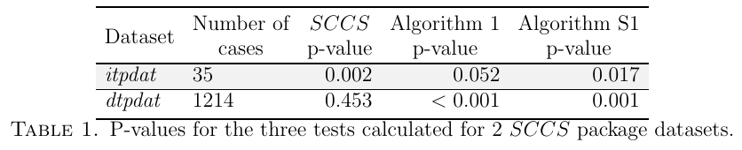

# Causal Inference from Self-controlled Case Series

仅有出现事件者的轨迹时，可以在同一个体、同一协变量层内比较风险期和非风险期。效应大小需要较强的条件；仅检验有无效应可在较弱的条件下做，仍要检查事件是否成串发生。

Gellért Perényi、Marco Piccininni、Mats J. Stensrud。arXiv 首次提交 2026-11-02，本次核验 v2（2026-11-03）。[论文与版本记录](https://arxiv.org/abs/2611.03531v2) · [原文 HTML](https://arxiv.org/html/2611.03531v2) · [本地完整 PDF](./assets/source/paper.pdf)

**阅读覆盖**　v2 的 §§2–8、命题 1–3、算法 1、表 1、附录 D/K 的模拟和备选检验；未逐页复证补充材料。v1 与 v2 均不在既有库，只归档当前 v2，本次未作逐字版本差异比较。

**代码与数据**　§7 指明公开 R 包 SCCS 的示例数据 itpdat、dtpdat。作者实现算法 1/S1 的公开代码入口未核实；示例数据与完整复现代码分别记录。

## 1. 同一个体在两个时期充当自己的对照

按固定间隔记录处理、协变量 $L_k$、事件 $Y_k$，将过去 $m$ 期内有暴露作为短暂风险窗口 $V_k=1$。样本仅收录至少一次事件的病例；不随时间变化的特征 $U$ 可在个人内比较中隐式控制。命题 1 从目标试验与潜在结果引出边际因果率比。需要给定 $U,L$ 的平稳性、同一层同时有暴露与未暴露时点、细时间尺度下的稀有事件条件，以及可合并非免疫层的效应同质性等；附录另列处理可交换性及历史限制。仅看到病例并不能恢复全人群绝对风险或个体异质效应。命题 2 在附加条件下联系到条件泊松拟合。

## 2. 只问有没有效应，哪些条件可以放宽

§6 的原假设是每个时点对所有处理历史的潜在结果完全相同。命题 3 要求二元事件、给定协变量层的结局向量在保持层别的置换下分布不变（部分可交换性）和处理可交换性 S2，不要求完整泊松率比模型。对病例 $i$ 的层 $l$，令 $n_1,n_0$ 是风险/对照时点数、$s$ 是总事件、$s_1$ 是风险期事件。算法 1 计算

$$
D=\sum_{i,l}\left[s_1-s\frac{n_1}{n_0+n_1}\right],\qquad
s_1^{(b)}\sim \mathrm{Hypergeom}(n_0+n_1,n_1,s).
$$

每次模拟所有层、合计同一统计量，用含观测本身的加一法得双侧 Monte Carlo p 值。必须有两种时期的层才贡献信息。若事件密集成串、置换会破坏自相关，则条件检验的适用性改变。附录 K 的 S1 改为病例级重抽样率差，转而需要相应条件均值相等和个体独立，且为大样本方法。

## 3. 两个公开数据示例说明了什么

§6.1 的 5,000 次模拟中，假设 7 成立时精确条件法一类错误约 0.04–0.05。S1 在多数情形为 0.05–0.06，非平稳或暴露严重失衡、有效对照稀少时为 0.12。§7 表 1 的 itpdat（35 例）标准 SCCS、算法 1、S1 的 p 值为 0.002、0.052、0.017；dtpdat（1,214 例）为 0.453、<0.001、0.001。后者有 130 人重复事件，图 2 提示时间聚集，对算法 1 的置换条件提出疑问。p 值不量化效应大小，也不能凭方法间多数投票确定真值。

潜在业务用途是仅留存罕见负向事件的干预监测。需要完整的病例观察时窗、动作时点和足够的对照时间，事件若反过来改变后续动作或观察终止，则必须重新检查识别条件。

## 方法卡与实验

[[研究前沿/uplift模型迭代/02-可复用方法卡/病例内风险窗口的条件置换检验|病例内风险窗口的条件置换检验]]

尚无本地实验记录。
