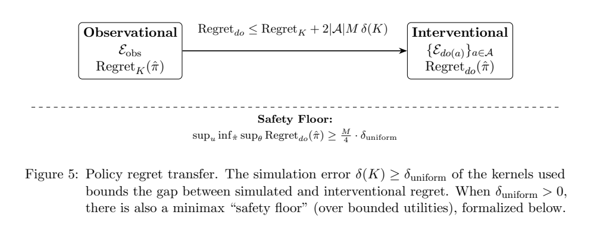

# Constraints on Causal Inference as Experiment Comparison: A Framework for Identification, Transportability, and Policy Learning

<!-- 全库方法复筛开始 -->
> **方法储备 · 训练目标与数据反馈**。保留“跨试验比较的因果假设与纠错”这一研究问题或机制；是否用于当前业务另行验证。
> 原有阅读范围与证据等级不变；储备不等于效果已验证。
> 已恢复此前因业务距离被移出的原笔记；旧取舍原因仅作历史记录。
> [[研究前沿/论文库复筛与阅读路线|全库阅读路线]] · [[研究前沿/训练目标与数据反馈/存量论文分层索引|本方向完整分层]]
<!-- 全库方法复筛结束 -->

用观察模型模拟每个动作，模拟最优仍可能在真实干预下选错。旧软件低估了这一差额；新版把策略是否因人而异，以及可选动作数，显式写进上界。

Deniz Akdemir。系列首发 2026-01-25；11-09 作者上传理论修正 v5，同日 CRAN 发布 0.3.0；11-12 v6 更新演示与技术说明。 [作者存档](https://zenodo.org/records/24161548) · [本地 v6](./assets/source/paper.pdf) · [对照 v5](./assets/source/paper-v5.pdf) · [CRAN 原包](./assets/source/causaldef_0.3.0.tar.gz) · [更正清单](./assets/source/NEWS.html)

## 研究问题与机制

§3.2 为每个动作建立从观察分布到干预分布的模拟核 K，以所有允许环境和动作上的最坏总变差误差 δ(K) 衡量准确性。若效用在 [0,M] 内，每一项价值误差由 Mδ(K) 控住；按协变量选动作的策略须将多个动作的误差求和。在最优策略和被评价策略各扣一次价值误差，得到后悔转移。固定动作策略只需对一个动作计误差。

$R_{do}(\pi)\le R_K(\pi)+2|\mathcal A|M\delta(K)$，当比较的是恒定动作策略时将 $|\mathcal A|$ 换成 1。定理 15 的 minimax 下界针对存在某个有界效用，使用 $M\delta_{uniform}/4$；不能拿它预测给定效用的后悔。

## 对照与证据

定理 13 后注 14 构造共享一个观察分布的两个环境：模拟值并列，各环境下真实最优固定动作相反，最坏后悔达到 2Mδ。由此推翻旧软件的 Mδ 上界。11-09 手稿 v5 与软件 0.3.0 已改正常数；11-12 v6 第 6 节进一步与新软件输出对齐。二元、M=1、δ 代理约 0.0212 的演示，协变量策略罚项约 0.0848，固定动作约 0.0424。这个数值是软件示例；反例和定理才支持常数的修订。

图 5，模拟策略后悔与真实干预后悔之间的理论关系。

## 假设、局限与复核范围

定理需要真正的最坏核误差或有效上界。该包用倾向得分总变差作代理时，所得为启发式量；把代理的 bootstrap 区间上端代入也不会自动成为因果保证。另一个有 VC 复杂度项的有限样本结果还要求已知倾向与重叠。

已读取 CRAN 0.3.0 源包 R/policy_bounds.R 中 policy_regret_bound()、测试文件与 NEWS。[CRAN 发布](https://cran.r-project.org/web/packages/causaldef/index.html) · [更新说明](https://cran.r-project.org/web/packages/causaldef/news/news.html)

[1 月首次公开记录](https://zenodo.org/records/18367347) · [11-09 v5](https://zenodo.org/records/24088453) · [11-12 v6](https://zenodo.org/records/24161548)

本次核查了上文的方法、直接对照与适用条件，尚未本地复现实验。

[[研究前沿/uplift模型迭代/02-可复用方法卡/按策略是否依赖协变量给模拟价值转移留出误差|按策略是否依赖协变量给模拟价值转移留出误差]] · [[研究前沿/uplift模型迭代/03-实验假设与结果/两个观测上无法区分的环境能否打破旧的策略遗憾界|两个观测上无法区分的环境能否打破旧的策略遗憾界]]
