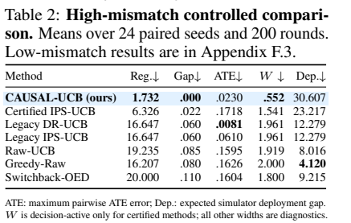

# Online Causal Configuration for Networked Systems via Doubly Robust Steady-State Learning

<!-- 全库方法复筛开始 -->
> **方法储备 · 训练目标与数据反馈**。保留“稳态配置价值的双重稳健在线估计”这一研究问题或机制；是否用于当前业务另行验证。
> 原有阅读范围与证据等级不变；储备不等于效果已验证。
> 已恢复此前因业务距离被移出的原笔记；旧取舍原因仅作历史记录。
> [[研究前沿/论文库复筛与阅读路线|全库阅读路线]] · [[研究前沿/训练目标与数据反馈/存量论文分层索引|本方向完整分层]]
<!-- 全库方法复筛结束 -->

线上探索可能改变邻居动作，也可能改变系统长期处于哪些状态。CAUSAL-UCB 针对关闭探索后的稳态价值做双重稳健估计，并同时记录探索期间实际付出的部署损失。

Liu, Yuli、Zhang, Zhiheng。arXiv 首投 2026-11-06，本次版本 v1（2026-11-06，按来源日期）。 [版本记录](https://arxiv.org/abs/2611.09665v1) · [本地原文](./assets/source/paper.pdf) · [原文 HTML](./assets/source/paper.html)

## 研究问题与机制

§3–4 先声明每个配置关闭探索时的目标价值。相邻控制器的动作通过暴露映射进入结果模型。用目标动作和邻域暴露的概率与日志概率之比修正预测残差，以截断抑制极端权重，再对目标稳态上下文差异和依赖等误差单独留出半径。各配置按带误差半径的乐观上界选择。相同的探索日志可能对应不同的无探索价值，是需要额外识别和迁移假设的原因。

单步 DR 结构为目标动作/暴露下的预测均值加 $\min(w,c)(Y-\hat m)$，其中 $w$ 是联合动作与暴露的概率比。上下文稳态变化及截断偏差要另行计入。

## 对照与证据

表 2 的高失配环形网络仿真，24 个配对种子各 200 轮。在均采用证书的设置下，CAUSAL-UCB 与 IPS-UCB 的目标后悔为 1.732/6.326，最大成对 ATE 误差为 0.0230/0.1718，探索期间部署差距却为 30.607/23.217。表 3 的 METR-LA/FlockLab 是使用真实轨迹及模拟反事实的回放。附录单独的 matched-log 研究不是这 24 个种子的消融。

表 2，目标后悔、成对误差和部署差距应分别读。

## 假设、局限与复核范围

要有联合动作与邻域暴露的支持，对策略迁移、上下文漂移、截断和时间相关项需独立校准；仅已知局部干扰子模型有随时有效的有限样本证书。低失配时简单贪心可更优。

作者仓库固定提交 d799e8044355cd3efbc6d426b7471b1fd4bdbb2b；核到 PublicDesign、CertifiedArm、CertifiedPolicy 与 make_run，仅核对源文件。[src/cert_dr.py](https://github.com/ylliua1116/causal-ucb/blob/d799e8044355cd3efbc6d426b7471b1fd4bdbb2b/src/cert_dr.py)

作者在 arXiv 的说明为 NeurIPS 2026 已接收。

本次核查了上文的方法、直接对照与适用条件，尚未本地复现实验。

[[研究前沿/uplift模型迭代/02-可复用方法卡/评估无探索稳态价值时同时校正动作暴露与上下文分布|评估无探索稳态价值时同时校正动作暴露与上下文分布]] · [[研究前沿/uplift模型迭代/03-实验假设与结果/探索日志对无探索稳态估值的两种偏差能否分开检出|探索日志对无探索稳态估值的两种偏差能否分开检出]]
