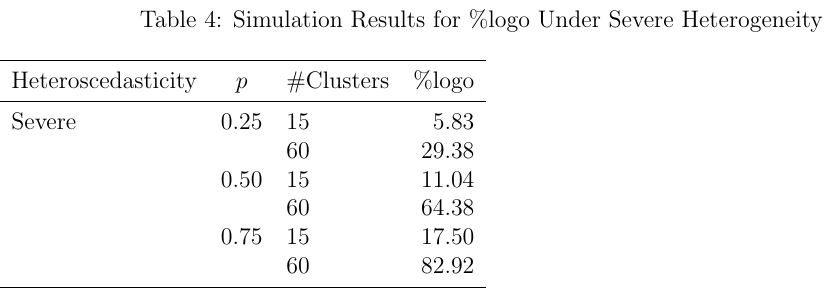

# Bayesian Cluster-Adjusted Standardised Mean Differences: A Simulation Study

连续量表分组试验中，各群组的处理均值差可部分汇聚，再按同一总体尺度标准化。模拟显示给残差尺度也加群组随机效应，对平均效应偏差的帮助有限，但在群组多、处理分配倾斜时可改善整群留出的预测。

Yannis Bähni。arXiv 首次提交 2026-11-03，本次核验 v1（2026-11-03）。[论文与版本记录](https://arxiv.org/abs/2611.04812v1) · [原文 HTML](https://arxiv.org/html/2611.04812v1) · [本地完整 PDF](./assets/source/paper.pdf)

**阅读覆盖**　§§1–4、式（2）–（12）、表 1–4；未重跑 Stan/仿真，结论限定在文中生成机制。

**代码与数据**　作者用 R、brms 和 cmdstanr。§2 的 Zenodo 总 DOI 指向 2026-10-31 的审稿记录，记录列出 SMD_i_j.Rmd、SMD_p_j.Rmd 等命名规则，访问级别为 restricted，未取得具体脚本。[Zenodo 记录](https://zenodo.org/records/23831421)

## 1. 同一均值差可有三种标准化定义

每个群组 $j$ 内有处理和对照，观测连续近似高斯的结果。均值模型含两臂各自的群组偏移 $u_{0j},u_{1j}$，群内差为 $\delta_j=\beta_1+u_{1j}-u_{0j}$。尺度模型允许两臂残差不同，完整版还允许其随群组变化。式（7）用本群组残差作分母，极小残差会放大结果；式（8）用总体分母使所有组可比；式（9）同时包含当地残差和组间成分。不同分母回答不同问题。

## 2. 简化的群组效应估计

§1.6 保留两臂均值的随机效应及相关性，为每臂保留单一残差尺度 $\sigma_a=e^{\gamma_a}$。设 $s_a^2$ 为第 $a$ 臂均值的组间方差，$p$ 为文中用于汇总的处理权重，则简化的边际标准化差为

$$
\mathrm{SMD}_{V,red}(j)=\frac{\delta_j}
{\sqrt{(1-p)(\sigma_0^2+s_0^2)+p(\sigma_1^2+s_1^2)}}.
$$

贝叶斯分层拟合给有观测的群组均值做部分汇聚。既可报告各组 SMD 跨群组的均值，也可报告标准差来描述群组间异质性。没有预处理描述变量刻画新群时，作者用随机效应分布对新群预测，不能据此输出新群的确定排序。

## 3. 偏差和预测是两个问题

§2 用 15、30、45、60 个群组，分配概率 0.25/0.50/0.75，三档尺度异质性，合计 36 个场景，每格 480 次模拟。§3 表 2–3，两种模型平均 SMD 的百分比偏差均落在作者采用的 ±10% 阈值内，群组少时 MSE 可较大。表 4 的 %logo 是完整模型在群组留出对数预测密度差上超过式（12）标准的重复比例，不是准确率增量。实际采用分组 12 折近似。

严重异方差下，处理概率 0.50 时，15 和 60 群组的 %logo 为 11.04% 和 64.38%；0.75、60 组时升为 82.92%，改用 4 SE 更严阈值后只有 6.88%。不能将“平均效应相似”推为“完整模型没有预测价值”。论文依据为受控模拟，现实缺失机制、非高斯指标和群组构成漂移仍待验证。不同业务活动若需比较统一量纲下的群组增量，可借用部分汇聚，但涉及金额决策时还需报告原始单位差值。

## 方法卡与实验

[[研究前沿/uplift模型迭代/02-可复用方法卡/统一尺度的群组增量部分汇聚|统一尺度的群组增量部分汇聚]]

尚无本地实验记录。
