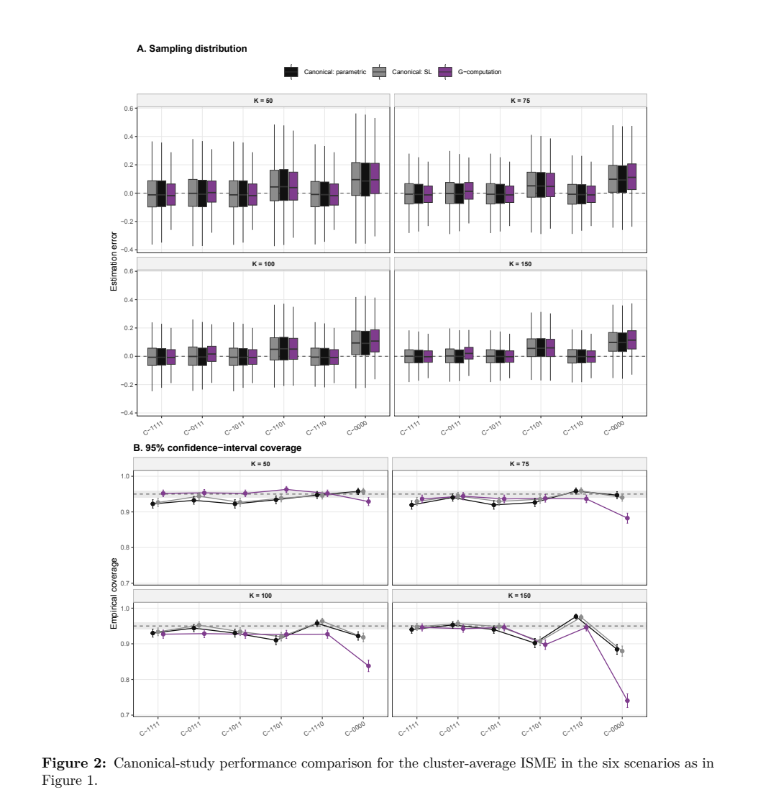

# 把群内干预的自身中介与同伴中介分开

<!-- 全库方法复筛开始 -->
> **方法储备 · 面向决策的履约建模**。保留“聚类数据的中介效应估计”这一研究问题或机制；是否用于当前业务另行验证。
> 原有阅读范围与证据等级不变；储备不等于效果已验证。
> 已恢复此前因业务距离被移出的原笔记；旧取舍原因仅作历史记录。
> [[研究前沿/论文库复筛与阅读路线|全库阅读路线]] · [[研究前沿/面向决策的履约建模/存量论文分层索引|本方向完整分层]]
<!-- 全库方法复筛结束 -->

Semiparametric causal mediation analysis in cluster-randomized trials with post-treatment confounding。作者为 Ham, Daeyoung、Cheng, Chao、Li, Fan。arXiv 首投 2026-11-09，本次核验 v1。 [版本记录](https://arxiv.org/abs/2611.11903v1) · [本地 PDF](./assets/source/paper.pdf) · [本地 HTML](./assets/source/paper.html)

## 研究问题

群级随机化后，处理可能改变共同环境，又通过个体及同伴的中间变量影响结局。

## 方法与关键计算

定义对整个簇的联合中介分布进行随机干预的直接及间接效应，再分解个体及他人部分。以整簇切分训练和估计折，拟合中介分布、结局及相关干扰函数，对目标函数作影响函数校正。簇权重决定按簇还是按人平均。

$$
\mathrm{IDE}=h\{\theta(1,0),\theta(0,0)\},\quad\mathrm{IIE}=h\{\theta(1,1),\theta(1,0)\}
$$

θ 的第二个参数指定随机中介分布的处理臂，h 为选定的对比。再把联合中介分解为自身和同伴的随机干预。 [原文定位](https://arxiv.org/html/2611.11903v1#S2.Ex1)

## 对照、结果和限制

§6 用 50、75、100、150 个簇，每种重复 2,000 次。只错设 η 的 C-0111 中，两个 EIF 方法对直接效应与群内溢出中介效应仍近似无偏；直接 g 计算对溢出项的偏差随簇数增长仍存在。小簇数下部分区间覆盖偏低。 [原文证据](https://arxiv.org/html/2611.11903v1#S6.F2)

原文 PDF 第 15 页。

需要簇间无干扰、足够重叠和给定变量后的中介识别条件。引入处理后混杂的建模不等于能处理任意未测混杂。

## 复用和阅读范围

已核问题设定、方法与上文所列的关键对照，详细证明及未列出的实验以所附全文为准。已按公开仓库快照核对文件路径。[R/api.R](https://github.com/daeyoungspam-stat/CRT-interventional-mediation/blob/a779b8683f74d742378d5e700e32c2fb30283cb5/R/api.R)

[[研究前沿/uplift模型迭代/02-可复用方法卡/ClusterPaths-整簇交叉拟合的间接效应|整簇交叉拟合的间接效应]] · [[研究前沿/uplift模型迭代/03-实验假设与结果/ClusterPaths-对共享资源组的中间响应分开处置，自身与同组贡献能否在错设下还原|对共享资源组的中间响应分开处置，自身与同组贡献能否在错设下还原]]

显式区分中介贡献与其他路径，需要写清楚谁的哪个分布受干预。 [[研究前沿/面向决策的履约建模/01-论文原文与精读/CompetingMediation/精读|另一方向的对照]]
