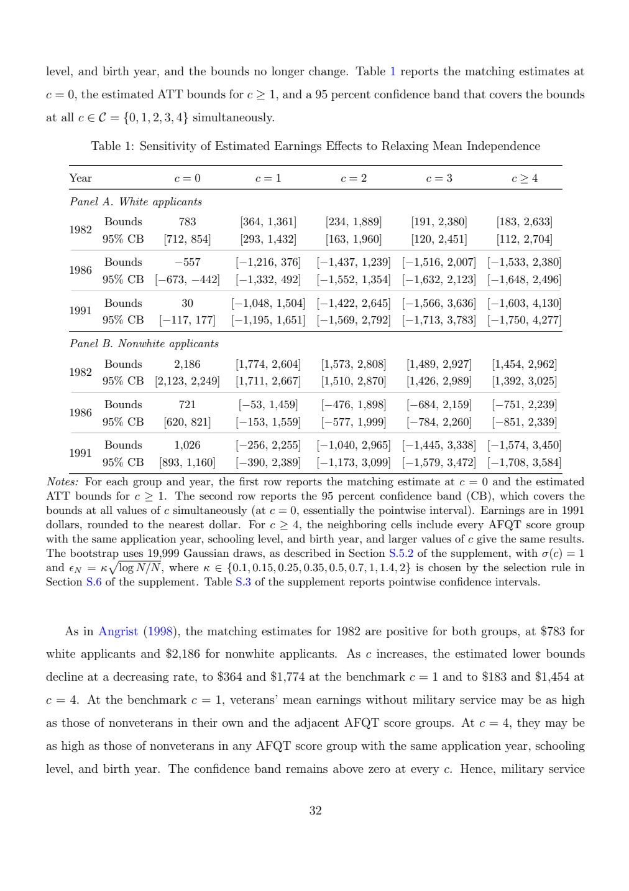

# Lost in the Bins: Treatment Effects with Discretized Covariates

<!-- 全库方法复筛开始 -->
> **方法储备 · 训练目标与数据反馈**。保留“Lost in the Bins: Treatment Effects with Discretized Covariates”这一研究问题或机制；是否用于当前业务另行验证。
> 原有阅读范围与证据等级不变；储备不等于效果已验证。
> [[研究前沿/论文库复筛与阅读路线|全库阅读路线]] · [[研究前沿/训练目标与数据反馈/存量论文分层索引|本方向完整分层]]
<!-- 全库方法复筛结束 -->

## 把原始协变量分箱后，处理效应的正负号还稳吗？

同一档内，处理组和对照组可能聚集在原连续变量的不同位置。论文从这个残余差异出发，让不可见的反事实均值在相邻档的已观测均值间变化，推算 ATT、ATE 的可识别上下界。

Liu, Cenchen。arXiv 首投 2026-11-10，本次核验 v1（2026-11-10，来源日期）。[论文与版本](https://arxiv.org/abs/2611.14789v1) · [本地原文](./assets/source/paper.pdf)

## 方法与估计对象

输入粗分箱、处理标识、结局及各档组别占比。按档估同处理臂的已观测均值；为每档缺失潜在结局选半径 c 的邻档最小与最大均值，再按目标群体权重合成上下界，并对整个敏感性曲线做同时置信带。ATT 的粗化偏差来自未处理潜在均值组成，ATE 另外受处理收益异质性影响。

对每个处理臂 $d$、档 $w$，以 $\min_{v\in N_c(w)}\mu_d(v)$ 和 $\max_{v\in N_c(w)}\mu_d(v)$ 限制该档缺失的对应反事实均值。$c=0$ 恢复档内均值独立。

## 对照与证据

表 1 使用美国自愿服役申请人数据（1991 年美元）。白人申请者 1982 年服役 ATT 在 c=0 时为 783，到覆盖全部档的 c≥4 仍为 [183,2633]；1986 年由 −557 变为 c=1 的 [−1216,376]。前者方向对该敏感性范围稳健，后者放宽一档便跨零。表中另列 95% 同时置信带。

表 1，两个申请人群的效应界及同时置信带。原始 PDF 第 32 页。

## 识别条件与适用范围

依赖相邻档可作反事实均值参照，及组别支持。半径跨遍全部档仍保留全局均值范围假设；分箱前的精细可忽略性也不能直接传给分箱数据。

本轮从论文正文与作者标注中未取得可验证的配套代码入口。

本次精读覆盖上述方法、证据页和相关限制。附录中的其他推导与实验未逐项复算。

[[研究前沿/uplift模型迭代/02-可复用方法卡/用相邻协变量分箱给反事实均值设范围|用相邻协变量分箱给反事实均值设范围]] · [[研究前沿/uplift模型迭代/03-实验假设与结果/增加多少分箱内排序偏差会使增量改变符号|增加多少分箱内排序偏差会使增量改变符号]]
