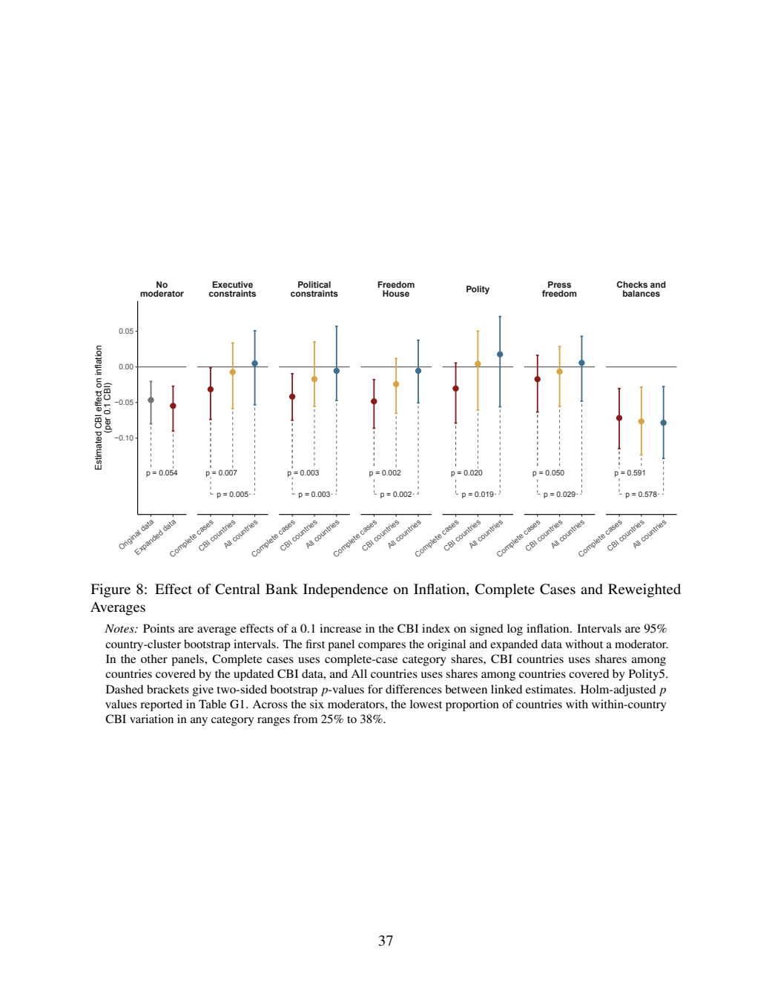

# When Listwise Deletion Works: Causal Diagrams and Complete-Case Regression

<!-- 全库方法复筛开始 -->
> **方法储备 · 训练目标与数据反馈**。保留“完整案例分析依赖的缺失机制”这一研究问题或机制；是否用于当前业务另行验证。
> 原有阅读范围与证据等级不变；储备不等于效果已验证。
> 已恢复此前因业务距离被移出的原笔记；旧取舍原因仅作历史记录。
> [[研究前沿/论文库复筛与阅读路线|全库阅读路线]] · [[研究前沿/训练目标与数据反馈/存量论文分层索引|本方向完整分层]]
<!-- 全库方法复筛结束 -->

## 只分析完整样本时，估到的平均效果属于哪个人群？

删掉缺失样本后，回归即便在每个协变量组内正确，也会按完整样本的人群比例汇总。作者将缺失指示加入因果图，分开判定组内可比较性、完整样本的效应与向目标人群的可迁移性。

Lin, Wenxin、Liu, Shiyao。arXiv 首投 2026-11-03，本次核验 v2（2026-11-12，来源日期）。[论文与版本](https://arxiv.org/abs/2611.04366v2) · [本地原文](./assets/source/paper.pdf) · [本地 HTML](./assets/source/paper.html)

旧稿修订。11 月 3 日 v1 已有完整样本内的判定与加权。11 月 12 日 v2 新增央行独立性应用、附表 G1 与以国家为单位的 2,000 次 bootstrap，对照不同目标总体的构成。

## 方法与估计对象

先在含缺失指示的图上检验调整是否打开选择路径；验证回归或逆倾向加权能正确汇总完整样本内的分组比较。若要报告目标人群 ATE，在相应支持及效应可迁移假设下固定分组效应，以目标人群权重重新标准化。

在效应均值的组内可迁移与正性成立时，$\tau_{pop}=\sum_x P_{pop}(x)\tau_{cc}(x)$，而完整样本使用 $P(x\mid M=0)$。

## 对照与证据

v2 新增央行独立性再分析。正文 §5.2、图 8 和附表 G1 对六种调节因素固定组内系数，只替换权重。三种因素下，完整样本的平均效应显著为负，而在扩充 CBI 目标总体中不再与零可区分；四种因素的两种加权平均之差在未校正的 5% 水平显著，附表另列 Holm 校正。部分政治分组内只有 25%–38% 的国家有可识别组内变动。

图 8，完整样本与不同目标总体重加权。原始 PDF 第 37 页。

## 识别条件与适用范围

更换权重需要目标群体的协变量分布，无法挽救组内效应不可迁移或缺乏支持。不同总体间结果显著性变化本身不是对两个结果差值的检验。

正文列有基础研究数据来源；本轮未定位本文再分析脚本的公开入口。

本次精读覆盖上述方法、证据页和相关限制。附录中的其他推导与实验未逐项复算。

[[研究前沿/uplift模型迭代/02-可复用方法卡/固定完整样本分组效应后用目标分布重新标准化|固定完整样本分组效应后用目标分布重新标准化]] · [[研究前沿/uplift模型迭代/03-实验假设与结果/完整样本和目标人群的增量差异有多少源于构成|完整样本和目标人群的增量差异有多少源于构成]]
