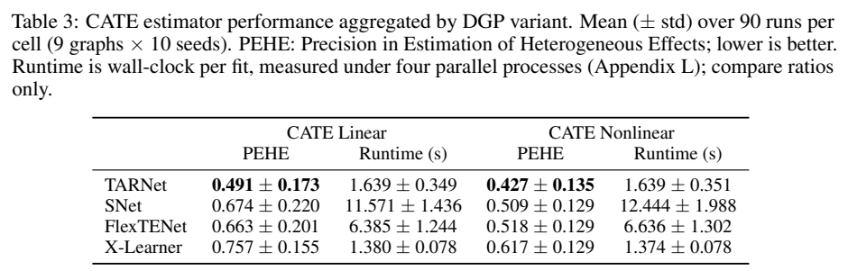

# Composable Causality: A Toolkit for Systematic Time-Series Causal Discovery and Treatment-Effect Benchmarking

在同一个时序结构模型里缓存并重放所有随机扰动，可以直接计算两条干预轨迹的逐时效应。作者的 CATE 比较使用随机二元分配，公开评估脚本在同一组特征上拟合和预测，数值应按轨迹内误差阅读。

Muhammad Hasan Ferdous、Md Osman Gani。arXiv 首次提交 2026-11-06，已读 v1（2026-11-06）。 [版本记录](https://arxiv.org/abs/2611.08918v1) · [已保存的原文 PDF](./assets/source/paper.pdf)

**阅读覆盖**　§§3–5，图 1，主表 1–3，附表 4–5、9 及测试代码。论文页面注明已获 NeurIPS 2026 Evaluations and Datasets Track 接收；未重跑发现算法或核查所有附表。

**代码与数据**　已核验官方仓库提交 65554be。run_cate.py 是表 3 评测入口，src/dtcd/interventions/base.py 定义干预模块，tests/test_counterfactual_exactness.py 检查介入前完全一致。[作者仓库](https://github.com/hferdous/Composable_Causality/tree/65554be7b8ae7c3580b6fa9517da64f2ae6501d5)

## 1. 时序效应的真值从何而来

拓扑、节点方程、噪声、观测遮罩、干预策略可分别配置。图保留同一时刻及各滞后层的边；先按结构方程生成事实轨迹，并保存每个时点、每个节点的外生实现。给定同一初始历史，替换目标变量的生成方程，随后依照图的时间与因果顺序，用同一份扰动重算后续节点。可以改变遮罩或分配策略以做控制试验，前提是两分支的噪声、图与干预前状态确实共享。

$$
X^a_{t,i}=f_i(\mathrm{pa}_{t,i}^a,N_{t,i}),\qquad
\Delta_{t,j}^{a,b}=X^a_{t,j}-X^b_{t,j}.
$$

上式是 §3.3 的计算简写；干预节点使用指定赋值。所得是该生成器下、该随机实现的潜在轨迹差，不能恢复真实日志中缺失的个体反事实。已核验的测试对线性、通用和漂移生成器检查介入前逐元素相等、介入后目标列改变；测试没有独立验证每种场景的长期响应曲线。

## 2. 基准比较的实际目标

9 个图模板取变量数 4/6/8 和最大滞后 2/3/4 的组合，轨迹长 1,000。用于效应估计的是线性和递归非线性两类生成过程，共 18 个配置，各取 10 个评估种子。附表 4 的事实处理在每时点独立按 Bernoulli(0.5) 分配；两条真值轨迹则是全程 1 与全程 0。两者的结果差可能包含历史效应；与只改本期剂量的效应目标不同。

表 3 线性/非线性 PEHE，TARNet 为 0.491±0.173 / 0.427±0.135，X-Learner 为 0.757±0.155 / 0.617±0.129。± 为跨 90 次运行的标准差。源代码对排除动作和结局列后的同一行特征先 fit，再 predict，随后计算与孪生真值的 RMSE；这种评价未测未见轨迹外推，也没有建立有混杂赋值下的去偏能力。非线性变换可压缩真实效应变化幅度，不同生成过程的原始误差不能只按大小判断学习器变强。

## 3. 其他控制与可复用范围

结构发现部分另有 8 个算法、81 个配置。作者用标准化与方差排序基线诊断算法借助变量尺度推断因果方向的捷径；某一图的定向 F1 从 1.00 降到 0.44（附图 5/§4.3）。这是结构发现证据，不能归为四个 CATE 方法的消融收益。原文以真图调参的发现对照也不可直接模拟真实应用。若迁移到分期激励基准，须在不知道测试种子的情况下固定可用历史，明确单步与整段规则，按轨迹留出。

## 方法与实验

[[研究前沿/uplift模型迭代/02-可复用方法卡/缓存外生噪声的时序干预双轨回放|缓存外生噪声的时序干预双轨回放]] · [[研究前沿/uplift模型迭代/03-实验假设与结果/区分单期和持续干预的跨轨迹增量评估|区分单期和持续干预的跨轨迹增量评估]]
