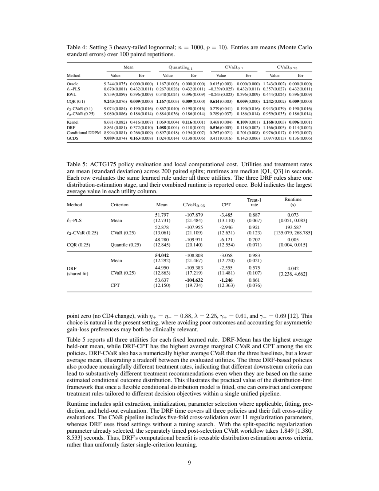

# Distribution-First Framework for Learning Risk-Sensitive Individualized Treatment Rules

<!-- 全库方法复筛开始 -->
> **方法储备 · 面向决策的履约建模**。保留“先学结果分布再求风险敏感处理决策”这一研究问题或机制；是否用于当前业务另行验证。
> 原有阅读范围与证据等级不变；储备不等于效果已验证。
> 已恢复此前因业务距离被移出的原笔记；旧取舍原因仅作历史记录。
> [[研究前沿/论文库复筛与阅读路线|全库阅读路线]] · [[研究前沿/面向决策的履约建模/存量论文分层索引|本方向完整分层]]
<!-- 全库方法复筛结束 -->

## 同一套响应模型，换一个风险目标会把干预给谁？

先估每个处理档下结局的完整条件分布，再用同一分布计算均值、尾部平均或损失厌恶效用。风险目标可以单独替换，也能把一条已固定的策略放回所有目标下交叉评价。

Fang, Zhen、Chen, Guanting、Liu, Yufeng。arXiv 首投 2026-11-12，本次核验 v1（2026-11-12，来源日期）。[论文与版本](https://arxiv.org/abs/2611.16274v1) · [本地原文](./assets/source/paper.pdf) · [本地 HTML](./assets/source/paper.html)

## 方法与估计对象

按处理档用核权重、分布随机森林（DRF）或条件生成器估计条件分布。推理时对每个档的分布应用选定效用，以最高效用分配。作者还推导了第一阶段分布误差在局部 Hölder 稳定性与决策边界条件下如何传至策略遗憾。

算法 1 的分配为 $\hat\pi_T(x)\in\arg\max_a T(\hat F_a(\cdot\mid x))$；下尾 CVaR 使用该档最差尾部的平均结果。

## 对照与证据

表 5 在 ACTG175 试验上做 200 次配对划分。共享 DRF 一次拟合，均值、下尾 CVaR 与累计前景理论（CPT）三种决策规则的选臂 1 比例为 98.3%、57.5%、86.1%。均值规则的留出均值 54.042，CPT 规则 53.637；两者在 CVaR 指标为 −108.808 和 −104.632。表 4 合成重尾例中，目标匹配的分位数回归也能优于 DRF。

表 4–5，重尾仿真和 ACTG175 离线对照。原始 PDF 第 9 页。

## 识别条件与适用范围

试验留出结果是离线评价，三种效用是不同目标。尾部估计需要档内支持度；目标设定、尾部样本及一阶段误差会改变赢家。

[作者实现的条件风险函数](https://github.com/zhenf530/Distributio_Risk_ITR/blob/852117b2d8237520b3171731eb01a3e03482e36a/Simulation/Methods/conditional_risk.R)。

本次精读覆盖上述方法、证据页和相关限制。附录中的其他推导与实验未逐项复算。

[[研究前沿/uplift模型迭代/02-可复用方法卡/从每档条件结局分布切换不同风险效用|从每档条件结局分布切换不同风险效用]] · [[研究前沿/uplift模型迭代/03-实验假设与结果/共享响应分布时高均值策略要牺牲多少下尾表现|共享响应分布时高均值策略要牺牲多少下尾表现]]
