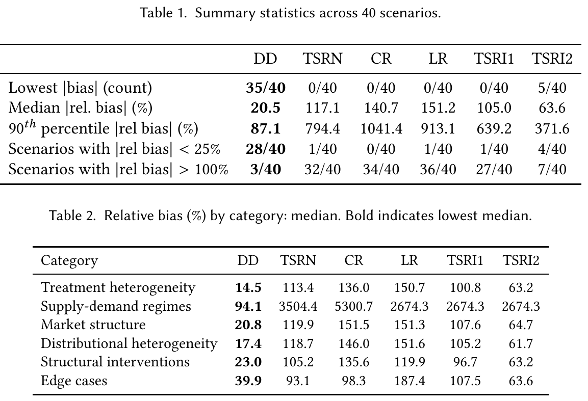

# The Double Diagonal Estimator: Reducing Bias in Two-Sided Marketplace Experiments

[官方论文](https://arxiv.org/abs/2610.41294) · [本地PDF](./assets/source/paper.pdf) · [HTML快照](./assets/source/paper.html)

版本记录：[Submitted on 30 Oct 2026]；本次核验与精读：2026-11-06。本篇为滚动窗口内首次入库；检索日不等于首次发表日。

阅读范围：§6估计公式与推导、§7偏差符号/阈值、§8实验配置与结果；附录代数证明未逐行复证。未逐行复证全部数学证明，未声称逐页翻译。[[研究前沿/uplift模型迭代/01-论文原文与精读/DoubleDiagonal/阅读覆盖|原文章节与公式索引]]；HTML为原始快照，外部样式和图片可能需要联网，PDF可离线阅读。

代码：本次核验的论文原文与元数据未提供可确认的作者实现入口；代码状态未知，不能据此断言不存在。未运行代码。 [[研究前沿/uplift模型迭代/01-论文原文与精读/DoubleDiagonal/代码核验|核验记录]]

## 问题：两侧随机实验仍有库存干扰

平台资源被预约后暂时不可用，处理侧更快耗尽库存会影响其他用户；普通处理用户×处理资源格子的缩放并不等于全量上线。本文在均值场库存市场中估计全局处理效应GTE。

## 双对角估计（§6）

Q_ab为客户状态a、资源状态b的总预约率，αL为资源处理占比：
$$\widehat{GTE}_{DD}=\frac{Q_{11}+Q_{01}}{\alpha_L}-\frac{Q_{10}+Q_{00}}{1-\alpha_L}.$$
这是按资源侧汇总两类客户预约，利用非对角格子纠正部分混合竞争。稳定库存流量平衡把它解释为归一化可用库存差；只是逼近全局稳态，不是无偏定理。

## 证据与限制（§7–8）

简化同质模型、小正处理效应下，DD向下偏、朴素TSRN向上偏；比较取决于外部选项吸引力a。αL=0.5时临界约2.34，超过时DD偏差更大。理论使用特别参数限制，不能把方向关系套到任意异质市场。

40个数值稳态场景中DD有35个最低绝对偏差；中位相对偏差20.5%，TSRN117.1%（Table1）。仍有3/40场景偏差超100%；相反处理效应场景DD44.5% vsTSRN34.5%，强外部选项42.3% vs22%。计算通过动力系统到梯度范数<1e−4；并非真实AB数据。

论文仅比较偏差，未比较方差/MSE；处理仅影响匹配倾向，不改变到达或占用时长。可作为市场实验读数敏感性对照，不能取代合适的随机化设计，也不能称个体CATE估计器。

## 原文关键图表

原文 Tables 1–2，PDF 第 15 页；原始裁图，机制和证据解释见上文。裁图坐标与源文件校验值见 assets/source/figure-provenance.json。

## 方法卡

- [[研究前沿/uplift模型迭代/02-可复用方法卡/DoubleDiagonal-inventory-correction|利用四格预约率的库存干扰对照估计]]
