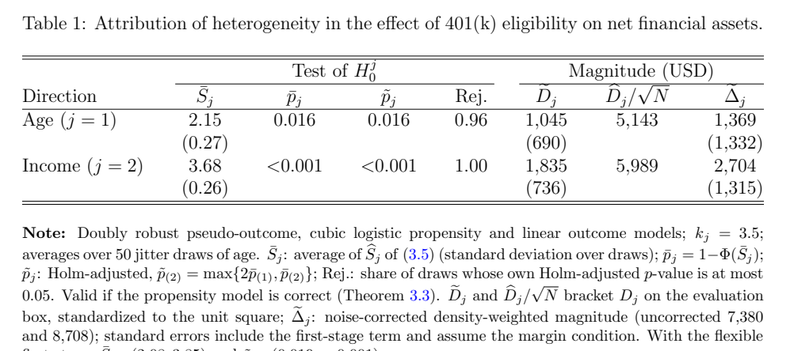

# 控制其他变量后特征组还能解释多少增量异质性

<!-- 全库方法复筛开始 -->
> **方法储备 · 训练目标与数据反馈**。保留“成对差分形式的异质效应学习”这一研究问题或机制；是否用于当前业务另行验证。
> 原有阅读范围与证据等级不变；储备不等于效果已验证。
> 已恢复此前因业务距离被移出的原笔记；旧取舍原因仅作历史记录。
> [[研究前沿/论文库复筛与阅读路线|全库阅读路线]] · [[研究前沿/训练目标与数据反馈/存量论文分层索引|本方向完整分层]]
<!-- 全库方法复筛结束 -->

Asymptotic Theory of Integrated Pairwise-Difference Functionals of Kernel Estimators, with Applications to Treatment Effect Heterogeneity。作者为 Owusu, Julius。arXiv 首投 2026-11-07，本次核验 v1。 [版本记录](https://arxiv.org/abs/2611.10383v1) · [本地 PDF](./assets/source/paper.pdf) · [本地 HTML](./assets/source/paper.html)

## 研究问题

两个相关特征都与高 uplift 人群相关，重要性排名难以说明控制另一组后谁仍在改变增量。

## 方法与关键计算

用处理概率和结局回归构造伪结果，核平滑估计条件效应。固定一组特征，对另一组的不同取值求成对差，积分绝对值或正部；使用可行的中心化和方差估计作检验，并用结果原单位表达异质性规模。

$$
H_0:\ \tau(x_1,x_2)=\tau(x_1^\prime,x_2)
$$

固定第二组变量，改变第一组后效应仍相等，即无额外效应修饰。用成对差检验这项原假设。 [原文定位](https://arxiv.org/html/2611.10383v1#S2.E6)

## 对照、结果和限制

§5 表 1 对 401(k) 资格与净金融资产中年龄、收入两组做分析，Holm 调整后 p 值分别为 0.016 和小于 0.001。年龄作 50 次 jitter，逐次拒绝率为 0.96；表 S1–S5 另有方向性与检验尺寸模拟。 [原文证据](https://arxiv.org/html/2611.10383v1#S5.T1)

原文 PDF 第 32 页。

结果依赖处理识别、倾向模型、带宽与协变量支持；显著的效应变化不能证明用该变量分配预算会赚更多。

## 复用和阅读范围

已核问题设定、方法与上文所列的关键对照，详细证明及未列出的实验以所附全文为准。本次未核实作者公开实现入口。

[[研究前沿/uplift模型迭代/02-可复用方法卡/EffectBlockTest-条件成对效应差检验|条件成对效应差检验]] · [[研究前沿/uplift模型迭代/03-实验假设与结果/EffectBlockTest-保持其他特征后，候选特征组是否稳定解释独立的处理效应差异|保持其他特征后，候选特征组是否稳定解释独立的处理效应差异]]
