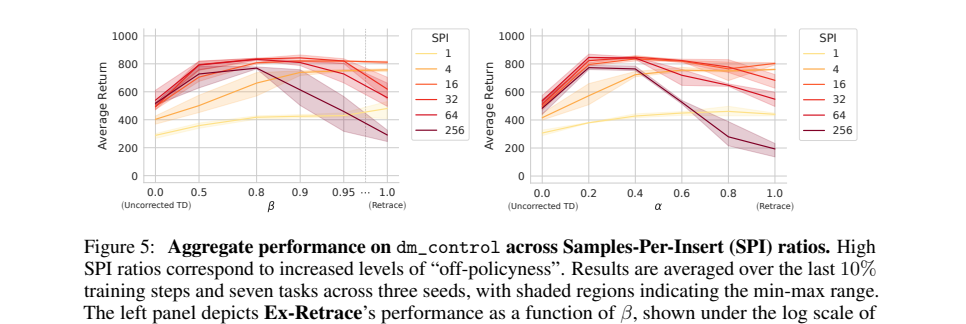

# 显式控制目标策略连续执行多少步

<!-- 全库方法复筛开始 -->
> **方法储备 · 训练目标与数据反馈**。保留“随时间变化的 excursion 策略效应”这一研究问题或机制；是否用于当前业务另行验证。
> 原有阅读范围与证据等级不变；储备不等于效果已验证。
> 已恢复此前因业务距离被移出的原笔记；旧取舍原因仅作历史记录。
> [[研究前沿/论文库复筛与阅读路线|全库阅读路线]] · [[研究前沿/训练目标与数据反馈/存量论文分层索引|本方向完整分层]]
<!-- 全库方法复筛结束 -->

Off-policy Learning with Excursion Policies。作者为 He, Jiamin、Rowland, Mark、Guo, Zhaohan Daniel、van Hasselt, Hado、Borsa, Diana。arXiv 首投 2026-11-09，本次核验 v1。 [版本记录](https://arxiv.org/abs/2611.13275v1) · [本地 PDF](./assets/source/paper.pdf) · [本地 HTML](./assets/source/paper.html)

## 研究问题

行为日志与目标策略相差很大时，过长的离策略轨迹容易放大波动。逐步随机混合和连续执行数步后返回会产生不同的估值对象。

## 方法与关键计算

引入是否仍在目标策略段的隐状态；以持续概率 β 决定下一步继续目标策略还是返回行为策略。扩充状态后推导 Bellman 目标与多步 TD，结合截断迹形成 Ex-Retrace。评估时必须说明估的是哪个 β 的策略。

$$
\Pr(Z_t=1\mid Z_{t-1}=1)=\beta
$$

这一段尚未结束时，以 β 概率继续执行目标政策。β 越大，连续目标段通常越长，估值难度和目标本身都会改变。 [原文定位](https://arxiv.org/html/2611.13275v1#S3.Ex1)

## 对照、结果和限制

§5.2 图 4 在七个 dm_control 任务、三种子、每条新经验进行 32 次更新时，β=1 的 Retrace 不稳，β=0 的未校正 TD 学得慢，中间值表现更好。图 5 按重放强度复核；实验针对整个学习器。 [原文证据](https://arxiv.org/html/2611.13275v1#S5.F5)

原文 PDF 第 10 页。

回到行为策略会改变 estimand；收敛理论的表格设定与连续控制的函数逼近实验分开看。

## 复用和阅读范围

已核问题设定、方法与上文所列的关键对照，详细证明及未列出的实验以所附全文为准。本次未核实作者公开实现入口。

[[研究前沿/uplift模型迭代/02-可复用方法卡/ExcursionTD-连续目标策略段|连续目标策略段]] · [[研究前沿/uplift模型迭代/03-实验假设与结果/ExcursionTD-在有真值的重派重试模拟中，目标策略连续执行几步后估值最稳定|在有真值的重派重试模拟中，目标策略连续执行几步后估值最稳定]]
