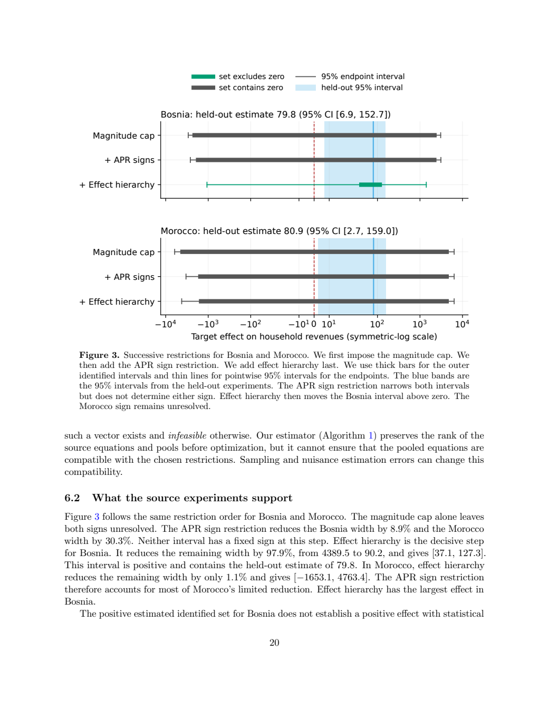

# A Sensitivity Framework for Assessing External Validity

<!-- 全库方法复筛开始 -->
> **方法储备 · 训练目标与数据反馈**。保留“外部有效性的敏感性分析”这一研究问题或机制；是否用于当前业务另行验证。
> 原有阅读范围与证据等级不变；储备不等于效果已验证。
> 已恢复此前因业务距离被移出的原笔记；旧取舍原因仅作历史记录。
> [[研究前沿/论文库复筛与阅读路线|全库阅读路线]] · [[研究前沿/训练目标与数据反馈/存量论文分层索引|本方向完整分层]]
<!-- 全库方法复筛结束 -->

## 跨地区转移试验结论，哪些假设足以确定效应方向？

来源地区太少，很多地区差异无法从试验同时学出。论文保留未识别的方向，将能接受的幅度、系数符号及交互限制逐项加入，用每组假设容许的最小、最大目标地效应呈现外推幅度。

Boyarsky, Ariel、Egami, Naoki、Namkoong, Hongseok。arXiv 首投 2026-11-12，本次核验 v1（2026-11-12，来源日期）。[论文与版本](https://arxiv.org/abs/2611.16242v1) · [本地原文](./assets/source/paper.pdf) · [本地 HTML](./assets/source/paper.html)

## 方法与估计对象

用来源随机试验及目标协变量估两臂的条件结局和试点分布。先在各留出折计算去偏得分，合并得分后只解一对上、下界约束优化；将来源方程限制到可识别的方向。优化器、对偶变量和抽样误差决定端点区间。

给定总体矩限制及可接受的限制集 $\mathcal R$，在可行系数上分别最小化与最大化目标地 ATE。取点估计的识别集与对端点分别做的置信区间回答不同问题。

## 对照与证据

图 3 逐国留出微贷试验。施加幅度及利率符号限制后，进一步加交互小于主效应的层级约束，波黑的估计范围由宽 4389.5 减至 90.2，变为 [37.1,127.3]，留出估计 79.8；摩洛哥只收窄 1.1%，为 [−1653.1,4763.4]。图 2 另检验先合并再优化能避免折间符号不一致。

图 3，依次加限制的目标效应范围。原始 PDF 第 20 页。

## 识别条件与适用范围

要求相应的臂别响应外推模型、来源与目标的支持条件及给定结构限制。估计识别集在零上方仍需查看端点抽样不确定性，不能直接报告显著正效应。

本轮从论文正文与作者标注中未取得可验证的配套代码入口。

本次精读覆盖上述方法、证据页和相关限制。附录中的其他推导与实验未逐项复算。

[[研究前沿/uplift模型迭代/02-可复用方法卡/先汇总去偏矩再求跨地点效应上下界|先汇总去偏矩再求跨地点效应上下界]] · [[研究前沿/uplift模型迭代/03-实验假设与结果/逐站留出时哪些外推限制才会确定效应符号|逐站留出时哪些外推限制才会确定效应符号]]
