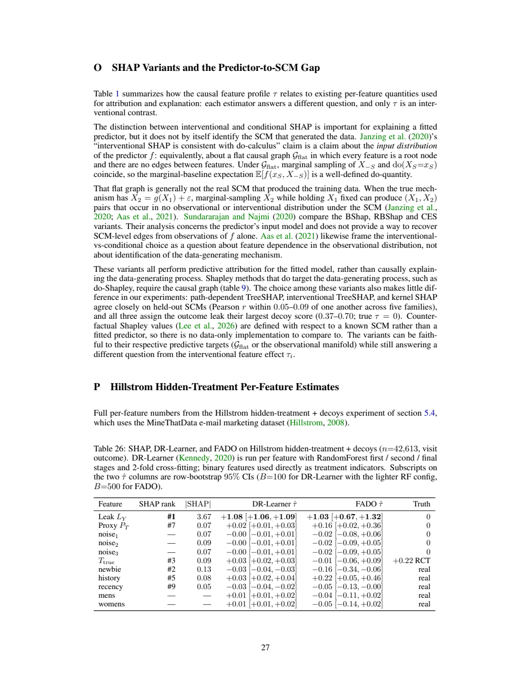

# FADO: Learning Causal Explanations with Prior-Fitted Networks

<!-- 全库方法复筛开始 -->
> **方法储备 · 模型自进化**。保留“预训练因果解释的泄漏与归因边界”这一研究问题或机制；是否用于当前业务另行验证。
> 原有阅读范围与证据等级不变；储备不等于效果已验证。
> 已恢复此前因业务距离被移出的原笔记；旧取舍原因仅作历史记录。
> [[研究前沿/论文库复筛与阅读路线|全库阅读路线]] · [[研究前沿/模型自进化/存量论文分层索引|本方向完整分层]]
<!-- 全库方法复筛结束 -->

## 只看观察表，能分清该改哪个特征、哪个只是结果的影子吗？

FADO 在已知生成过程的合成表上学习每一列的干预效应，推理时读入一张新观察表，一次给出多列估计。它在部分合成结构上学会剔除代理变量，但在带结果泄漏的真实邮件试验上，仍会把泄漏特征错当原因。

Flaxman, Seth、Carr, Jess、Jakob, Annabel、Masiak, Marek、Sejdinovic, Dino。arXiv 首投 2026-11-11，本次核验 v1（2026-11-11，来源日期）。[论文与版本](https://arxiv.org/abs/2611.15607v1) · [本地原文](./assets/source/paper.pdf) · [本地 HTML](./assets/source/paper.html)

## 方法与估计对象

从结构因果模型先验抽取有真值的训练表，对每个特征做两个锚点干预产生标签。模型沿样本轴及特征轴聚合表格信息，并标记哪个列是结局，联合回归每列的干预对比。换入新观测表时使用同一权重进行摊销推断。

论文的连续标准化特征对比为 $\Delta_i=E[Y\mid do(X_i=+1)]-E[Y\mid do(X_i=-1)]$；类别变量须沿用论文的编码与锚点。

## 对照与证据

表 12 在 200 个留出的线性 SCM 上按同一流程重训；完整模型的效应向量相关为 0.95，移除样本轴注意力为 0.73，移除特征轴注意力为 0.00。表 26 的 Hillstrom 试验加入诱饵后，真实零效应的结果泄漏列得到 +1.03 [0.67,1.32]，随机邮件列的参照为 +0.22，FADO 为 −0.01 [−0.06,0.09]。该表使用作者的标准化效应尺度。

附表 26，真实试验和人工诱饵对照。原始 PDF 第 27 页。

## 识别条件与适用范围

目标是特征层面的平均干预对比，不能自动识别任意真实表的因果方向。附图 9、表 28 给出两个观察分布完全相同、干预效应不同的模型；给定先验时的最优预测仍有不可消除的误差。

[作者的 Hillstrom 试验入口](https://github.com/MLGlobalHealth/FADO/blob/ac020c86692686bf30928301d734234932944c7b/causal_probe/hillstrom_rct.py)。

本次精读覆盖上述方法、证据页和相关限制。附录中的其他推导与实验未逐项复算。

[[研究前沿/uplift模型迭代/02-可复用方法卡/用已知因果图的干预标签训练整表特征效应估计器|用已知因果图的干预标签训练整表特征效应估计器]] · [[研究前沿/uplift模型迭代/03-实验假设与结果/特征干预估计器能否同时排除泄漏与识别真实处理|特征干预估计器能否同时排除泄漏与识别真实处理]]
