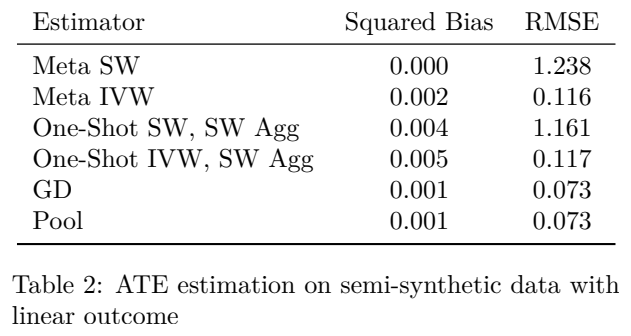

# 不同试验的分流比例不同，怎样合并出目标人群的平均增量？

<!-- 全库方法复筛开始 -->
> **方法储备 · 训练目标与数据反馈**。保留“联邦处理效应估计的协作边界”这一研究问题或机制；是否用于当前业务另行验证。
> 原有阅读范围与证据等级不变；储备不等于效果已验证。
> 已恢复此前因业务距离被移出的原笔记；旧取舍原因仅作历史记录。
> [[研究前沿/论文库复筛与阅读路线|全库阅读路线]] · [[研究前沿/训练目标与数据反馈/存量论文分层索引|本方向完整分层]]
<!-- 全库方法复筛结束 -->

分别按处理臂拟合结局，再按目标人群的构成汇总。作者同时给出能和集中拟合逐项对照的联邦实现。

## 文献与版本

Federated Causal Inference: Multi-Study ATE Estimation beyond Meta-Analysis。Rémi Khellaf、Aurélien Bellet、Julie Josse。历史论文首投 2024-10-22，所读 v2 为 2025-03-25。随后收入 AISTATS 2025 论文集（会期 05-03 至 05-05）。本周新增为 dsFedAteClient 0.1.0，CRAN 源包标记 2026-11-13 23:30 UTC（北京时间 11-14 07:30，早于本次最近 24 小时）。服务端 0.1.0 已于 10-15 发布。 检索及精读于 2026-11-15。精读原论文 §3–5、表 2–3，并核对两个源码包、客户端示例 1–4 和测试入口。 [一手来源](https://arxiv.org/abs/2410.16870v2) · [关联原始资料](https://cran.r-project.org/package=dsFedAteClient) · [关联原始资料](https://cran.r-project.org/package=dsFedAte) · [关联原始资料](https://proceedings.mlr.press/v258/khellaf25a.html)

本地资料　[paper-v2.pdf](./assets/source/paper-v2.pdf) · [federated-rct.html](./assets/source/federated-rct.html) · [dsFedAteClient_0.1.0.tar.gz](./assets/source/dsFedAteClient_0.1.0.tar.gz) · [dsFedAte_0.1.0.tar.gz](./assets/source/dsFedAte_0.1.0.tar.gz) · [client-manual.pdf](./assets/source/client-manual.pdf) · [aistats-2025.pdf](./assets/source/aistats-2025.pdf)

## 方法与关键计算

各站保留协变量、随机干预和结局。对每个处理臂拟合一个全局线性结局模型，有站点基线差异时在模型中显式加入站点项。每站在自己的全部样本上算两个拟合均值之差，再向分析端返回局部汇总量。若目标为各站样本的混合总体，则 $\hat\tau=\sum_k(n_k/n)\hat\tau_k$。原文还比较一次通信的估计器、迭代梯度估计器与直接汇总各站效应的两种 meta 估计器。

## 效果证据与对照

半合成线性结局的表 2 里，联邦梯度法和集中回归的 RMSE 均为 0.073，逆方差 meta 分析为 0.116，按人数 meta 分析为 1.238。客户端示例 4 的合成真值为 0.0875，未校正站点时估计 −4.3609，加入站点调整的方案为 0.0556（95% 区间 −0.2329 至 0.3441）。

表 3 的非线性结局仍用线性模型，两种实现 RMSE 同为 0.078，作者把这部分列为经验结果。软件示例 1 直接核对合并数据和联邦估值；示例 4 是一次生成数据的两套配置比较，同时改变了方差处理，区间变化不能全归因于站点项。

原方法表 2，线性结局的半合成对照。 [原文第 9 页](./assets/source/paper-v2.pdf#page=9)

## 能迁移到什么问题

估计的是多个试验混合总体的 ATE。若目标换成新城市或按个人排序，要另定权重、支持条件和估计量。研究站点内的随机分配、臂内有效样本和同口径协变量决定能否沿用。

已核实客户端 R/ds.EstimateAte.R、tests/testthat/test-ds.EstimateAte.R，服务端 R/localAteDS.R 和 R/addStudyIdDS.R。随包 HTML 含作者预运行的输出，本地未执行。

[[研究前沿/uplift模型迭代/02-可复用方法卡/FedTrialATE-分处理臂拟合后按目标总体标准化|分处理臂拟合后按目标总体标准化]] · [[研究前沿/uplift模型迭代/03-实验假设与结果/FedTrialATE-不同分流比例下的跨站增量复核|不同分流比例下的跨站增量复核（未运行）]]
