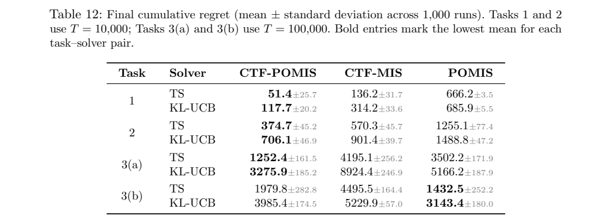

# 部分因果图能排除哪些不值得探索的动作

<!-- 全库方法复筛开始 -->
> **方法储备 · 训练目标与数据反馈**。保留“利用因果结构裁剪动作集合”这一研究问题或机制；是否用于当前业务另行验证。
> 原有阅读范围与证据等级不变；储备不等于效果已验证。
> 已恢复此前因业务距离被移出的原笔记；旧取舍原因仅作历史记录。
> [[研究前沿/论文库复筛与阅读路线|全库阅读路线]] · [[研究前沿/训练目标与数据反馈/存量论文分层索引|本方向完整分层]]
<!-- 全库方法复筛结束 -->

Generalizing Causal Decision-Making: Markov Equivalence, Transportability and Counterfactuals。作者为 Park, Min Woo、Lee, Sanghack。arXiv 首投 2026-11-10，本次核验 v1。 [版本记录](https://arxiv.org/abs/2611.14066v1) · [本地 PDF](./assets/source/paper.pdf) · [本地 HTML](./assets/source/paper.html)

## 研究问题

在干预组合很多时，图不完整或部分变量不可操纵，单纯穷举会给明显冗余组合反复分流。

## 方法与关键计算

从允许的图及实验能力枚举最小且可能最优的干预集合；在可迁移的源分布提供奖励界时，剔除上界低于其他可行动作下界的选择。记录删去每一类动作所需的图与边界假设，再在剩余集合运行原 bandit。

$$
U(a)<\max_{a^\prime}L(a^\prime)\ \Longrightarrow\ a\ \text{can be discarded}
$$

在所有有效奖励上下界同时成立时才可这样删去动作。图结构和实验能力也能预先排除不可行或等价的干预。 [原文定位](https://arxiv.org/html/2611.14066v1#S5)

## 对照、结果和限制

§6 表 12 在 1,000 次重复、四个构造任务和两种求解器中，CTF-POMIS 的平均累计遗憾均低于 CTF-MIS。任务 1 下为原基线的 37.7%（TS）和 37.5%（KL-UCB）。在任务 3(b) 普通 POMIS 更好。 [原文证据](https://arxiv.org/html/2611.14066v1#S6.T12)

原文 PDF 第 105 页。

反事实动作要能由给定实验机制实现。错误图或无效的迁移界可能剪掉最优动作，文中遗憾保证以界有效为条件。

## 复用和阅读范围

已核问题设定、方法与上文所列的关键对照，详细证明及未列出的实验以所附全文为准。本次未核实作者公开实现入口。

[[研究前沿/uplift模型迭代/02-可复用方法卡/GraphBanditPrune-因果图约束的探索剪枝|因果图约束的探索剪枝]] · [[研究前沿/uplift模型迭代/03-实验假设与结果/GraphBanditPrune-可信图结构稀疏时，剪枝是否减少探索而不误删最优动作|可信图结构稀疏时，剪枝是否减少探索而不误删最优动作]]
