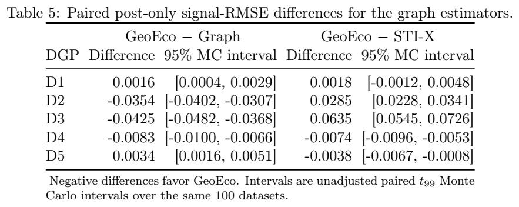

# 没有上线前记录的地区，可以借相邻地区估计增量吗？

<!-- 全库方法复筛开始 -->
> **方法储备 · 训练目标与数据反馈**。保留“历史缺失下的图合成控制”这一研究问题或机制；是否用于当前业务另行验证。
> 原有阅读范围与证据等级不变；储备不等于效果已验证。
> 已恢复此前因业务距离被移出的原笔记；旧取舍原因仅作历史记录。
> [[研究前沿/论文库复筛与阅读路线|全库阅读路线]] · [[研究前沿/训练目标与数据反馈/存量论文分层索引|本方向完整分层]]
<!-- 全库方法复筛结束 -->

关键取决于邻近地区能否共享对照地区的组合。作者专门模拟了历史数据选择性缺失、从而使估计方向翻转的情形。

## 文献与版本

Graph-regularized synthetic control for spatial panels with post-only treated locations。Hajime Seya、Ryosei Moriwaki、Daisuke Murakami。arXiv v1 首投于 2026-11-08。该预印本进入 11 月 10 日 stat.ME 公告，按公告补读。 检索及精读于 2026-11-16。精读识别条件、图正则目标、无历史节点的解与表 4–7。 [一手来源](https://arxiv.org/abs/2611.11496v1) · [关联原始资料](https://doi.org/10.5281/zenodo.24056020)

本地资料　[paper-v1.pdf](./assets/source/paper-v1.pdf) · [paper-v1.html](./assets/source/paper-v1.html) · [GraphSCM-v0.0.0.zip](./assets/source/GraphSCM-v0.0.0.zip)

## 方法与关键计算

为每个处理地区拟合一组非负且和为 1 的供体权重。目标依次加入有历史地区的干预前拟合误差、邻接边两端权重差的平方和及小幅正则。无历史地区没有本地拟合项；当图中该连通分量有历史锚点、无岭惩罚时，其权重是锚点权重的调和延拓。GeoEco 用干预前的经济协变量调整既有地理边，以学到的权重组合供体的干预后结果。

## 效果证据与对照

每种场景 100 次模拟。表 5 的 D4 中，GeoEco 相对带协变量的时空插补 STI-X，反事实信号 RMSE 的配对差为 −0.0074（95% 蒙特卡洛区间 −0.0096 至 −0.0053）。D3 选择性缺历史时，差为 +0.0635；表 7 中 GeoEco 的平均效应偏差达 −8.164 个百分点，平均估计方向翻转。

D4 同时改变时间因子和经济载荷，不能单独归因某条边。表 4 的 D5 将真实权重独立生成，等权供体的 RMSE 为 0.0978，优于 GeoEco 的 0.1073。信号恢复与平均处理效应恢复应分别评价。

表 5。相同模拟数据上的配对差，负值有利于 GeoEco。 [原文第 35 页](./assets/source/paper-v1.pdf#page=35)

## 能迁移到什么问题

需有未受干预或溢出污染的供体、稳定干预前关系，并对没有历史记录的目标检查邻域支持。对新地区的外推依赖这些结构假设。

Zenodo 0.0.0 复现包已下载和校验。已核对 START_HERE.R、RUN_FULL_STUDY.R、analysis/build_five_design_tables.py 及 data/ATT_replications.csv；本地未重跑。

[[研究前沿/uplift模型迭代/02-可复用方法卡/GraphSCM-用有历史地区的供体权重补全无历史地区|用有历史地区的供体权重补全无历史地区]] · [[研究前沿/uplift模型迭代/03-实验假设与结果/GraphSCM-遮掉干预前记录检验空间借用的偏差|遮掉干预前记录检验空间借用的偏差（未运行）]]
