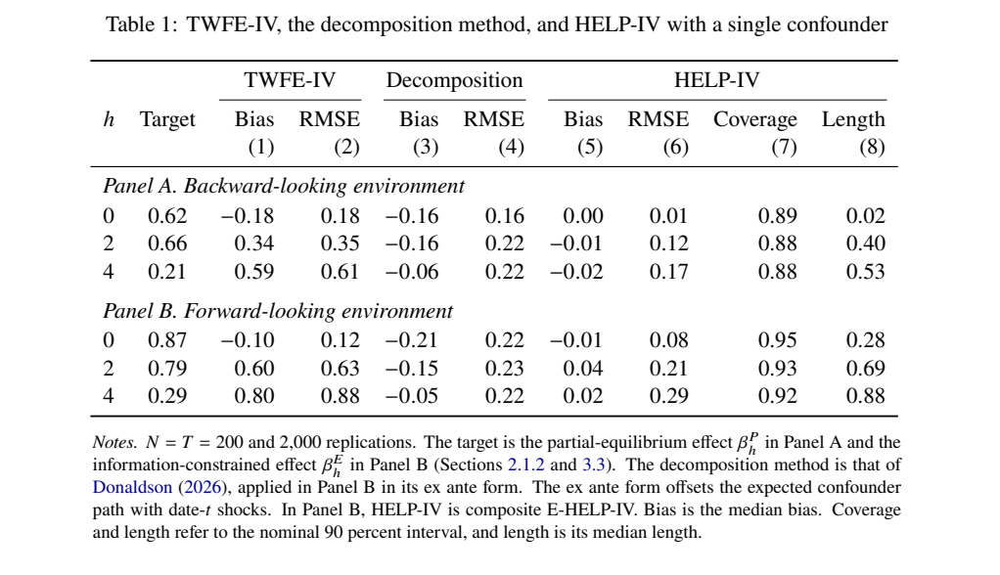

# Hedging out the HEDGE Bias: Identifying Dynamic Partial-Equilibrium Effects with Panel LP-IV

<!-- 全库方法复筛开始 -->
> **方法储备 · 训练目标与数据反馈**。保留“动态工具变量识别路径而非单点效应”这一研究问题或机制；是否用于当前业务另行验证。
> 原有阅读范围与证据等级不变；储备不等于效果已验证。
> 已恢复此前因业务距离被移出的原笔记；旧取舍原因仅作历史记录。
> [[研究前沿/论文库复筛与阅读路线|全库阅读路线]] · [[研究前沿/训练目标与数据反馈/存量论文分层索引|本方向完整分层]]
<!-- 全库方法复筛结束 -->

估计一次共同政策冲击的局部效应时，各地对冲击与共同混杂因素的敏感性可能相关。HELP-IV 给整段混杂路径配工具，并在同一受控情景中计算第一阶段与结局响应。

Wang, Endong、Zhang, Ren。arXiv 首投 2026-11-10，本次版本 v1（2026-11-10，按来源日期）。 [版本记录](https://arxiv.org/abs/2611.14434v1) · [本地原文](./assets/source/paper.pdf) · [原文 HTML](./assets/source/paper.html)

## 研究问题与机制

§2 以预先确定的单位暴露乘总体冲击代理作处理工具，并对 t 至 t+h 各期共同混杂因素的路径加入对应的暴露交互工具。在带单位和时期固定效应的局部投影中，同时对当期处理和混杂路径作工具变量估计，得到保持该路径固定时的影响。传统 TWFE-IV 会把相关暴露和混杂对处理的反馈一并计入。后顾和前瞻环境需要的工具与排除条件不同。

对每个 $h$，将 $Y_{i,t+h}$ 对 $s_iG_t$ 及 $s_iR_{t:t+h}$ 做 IV 局部投影；固定混杂路径的约化式响应除以同一受控情景的处理响应。

## 对照与证据

表 1 后顾仿真、h=2，真实系数 0.66。同一生成机制下 TWFE-IV、分解法、HELP-IV 的偏差分别为 +0.34、−0.16、−0.01，对应 RMSE 为 0.35、0.22、0.12。实证表 3 美国州级财政乘数两年期从传统 1.45 变为只固定利率时的 1.00；加入更多混杂和不同的固定路径时估计目标也会改变。

表 1，对同一受控响应的偏差与 RMSE。

## 假设、局限与复核范围

需要可观测的事前暴露、冲击代理的相关性和排除限制、受控处理响应非零；不能从一般日志自动构造有效工具。目标是冻结特定共同路径的动态局部均衡效应，而非政策引起的总均衡变化。

正文和公开题名检索未定位到可核实的作者实现，代码入口未知。

本次核查了上文的方法、直接对照与适用条件，尚未本地复现实验。

[[研究前沿/uplift模型迭代/02-可复用方法卡/在局部投影中用工具固定共同混杂因素的整条路径|在局部投影中用工具固定共同混杂因素的整条路径]] · [[研究前沿/uplift模型迭代/03-实验假设与结果/只控制当前混杂与固定未来路径会怎样改变动态增量|只控制当前混杂与固定未来路径会怎样改变动态增量]]

## 2026-11-14 版本复核

HELP-IV v2 把目标规则区间的适用条件明确为样本精确平衡，并报告同一样本上两个非贸易部门工资系数的差及标准误。 [[研究前沿/uplift模型迭代/01-论文原文与精读/HELPIV/版本更新-2026-11-14|双版本对照与原文]]
