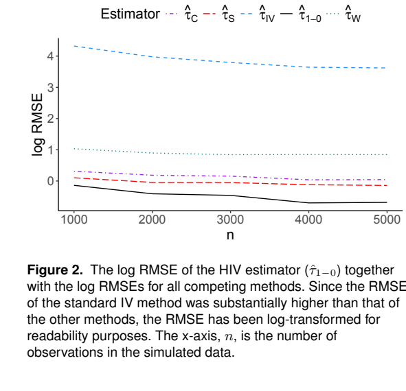

# Heterogeneous treatment effect estimation with instrumental variable methods

把多个可识别依从层的局部响应与常规协变量调整合并，估计隐藏混杂随观测特征变化的偏差。在局部工具较弱处降低局部比率估计的权重；偏差函数能否跨特征区间外推仍是实质假设。

Amir Aamodt Kazemi、Joseph Sexton、Inge Christoffer Olsen。作者预印本首发 2026-01-13（本地 PDF、下述公式和图号均来自此版）；期刊于 2026-11-06 在线发表。本次核对期刊元数据与摘要，出版商 PDF/XML 请求返回 403，尚未比较终稿正文。[作者预印本](https://doi.org/10.31222/osf.io/nbg3q_v1) · [PubMed](https://pubmed.ncbi.nlm.nih.gov/42992410/) [版本记录](https://doi.org/10.1177/09622802261495081) · [已保存的原文 PDF](./assets/source/paper.pdf)

**阅读覆盖**　作者预印本 §§2–5、引理 1–2、定理 1、图 2–4；期刊在线摘要与项目元数据另核。

**代码与数据**　作者在 OSF 存放分类 IV、TNFi 分析代码，论文报告使用 R 4.2.1；本次核实公开项目与子项目清单，未运行代码。[作者项目](https://osf.io/dtcgh/) · [分类 IV 代码](https://osf.io/cby5j/) · [TNFi 代码](https://osf.io/qy4rk/)

## 1. 问题、目标和识别

分类处理 $T$ 的每个工具值 $Z$ 给出对所有可选处理的完整鼓励排序。每个人有一个可接受的处理集合，假定会从中取排序最高者；当工具只有两值时对应熟悉的单调性。模型还要求工具与观测/隐藏混杂、效果修饰因子独立，工具只经由处理影响结局。$X$ 为观测到的效果修饰因子，$V$ 为其他观测调整项，$U$ 为未观测混杂。式（4）要求给定 $X$ 后，处理效应与影响选择的其他因素独立。普通鼓励日志是否满足这些假设，要按生成过程论证。

目标为 $\tau_{t-t'}(x)=\theta_t(x)-\theta_{t'}(x)$，其中 $\theta_t=E[Y(t)\mid X]$。仅调整 $V,X$ 得到 $\omega_t$，仍有混杂偏差 $\beta_t=\omega_t-\theta_t$。工具变量则能识别符合式（6）可估条件的依从层组合 $b$ 的局部响应 $\phi_t(b,x)$。引理 1 给出 $\theta_t(x)=\phi_t(b,x)+C(b,x)$，其中同一 $b,x$ 下的偏移不随方案而变。二元时可利用总接受者、从不接受者及服从者等局部信息。

## 2. 两个估计怎样合并

先跟随式（6）解每个可识别层的处理概率与结局比率，再回归 $\widehat\omega_t-\widehat\phi_t(b,x)$。式（8）放入按处理变化的截距、斜率及按依从层变化的截距、斜率，权重取特征密度乘局部 IV 分母的平方。这样局部依从概率很小或人群稀疏处对偏差拟合的影响较小；该权重忽略了结局回归估计方差和部分协方差，作者将其作为近似。定理 1 在偏差 $\beta_t(x)$ 及分层偏移 $C(b,x)$ 都对 $x$ 呈仿射关系等条件下得到校正对比，

$$
\widehat\tau_{t-t'}(x)=\widehat\omega_t(x)-\widehat\omega_{t'}(x)
-(\widehat\alpha_t-\widehat\alpha_{t'})-(\widehat\alpha_{t,X}-\widehat\alpha_{t',X})x .
$$

所需近似线性的是偏差相关函数，潜在结局曲线本身可更灵活。局部 IV 强度弱、可识别层稀少或偏差随 $x$ 弯曲时，校正仰赖外推；两类数据结合并未导出任一子模型正确就一致的性质。

## 3. 模拟和队列证据

图 2 的二元仿真有隐藏混杂和真值 $\tau(x)=x^2+x+1$，每个样本量 1,000–5,000 各重复 100 次。文中指出该生成过程的混杂偏差并非严格线性。标准条件 IV 的 RMSE 很高，作者使用对数纵轴。在此设计中，提出的 HIV 校正是被比较的 IV 方案里唯一优于仅调整已测变量的 GAM 的方法。研究没有在大范围生成机制中证明普遍优势。

应用纳入 2010–2023 年 1,446 位类风湿关节炎患者，比较五种治疗，将价格排序作为工具，依从层限于 14 个事先选定的可解释集合。结局是三个月 DAS28 CRP；图 4 以年龄作修饰因子，100 次 bootstrap 给出区间。队列没有个体效应真值；研究本身不能验证工具排除限制或条件同质性。向激励场景迁移时，应有确实外生的鼓励及完整动作排序，且先排查鼓励本身直接改变响应的路径。

## 方法与实验

[[研究前沿/uplift模型迭代/02-可复用方法卡/用多依从层工具变量校正条件效应偏差|用多依从层工具变量校正条件效应偏差]] · [[研究前沿/uplift模型迭代/03-实验假设与结果/按工具强度与隐匿修饰检验多档偏差校正|按工具强度与隐匿修饰检验多档偏差校正]]
