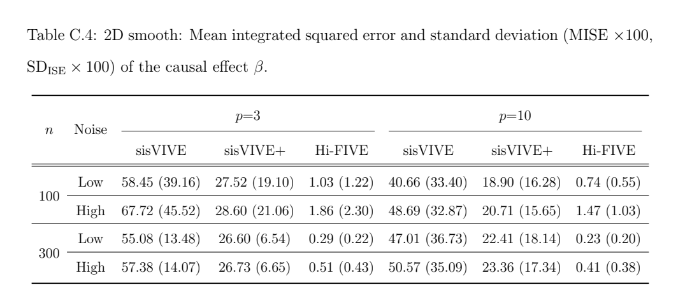

# Causal Learning with Invalid Instruments for High-dimensional Imaging Responses

<!-- 全库方法复筛开始 -->
> **方法储备 · 训练目标与数据反馈**。保留“从图像提取空间工具变量的识别条件”这一研究问题或机制；是否用于当前业务另行验证。
> 原有阅读范围与证据等级不变；储备不等于效果已验证。
> 已恢复此前因业务距离被移出的原笔记；旧取舍原因仅作历史记录。
> [[研究前沿/论文库复筛与阅读路线|全库阅读路线]] · [[研究前沿/训练目标与数据反馈/存量论文分层索引|本方向完整分层]]
<!-- 全库方法复筛结束 -->

像素位置上的多数候选工具可能同时失效。Hi-FIVE 利用真实效应在相邻位置的连续性，以及无效工具作用的区域边界，约束整张影像上的工具变量估计。

Wang, Yiting、Li, Chunlin、Yu, Shan、Wang, Lily。arXiv 首投 2026-11-09，本次版本 v1（2026-11-09，按来源日期）。 [版本记录](https://arxiv.org/abs/2611.13187v1) · [本地原文](./assets/source/paper.pdf) · [原文 HTML](./assets/source/paper.html)

## 研究问题与机制

§2 先估每个工具对处理的第一阶段强度；如果工具只通过处理作用于某位置，其结局系数与第一阶段的比值应等于该处的因果效应。平滑效应面使用三角剖分样条，无效工具的直接影响单独按区域惩罚，且每个单纯形要求至少保留一个相关且有效的工具。由可识别区域向邻域匹配同一连续分支；各处独立估计后再平滑无法替代该识别步骤。

同一工具 $j$ 在位置 $s$ 的约化式可写为 $\Gamma_j(s)=\gamma_j\beta(s)+\alpha_j(s)$；若 $\alpha_j(s)=0$ 且 $\gamma_j\ne0$，比值 $\Gamma_j(s)/\gamma_j$ 对应目标曲面。

## 对照与证据

附表 C.4 二维平滑、n=100、10 个工具、高噪声，MISE×100 对 sisVIVE / 点估计后平滑的 sisVIVE+ / Hi-FIVE 为 48.69 / 20.71 / 1.47。附表 C.5 对应有真跳变的设计变为 46.59 / 42.39 / 30.79。是整套模型的配对设置；无法将全部差异归给某一个惩罚项。

补表 C.4，平滑真值下的三方法 MISE。

## 假设、局限与复核范围

连续性、有效工具能锚定每个区域、局部无效作用以足以区分的方式切换都是识别条件。位置是结局维度，二维脑图上的异质性不等同于人群 CATE。识别与误差证据取自模拟，真实影像没有效应真值。

正文和公开题名检索未定位到可核实的作者实现，代码入口未知。

本次核查了上文的方法、直接对照与适用条件，尚未本地复现实验。

[[研究前沿/uplift模型迭代/02-可复用方法卡/利用效应面连续性区分局部失效的工具变量|利用效应面连续性区分局部失效的工具变量]] · [[研究前沿/uplift模型迭代/03-实验假设与结果/真实效应出现跳变时空间连续约束还能识别多少信号|真实效应出现跳变时空间连续约束还能识别多少信号]]
