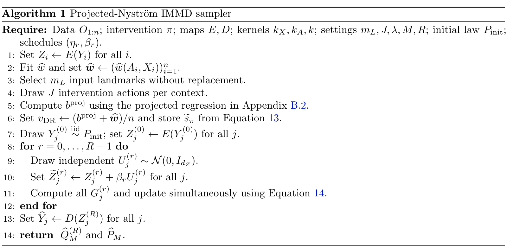

# Sampling Interventional Distributions with Orthogonal MMD Flow

[官方论文](https://arxiv.org/abs/2611.03962) · [本地PDF](./assets/source/paper.pdf) · [HTML快照](./assets/source/paper.html)

版本记录：[Submitted on 2 Nov 2026]；本次核验与精读：2026-11-06。本篇为滚动窗口内首次入库；检索日不等于首次发表日。

阅读范围：§2–5识别/算法/定理条件、§6主实验、AppendixE.6消融；Nyström矩阵推导未逐式复证。未逐行复证全部数学证明，未声称逐页翻译。[[研究前沿/uplift模型迭代/01-论文原文与精读/IMMD-Flow/阅读覆盖|原文章节与公式索引]]；HTML为原始快照，外部样式和图片可能需要联网，PDF可离线阅读。

代码：已核验[作者仓库](https://github.com/BariscanBozkurt/Interventional-MMD-Flow-Sampling)，commit `003d0e85b0ad9bce369bd346c6d473d438c0455f`；入口：[src/causality_utils/crossfit.py](https://github.com/BariscanBozkurt/Interventional-MMD-Flow-Sampling/blob/003d0e85b0ad9bce369bd346c6d473d438c0455f/src/causality_utils/crossfit.py)；[Simulations/ColorMNIST/dr_mmd_flow/colormnist_dr_mmd_flow_simulation.py](https://github.com/BariscanBozkurt/Interventional-MMD-Flow-Sampling/blob/003d0e85b0ad9bce369bd346c6d473d438c0455f/Simulations/ColorMNIST/dr_mmd_flow/colormnist_dr_mmd_flow_simulation.py)。已读取入口声明/关键片段，未审计全部实现、未安装运行。 [[研究前沿/uplift模型迭代/01-论文原文与精读/IMMD-Flow/代码核验|核验记录]]

## 问题与总体流程

从观察数据生成一个给定软干预策略下的**总体结果分布**，不限于均值。需要一致性、给定处理前X的可交换性、目标策略π对日志π0绝对连续。固定编码E、解码D，在潜空间拟合干预核均值，再固定目标移动粒子；不训练额外干预生成网络。

## 双重稳健目标与粒子更新（§3–5）

记 $m(a,x)=E[\varphi(Z)|a,x]$、$w=\pi/\pi_0$，构造
$$h_\pi=E\left[\int m(a,X)\pi(da|X)+w(A,X)\{\varphi(Z)-m(A,X)\}\right].$$
目标偏差是两个nuisance误差乘积，任一个正确可恢复目标。MMD风险 $\frac12\|\mu_Q-h_\pi\|^2$ 只依赖一个固定Hilbert空间元素。用Nyström核回归和每上下文J次动作抽样得到系数v，目标势 $s(z)=\sum_i v_i k(z,Z_i)$；v可负、不必归一，不能直接当概率质量抽样。

粒子更新 $z_j\leftarrow z_j-\eta[M^{-1}\sum_l\nabla_1k(z_j,z_l)-\nabla s(z_j)]$，可在梯度位置注入噪声。最后固定D解码。代码的Riesz–AdamW为另一个能量/更新变体，不是平滑核定理自动覆盖。

双稳健不保证全局优化收敛：Theorem5.3另需noisy gradient dominance、步长和平滑条件；更多迭代减少优化误差但放大目标误差。实现同样本拟合/评价nuisance，Assumption5.4明确要求经验过程余项控制，不能直接套cross-fit保证。非单射编码下潜空间正确不保证全部原结果分布正确。

## 实验与可归因证据

Table1：n=20000、M=2000、3数据种子，ColorMNIST像素SW2×1000为DR9.30±0.30、DecFM-Plugin11.37±0.78；CelebA26.56±1.55 vs32.72±1.83，dSprites软干预8.41±0.08。DR与单nuisance变体部分任务几乎相同，不能称DR模块普遍大幅提高指标。

Table2拟合+一次生成总耗时比DecFM快约11–42倍，排除共享编码/解码/指标；**拟合后单次生成反而DecFM更快**。AppendixE.6 Table8 Nyström在n=20000把CME求解9.09秒降至0.04秒，SW2 9.52→9.35，仅核回归求解计时。Table7观测初始化对复杂图像显著有利，CelebA高斯初始化潜距离相近但FID可从11.57恶化至211.40，说明潜度量不足。

实验是构造混杂的图像基准；粒子路径是优化轨迹，不是个体反事实对应。对履约可研究动作下时间/收益/风险联合分布，但需另验证可交换性、支持与分布指标及决策价值。

## 原文关键图表

原文 Algorithm 1，PDF 第 7 页；原始裁图，机制和证据解释见上文。裁图坐标与源文件校验值见 assets/source/figure-provenance.json。

## 方法卡

- [[研究前沿/uplift模型迭代/02-可复用方法卡/IMMD-Flow-orthogonal-target|先估计双稳健核目标，再优化干预结果分布]]
- [[研究前沿/uplift模型迭代/02-可复用方法卡/IMMD-Flow-nystrom-reuse|固定核目标的Nyström计算复用]]
