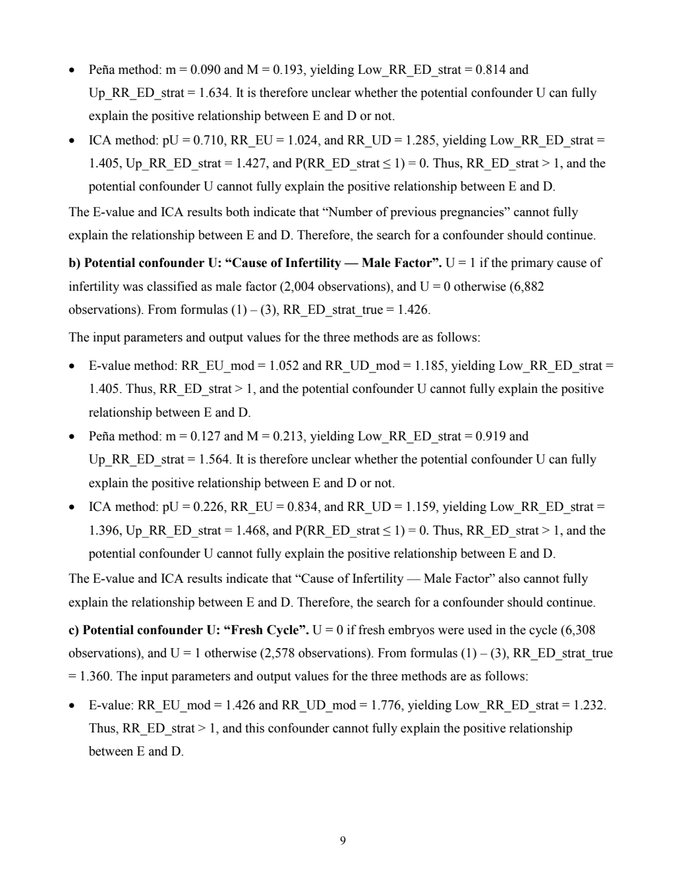

# Inverse Confounding Analysis: Part 2. Applications to Real- World Observational Data

<!-- 全库方法复筛开始 -->
> **方法储备 · 训练目标与数据反馈**。保留“从汇总表反推混杂的识别限制”这一研究问题或机制；是否用于当前业务另行验证。
> 原有阅读范围与证据等级不变；储备不等于效果已验证。
> 已恢复此前因业务距离被移出的原笔记；旧取舍原因仅作历史记录。
> [[研究前沿/论文库复筛与阅读路线|全库阅读路线]] · [[研究前沿/训练目标与数据反馈/存量论文分层索引|本方向完整分层]]
<!-- 全库方法复筛结束 -->

## 只恢复一个混杂因素的边际关联，能将风险比限制到多窄？

论文第二部分在完整数据里暂时隐藏三元联合表，只保留暴露、结局、候选混杂变量的发生比例和两两关联。剩下的一维自由度决定分层风险比的上下界，再拿完整数据的真值核对这些界。

Porotsky, Sergey。arXiv 首投 2026-11-12，本次核验 v1（2026-11-12，来源日期）。[论文与版本](https://arxiv.org/abs/2611.16559v1) · [本地原文](./assets/source/paper.pdf)

应用论文自己的 arXiv v1 为 11 月 12 日。核心 ICA 方法另见 [8 月首稿](https://arxiv.org/abs/2608.11991)，本条收录的是按隐藏、回填同一个已测因素核对范围的应用证据。

## 方法与估计对象

对三个二值变量输入三个边际比例与三种两两风险比。把所有非负联合单元表示成自由概率 p111 的函数，找满足非负约束的区间，以线性分式函数的端点算分层风险比范围。若进一步报告某段范围的概率，还需为未知 p111 指定分布。

给定这些输入后，$RR_{strat}=(a+b p_{111})/(c+d p_{111})$。取极值和把 $p_{111}$ 假为均匀以求概率是两个步骤。

## 对照与证据

§4.1 的回顾性 IVF 数据含 8,886 人。对“男性因素”候选混杂变量，完整分层 RR 为 1.426。只向 ICA 提供边际与两两关联给 [1.396,1.468]，Peña 方法得 [0.919,1.564]，E-value 方法给下界 1.405。三种方法输入信息不同，因此宽度不能解释为同信息下某算法更有效率。

§4.1，完整分层与三种敏感性分析的比较。原始 PDF 第 9 页。

## 识别条件与适用范围

这是 8 月原方法的应用续篇。示例能完整查看一个被暂时遮蔽的已测因素，不能据此断言真实未测混杂的边际参数可知。均匀假设下的概率不等于以频率校准过的真实混杂概率。

本轮从论文正文与作者标注中未取得可验证的配套代码入口。

本次精读覆盖上述方法、证据页和相关限制。附录中的其他推导与实验未逐项复算。

[[研究前沿/uplift模型迭代/02-可复用方法卡/从二值边际及两两关联列举分层风险比的相容范围|从二值边际及两两关联列举分层风险比的相容范围]] · [[研究前沿/uplift模型迭代/03-实验假设与结果/边际信息精度降低时混杂风险比的符号何时消失|边际信息精度降低时混杂风险比的符号何时消失]]
