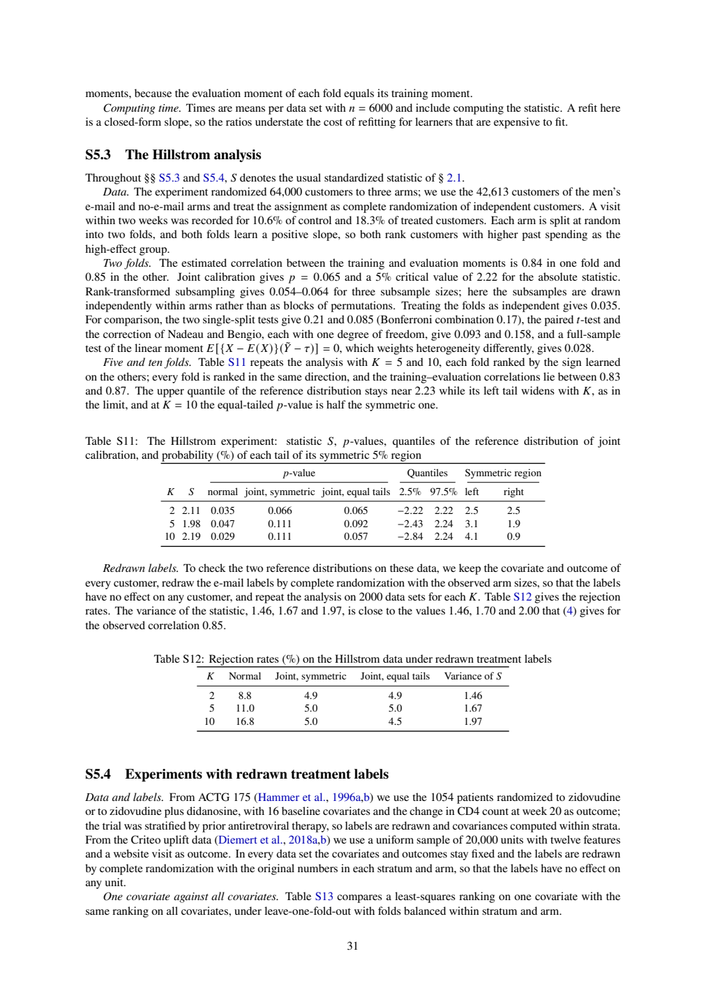

# Non-normal Limits and Joint Calibration of Cross-fitted Heterogeneity Tests

<!-- 全库方法复筛开始 -->
> **方法储备 · 训练目标与数据反馈**。保留“Non-normal Limits and Joint Calibration of Cross-fitted Heterogeneity Tests”这一研究问题或机制；是否用于当前业务另行验证。
> 原有阅读范围与证据等级不变；储备不等于效果已验证。
> [[研究前沿/论文库复筛与阅读路线|全库阅读路线]] · [[研究前沿/训练目标与数据反馈/存量论文分层索引|本方向完整分层]]
<!-- 全库方法复筛结束 -->

## 用了交叉拟合，高低增量两组的显著性还会被夸大吗？

对每一折来说，给这折排序的模型确实没见过这折。但它自己的数据参与了其他折的排序。没有异质性时，选方向的随机波动与检验统计量相互依赖，正态近似会误报。作者保留统计量，联合模拟选方向和估效果所用的矩。

He, Even、Yan, Zaizai。arXiv 首投 2026-11-11，本次核验 v1（2026-11-11，来源日期）。[论文与版本](https://arxiv.org/abs/2611.15333v1) · [本地原文](./assets/source/paper.pdf) · [本地 HTML](./assets/source/paper.html)

## 方法与估计对象

在随机试验每折外拟合排序，在折内估高低组的处理效应差，汇总并标准化。校准时估计各折选择矩与评价矩的联合协方差，在高斯模拟里重放相同的折间选向与排序规则，再用模拟分位数检验。线性斜率选向和有限候选排序的条件不同。

核心操作为“联合抽取选择矩、评价矩 → 每折用其余折选方向 → 本折计算差 → 汇总”，模拟阶段无需再拟合原学习器。

## 对照与证据

附表 S11–S12 固定 Hillstrom 顾客协变量、结局和邮件臂人数，分别做 2,000 次完整重随机化。在 2/5/10 折、名义 5% 下，正态拒绝率为 8.8%/11.0%/16.8%，联合对称校准为 4.9%/5.0%/5.0%。在真实邮件分组的十折检验中，同一统计量 2.19 的正态 p 为 0.029，联合对称 p 为 0.111。

附表 S11、S12，真实分组检验和重随机化误报率。原始 PDF 第 31 页。

## 识别条件与适用范围

重随机化验证的是已知零效应下的一类错误；观察到的 p 值变化不能证明真实实验没有异质性。理论推导指定了学习与选择结构，任意黑盒排序需另行验证。

本轮从论文正文与作者标注中未取得可验证的配套代码入口。

本次精读覆盖上述方法、证据页和相关限制。附录中的其他推导与实验未逐项复算。

[[研究前沿/uplift模型迭代/02-可复用方法卡/把跨折选排名与估效应的随机矩联合校准|把跨折选排名与估效应的随机矩联合校准]] · [[研究前沿/uplift模型迭代/03-实验假设与结果/互相借折训练会把高低组显著性推高多少|互相借折训练会把高低组显著性推高多少]]
