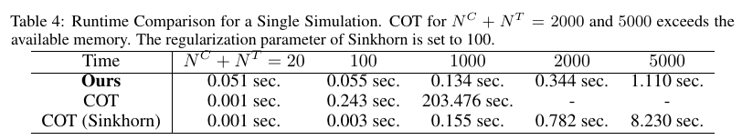

# Identification and Bounding of Joint Expectation over Potential Outcomes

只知道处理、对照各自的结果分布时，可以用极端秩配对给个体增量方差等统计量求尖锐界。LaLonde 收入含零点质量，文中的混合分布算法专门处理这种并列值。

Yuta Kawakami、Jin Tian。arXiv 首次提交 2026-11-05，本次核验 v1（2026-11-05）。[论文与版本记录](https://arxiv.org/abs/2611.07536v1) · [原文 HTML](https://arxiv.org/html/2611.07536v1) · [本地完整 PDF](./assets/source/paper.pdf)

**阅读覆盖**　§§3–7、定理 1/3/4/5、附录 D 表 3–4 与 E 实例；高阶矩的各条推论与附录证明未逐项复证。

**代码与数据**　附录和 checklist 给出作者仓库，已核验 exp_inver.R、COT comparison.R、application.R 和 lalonde.R 等入口。未运行。[作者代码](https://github.com/NA679723/NeurIPS2026_Joint_Expectation)

## 1. 哪个量能从随机试验得到

两臂随机化能识别边际 $F_1,F_0$，平均差由两个均值决定。若统计量是 $E[g(Y_1,Y_0)]$，联合依赖一般未知，同样两个边际可能产生不同个体差值方差。§4 的 comonotonicity 要求任意两人在两个潜在结果下的排序不反转，countercomonotonicity 要求反向排序；有并列值也可定义。两种假设由研究设计另行辩护。

## 2. 两个极端的耦合

式（6）给出 Fréchet–Hoeffding 极端联合分布，令 $a=F_1(y_1)$、$b=F_0(y_0)$。

$$
F^U(y_1,y_0)=\min(a,b),\qquad F^L(y_1,y_0)=\max(a+b-1,0).
$$

定理 1 说明同向或反向单调下，用对应联合分布积分得到点值；未指定耦合，定理 3 对有界超模 $g$ 给出 $E^L[g]\le E[g]\le E^U[g]$，对次模 $g$ 方向互换。对有界结果，$g=(Y_1-Y_0)^2$ 为次模，两个端点都可达到。只需从二阶矩两端减去平均差平方就得到方差界。奇数阶差的矩一般只有非尖锐界；比例效应对零分母还需额外处理。

## 3. 有原子质量的数据如何估计

式（16）–（22）显式区分 $F_0(y_0^-)$ 与 $F_0(y_0)$。对每个对照结果，在其累计质量对应的秩区间内均匀抽取一秩，按处理臂经验分位数映射至同向或反向配对，再平均 $g$。这样一批零收入记录可分配到一段秩，避免把它们强行对应到同一处理值。定理 5 的收敛速率要求 Lipschitz 函数和紧支撑。观察样本还须先识别两臂边际，原始选择偏差会传入两端。

## 4. 仿真、运行成本与实证

附录 D 表 3，SCM (B)、总样本 1,000，二阶原点矩真值 4.100，作者方法报告的平均下界 3.359、平均上界 4.347；比较方法 MCI 下界 0.572。它衡量的是总体二阶矩的可识别范围。表 4 在相同总样本规模的单次计时为 0.134 秒，对应精确 COT 203.476 秒；2,000/5,000 时精确 COT 超过可用内存。20 人时精确 COT 更快。表 4 是单次实现计时，不能推为系统 SLA。

附录 E 以胆固醇和培训收入作说明；LaLonde 数据 722 人中 196 人收入为零，比值分析先加 1，改变了该比值的含义。真实数据未观测个体效应真值。把界用于核查异质性声明，需区分 $\mathrm{Var}(Y_1-Y_0)$ 与模型分数的方差；只有条件均值分数时，二者不能直接比较。

## 方法卡与实验

[[研究前沿/uplift模型迭代/02-可复用方法卡/带并列值的潜在结果极端耦合|带并列值的潜在结果极端耦合]]

[[研究前沿/uplift模型迭代/03-实验假设与结果/零膨胀结果下的个体增量方差识别区间|零膨胀结果下的个体增量方差识别区间]]
