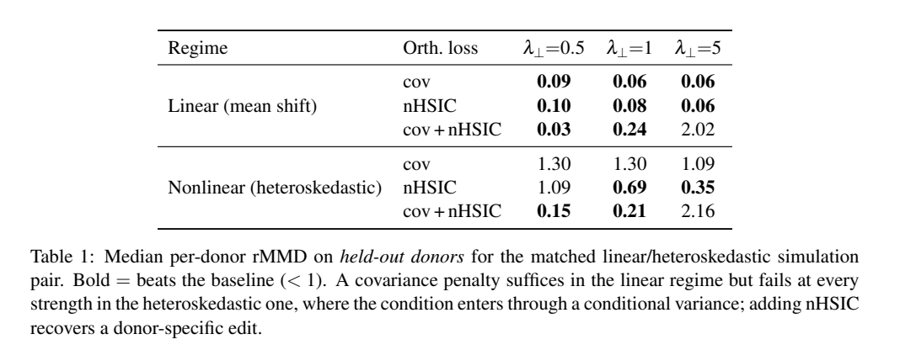

# When Covariance Is Not Enough: Kernel-Based Regularization for Single-Cell Counterfactuals

<!-- 全库方法复筛开始 -->
> **方法储备 · 训练目标与数据反馈**。保留“独立性检验中 HSIC 与协方差的区别”这一研究问题或机制；是否用于当前业务另行验证。
> 原有阅读范围与证据等级不变；储备不等于效果已验证。
> 已恢复此前因业务距离被移出的原笔记；旧取舍原因仅作历史记录。
> [[研究前沿/论文库复筛与阅读路线|全库阅读路线]] · [[研究前沿/训练目标与数据反馈/存量论文分层索引|本方向完整分层]]
<!-- 全库方法复筛结束 -->

两个表示块协方差为零，并不排除其中一个仍记录另一个的方差变化。作者用仅改变这一依赖形式的两组模拟，检验核独立性约束能否保留个体差异。

Traeuble, Korbinian、de Brouwer, Edward、Verma, Archit、Haviv, Doron、Fletez-Brant, Kipper。arXiv 首投 2026-11-10，本次版本 v1（2026-11-10，按来源日期）。 [版本记录](https://arxiv.org/abs/2611.13748v1) · [本地原文](./assets/source/paper.pdf) · [原文 HTML](./assets/source/paper.html)

## 研究问题与机制

模型用监督表示记录已知条件，另用一个表示记录其余个体差异。生成反事实时，替换已知条件而保留同一个体的其余表示。线性协方差只能惩罚一阶关联；基于两个批内核矩阵的归一化 HSIC 还能对非线性相关产生惩罚。作者使用配对模拟，将条件引起的共享均值平移换成个体特征的条件方差变化，保留其余生成过程和划分，检查改变条件后是否仍能匹配同一个体。

以中心化核矩阵 $K_c,L_c$ 衡量两表示块的依赖，归一化核对齐可写作 $\langle K_c,L_c\rangle_F/(\|K_c\|_F\|L_c\|_F)$。评价用同一留出个体目标分布的 MMD 除以通用训练目标分布与该个体目标的 MMD，比值小于 1 表示超过通用分布基线。

## 对照与证据

表 1，固定惩罚强度 0.5。线性场景仅协方差、仅 nHSIC、两者相加的个体 rMMD 中位数分别为 0.09、0.10、0.03；异方差场景为 1.30、1.09、0.15。强度升至 5 时，联合惩罚在异方差条件下反而达到 2.16，单独 nHSIC 为 0.35。配对对照支持检查依赖的阶数和惩罚强度，不足以支持联合项普遍最优。

表 1，均值与异方差两个机制中相同正则强度的比较。

## 假设、局限与复核范围

固定架构和单个训练种子的模拟网格；真实数据只能将同一来源的目标组作为分布对照，没有逐个样本的反事实真值。适合迁移的是检验表示依赖和个体保真的统计设计。

正文和公开题名检索未定位到可核实的作者实现，代码入口未知。

可对照 [[研究前沿/uplift模型迭代/01-论文原文与精读/CFEditTest/精读|反事实生效与保真检查]]。

本次核查了上文的方法、直接对照与适用条件，尚未本地复现实验。

[[研究前沿/uplift模型迭代/02-可复用方法卡/用配对的均值与方差干预检验表示中的非线性依赖|用配对的均值与方差干预检验表示中的非线性依赖]] · [[研究前沿/uplift模型迭代/03-实验假设与结果/在均值平移和条件方差改变下分别检验核独立性惩罚|在均值平移和条件方差改变下分别检验核独立性惩罚]]
