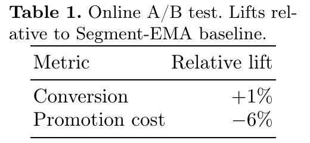

# LCM-Promo: An LLM-Based Uplift Model for Promotion Allocation

[官方论文](https://arxiv.org/abs/2610.37570) · [本地PDF](./assets/source/paper.pdf) · [HTML快照](./assets/source/paper.html)

版本记录：[Submitted on 27 Oct 2026]；本次核验与精读：2026-11-06。本篇为已播报历史队列补精读，不是新论文。

阅读范围：§1–4全文的方法、线上/离线实验及部署描述。未逐行复证全部数学证明，未声称逐页翻译。[[研究前沿/uplift模型迭代/01-论文原文与精读/LCM-Promo/阅读覆盖|原文章节与公式索引]]；HTML为原始快照，外部样式和图片可能需要联网，PDF可离线阅读。

代码：本次核验的论文原文与元数据未提供可确认的作者实现入口；代码状态未知，不能据此断言不存在。未运行代码。 [[研究前沿/uplift模型迭代/01-论文原文与精读/LCM-Promo/代码核验|核验记录]]

正式出版入口：[ECML PKDD 2026章节](https://doi.org/10.1007/978-3-032-37685-5_53)。本次精读基于arXiv v1；未核验正式版差异。

## 问题与整体方法

Segment-EMA按人群×优惠配置单独维护响应，细分变多后每个格子都要重新探索。LCM-Promo把历史行为摘要、城市/时段等会话信息和优惠选项写成prompt，用4B稠密模型预测一个优惠标识token；再把输出分布解释为用户的最低转化优惠阈值。模型、阈值解码、抽样聚合与预算分配构成完整链条。

## 核心计算（§2）

按折扣深度排序选项 $d_0,\ldots,d_K$，另有不购买标识 $a_\emptyset$。只保留合法标识的下一token概率并重新归一化：

$$q_i(x)=\frac{p_\theta(a_i\mid x)}{\sum_{j=0}^Kp_\theta(a_j\mid x)+p_\theta(a_\emptyset\mid x)}.\qquad\text{(1)}$$

将其作为阈值 $T$ 的PMF后累加：

$$r_k(x)=P(T\le d_k\mid x)=\sum_{j=0}^kq_j(x).\qquad\text{(2)}$$

这在结构上保证响应不随折扣增加而下降，且不购买质量使最大折扣响应仍可小于1。相对零折扣的差得到模型内的uplift。

训练是观察到的“转化时优惠标识/未转化标识”的交叉熵。用户一个月可见多次优惠、通常最多转化一次，作者把观察转化优惠当最低阈值的代理。**观察到的成交优惠不等于已知的真实最低阈值**；日志混杂与曝光策略、未观察的替代优惠结果并未被单调解码自动解决。因而该结构保证的是曲线形状，不能单凭结构宣称识别了因果剂量响应。

waterfall变体把成交折扣及所有更深折扣都标正，再平滑成多标签soft target。它仍用交叉熵，但改变了下一token目标语义；论文给出负面证据，不能默认采用。

## 实验与工程证据（§3）

巴西iFood流失召回场景，一个月随机90%对照/10%处理；两臂同一全局预算约束、同一线性优化分配器，替换响应模型。相对Segment-EMA，转化+1%、总优惠成本−6%。正文未提供置信区间、样本量或各组件独立线上消融；收益属于这次模型系统替换。

离线固定优惠RCT：随机森林用往月RCT训练，LCM用历史生产日志训练、仅在RCT评估。AUUC：0.0578±0.0064 vs LCM后处理0.0608±0.0032；Qini：0.0466±0.0053 vs 0.0490±0.0028；Uplift@30：森林0.1708±0.0064高于LCM0.1626±0.0035。waterfall分别只有0.0278、0.0226、0.1208。作者明确只把离线结果视为支持开展线上试验，未主张全面优胜。关于waterfall与预训练目标冲突的解释是作者推测，未单独验证。

每天午餐/晚餐两次批推理；用户按城市、会话、生命周期聚类，随机抽样估计平均响应曲线，bootstrap决定样本量。预先算好行为摘要，vLLM+BESH批服务，作者报告8张H200每天运行约1小时。分群从约50增至1000以上、组合由10到百万以上是系统容量变化，不等于同幅度收益。

## 采用边界

可先研究“合法token归一化→PMF累计”的单调响应头，模型不必固定4B。若优惠不可全序、存在厌恶/疲劳导致非单调，结构假设会错。抽样聚合适合批量策略，无法由本文结果推导实时个体决策延迟。需对固定阈值策略和预算排序分别校准、检查日志支持，并保留waterfall负对照。

## 原文关键图表

原文 Table 1，PDF 第 3 页；原始裁图，机制和证据解释见上文。裁图坐标与源文件校验值见 assets/source/figure-provenance.json。

## 方法卡

- [[研究前沿/uplift模型迭代/02-可复用方法卡/LCM-Promo-threshold-pmf|合法token概率到单调阈值响应曲线]]
- [[研究前沿/uplift模型迭代/02-可复用方法卡/LCM-Promo-cluster-sampling|上下文聚类后的抽样响应曲线批服务]]

## 待验证想法

[[研究前沿/uplift模型迭代/03-实验假设与结果/2026-11-06-单调响应与反事实一致性|单调响应与反事实一致性（未运行）]]
