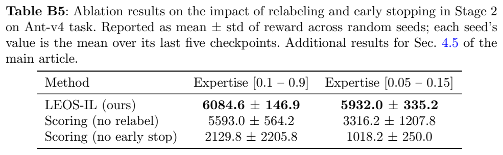

# 多个历史策略的质量不同，怎样避免把坏动作也当成专家样本？

<!-- 全库方法复筛开始 -->
> **方法储备 · 模型自进化**。保留“异质且不完美示范者的模仿学习”这一研究问题或机制；是否用于当前业务另行验证。
> 原有阅读范围与证据等级不变；储备不等于效果已验证。
> 已恢复此前因业务距离被移出的原笔记；旧取舍原因仅作历史记录。
> [[研究前沿/论文库复筛与阅读路线|全库阅读路线]] · [[研究前沿/模型自进化/存量论文分层索引|本方向完整分层]]
<!-- 全库方法复筛结束 -->

从示范来源和状态动作估计动作质量，再在在线微调时更新伪标签。作者单独检验了何时应停止改标签。

## 文献与版本

Imitating the Imperfect: Offline-to-Online Robust Imitation Learning from Heterogeneous Demonstrators。Cheng Pan 等。arXiv v1 首投 11-11。 检索及精读于 2026-11-15。精读算法 1–2、§4.1–4.5、附录表 B4–B7；核实作者代码目录。 [一手来源](https://arxiv.org/abs/2611.16020v1) · [关联原始资料](https://github.com/ch-engpan/IL_imperfect)

本地资料　[paper-v1.pdf](./assets/source/paper-v1.pdf) · [paper.html](./assets/source/paper.html)

## 方法与关键计算

离线阶段在不同示范者的轨迹上联合估动作质量及每个示范者的优质动作比例；交替更新分类分数和各来源的正标签比例，并检查来源间估计是否塌缩。策略学习阶段从示范中选高分子集，与学习器新轨迹一起更新打分器；以打分器作替代奖励。每轮重选高分子集，连续多轮集合成员变化低于阈值时冻结伪标签。

## 效果证据与对照

Ant-v4、低质量示范混合（各来源优质动作比例 0.05–0.15），附表 B5 的五种子平均回报为完整方案 5,932、不再重标 3,316、持续重标但无早停 1,018；种子间标准差分别约为 335、1,208、250。

广泛质量分布下，同一组是 6,085、5,593、2,130。附表 B6 显示低质量场景取前 10% 为 5,932，放宽到前 20% 降至 1,757，阈值与真实质量比例有关。示范由较早和较晚的强化学习策略检查点混合生成。

表 B5，重标与早停的独立对照。 [原文第 18 页](./assets/source/paper-v1.pdf#page=18)

## 能迁移到什么问题

迁移到多来源历史决策，需要来源标识、可比的状态支持以及能辨别优劣方向的信息。论文需要锚点和方向假设，在线阶段可以采样环境。它能为策略学习筛示范，分数本身不识别某个人的增量收益。

仓库中的 utils_scoring_selfLabel_uu_sort_paral.py 及 paper_figures_and_tables/table_reward_ablations.py 对应打分与消融表整理，未运行。

[[研究前沿/uplift模型迭代/02-可复用方法卡/LEOSIL-按来源区分示范质量并在成员稳定时停止重标|按来源区分示范质量并在成员稳定时停止重标]] · [[研究前沿/uplift模型迭代/03-实验假设与结果/LEOSIL-示范混合比例变化时重标早停是否仍有效|示范混合比例变化时重标早停是否仍有效（未运行）]]
