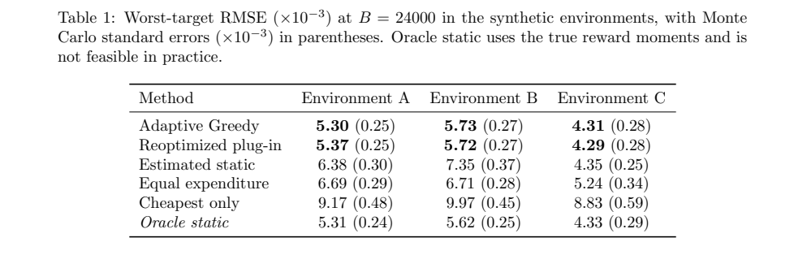

# 有限预算下应从哪套历史政策追加一条观测

<!-- 全库方法复筛开始 -->
> **方法储备 · 训练目标与数据反馈**。保留“Adaptive Budgeted Data Acquisition for Robust Off-Policy Evaluation from Multiple Loggers”这一研究问题或机制；是否用于当前业务另行验证。
> 原有阅读范围与证据等级不变；储备不等于效果已验证。
> [[研究前沿/论文库复筛与阅读路线|全库阅读路线]] · [[研究前沿/训练目标与数据反馈/存量论文分层索引|本方向完整分层]]
<!-- 全库方法复筛结束 -->

Adaptive Budgeted Data Acquisition for Robust Off-Policy Evaluation from Multiple Loggers。作者为 Biswas, Amitakshar、Zhu, Ruoqing。arXiv 首投 2026-11-06，本次核验 v1。 [版本记录](https://arxiv.org/abs/2611.10095v1) · [本地 PDF](./assets/source/paper.pdf) · [本地 HTML](./assets/source/paper.html)

## 研究问题

若不同日志有不同获取成本，等额取数可能把预算花在对候选政策几乎没有信息的来源。

## 方法与关键计算

先给各来源初始覆盖，在线估计结果矩和分层方差；对每个买得起的来源试算追加一条后最坏目标方差的下降，再按单位成本排序。累计观测进入同一池化估值器。仅在能够主动选择样本来源时可执行。

$$
k_t\in\arg\max_{k:c_k\le B_t}\frac{\widehat G(N_t)-\widehat G(N_t+e_k)}{c_k}
$$

选择规则的简记。G 表示候选策略中的最坏估值方差准则，c 为来源价格，B 为剩余预算。 [原文定位](https://arxiv.org/html/2611.10095v1#S3)

## 对照、结果和限制

§5 表 1，合成环境 A、预算 24,000 时，最坏目标 RMSE（×10⁻³）为贪心 5.30、等额支出 6.69、反复重解整数规划 5.37。环境 C 则为 4.31、5.24、4.29。表 2 单列真实特征半合成对照。 [原文证据](https://arxiv.org/html/2611.10095v1#S5.T1)

原文 PDF 第 16 页。

采购机制和已知成本是额外前提；与使用固定历史数据再优化估值权重解决的是不同问题。

## 复用和阅读范围

已核问题设定、方法与上文所列的关键对照，详细证明及未列出的实验以所附全文为准。本次未核实作者公开实现入口。

[[研究前沿/uplift模型迭代/02-可复用方法卡/LoggerAcquisition-按方差下降采购日志|按方差下降采购日志]] · [[研究前沿/uplift模型迭代/03-实验假设与结果/LoggerAcquisition-固定预算和目标策略集时，逐次改变取样来源能否优于固定配额|固定预算和目标策略集时，逐次改变取样来源能否优于固定配额]]
