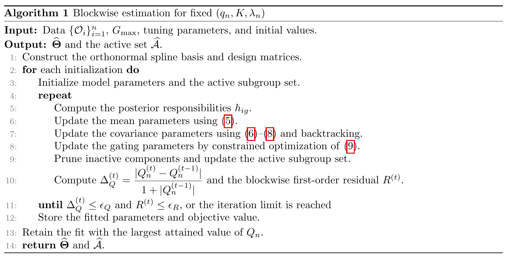

# Unifying Data-Adaptive Longitudinal Treatment-Effect Subgroup Discovery and Pretreatment Membership Prediction

[官方论文](https://arxiv.org/abs/2610.41886) · [本地PDF](./assets/source/paper.pdf) · [HTML快照](./assets/source/paper.html)

版本记录：[Submitted on 30 Oct 2026]；本次核验与精读：2026-11-06。本篇为滚动窗口内首次入库；检索日不等于首次发表日。

阅读范围：§2结构和分块拟合、§4.4模拟、§5两应用及§6局限；渐近定理未逐证明复核。未逐行复证全部数学证明，未声称逐页翻译。[[研究前沿/uplift模型迭代/01-论文原文与精读/LongitudinalMoE/阅读覆盖|原文章节与公式索引]]；HTML为原始快照，外部样式和图片可能需要联网，PDF可离线阅读。

代码：本次核验的论文原文与元数据未提供可确认的作者实现入口；代码状态未知，不能据此断言不存在。未运行代码。 [[研究前沿/uplift模型迭代/01-论文原文与精读/LongitudinalMoE/代码核验|核验记录]]

## 模块价值：同时发现时变效应群体和预测新个体归属

两阶段先聚类完整轨迹、再训练归属器可能发现无法由处理前信息识别的人群。本文把处理前Z的门控直接放进纵向混合似然；每群有平滑基础/处理效应曲线和独立协方差结构。

$$Y_i(t)=X_i(t)^T[\beta_{g1}(t)+D_i\beta_{g2}(t)]+e_{ig}(t)+\epsilon_{ig}(t),\quad
\pi_g(Z)=\frac{\omega_g e^{Z^T\eta_g}}{\sum_h\omega_h e^{Z^T\eta_h}}.$$

ω全局删专家，η随个体改变成员概率；ω是Z=0时概率，不一定是总体占比。B样条表示均值/特征函数，低秩高斯过程刻画个体内相关；对ω加对数惩罚剔除冗余专家。

## 拟合与部署（§2）

EM式责任权重→加权GLS更新曲线→协方差Fisher scoring/正交约束→联合优化ω和η；回溯确保惩罚目标不下降，多初始化与BIC选择样条维、秩和惩罚。训练归属可用结果轨迹，部署只能用处理前门控概率，不能泄漏未来结果。

## 证据（§4–6）

200次模拟/每样本规模，n600、Gmax5/8/10选对两群196/194/192次；两阶段196/180/191。测试归属准确率约90.48–90.59% vs79.60–81.78%，Brier0.068–0.069 vs0.182–0.194。误差比较条件于各方法选出两群，并保留未收敛返回值；并非无条件全面优势，给真实群数/协方差形状的HLME部分参数更好。

COMPETE469人发现早平台与延迟增强曲线，SANAD540人1720观察发现时段差异，仅探索性重分析。SANAD门控的首次ANX/DEP是否处理前未证实；两应用完整病例、非凸拟合、bootstrap受选群条件影响。潜在群可因预后/协方差差异形成，不全是治疗敏感度群。

迁移可研究多时点优惠/等待后结果曲线与软人群归属；先明确识别假设与删失机制，归属准确不等于策略最优。

## 原文关键图表

原文 Algorithm 1，PDF 第 7 页；原始裁图，机制和证据解释见上文。裁图坐标与源文件校验值见 assets/source/figure-provenance.json。

## 方法卡

- [[研究前沿/uplift模型迭代/02-可复用方法卡/LongitudinalMoE-joint-trajectory-gating|全局稀疏权重与处理前门控联合学习时变效应群]]
