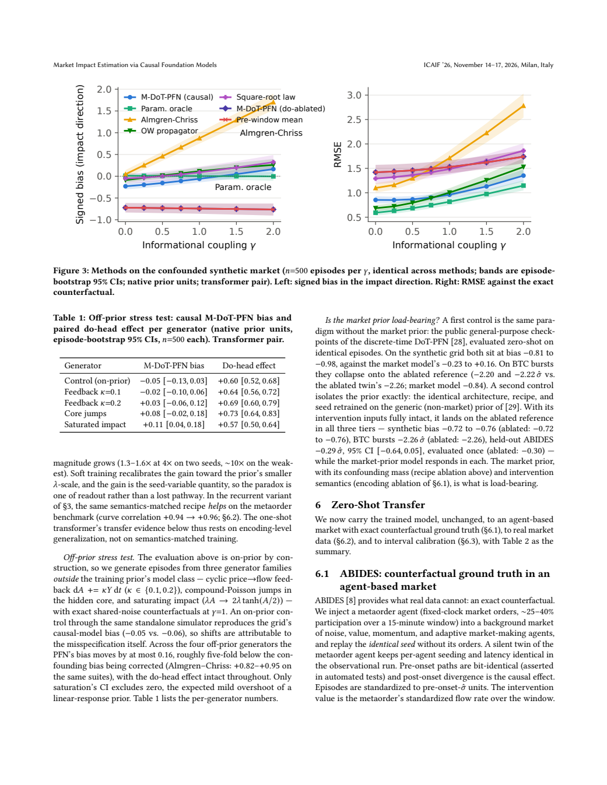

# Market Impact Estimation via Causal Foundation Models

<!-- 全库方法复筛开始 -->
> **方法储备 · 司乘行为序列建模**。保留“市场冲击世界模型的动作依赖诊断”这一研究问题或机制；是否用于当前业务另行验证。
> 原有阅读范围与证据等级不变；储备不等于效果已验证。
> 已恢复此前因业务距离被移出的原笔记；旧取舍原因仅作历史记录。
> [[研究前沿/论文库复筛与阅读路线|全库阅读路线]] · [[研究前沿/司乘行为序列建模/存量论文分层索引|本方向完整分层]]
<!-- 全库方法复筛结束 -->

## 训练在模拟市场上的模型，怎样检验它学到的是干预响应？

对同一交易情境分别询问追加母单和不追加母单后的价格，并与拿掉干预输入的同构模型比较。作者分开检验是否响应、持续时间的形状和绝对量级；用同随机种子的撮合模拟重放提供反事实真值。

Thumm, Dennis、Chen, Ying。arXiv 首投 2026-10-08，本次核验 v2（2026-11-11，来源日期）。[论文与版本](https://arxiv.org/abs/2610.12537v2) · [本地原文](./assets/source/paper.pdf) · [本地 HTML](./assets/source/paper.html)

旧稿修订。对照 10 月 8 日 v1，v2 新增按生成器变化的偏差与置信区间（表 1）、新种子模拟时长曲线对照及四层证据汇总（表 4）。v1 已有干预头消融和跨市场形状比较。

## 方法与估计对象

合成市场让隐藏消息同时影响订单流与价格，改变混杂强度得到有真值的训练对。用训练好的 PFN 在相同历史上输入两条动作路径，按价格单位归一化读出差值。与删掉干预输入的模型、一次性预测和逐步递归预测在相同回放上作配对比较。

对同一历史 $h$ 与干预路径 $a$，比较 $\hat Y(h,do(a))-\hat Y(h,do(0))$，在可以重复运行的市场以共用噪声轨迹生成真值。

## 对照与证据

v2 新表 1 每类生成器 500 个事件。有反馈 κ=0.2 时预测干预效应偏差 +0.03 [−0.06,0.12]，改为饱和冲击时偏差 +0.11 [0.04,0.18]。表 4 中同种子 ABIDES 重放的时长曲线相关从一次性 +0.69 到递归 +0.97，配对差 +0.28 [0.09,0.46]；自然交易簿只观察到一条路径。

v2 表 1，偏离训练先验时的共享噪声反事实检验。原始 PDF 第 5 页。

## 识别条件与适用范围

作者实际市场成交日志上能检验曲线形状与响应，不能核出真实无交易反事实。跨结构变体也会同时改变训练方式，不能把全部差异归给递归本身。

作者的 [复现仓库](https://github.com/thummd/causal-market-simulator) 将 notebooks/reproduction_walkthrough.ipynb 列为复现入口，表图对应脚本见 ARTIFACT.md。

本次精读覆盖上述方法、证据页和相关限制。附录中的其他推导与实验未逐项复算。

[[研究前沿/uplift模型迭代/02-可复用方法卡/用同种子重放分开核对干预响应的方向形状和量级|用同种子重放分开核对干预响应的方向形状和量级]] · [[研究前沿/uplift模型迭代/03-实验假设与结果/同形状的模型能否在新机制上保住干预效应量级|同形状的模型能否在新机制上保住干预效应量级]]
