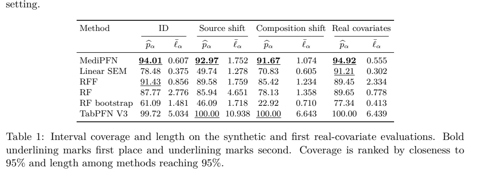

# MediPFN: Amortized In-Context Nuisance Learning and Inference for Causal Mediation Analysis

<!-- 全库方法复筛开始 -->
> **方法储备 · 模型自进化**。保留“预训练模型辅助中介估计”这一研究问题或机制；是否用于当前业务另行验证。
> 原有阅读范围与证据等级不变；储备不等于效果已验证。
> 已恢复此前因业务距离被移出的原笔记；旧取舍原因仅作历史记录。
> [[研究前沿/论文库复筛与阅读路线|全库阅读路线]] · [[研究前沿/模型自进化/存量论文分层索引|本方向完整分层]]
<!-- 全库方法复筛结束 -->

MediPFN 先用表格基础模型和交叉拟合估计自然间接效应，再学习该估计器在已知真值模拟表上的误差分布。同一批压力测试表上，主要的覆盖改善伴随对称化后的区间变宽。

Bo, Shi、Hu, Jiaming。arXiv 首投 2026-11-09，本次版本 v2（2026-11-11，按来源日期）。 [版本记录](https://arxiv.org/abs/2611.13219v2) · [本地原文](./assets/source/paper.pdf) · [原文 HTML](./assets/source/paper.html)

## 研究问题与机制

§2–3 的目标是处理从 0 改为 1 时，经由中介变化传递的平均差异。冻结的表格骨干配合可训练适配器预测辅助函数，将折外预测代入影响函数得点估计和尺度。另一只预测头以整张模拟表为单位，学习标准化误差的分位数。先细调，再把左右两端的较大距离用作对称半径，最后用独立的校准表决定额外扩张。

令 $\theta_{ab}=E[Y(a,M(b))]$，目标为 $\theta_{11}-\theta_{10}$。给定原区间 $[L,U]$ 和中心 $\hat\theta$，对称半径取 $\max(|L-\hat\theta|,|U-\hat\theta|)$。

## 对照与证据

§4.3、图 4 与附录 C 固定辅助预测、折与点估计，比较 576 张压力测试表：直接区间经细调后，覆盖从 84.55% 到 84.38%，平均长度从 1.426 到 1.387；细调后的对称区间覆盖 94.10%，长度 2.249。这批表在 95% 水平上的额外校准扩张为零。27 张表中，100 次重抽样相对整套 MediPFN 的配对耗时比中位数为 59.1，无法由此推断所有硬件或部署的加速。

表 1，四类评价设置的覆盖与平均区间长度。

## 假设、局限与复核范围

自然效应需要一致性、正性和相应无未观测混杂/跨世界条件。覆盖证据来自已知模拟机制或真实协变量配模拟因果结局。v1 与 v2 PDF 均核读；v2 附录明确给出对称化的分阶段对照及敏感性说明。

正文和公开题名检索未定位到可核实的作者实现，代码入口未知。

本次核查了上文的方法、直接对照与适用条件，尚未本地复现实验。

[[研究前沿/uplift模型迭代/02-可复用方法卡/固定间接效应点估计后学习标准化误差并对称化区间|固定间接效应点估计后学习标准化误差并对称化区间]] · [[研究前沿/uplift模型迭代/03-实验假设与结果/中介效应区间的覆盖改善来自对称化还是校准|中介效应区间的覆盖改善来自对称化还是校准]]
